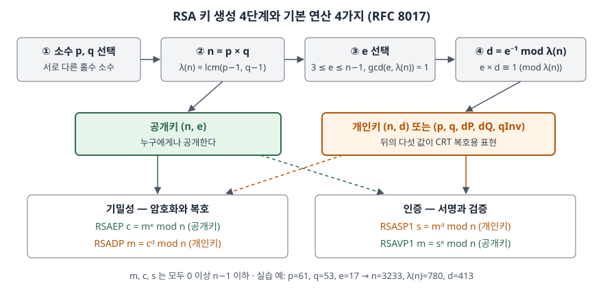

## 들어가며

RSA 는 정보보안 과목에서 계산형으로 나오는 몇 안 되는 주제다. "p, q, e 를 주고 n, d, 암호문을 구하라"는 문제가 대표적이고, 서술형에서는 "교과서 RSA 를 그대로 쓰면 안 되는 이유"를 묻는다. 실무에서는 TLS 인증서 서명, 코드 서명, JWT 의 RS256 처럼 서명 쪽에서 매일 쓰인다. 이 글은 RFC 8017 의 절차를 작은 소수로 따라 계산하고, 2048비트 키로 같은 계산을 돌려 검산했다.

## 정의

**RSA**: 두 소수의 곱 n 을 법(나머지를 구하는 기준 수)으로 하는 거듭제곱 `mᵉ mod n` 과 그 역연산 `cᵈ mod n` 으로 암호화와 전자서명을 수행하는 공개키 암호 방식이다. 공개키는 (n, e), 개인키는 (n, d) 다(RFC 8017 의 공개키 정의 §3.1, 개인키 정의 §3.2).

RFC 8017 은 안전성의 전제를 **"n 을 법으로 e 제곱근을 구하는 것이 사실상 불가능하다"**는 가정(RSA 문제)으로 적는다(암호화 방식 RSAES-OAEP 절, §7.1). p 와 q 를 알면 아래 ②·④ 단계로 d 를 바로 계산할 수 있으므로, n 의 소인수분해는 곧 개인키 노출이다.

## 등장 배경

대칭키 암호는 보내는 쪽과 받는 쪽이 **같은 키를 미리 나눠 가져야** 한다. 상대가 n 명이면 키도 그만큼 필요하고, 처음 만나는 상대와는 키를 안전하게 건넬 통로부터 없다. 공개키 암호는 암호화 키와 복호 키를 나눠 이 문제를 푼다. 암호화 키는 공개해도 되고, 복호 키만 지키면 된다. 같은 짝을 거꾸로 쓰면 "개인키를 가진 사람만 만들 수 있고 누구나 확인할 수 있는 값", 곧 전자서명이 된다. 쓰임의 구분은 이 저장소의 [대칭키와 공개키 글](../2026-09-29-symmetric-vs-public-key-hybrid/index.md)에서 다뤘다.

## 구성요소 / 절차

### 키 생성 4단계 (RFC 8017 의 키 정의 §3.1·§3.2)

| 단계 | 내용 | 실습 값 |
|---|---|---|
| ① 소수 선택 | 서로 다른 홀수 소수 p, q | p = 61, q = 53 |
| ② 법 계산 | n = p × q, λ(n) = lcm(p−1, q−1) | n = 3233, λ(n) = 780 |
| ③ 공개 지수 | 3 ≤ e ≤ n−1, gcd(e, λ(n)) = 1 | e = 17 |
| ④ 개인 지수 | e × d ≡ 1 (mod λ(n)), d < n | d = 413 |

λ(n) 은 카마이클 함수다. 교과서에서 흔히 쓰는 오일러 함수 φ(n) = (p−1)(q−1) = 3120 으로 구하면 d = 2753 이 나온다. 실습 [1]에서 두 값의 차 2340 은 λ(n) 의 3배였다. 둘 다 e × d ≡ 1 (mod λ(n)) 을 만족하므로 둘 다 복호한다([2]에서 0 부터 3232 까지 전부 확인).

### 기본 연산 4가지 (RFC 8017 의 기본 연산 절 §5)

| 연산 | 식 | 키 | 목적 |
|---|---|---|---|
| RSAEP (암호화) | c = mᵉ mod n | 공개키 | 기밀성 |
| RSADP (복호) | m = cᵈ mod n | 개인키 | 기밀성 |
| RSASP1 (서명) | s = mᵈ mod n | 개인키 | 인증·부인 방지 |
| RSAVP1 (검증) | m = sᵉ mod n | 공개키 | 인증·부인 방지 |

네 연산 모두 입력이 0 이상 n−1 이하여야 하고, 벗어나면 "out of range" 로 멈춘다(각 연산의 단계 1). 실습 [5]에서 이 검사를 빼면 65 와 65+3233 이 같은 암호문 2790 이 됐다.

### CRT 복호 4단계 (RSADP 단계 2b, §5.1.2)

개인키를 (p, q, dP, dQ, qInv) 다섯 값으로 들고 있으면 n 대신 p, q 로 따로 계산해 합친다. RFC 8017 은 CRT(중국인의 나머지 정리)를 쓰면 복호·서명 연산의 비용이 낮아진다고 적는다(§3).

| 단계 | 식 | 실습 값 (c = 2790) |
|---|---|---|
| 1 | dP = d mod (p−1), dQ = d mod (q−1), qInv = q⁻¹ mod p | 53, 49, 38 |
| 2 | m₁ = c^dP mod p, m₂ = c^dQ mod q | 4, 12 |
| 3 | h = (m₁ − m₂) × qInv mod p | 1 |
| 4 | m = m₂ + q × h | 12 + 53 = 65 |

## 도식

> **출처**: 키 생성 조건은 [RFC 8017 §3.1 RSA Public Key](https://www.rfc-editor.org/rfc/rfc8017.html#section-3.1)·[§3.2 RSA Private Key](https://www.rfc-editor.org/rfc/rfc8017.html#section-3.2), 연산 식은 [§5.1.1 RSAEP](https://www.rfc-editor.org/rfc/rfc8017.html#section-5.1.1)·[§5.1.2 RSADP](https://www.rfc-editor.org/rfc/rfc8017.html#section-5.1.2)·[§5.2.1 RSASP1](https://www.rfc-editor.org/rfc/rfc8017.html#section-5.2.1)·[§5.2.2 RSAVP1](https://www.rfc-editor.org/rfc/rfc8017.html#section-5.2.2). 실습 값은 `code/rsa_by_hand.py` 로 계산했다.

이 글의 실습 번호는 [`code/rsa_by_hand.py`](code/rsa_by_hand.py) 의 단계 번호이고, 출력은 수행 기록 [`code/output.txt`](code/output.txt) 에 있다.

답안에는 위 줄의 네 칸과 아래 두 칸만 옮겨도 된다. 실선은 같은 목적의 기본 경로(암호화는 공개키, 서명은 개인키), 점선은 반대편 키가 쓰이는 자리다.

## 비교

### φ(n) 과 λ(n)

| 구분 | φ(n) = (p−1)(q−1) | λ(n) = lcm(p−1, q−1) |
|---|---|---|
| 실습 값 | 3120 | 780 |
| 구한 d | 2753 | 413 |
| 복호 결과 | 같다 | 같다 |
| 쓰는 곳 | 교과서·시험 계산 | RFC 8017 의 정의 |

λ(n) 은 φ(n) 의 약수라서 d 가 같거나 작아진다. 시험에서 φ(n) 으로 풀어도 틀린 답이 아니며, 표준이 λ(n) 을 쓴다는 점을 덧붙이면 된다.

### 교과서 RSA 와 표준 방식

| 방식 | 무작위성 | 같은 평문 → 같은 암호문 | RFC 8017 의 위치 |
|---|---|---|---|
| 교과서 RSA (RSAEP 그대로) | 없음 | 같다 | 기본 연산일 뿐 방식이 아니다 |
| RSAES-PKCS1-v1_5 | 0 이 아닌 의사난수 바이트 | 다르다 | 기존 응용 호환용(§7) |
| RSAES-OAEP | 해시 길이만큼의 난수 seed | 다르다 | 새 응용은 지원 필수(§7) |
| RSASSA-PKCS1-v1_5 (서명) | 없음 | — | 기존 응용 호환용(§8) |
| RSASSA-PSS (서명) | salt | — | 새 응용은 필수(§8) |

교과서 RSA 의 문제는 실습 [6]·[7-B]에서 숫자로 보인다.

- **결정적이다.** m = 65 를 두 번 암호화하면 둘 다 2790 이다. 평문 후보가 적으면(예·아니오, 금액 몇 가지) 공격자가 공개키로 후보를 전부 암호화해 맞춰 본다. 0 과 1 은 암호화해도 0 과 1 그대로였다.
- **곱셈이 그대로 통과한다.** E(7) × E(9) mod n = 3216 이 E(63) 과 같았다. 개인키 없이 "63 의 암호문"을 만들어 낸 것이다.
- **작은 e 와 짧은 평문.** e = 3, 2048비트 n 에 128비트 키를 패딩 없이 넣으면 m³ 이 379비트라 mod 가 일어나지 않는다. 암호문의 정수 세제곱근이 곧 평문이었다.

패딩은 평문에 난수와 구조를 붙여 n 에 가까운 크기로 채운다. 그래서 OAEP 로 넣을 수 있는 메시지 길이는 k − 2hLen − 2 바이트(k 는 n 의 바이트 수, hLen 은 해시 길이), PKCS1-v1_5 는 k − 11 바이트로 줄어든다(§7.1, §7.2).

## 적용 시 고려사항

1. **키 길이는 2048비트 이상.** NIST SP 800-131A Rev.2 는 서명 생성에서 len(n) < 2048 을 금지(Disallowed)하고 ≥ 2048 을 허용으로 둔다(Table 2). 1024~2048 미만은 예전 서명의 **검증**에만 쓸 수 있다. RSA 기반 키 전송도 2048 미만은 금지다(Table 5).
2. **암호화 패딩은 OAEP 로 간다.** RFC 8017 은 PKCS1-v1_5 암호화를 호환용으로만 남기고, 오류 처리 방식에 따라 선택 암호문 공격(Bleichenbacher)이 가능하다고 적는다(§7.2). NIST SP 800-131A Rev.2 는 PKCS1-v1_5 패딩의 키 전송을 2023년 말 이후 금지했다(Table 5). 복호 실패 메시지를 구분해 돌려주지 않는 것도 같은 이유다.
3. **복호·서명이 비싸다.** 2048비트 키에서 암호화(e = 65537)는 0.116 ms, CRT 없는 복호는 16.83 ms 로 145배였고, CRT 로 4.84 ms(3.5배 빠름)가 됐다(실습 [7-A], 측정은 기계마다 다르다). e 는 2진수로 1 이 두 개뿐인 작은 수이고 d 는 2043비트라 차이가 난다. 서버 인증서처럼 서명을 많이 하는 쪽에 부하가 몰린다.
4. **CRT 값은 개인키다.** p, q, dP, dQ, qInv 중 하나라도 새면 위험하다. p 나 q 를 알면 ②·④ 단계로 d 를 바로 구한다.
5. **양자 컴퓨터 위협은 키 길이와 별개로 판단한다.** 위의 키 길이 기준은 고전 컴퓨터를 전제로 한 것이다. 양자 컴퓨터에 대비한 전환 전략은 이 저장소의 [양자 내성 암호 글](../../emerging-tech/2026-10-15-post-quantum-cryptography-transition/index.md)에서 다뤘다.

## 정리

- 키 생성 **4단계**: ① p, q → ② n = pq, λ(n) = lcm(p−1, q−1) → ③ gcd(e, λ) = 1 인 e → ④ d = e⁻¹ mod λ(n)
- 기본 연산 **4가지**: 암호화 mᵉ(공개키)·복호 cᵈ(개인키)·서명 mᵈ(개인키)·검증 sᵉ(공개키). 입력은 0 ~ n−1
- CRT 복호 **4단계**: dP·dQ·qInv → m₁·m₂ → h → m = m₂ + qh
- 교과서 RSA 의 약점 **3가지**: 결정적·곱셈 동형·작은 e 와 짧은 평문 → 암호화는 OAEP, 서명은 PSS
- 암기 단서: **"공암개복, 개서공검"** — 공개키로 암호화·개인키로 복호, 개인키로 서명·공개키로 검증
- 계산 검산 값: p=61, q=53, e=17 → n=3233, λ=780, d=413(φ 기준 2753), m=65 → c=2790

## 참고 자료

- [RFC 8017, PKCS #1: RSA Cryptography Specifications Version 2.2 (2016-11)](https://www.rfc-editor.org/rfc/rfc8017.html) — §3.1·§3.2 키 정의와 λ(n), §3 CRT 표현의 비용 이점, §5.1.1~§5.2.2 기본 연산과 범위 검사, §7 OAEP 필수·PKCS1-v1_5 호환용, §7.1 e 제곱근 가정과 메시지 길이, §7.2 Bleichenbacher 공격, §8 PSS 필수
- [RFC 8017 §5.1.2 RSADP](https://www.rfc-editor.org/rfc/rfc8017.html#section-5.1.2) — CRT 복호 단계 2b
- [NIST SP 800-131A Rev.2, Transitioning the Use of Cryptographic Algorithms and Key Lengths (2019-03)](https://doi.org/10.6028/NIST.SP.800-131Ar2) — Table 2 서명 키 길이 승인 상태, Table 5 RSA 키 전송과 PKCS1-v1_5 패딩 금지 시점
- [대칭키와 공개키 — 쓰임이 갈리는 지점](../2026-09-29-symmetric-vs-public-key-hybrid/index.md) — 같은 저장소에서 공개키를 키 확립과 서명에 쓰는 구조를 다룬 글
- [공개키 기반구조(PKI)와 인증서 검증 경로](../2026-10-08-pki-certificate-path-validation-revocation/index.md) — RSA 서명이 인증서 체인에서 쓰이는 자리
- [대칭키와 공개키의 속도 차이는 몇 배인가](../../../Security/crypto/2026-11-03-openssl-speed-symmetric-vs-public-key/index.md) — openssl speed 로 RSA 서명·검증 속도를 잰 글
