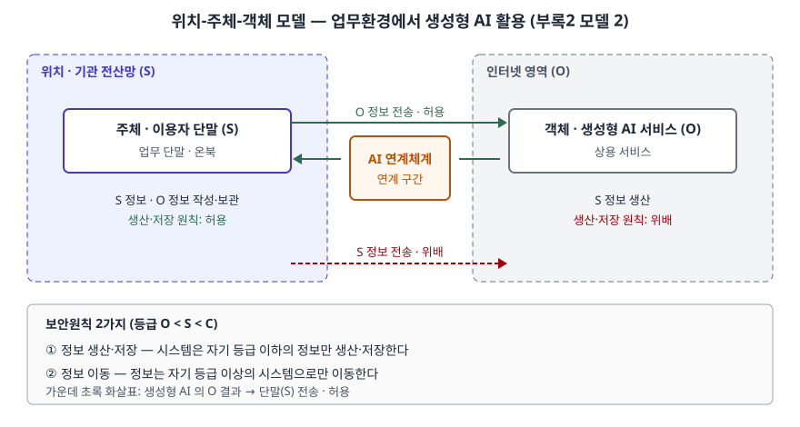

## 들어가며

공공기관 업무망에서 생성형 AI 나 외부 클라우드를 쓰려면 지금까지는 망 분리 예외를 받아야 했다. 국가 망 보안체계(N2SF)는 이 판단 기준을 "어느 망에 있는가"에서 "그 정보가 몇 등급인가"로 바꾼다. 시험에서는 개념과 절차를 함께 묻는데, 점수가 갈리는 곳은 **위협을 어디서 찾는가**를 설명하는 부분이다. 이 글은 그 위협 모델을 부록의 실제 판정 사례로 정리한다.

> 본문 PDF는 10MB를 넘어 받지 못했다. 근거는 같은 가이드라인 1.0의 **부록1(보안통제 항목 해설서)과 부록2(정보서비스 모델 해설서 모델 1·2)** 이다. 한 줄 정의만 본문 대신 2차 자료 2건(2025-01-23, 2025-01-30)으로 교차 확인했다. 정보공개법에 근거한 등급 기준, 5단계 14개 활동의 세부, 오버레이 개념은 본문에 있으므로 이 글에서 다루지 않고 기출 답안으로 넘긴다.

## 정의

**국가 망 보안체계는 업무정보를 중요도에 따라 기밀(C)·민감(S)·공개(O)로 나누고, 등급별로 보안통제를 차등 적용하는 공공부문 보안 프레임워크다.**

부록1의 보안통제 항목은 모두 C·S·O 세 칸에 "우선 검토사항" 표시를 달고 있어, 차등 적용이 문서 구조 자체에 들어 있다. 정의 문장은 초안 공개 당시 보도(디지털데일리 2025-01-23, 바이라인네트워크 2025-01-30)가 국가정보원 설명을 같은 뜻으로 옮긴 것이다.

## 등장 배경

망 분리는 업무망과 인터넷망을 물리적으로 떼어, 망 경계를 넘는 연결을 위협으로 본다. 이 방식에서는 공개해도 되는 정보까지 업무망 안에 묶여 외부 서비스를 쓸 수 없다. 부록2 활용 방안 절은 이 체계가 "획일적인 망 분리 정책에서 탈피"해 AI·클라우드 같은 신기술을 도입하는 과정을 돕는다고 목적을 밝힌다. 경계가 아니라 정보의 등급을 기준으로 삼으면, 같은 업무망 안에서도 O 정보는 외부로 보내고 S 정보는 막는 식의 구분이 생긴다.

## 구성요소 — 위협식별의 3요소와 2원칙

부록2 표 1-1은 위협식별 단계를 **3개 활동**으로 나눈다. 활동-3-1 모델링 및 C/S/O 평가, 활동-3-2 보안원칙 적용, 활동-3-3 보안위협 식별이다.

**① 위치-주체-객체 모델 (3요소)** — 정보서비스를 세 요소로 줄이고 각각에 등급을 붙인다.

| 요소 | 뜻 | 모델 2의 예 |
|---|---|---|
| 위치 | 주체가 놓인 영역 | 기관 전산망 (S) |
| 주체 | 업무정보를 쓰는 시스템 | 이용자 단말: 업무 단말·온북 (S) |
| 객체 | 주체가 접속·이용하는 대상 | 생성형 AI 서비스 (O) |

**② 보안원칙 (2가지)** — 부록2가 모델마다 적용하는 문장을 일반화하면 다음과 같다.

| 원칙 | 허용 | 위배 |
|---|---|---|
| 정보 생산·저장 | 시스템이 자기 등급 **이하**의 정보를 생산·저장 | O 등급 생성형 AI 에서 S 정보를 생산 |
| 정보 이동 | 정보가 자기 등급 **이상**의 시스템으로 이동 | 단말의 S 정보를 O 등급 생성형 AI 로 전송 |

**③ 보안통제 항목 (6개 대항목, 27개 중항목)** — 부록1 목차 기준이다.

| 대항목 | 중항목 수 | 중항목 |
|---|---|---|
| 권한 | 4 | 최소 권한, 신원 검증, 식별자 관리, 계정 관리 |
| 인증 | 7 | 다중요소 인증, 외부인증수단, 단말인증, 인증보호, 인증정책, 인증수단, 로그인 |
| 분리 및 격리 | 2 | 분리, 격리 |
| 통제 | 7 | 정보흐름, 외부경계, CDS, 원격접속, 세션, 무선망 접속, 블루투스 연결 |
| 데이터 | 4 | 암호 키 관리, 암호 모듈 사용, 데이터 전송, 데이터 사용 |
| 정보자산 | 3 | 모바일 단말, 하드웨어, 정보시스템 구성요소 |

항목마다 `N2SF-LP-1` 같은 식별자와 등급 표시가 붙는다. `N2SF-LP-1`(정보시스템 접근 권한 정의)은 C·S, `N2SF-LP-4(1)`(원격접속을 통한 관리자 권한 접속제한)은 S·O 에만 표시돼 있다. `N2SF-CD-2`(다단계 보안 레이블 적용)처럼 C 에만 붙은 항목도 있다.

## 도식



> **출처**: [국가정보원, 국가 망 보안체계 보안 가이드라인 1.0 부록2 모델 2 「업무환경에서 생성형 AI 활용」 (2025-09) — 제2장 제2절 2. 모델링 및 C/S/O 평가, 3. 보안원칙 적용](https://mnuk2.mokpo.ac.kr/bbs/mnusecu/1544/278520/artclView.do) (제3자 전재, 발행처 국가사이버안보센터)

답안에서는 두 점선 영역, 그 안의 주체·객체, 가운데 연계체계, 화살표 세 개만 그리면 된다.

## 실행 검산 — 규칙이 문서의 판정을 다시 만드는가

전체 소스: [`code/n2sf_principles.py`](code/n2sf_principles.py) · 수행 기록: [`code/output.txt`](code/output.txt)

두 원칙을 등급 비교 두 줄로 옮기고, 부록2 모델 1·2가 적은 판정 12건과 대조했다.

```text
[모델 2 업무환경에서 생성형 AI 활용]
  위치 S · 주체 S · 객체 O
  생성형 AI(O)에서 S 정보 생산                    계산 위배  문서 위배  (14쪽) 일치
  단말의 S 정보 → 생성형 AI(O)                   계산 위배  문서 위배  (14쪽) 일치
  생성형 AI 의 O 결과 → 단말(S)                  계산 허용  문서 허용  (14쪽) 일치
  불일치 0건
```

(공백 일부를 줄였다. 모델별 6건 전체는 수행 기록에 있다.)

12건이 모두 일치했다. 다만 두 가지는 규칙만으로 나오지 않았다.

- **보안조치(+).** 모델 1은 세 요소가 모두 O 인데, "보안조치(+)를 하는 경우 S등급 이상의 업무정보 생산·저장이 가능"하다고 적는다. 원칙이 절대 금지가 아니라 **통제를 갖추면 넘을 수 있는 기본값**이라는 뜻이다. 계산에서는 별도 인자로 넣어야 맞았다.
- **등급이 같아도 위협은 있다.** 등급이 모두 같은 모델 1에도 보안위협이 식별돼 있다.

```text
[모델 1 …] 합계 9개, 대상 2곳   (단말 5 + 인터넷 연계체계 4)
[모델 2 …] 합계 21개, 대상 3곳  (단말 8 + AI 연계체계 11 + 생성형 AI 서비스 2)
```

두 원칙은 **어느 흐름을 막아야 하는가**를 가리는 도구이고, 단말 취약점이나 연계체계 장애 같은 위협은 등급과 상관없이 따로 식별된다. 등급이 섞인 모델 2에서 위협이 12개 늘었고, 그중 7개가 연계체계에서 늘었다. `TH-M2-12`(공개 등급 외 업무정보의 생성형 AI 서비스 활용)가 정보 이동 원칙 위배를 위협으로 옮긴 항목이다.

## 비교 — 망 분리와 N2SF 의 위협 모델

| 구분 | 망 분리 | N2SF |
|---|---|---|
| 보호 단위 | 망 | 업무정보·시스템·위치의 등급 |
| 위협을 보는 곳 | 망 경계를 넘는 연결 | 등급이 다른 요소 사이의 생산·저장·이동, 그리고 각 구성요소 |
| 외부 서비스 | 원칙 차단 | O 정보는 연계체계를 거쳐 이용 (모델 2) |
| 통제 선택 | 정해진 구성 | 6개 대항목에서 등급별 우선 검토사항을 기준으로 선택·조정 |

## 적용 시 고려사항

1. **등급분류가 틀리면 원칙이 엉뚱한 흐름을 허용한다.** 두 원칙은 등급 비교일 뿐이라, S 정보를 O 로 잘못 매기면 모델 2의 위배 흐름이 허용으로 계산된다. 검산에서 규칙 두 줄로 판정이 전부 재현됐다는 것은, 판정의 정확도가 전적으로 입력 등급에 달려 있다는 뜻이기도 하다.
2. **연계체계가 통제의 중심이다.** 모델 2 위협 21개 중 11개가 AI 연계체계에 있다. O 정보만 넘기는 판단을 사람이 아니라 연계 구간에서 강제해야 하며, 부록1의 정보흐름(IF)·CDS(CD) 항목이 이 자리에 쓰인다.
3. **보안조치(+)의 범위를 문서로 남긴다.** 원칙을 넘는 예외는 어떤 통제를 근거로 허용했는지가 남아야 보안성 검토에서 설명할 수 있다.
4. **부록의 통제 목록은 시작점이다.** 부록2는 제시한 항목을 모두 구현할 필요도, 없는 항목을 빼도 된다는 뜻도 아니라고 밝히고, 기관 환경에 맞춰 추가·수정·삭제하라고 한다.

## 정리

- **정의**: 업무정보를 C·S·O 로 나눠 등급별로 통제를 달리하는 체계
- **위협식별 3활동**: 모델링 및 C/S/O 평가 → 보안원칙 적용 → 보안위협 식별
- **3요소 2원칙**: 위치·주체·객체 / 생산·저장(자기 등급 이하만), 이동(자기 등급 이상으로만)
- **통제 6·27**: 권한·인증·분리 및 격리·통제·데이터·정보자산, 중항목 27개
- 원칙은 보안조치(+)로 넘을 수 있는 기본값이고, 등급이 같아도 구성요소 위협은 남는다

> 기출 답안: [기출문제 — 국가 망 보안체계(N2SF)의 개념, 적용 절차, 고려사항](../../exam/2026-11-16-national-network-security-framework-n2sf/index.md)

## 참고 자료

- 국가정보원(국가사이버안보센터), 국가 망 보안체계 보안 가이드라인 1.0 (2025-09) — [발행처](https://www.ncsc.go.kr:4018/)
  - 부록1 보안통제 항목 해설서: 목차(6개 대항목 27개 중항목), 보안통제 항목 종합(C/S/O 우선 검토사항), 제1장 최소 권한, 제4장 정보흐름·CDS
  - 부록2 모델 1 「인터넷 단말의 업무 활용성 제고」, 모델 2 「업무환경에서 생성형 AI 활용」: 제1장 제2절 활용 방안, 표 1-1, 제2장 제2절 2~4, 표 2-1
  - [본문·부록 PDF 게시물 — 목포대학교 정보보안 게시판 (제3자 전재)](https://mnuk2.mokpo.ac.kr/bbs/mnusecu/1544/278520/artclView.do)
- [디지털데일리, 국가망보안체계 예고편 나왔다…'N²SF 가이드라인' 초안 공개 (2025-01-23)](https://www.ddaily.co.kr/page/view/2025012316455942967) — 2차 자료, 정의 교차 확인
- [바이라인네트워크, 공공 망분리 대신할 '국가 망 보안체계' 가이드라인 나왔다 (2025-01-30)](https://byline.network/2025/01/30-371/) — 2차 자료, 정의 교차 확인
