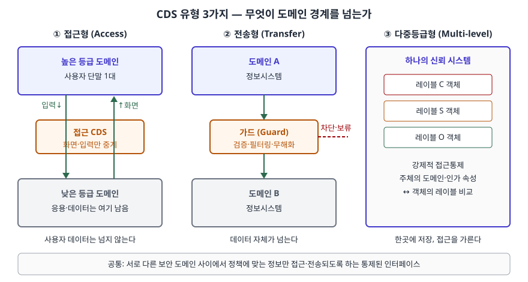

## 들어가며

국가 망 보안체계(N2SF)가 업무정보를 기밀(C)·민감(S)·공개(O)로 나누면서, 등급이 다른 영역 사이에 정보를 주고받는 구간이 설계의 핵심이 됐다. 망 분리 시절에는 이 구간을 "연결하지 않는다"로 처리했지만, 등급별 차등 통제에서는 "연결하되 정책에 맞는 것만 넘긴다"를 구현해야 한다. 그 구현을 가리키는 이름이 CDS다. 시험에서는 N2SF 문제의 고려사항이나 망 연계 문제에서 함께 나오며, 유형 3가지와 구성 기술을 구분해 쓰는 것이 점수가 갈리는 곳이다.

> **실행 검증 없음.** 미국 국가안보시스템위원회 용어집(CNSSI 4009-2022)의 정의를 NIST 용어집 수록본으로 확인했고, 통제 항목은 국가정보원 「국가 망 보안체계 보안 가이드라인」 1.0 부록1(보안통제 항목 해설서)의 CDS 장을 직접 읽어 정리했다. 가이드라인 본문의 CDS 참고 절은 PDF가 10MB를 넘어 받지 못해 인용하지 않았다.

## 정의

**CDS는 서로 다른 보안 도메인 사이에서 정보에 수동 또는 자동으로 접근하고 정보를 전송할 수 있게 하는 통제된 인터페이스로, 하나 이상의 장치로 구성될 수 있다** (CNSSI 4009-2022).

여기서 **보안 도메인**은 단일 보안 수준으로 운영되며 하나의 보안 정책을 구현하고 하나의 주체가 관리하는 영역이다(CNSSI 4009-2022). 망 하나가 곧 도메인인 것은 아니다. 등급과 관리 주체가 같으면 한 도메인으로 본다.

국가 망 보안체계 부록1은 같은 대상을 우리 공공 환경에 맞춰 이렇게 정의한다. 상이한 보안 등급 또는 네트워크 도메인 사이에서 **인가된 통신만 허용하고 미인가 접근·정보 유출을 막도록 설계된 보안 장치이자 체계**이며, 고신뢰 영역에서 저신뢰 영역으로 정보가 이동할 때 검증·필터링·무해화를 수행한다. 두 정의를 함께 쓰면 "무엇을 하는가(접근·전송)"와 "무엇을 막는가(미인가 접근·유출)"가 한 번에 드러난다.

## 등장 배경

도메인을 물리적으로 끊으면 경계를 넘는 위협은 사라지지만 업무에 필요한 정보 교환도 사라진다. 교환이 필요하면 사람은 다른 경로를 만든다. 부록1이 CDS 통제에 **우회 경로(USB, 무선, 별도 링크) 탐지·차단**(N2SF-CD-9)을 따로 넣은 것이 그 현실을 반영한다.

CDS의 발상은 경로를 없애는 대신 **경로를 하나로 모으고 그 경로에서 정책을 강제**하는 것이다. 부록1의 구현 예시도 도메인 사이 직접 연결을 차단하고 "오직 CDS를 통한 승인된 경로에서만" 통신하게 하라고 적는다. 경로가 하나여야 검사·기록·승인이 빠짐없이 걸린다.

## 구성요소 — 유형 3가지와 통제 17개

**① 유형 3가지** — CNSSI 4009-2022는 CDS를 무엇이 경계를 넘느냐로 나눈다.

| 유형 | 정의 요지 | 경계를 넘는 것 |
|---|---|---|
| **접근형** (Access) | 다른 보안 도메인의 플랫폼·응용·데이터에 접근하게 하되 **도메인 사이에 사용자 데이터를 옮기지 않는다** | 키보드·마우스 입력은 낮은 도메인 쪽으로, 화면 영상은 높은 도메인 쪽으로 |
| **전송형** (Transfer) | 서로 다른 보안 도메인의 정보시스템 사이에서 **데이터 이동에 보안 정책을 강제**한다 | 데이터 자체 |
| **다중등급형** (Multi-level) | 신뢰할 수 있는 **보안 레이블**로 객체에 등급을 붙이고, 주체의 도메인·인가 속성에 따라 강제적 접근통제를 적용한다 | 넘지 않는다. 한 시스템 안에서 접근을 가른다 |

**② 핵심 기능 4가지** — 유형과 상관없이 CDS를 이루는 기능이다.

| 기능 | 근거 | 내용 |
|---|---|---|
| 가드 (Guard) | RFC 4949 (CNSSI 4009 인용) | 서로 다른 보안 정책을 쓰는 두 정보시스템 사이의 관문. 데이터 전달을 중재하도록 신뢰받는 시스템 |
| 필터링 | DoDI 8540.01 (CNSSI 4009 인용) | CDS를 지나는 데이터를 검사해 미리 정한 정책에 맞는지 판정 |
| 단방향 전송 | N2SF-CD-3 | 데이터 다이오드로 물리적·논리적 단방향 흐름을 강제 |
| 무해화 (CDR) | N2SF-CD-6 | 파일 안의 숨은 객체·매크로·스크립트를 제거하고 안전한 형식으로 변환 |

**③ 국가 망 보안체계 CDS 통제 17개** — 부록1의 통제 대항목 아래 CDS 중항목(식별자 `CD`)은 **기술 통제 13개(CD-1~13)와 관리 통제 4개(CD-M1~M4)** 로 이뤄진다.

| 묶음 | 항목 | 우선 검토 등급 |
|---|---|---|
| 흐름 판정 | CD-1 도메인 간 정보 흐름 검증·통제, CD-11 등급 간 콘텐츠 정책 | C·S |
| 레이블 | CD-2 다단계 보안 레이블 적용 | C |
| 경로 강제 | CD-3 일방향 전송, CD-9 우회 경로 탐지·차단 | C·S |
| 콘텐츠 검사 | CD-4 검증 기반 릴레이, CD-5 파일 유형 기반 정책, CD-7 메타데이터 기반 정책 | C·S |
| 콘텐츠 정제 | CD-6 콘텐츠 무해화(CDR) | C |
| 신뢰성 | CD-10 전송 실패 보호·무결성 보장, CD-13 트래픽 흐름 컨텍스트 분석 | C·S |
| 구성·접근 | CD-8 승인된 CDS 구성요소만 사용, CD-12 사용자·단말 등록 기반 접근 제어 | C·S·O |
| 관리 | CD-M1 운용 정책, CD-M2 로그 기록·감사, CD-M4 구성요소 무결성 검증 | C·S·O |
| 관리 | CD-M3 도메인 간 정보 교환 승인 프로세스 | C·S |

세어 보면 C 등급은 17개 전부, S 등급은 15개(레이블·CDR 2개 제외), O 등급은 5개가 우선 검토 대상이다. O에 남는 5개는 모두 **CDS 자체를 믿을 수 있게 하는 항목**(승인 구성요소, 접근자 등록, 운용 정책, 로그, 무결성)이다. 콘텐츠를 깊게 검사하는 항목일수록 높은 등급에만 붙는다.

## 도식

> **출처**: [NIST CSRC Glossary — access cross domain solution](https://csrc.nist.gov/glossary/term/access_cross_domain_solution), [transfer cross domain solution](https://csrc.nist.gov/glossary/term/transfer_cross_domain_solution), [multi-level cross domain solution](https://csrc.nist.gov/glossary/term/multi_level_cross_domain_solution), [guard](https://csrc.nist.gov/glossary/term/guard) (CNSSI 4009-2022 수록 정의)

답안지에는 세 칸을 나란히 두고, 칸마다 "경계를 넘는 것"만 화살표로 그리면 된다.

## 비교 — 방향별 통제와 DLP·CDR·ABAC

같은 CDS라도 방향에 따라 걱정하는 것이 다르다. 영국 NCSC의 CDS 보안 원칙은 이를 **반입(import)은 악성 콘텐츠를 줄이는 것, 반출(export)은 올바른 정보만 내보내는 것**으로 구분한다. 시험에서 묻는 DLP·CDR·ABAC는 이 두 방향과 접근 판단에 각각 대응한다.

| 구분 | 막는 것 | 주로 쓰이는 방향 | CDS 안에서의 자리 |
|---|---|---|---|
| **CDR** (콘텐츠 무해화) | 파일에 숨은 매크로·스크립트·객체 | 낮은 등급 → 높은 등급 (반입) | 가드의 정제 단계 (N2SF-CD-6) |
| **DLP** (데이터 유출 방지) | 등급이 높은 정보가 섞여 나가는 것 | 높은 등급 → 낮은 등급 (반출) | 가드의 필터링 단계 (CD-1, CD-7 메타데이터 정책) |
| **ABAC** (속성 기반 접근통제) | 자격 없는 주체의 CDS 이용 | 양방향 | 접근 판단 (CD-12 등록 기반 접근, CD-2 레이블 비교) |
| **데이터 다이오드** | 반대 방향 흐름 자체 | 한 방향만 허용 | 경로 강제 (CD-3) |
| **방화벽** | 허용하지 않은 연결 | 양방향 | CDS 앞단. 연결은 보되 내용은 판단하지 않는다 |

ABAC는 NIST SP 800-162가 정의하듯 주체·객체·환경의 속성과 정책으로 접근을 판정하는 방식이다. 다중등급형 CDS의 "레이블과 인가 속성 비교"는 그중 등급 속성 하나로 강제 판정하는 특수한 경우로 볼 수 있다. CDS가 방화벽과 갈리는 점은 **연결이 아니라 내용을 판단한다**는 것이다.

## 적용 시 고려사항

1. **우회 경로를 먼저 없앤다.** CDS를 아무리 잘 만들어도 USB나 별도 링크가 열려 있으면 정책이 걸리지 않는 길이 생긴다(CD-9). 도입 사업에 매체 통제와 무선 차단을 함께 넣는다.
2. **레이블과 메타데이터가 판정의 입력이다.** 레이블(CD-2)·메타데이터(CD-7) 기반 정책은 등급이 정확히 붙어 있어야 동작한다. 등급분류가 틀리면 CDS는 잘못된 판정을 정확하게 수행한다. 반출할 때는 작성자·생성일 같은 메타데이터 자체가 유출 대상이 될 수 있어 제거 후 전송을 검토한다.
3. **CDS 자체의 신뢰를 관리한다.** 미국은 NCDSMO가 시험한 CDS를 기준 목록(baseline list)으로 관리하고, 부록1도 승인된 구성요소만 쓰고(CD-8) 무결성을 정기 검증하라고 한다(CD-M4). 가드가 뚫리면 등급 경계 전체가 뚫리므로, 일반 보안 장비보다 엄격한 변경 승인이 필요하다.
4. **실패했을 때 남는 것을 설계한다.** 전송 중 실패로 일부만 넘어가거나 중간 저장소에 파일이 남으면 그것이 유출이 된다(CD-10). 전송 단위의 완결성 확인과 중간 저장소 정리를 절차에 넣는다.
5. **모든 판정을 기록한다.** 허용뿐 아니라 차단·보류·예외까지 남겨야(CD-M2) 정책이 너무 느슨한지 너무 엄격한지 판단할 근거가 생긴다.

## 정리

- **정의**: 서로 다른 보안 도메인 사이의 접근·전송을 정책대로 허용하는 통제된 인터페이스 (CNSSI 4009)
- **유형 3가지 "접·전·다"**: 접근형(입력·화면만), 전송형(데이터가 가드를 거침), 다중등급형(한 시스템 안 레이블 비교)
- **기능 4가지**: 가드, 필터링, 단방향 전송, 무해화
- **N2SF 통제 17개 = 기술 13 + 관리 4**, 우선 검토는 C 17·S 15·O 5
- **방향**: 반입은 CDR, 반출은 DLP, 접근 판단은 ABAC

> 기출 답안: [기출문제 — 국가 망 보안체계(N2SF)의 개념, 적용 절차, 고려사항](../../exam/2026-11-16-national-network-security-framework-n2sf/index.md)

> 관련 개념: [국가 망 보안체계(N2SF) — C/S/O 등급분류와 위치-주체-객체 위협 모델](../2026-11-16-n2sf-location-subject-object-threat-model/index.md)

## 참고 자료

- NIST CSRC Glossary — CNSSI 4009-2022 수록 정의
  - [cross domain solution](https://csrc.nist.gov/glossary/term/cross_domain_solution) · [access](https://csrc.nist.gov/glossary/term/access_cross_domain_solution) · [transfer](https://csrc.nist.gov/glossary/term/transfer_cross_domain_solution) · [multi-level](https://csrc.nist.gov/glossary/term/multi_level_cross_domain_solution)
  - [guard](https://csrc.nist.gov/glossary/term/guard) (RFC 4949 인용) · [CDS filtering](https://csrc.nist.gov/glossary/term/cross_domain_solution_filtering) (DoDI 8540.01 인용) · [CDS baseline list](https://csrc.nist.gov/glossary/term/cross_domain_solution_baseline_list) · [security domain](https://csrc.nist.gov/glossary/term/security_domain)
- 국가정보원(국가사이버안보센터), 국가 망 보안체계 보안 가이드라인 1.0 부록1 보안통제 항목 해설서 (2025-09) — [발행처](https://www.ncsc.go.kr:4018/)
  - 보안통제 항목 종합(16쪽), 제4장 통제 3. CDS(70~72쪽), 1. 정보흐름 N2SF-IF-5
  - [본문·부록 PDF 게시물 — 목포대학교 정보보안 게시판 (제3자 전재)](https://mnuk2.mokpo.ac.kr/bbs/mnusecu/1544/278520/artclView.do)
- [UK NCSC — Security principles for cross domain solutions, v1.0 (2021-01-21)](https://www.ncsc.gov.uk/collection/cross-domain-solutions) — 반입·반출 구분. 2026-04-21 공개된 [Cross domain approach and architecture](https://www.ncsc.gov.uk/collection/cross-domain)로 대체 예정이라고 밝히고 있다
- [NIST SP 800-162, Guide to Attribute Based Access Control (ABAC) Definition and Considerations](https://csrc.nist.gov/pubs/sp/800/162/upd2/final) — ABAC 정의
