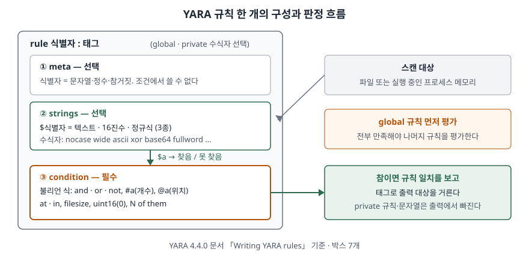

## 들어가며

악성코드가 공격 대상마다 조금씩 바뀌어 만들어지면서, 파일 해시나 백신 업체의 시그니처만으로는 같은 계열의 변종을 잡기 어려워졌다. 침해사고가 나면 분석가는 "이 계열이 공통으로 갖는 문자열과 바이트"를 규칙으로 적어 자기 서버를 직접 훑어야 하고, 그 규칙을 기관끼리 주고받는다. 그 규칙을 적는 사실상의 공용 언어가 YARA 다. 시험에서는 BPFDoor 같은 침해사고 문제의 대응 방안이나 위협 정보 공유 문제에서 함께 나오며, 규칙의 구성 3요소와 해시·시그니처 탐지와의 차이를 쓸 수 있어야 한다.

> **실행 검증 없음.** 규칙 문법은 YARA 공식 문서(4.4.0 판, 「Writing YARA rules」)를 직접 읽어 정리했고, 탐지 방식 비교와 배포 절차는 NIST SP 800-83 Rev.1 원문을 근거로 했다. 본문의 규칙 예시는 문법을 보이기 위한 것으로 실제 표본에 돌려 보지 않았다.

## 정의

**YARA 는 악성코드 연구자가 표본을 식별·분류할 수 있게, 문자열 집합과 그 조건을 정하는 불리언 식으로 이루어진 규칙을 써서 파일이나 프로세스 메모리를 검사하는 패턴 매칭 도구다** (YARA 공식 홈페이지 「YARA in a nutshell」).

규칙 하나는 "무엇을 찾을지(strings)"와 "찾은 결과를 어떻게 판정할지(condition)"를 분리해 적는다. 문서는 조건 절은 항상 있어야 하고, 문자열 절은 규칙이 문자열에 기대지 않으면 생략할 수 있다고 적는다.

## 등장 배경

NIST SP 800-83 Rev.1 은 백신이 주로 **이미 알려진 악성코드 사례의 특징**을 찾는 방식으로 탐지한다고 설명한다(§3.4.1). 이 방식은 알려진 악성코드에는 매우 효과적이지만, 대상마다 맞춤 제작된 악성코드에는 그렇지 않다고 같은 절이 적는다. 또 백신 시그니처는 업체가 만들어 배포할 때까지 시간이 걸린다. 같은 문서는 조직이 직접 쓴 시그니처가 백신 시그니처보다 몇 시간 먼저 새 위협을 막을 수 있다고 적는다(§3.4.2, §4.3.2).

YARA 는 그 "직접 쓰는 시그니처"를 파일·메모리 영역에서 쓰게 해 준다. 해시는 파일 하나를 가리키지만, YARA 규칙은 여러 변종이 공유하는 문자열·바이트 배열·파일 구조를 조건으로 묶어 **계열**을 가리킨다.

## 구성요소 — 절 3개, 문자열 3종, 수식자 8종

**① 규칙의 절 3개**

| 절 | 필수 여부 | 내용 |
|---|---|---|
| `meta` | 선택 | `식별자 = 값` 쌍. 값은 문자열·정수·참거짓. **조건에서 쓸 수 없고** 정보 기록용이다 |
| `strings` | 선택 | `$식별자 = 패턴`. 조건에서 `$식별자` 는 찾으면 참인 불리언이 된다 |
| `condition` | **필수** | 파일이나 프로세스가 규칙을 만족하는 경우를 적은 불리언 식 |

규칙 앞에는 `global`(모든 규칙의 전제가 되는 규칙)과 `private`(일치해도 보고하지 않는 규칙) 수식자를, 식별자 뒤에는 출력 거르기용 **태그**를 붙일 수 있다.

**② 문자열 3종**

| 종류 | 표기 | 쓰임 |
|---|---|---|
| 16진수 | `{ E2 34 ?? C8 [4-6] ( 62 B4 \| 56 ) }` | 원시 바이트. 와일드카드(`??`, 니블 단위)·부정(`~00`, 4.3.0부터)·점프(`[4-6]`)·대안(`( \| )`) 4가지 구문 |
| 텍스트 | `"cmd_shell"` | 기본은 ASCII·대소문자 구분. 수식자로 변형한다 |
| 정규식 | `/md5: [0-9a-f]{32}/` | 자체 엔진. 캡처 그룹·역참조는 없다 |

**③ 텍스트 수식자 8종** — `nocase`(대소문자 무시), `wide`(문자 사이에 0x00, UTF-16 흉내), `ascii`(wide 와 함께 쓸 때 ASCII 도 찾음), `xor`(1바이트 XOR 키 전체), `base64`·`base64wide`(base64 로 인코딩된 형태 3가지), `fullword`(앞뒤가 영숫자가 아닐 때만), `private`(일치 결과 출력에서 뺌). `nocase`·`xor`·`base64` 는 서로 함께 쓸 수 없다.

조건에서는 `#a`(일치 횟수), `@a[i]`(i 번째 위치), `$a at 100`·`$a in (0..100)`(위치 지정), `filesize`, `uint16(0) == 0x5A4D` 같은 오프셋 읽기, `2 of ($a,$b,$c)`·`any of them` 같은 집합 조건을 쓴다. `import "pe"` 로 모듈을 불러 실행 파일 구조도 조건에 넣는다.

```text
rule Sample_Elf_Loader : backdoor linux
{
    meta:
        description = "문법 예시 — 가상의 로더"
    strings:
        $s1 = "/tmp/.agent" ascii
        $s2 = "cmd_shell" nocase wide ascii
        $h1 = { 48 31 C0 ?? ?? E8 [4-6] C3 }
    condition:
        uint32(0) == 0x464C457F and filesize < 2MB and 2 of them
}
```

조건의 `uint32(0) == 0x464C457F` 는 파일 앞 4바이트가 ELF 매직(`7F 45 4C 46`, 리틀 엔디언으로 읽음)인지 본다. 문서의 `IsPE` 예시가 같은 방식으로 `MZ` 를 확인한다.

## 도식



> **출처**: [YARA 4.4.0 — Writing YARA rules](https://yara.readthedocs.io/en/stable/writingrules.html) 의 규칙 구성 설명, [Strings](https://yara.readthedocs.io/en/stable/writingrules.html#strings), [Conditions](https://yara.readthedocs.io/en/stable/writingrules.html#conditions), [Global rules](https://yara.readthedocs.io/en/stable/writingrules.html#global-rules), [Private rules](https://yara.readthedocs.io/en/stable/writingrules.html#private-rules), [Metadata](https://yara.readthedocs.io/en/stable/writingrules.html#metadata)

답안지에는 왼쪽 세 칸(meta·strings·condition)과 "필수는 condition 하나"만 그려도 핵심이 전달된다.

## 비교 — 탐지 방식 4가지

| 구분 | 해시 대조 | 백신 시그니처 | YARA 규칙 | 행위 기반(HIPS·NBA) |
|---|---|---|---|---|
| 대상 | 파일 전체 | 호스트의 파일 | 파일·프로세스 메모리 | 호스트 이벤트·네트워크 흐름 |
| 무엇을 대조하나 | 파일 전체로 계산한 값 | 알려진 사례의 특징 | 사용자가 적은 문자열·바이트·구조 조건 | 평소 기준선(baseline)에서 벗어남 |
| 잡는 범위 | 그 파일 하나 | 업체가 만든 시그니처의 범위 | 공통 특징을 공유하는 계열 | 알려지지 않은 공격도 가능 |
| 작성 주체 | 누구나 | 백신 업체 | 분석가·기관 | 제품 |
| 약점 | 1바이트만 바뀌어도 다른 값 | 맞춤형 악성코드에 약함 | 규칙 품질이 곧 탐지 품질, 오탐 | 벗어남을 악성으로 단정하기 어려움 |

백신 시그니처와 행위 기반 열은 NIST SP 800-83 Rev.1 §3.4.1·§3.4.2 의 설명이다. YARA 규칙은 위협 정보 공유 표준 STIX 2.1 의 지표 객체에 `pattern_type: yara` 로 그대로 담겨 교환된다([STIX·TAXII 글](../2026-11-02-stix-taxii-threat-intelligence-sharing-standards/index.md)).

## 적용 시 고려사항

1. **조건을 좁혀 오탐을 줄인다.** 흔한 문자열 하나만으로 판정하면 정상 파일도 걸린다. 파일 형식 확인(`uint16(0) == 0x5A4D`), 크기 제한(`filesize < 2MB`), "N개 이상 일치"(`2 of them`), 위치 제한(`in`)을 겹쳐 쓴다. 전체 규칙에 공통인 전제는 `global` 규칙 하나로 묶는다.
2. **배포 전에 시험한다.** NIST SP 800-83 Rev.1 은 시그니처 갱신을 관리자가 **획득·시험·승인·배포**하라고 하고(§3.4.1), 갱신된 시그니처는 적어도 최소한의 시험을 거친 뒤 배포하라고 적는다(§4.3.2). 잘못 쓴 시그니처는 정상 활동을 막는 오탐을 일으킨다고도 경고한다(§3.4.2). 정상 파일 묶음과 악성 표본 묶음 양쪽에 돌려 보고 배포하는 절차가 이것에 해당한다.
3. **규칙의 출처와 이력을 남긴다.** `meta` 에 작성자·근거 보고서·작성일을 적어 두면 오탐이 났을 때 누가 왜 만들었는지 추적할 수 있다. meta 는 조건에 영향을 주지 않으므로 마음껏 적어도 판정이 바뀌지 않는다.
4. **검사 범위를 정해 둔다.** 대량 서버에 배포하는 규칙은 스캔 대상 경로와 파일 크기를 제한해 검사 시간을 예측 가능하게 둔다. 문서의 `global` 규칙 예시도 `filesize < 2MB` 로 모든 규칙의 대상을 줄이는 경우다. YARA 4.5.0 부터는 느린 규칙을 알리는 콜백 메시지(`CALLBACK_MSG_TOO_SLOW_SCANNING`)가 있다.
5. **도구의 판을 확인한다.** `~` 부정 바이트(4.3.0), 범위 안 개수 세기(4.2.0), `0 of them` 의미 변경(4.3.0)처럼 판마다 문법이 다르다. VirusTotal 은 후속작 YARA-X 를 기본 도구로 바꾸려 하고 있으며, 기존 YARA 는 버그 수정 위주로 유지한다고 밝혔다.

BPFDoor 기출 답안에서도 KrCERT 가 배포한 YARA 규칙을 통제된 환경에서 시험한 뒤 서버 전반에 적용하는 것을 대응 방안으로 들었다 ([BPFDoor 기출 답안](../../exam/2026-11-16-bpfdoor-concept-threats-countermeasures/index.md)).

## 정리

- **정의**: 문자열 집합 + 불리언 조건으로 이루어진 규칙으로 파일·메모리를 검사하는 패턴 매칭 도구
- **절 3개 — "메스컨"**: meta(선택·조건 불가) · strings(선택) · condition(필수)
- **문자열 3종 — "헥텍정"**: 16진수(와일드카드·부정·점프·대안 4구문) · 텍스트(수식자 8종) · 정규식
- **해시와 차이**: 해시는 파일 하나, YARA 는 공통 특징으로 계열을 잡는다
- **배포 4단계(NIST)**: 획득 → 시험 → 승인 → 배포. 오탐은 조건을 겹쳐 좁힌다

## 참고 자료

- [YARA — Writing YARA rules (4.4.0 문서)](https://yara.readthedocs.io/en/stable/writingrules.html) — 규칙 구성, [Hexadecimal strings](https://yara.readthedocs.io/en/stable/writingrules.html#hexadecimal-strings), [Text strings](https://yara.readthedocs.io/en/stable/writingrules.html#text-strings), [Conditions](https://yara.readthedocs.io/en/stable/writingrules.html#conditions), [Global rules](https://yara.readthedocs.io/en/stable/writingrules.html#global-rules), [Private rules](https://yara.readthedocs.io/en/stable/writingrules.html#private-rules), [Metadata](https://yara.readthedocs.io/en/stable/writingrules.html#metadata)
- [YARA 공식 홈페이지 — YARA in a nutshell](https://virustotal.github.io/yara/) — 정의
- [VirusTotal/yara — Releases](https://github.com/VirusTotal/yara/releases) — 4.5.0 의 느린 규칙 콜백
- [VirusTotal/yara-x — README](https://github.com/VirusTotal/yara-x) — YARA-X 의 목표와 기존 YARA 유지 방침(FAQ)
- [NIST SP 800-83 Rev.1, Guide to Malware Incident Prevention and Handling for Desktops and Laptops (2013-07)](https://doi.org/10.6028/NIST.SP.800-83r1) — §3.4.1 Antivirus Software, §3.4.2 Intrusion Prevention Systems, §4.3.2 Containment Through Automated Detection
