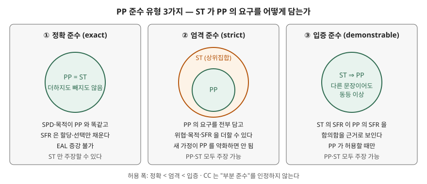
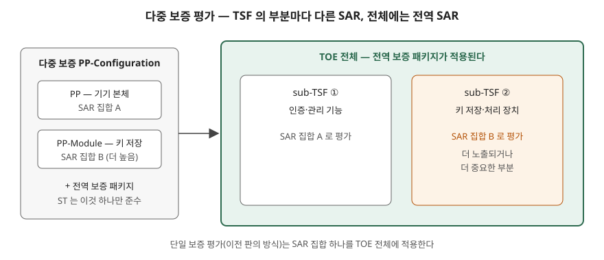

## 들어가며

공공기관에 보안 제품을 넣으려면 CC 인증서를 요구받는다. 답안에서는 "PP·ST·EAL" 세 단어로 끝내기 쉽지만, 2022년 개정판(CC:2022)은 **ST 가 PP 를 얼마나 똑같이 따라야 하는지(준수 유형)** 와 **제품의 부분마다 다른 보증을 요구하는 방식(다중 보증 평가)** 을 본문으로 들였다. 실무에서는 "이 제품의 EAL4 가 우리에게 무엇을 보장하나"를 판단할 때 EAL 이 어떤 보증 컴포넌트의 묶음인지 알아야 한다. 이 글은 원문 정의로 두 가지 신설 개념을 정리하고, EAL 표를 직접 계산해 등급 사이의 차이를 숫자로 본다.

## 정의

**CC(Common Criteria, 공통평가기준)** 는 IT 제품의 보안 특성을 평가하는 일반 개념·원칙과 평가 모델을 정한 국제 표준이다. ISO 판은 ISO/IEC 15408-1~5:2022, 짝이 되는 평가 방법론(CEM)은 ISO/IEC 18045:2022 다(Part 1 서문).

이 글에서 쓰는 용어의 원문 정의는 다음과 같다(Part 1 용어 절).

| 용어 | 정의 |
|---|---|
| 정확 준수 (exact conformance, 3.46) | ST 의 모든 요구가 **PP 에서만** 나오는 관계 |
| 엄격 준수 (strict conformance, 3.86) | PP 의 모든 요구가 ST 에도 있는 관계. "ST 는 PP 의 문장을 전부 담되 더 담을 수 있다" |
| 입증 준수 (demonstrable conformance, 3.29) | ST 가 PP 의 일반적 보안 문제를 **동등하거나 더 제한적인 방법**으로 푸는 관계 |
| 다중 보증 평가 (3.60) | PP-Configuration 의 구성요소마다 서로 다른 보증 요구를 적용하는 평가 |
| sub-TSF (3.87) | PP-Configuration 구성요소 하나의 SFR 을 시행하는 TOE 기능 부분 |
| 직접 근거 (direct rationale, 3.34) | SPD 요소를 TOE 보안 목적 없이 SFR 에 바로 대응시키는 PP·ST 유형 |

## 등장 배경

이전 판까지의 평가는 SAR 집합 하나를 TOE 전체에 적용하는 단일 보증 평가였다(Part 1 §6.3.4.2). 한 제품 안에서 보안 요구가 고르지 않으면 이 방식이 맞지 않는다. Part 1 §6.3.4.3 은 그런 경우로 키 저장·처리 장치나 보안 부팅 모듈처럼 일부만 더 높은 보증이 필요한 제품, 반대로 일부만 덜 노출된 제품, 기능을 여러 방식으로 구현한 제품군을 든다.

CC:2022 서문은 v3.1(2017년 Revision 5) 이후 부록·추록으로 쓰이던 방식을 본문으로 들였다고 밝힌다. 평가가 준수 주장의 범위를 넘지 못하게 하는 **정확 준수**와, 평가 활동으로 보안 기능마다 맞춤 보증과 객관적 지침을 주는 방식이 그 예다.

## 구성요소

### 가. CC:2022 개정 사항 — 구조 변경 1 + 기술 변경 6

| 구분 | 내용 (Part 1 서문) |
|---|---|
| 구조 | ① Part 4(평가 방법·활동을 정하는 틀)와 Part 5(미리 정의한 패키지)를 새로 둠 |
| 기술 | ② 용어 재검토 ③ 새 SFR·SAR ④ 정확 준수 유형 ⑤ 저보증 PP 삭제·직접 근거 PP 도입 ⑥ 다중 보증 평가 ⑦ 보증의 조합(composition) |

### 나. PP 준수 유형 — 3가지

PP 는 자신을 따르는 ST 가 어떻게 준수해야 하는지 준수 진술(conformance statement)로 셋 중 하나를 밝힌다(Part 1 PP 의 준수 주장과 진술 절, §10.3).

### 다. EAL — 7단계, 26개 보증 패밀리 위에서

EAL 은 Part 3 의 보증 컴포넌트를 미리 묶은 패키지다. Part 5 의 EAL 목적 절(§4.3)은 등급이 오를 때 **같은 패밀리의 상위 컴포넌트로 바꾸거나 다른 패밀리의 컴포넌트를 더한다**고 하고, 한 EAL 은 패밀리마다 컴포넌트를 하나까지만 담는다고 적는다. 증강(augmentation)은 EAL 에만 허용되고, "EAL 에서 하나를 뺀 것"은 인정되지 않으며, 정확 준수를 주장하는 ST 의 EAL 은 증강할 수 없다.

## 도식



> **출처**: [CC:2022 Release 1 Part 1 §10.3 Conformance claims and conformance statements, §3.29·§3.46·§3.86 정의](https://commoncriteriaportal.org/files/ccfiles/CC2022PART1R1.pdf), EAL 증강 불가 조건은 [CC:2022 Release 1 Part 5 §4.3](https://www.commoncriteriaportal.org/files/ccfiles/CC2022PART5R1.pdf)



> **출처**: [CC:2022 Release 1 Part 1 §6.3.4.3 Multi-assurance evaluation, §12.5 Additional requirements in the multi-assurance case, §3.52·§3.87 정의](https://commoncriteriaportal.org/files/ccfiles/CC2022PART1R1.pdf). 키 저장 장치에 더 높은 보증을 주는 경우는 §6.3.4.3 이 든 예이고, 두 sub-TSF 의 이름은 설명을 위한 예시다.

## 검산 — EAL 표를 직접 계산하기

전체 소스: [`code/eal_matrix.py`](code/eal_matrix.py) · 수행 기록: [`code/output.txt`](code/output.txt)

Part 5 의 요약 행렬(Table 1)과 등급별 목록(Table 2~8)을 **따로** 옮겨 적고 서로 대조했다. 일곱 등급 모두 일치해, 옮겨 적은 값과 원문 두 표가 서로 맞는다는 것을 확인했다. 패밀리는 26개, 클래스는 ADV·AGD·ALC·ASE·ATE·AVA 6개다.

```text
[3] 한 등급 오를 때 바뀌는 것
  EAL1→EAL2: 새 패밀리 6 ['ADV_ARC.1', 'ADV_TDS.1', 'ALC_DEL.1', 'ASE_SPD.1', 'ATE_COV.1', 'ATE_FUN.1']
  EAL2→EAL3: 새 패밀리 3 ['ALC_DVS.1', 'ALC_LCD.1', 'ATE_DPT.1']
  EAL3→EAL4: 새 패밀리 2 ['ADV_IMP.1', 'ALC_TAT.1']
  EAL4→EAL5: 새 패밀리 1 ['ADV_INT.2']
  EAL5→EAL6: 새 패밀리 1 ['ADV_SPM.1']
  EAL6→EAL7: 새 패밀리 0 []
```

(수행 기록에서 "올라간 컴포넌트" 줄을 뺐다.) 컴포넌트 수는 13·19·22·24·25·26·26 이다. 낮은 등급에서는 **검사 항목이 늘고**, 높은 등급에서는 **같은 항목을 더 깊게** 본다. 올라간 컴포넌트 수는 7·5·5·6·9·5 로, EAL5→6 이 가장 많았다(설계 표현·구현 매핑·개발 보안·취약점 분석 등 9개). EAL4→5 에서 시험 깊이(ATE_DPT)는 1 에서 3 으로 두 단계를 건너뛰었다. 앞 등급보다 내려간 패밀리는 어느 등급에도 없었다.

EAL1 과 EAL2 의 차이에서 ST 의 깊이가 보인다. EAL1 에는 보안 문제 정의(ASE_SPD)가 없다. Part 5 의 EAL1 개요(§4.4.2.3)는 SFR 을 위협에서 도출하지 않고 진술만 해도 된다고 적는다. ST 평가 패키지와 비교하면 **직접 근거 ST 패키지(STA-DR) = EAL1 의 ASE 6개 + ASE_SPD.1** 이고, **표준 ST 패키지(STA-STD) = EAL2 이상의 ASE 7개**였다.

## 비교

| 구분 | 정확 준수 | 엄격 준수 | 입증 준수 |
|---|---|---|---|
| 관계 | ST 의 요구가 PP 에서만 나옴 | ST ⊇ PP | ST 가 동등 이상의 해법 |
| 요구 추가 | 불가 — 할당·선택만 채움 | 위협·OSP·목적·SFR 추가 가능 | 추가 가능, 다른 문장도 허용 |
| 주장 주체 | ST 만 (PP 는 불가) | PP·ST | PP·ST, PP 가 허용할 때만 |
| EAL 증강 | 불가 | 가능 | 가능 |
| PP 작성자가 원하는 증거 (Part 1 부록 E) | ST 가 PP 의 SFR **그대로**의 구현이고 기능을 더하지 않았다 | ST 가 PP 의 구현이되 더 넓을 수 있다. 예: 선택형 조달 | ST 가 PP 의 일반적 보안 문제에 맞는 해법이다 |

| 구분 | 단일 보증 평가 | 다중 보증 평가 |
|---|---|---|
| SAR 적용 | TOE 전체에 한 집합 | sub-TSF 마다 다른 집합 + TOE 전체에 전역 패키지 |
| 근거 문서 | PP·PP-Configuration 을 주장하거나 주장 없음 | 다중 보증 PP-Configuration **하나만** 준수 |
| 맞는 제품 | 보안 요구가 고른 제품 | 키 저장·보안 부팅처럼 일부만 높은 보증이 필요한 제품 |

## 적용 시 고려사항

1. **EAL 숫자보다 컴포넌트를 본다.** EAL4 와 EAL5 의 차이는 컴포넌트 7개(새 패밀리 1 + 상위 6)다. 우리 위협에 필요한 것이 취약점 분석(AVA_VAN) 깊이인지 설계 문서의 정형성인지를 먼저 정하고, 필요한 패밀리만 골라 증강하는 편이 등급 전체를 올리는 것보다 맞는 경우가 있다.
2. **준수 유형을 조달 요건과 맞춘다.** 공동 PP 를 정확 준수로 요구하면 제품 간 결과를 그대로 비교할 수 있지만, 제품 고유 기능은 ST 에 넣을 수 없다. 고유 기능도 평가받아야 하면 엄격 준수 PP 를 쓰거나 PP-Module 로 나눈다.
3. **다중 보증이면 sub-TSF 경계를 운영 문서와 맞춘다.** 높은 보증은 그 sub-TSF 에만 해당한다. 운영 중에 높은 보증 부분을 거치지 않는 경로(예: 키를 소프트웨어 영역으로 내보내는 설정)를 열면 평가된 구성이 아니다.
4. **정확 준수 ST 는 EAL 을 증강할 수 없다.** 더 높은 보증이 필요하면 PP 자체가 그 SAR 을 담아야 한다. PP 를 고를 때 SAR 까지 확인한다.

## 정리

- **준수 유형 3**: 정확(ST = PP, ST 만) · 엄격(ST ⊇ PP) · 입증(동등 이상, PP 가 허용할 때만). 부분 준수는 없다
- **평가 방식 2**: 단일 보증(한 집합) · 다중 보증(sub-TSF 별 집합 + 전역 패키지, PP-Configuration 하나만)
- **EAL 7단계 · 패밀리 26 · 클래스 6**: 컴포넌트 13→26, 새 패밀리 6·3·2·1·1·0, EAL7 은 상위 컴포넌트로만 오른다
- **개정 7**: 구조 1(Part 4·5 신설) + 기술 6(용어·새 요구·정확 준수·직접 근거 PP·다중 보증·조합)

> 기출 답안: [기출문제 — CC(Common Criteria)](../../exam/2026-11-21-common-criteria-iso-15408/index.md)

## 참고 자료

- [CC:2022 Release 1 Part 1: Introduction and general model (CCMB, 2022-11)](https://commoncriteriaportal.org/files/ccfiles/CC2022PART1R1.pdf) — 서문의 개정 사항, 용어 정의(3.29 입증 준수, 3.34 직접 근거, 3.46 정확 준수, 3.52 전역 보증 패키지, 3.60 다중 보증 평가, 3.86 엄격 준수, 3.87 sub-TSF), §6.3.4 단일·다중 보증 평가, §10.3 준수 진술, §10.5~10.8 준수 유형별 추가 요구, §12.5 다중 보증 ST, 부록 E 준수 유형의 쓰임
- [CC:2022 Release 1 Part 5: Pre-defined packages of security requirements (CCMB-2022-11-005)](https://www.commoncriteriaportal.org/files/ccfiles/CC2022PART5R1.pdf) — §4.3 EAL 목적과 증강 규칙, Table 1 EAL 요약, §4.4 Table 2~8 등급별 컴포넌트, §8.4 Table 18·19 ST 평가 패키지
- [Common Criteria Portal — CCRA](https://www.commoncriteriaportal.org/ccra/index.cfm) — 상호 인정 협정
