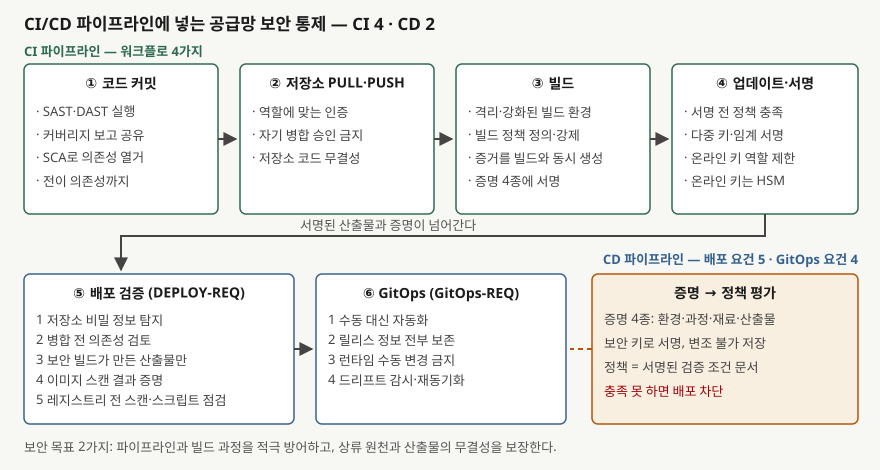

> **실행 검증 없음.** 미국 국립표준기술연구소(NIST)의 특별간행물 SP 800-204D 원문을 근거로
> 정리했다. 요건 식별자(`DEPLOY-REQ`, `GitOps-REQ`)는 원문 표기를 그대로 적었고, 특정 CI/CD
> 제품에서 돌려 본 결과는 싣지 않았다.

## 들어가며

DevOps의 단점을 묻는 문제에서 "보안이 약해진다"는 한 줄은 쉽게 쓴다. 점수는 그다음에서 갈린다.
**무엇이 새 공격 대상이 되고, 파이프라인의 어느 단계에 어떤 통제를 넣는가.** 실무에서 이 질문은
빌드 서버가 뚫린 뒤에 나온다. 소스 저장소에는 아무 흔적이 없는데 배포된 바이너리에 악성 코드가
들어 있으면, 코드 리뷰를 아무리 꼼꼼히 했어도 소용이 없다. 사람이 하던 확인을 파이프라인이 대신하는
순간, **파이프라인 자체가 지켜야 할 자산**이 된다는 것이 이 주제의 출발점이다.

## 정의

> **DevSecOps는 소스 코드를 여러 저장소에서 가져와 빌드·패키징·테스트·배포하는 단계들(CI/CD 파이프라인)로
> 클라우드 네이티브 애플리케이션을 개발·배포하는 애자일 방식이며, 그 파이프라인의 각 단계에 소프트웨어
> 공급망 보안 통제와 증거 생성을 넣어 산출물의 무결성을 검증 가능하게 만드는 것을 포함한다.**

SP 800-204D의 CI/CD 파이프라인 절(§4)이 DevSecOps를 이 단계들로 이루어진 애자일 방식으로 설명하고,
간행물 전체가 그 단계에 공급망 보안을 통합하는 전략을 다룬다. 정의에 들어갈 말은 **셋**이다.
**파이프라인 단계**(통제를 넣을 자리), **공급망**(지킬 대상), **증거**(지켰다는 것을 보이는 수단)다.

원문은 용어 둘을 먼저 정한다. **산출물(artifact)** 은 소스 코드와 거기서 만들어진 빌드·패키지 전부이고
각각 소유자가 있다. 산출물을 담는 논리적 그릇이 **저장소(repository)** 다. 그리고 공통 접근법으로
**출처 데이터(provenance)**, 곧 구성요소의 기원·개발·소유·위치·변경과 그 변경을 한 사람·과정의 연대기를
가능한 한 많이 만들고, 그것을 검증해 정책 판단에 쓰라고 적는다.

## 등장 배경

공급망 정의 절(§2.1)은 공급망 공격의 형태로 **세 가지**를 든다. 공급망의 단계를 바꾸거나 빼거나 끼워 넣어
결과물을 변조하는 것, **빌드 시스템의 자격 증명을 훔쳐 무단 소프트웨어를 만들고 서명하는 것**, 이름 충돌을
일으키는 것이다. 두 번째가 DevOps가 만든 틈이다. 자동화된 빌드는 사람의 손을 거치지 않고 서명까지 하므로,
그 서명이 정상 출처의 증거가 되지 못한다.

공격자에게 이 경로가 매력적인 이유도 **두 가지**로 적는다(§2.2). 규제가 엄격한 환경에 **정상 경로를 타고**
들어갈 수 있고, 공급망이 서로 얽혀 있어 **짧은 시간에 넓게** 피해를 낸다. 원문은 SolarWinds 사건(SOLORIGATE)을
예로 든다.

목록만으로 해결되지 않는다는 점도 원문이 짚는다. SBOM은 구성요소와 출처를 식별하게 하지만, 취약점과 결함을
다룰 정보까지 담지는 않으므로 **SBOM만으로 취약점 관리를 할 수 없다.** 무엇이 들어 있는지와 그것이
제대로 만들어졌는지는 다른 질문이다.

## 구성요소 — 다섯 묶음

### 가. 보안 목표 2가지 (§4.1)

① **CI/CD 파이프라인과 빌드 과정을 적극 방어한다.** ② **상류 원천과 산출물(저장소 등)의 무결성을 보장한다.**
앞은 파이프라인이라는 실행 환경을, 뒤는 그 안을 흐르는 재료를 지킨다.

### 나. 파이프라인 가동 전 선행 조건 5가지 (§5)

| 조건 | 내용 |
|---|---|
| ① 실행 환경 강화 | 파이프라인이 도는 VM·파드의 공격 표면을 줄인다 |
| ② 역할 정의 | 애플리케이션 갱신 담당, 패키지 관리자, 배포 담당처럼 행위자의 역할을 정한다 |
| ③ 세분화된 권한 | 커밋, 빌드·패키지 생성, 저장소 반입·반출을 작업 단위로 인가한다 |
| ④ 전 구간 자동화 | 상위 구동 도구가 체크아웃·컴파일·커밋·테스트(SAST·DAST·SCA) 도구를 차례로 부른다. **구동 도구(빌드 제어부)는 개별 단계보다 높은 신뢰 수준에서 돈다** |
| ⑤ 보안 요건 정의 | 애플리케이션 코드, 코드형 인프라(IaC), 코드형 정책·설정 코드(YAML) 각각의 요건을 정한다 |

### 다. CI 워크플로 4가지 (§5.1)

CI 파이프라인은 **빌드, 저장소 PULL·PUSH, 소프트웨어 업데이트, 코드 커밋** 네 가지로 이루어진다.

- **빌드**(§5.1.1): 격리된 플랫폼·사용 도구·빌드 수행자 인증을 정책으로 정하고 강제한다. 핵심은 **증거를 빌드와
  동시에 생성**하는 것이다. 증거 생성은 빌드보다 높은 신뢰·격리 수준의 과정이 맡아야 변조를 막는다. 최종 산출물과
  재료의 해시를 개발자가 통제하지 못하는 신뢰 구성요소가 인증서로 서명해 **증명(attestation)** 을 만든다
- **저장소 PULL·PUSH**(§5.1.2): 요청이 개발자의 역할과 맞는지 인증하고, **병합 승인 권한자도 자기 병합은 승인하지
  못한다.** 저장소 안 코드의 무결성을 믿을 수 있어야 다음 변경에 쓴다
- **업데이트 증거 생성의 무결성**(§5.1.3): 서명 전에 빌드 정책을 충족해야 한다. 키가 털려도 피해를 줄이도록
  **다중 키와 임계(정족수) 서명**을 지원하고, 자동으로 쓰이는 온라인 키는 클라이언트가 최종 신뢰하는 역할에 쓰지
  않는다. 온라인 키는 HSM에 두고 정책을 통과한 산출물에만 쓰게 한다
- **코드 커밋**(§5.1.4): 커밋 전에 SAST·DAST를 돌려 커버리지를 개발자와 보안 담당에게 보이고, 오픈소스 의존성은
  SCA로 **전이 의존성까지** 열거해 정책으로 평가한다

빌드 증명의 구성은 **4종**이다. **환경** 증명(빌드가 돈 플랫폼의 목록), **과정** 증명(소스를 산출물로 바꾼
컴파일러·패키징·테스트 도구), **재료** 증명(설정·소스·의존성 같은 원재료), **산출물** 증명(각 단계의 결과물,
SAST의 스캔 결과도 산출물이다). 증명은 보안 키로 서명하고 변조할 수 없는 곳에 엄격한 접근 통제로 저장한다.
그다음 **정책**, 곧 산출물이 통과해야 할 조건을 적은 서명된 문서로 증명을 평가한다.

### 라. CD 요건 — 배포 5가지와 GitOps 4가지 (§5.2)

배포 요건(`DEPLOY-REQ`) **다섯 가지**는 산출물의 배포 허용·차단 정책으로 구현한다. ① 저장소의 키·토큰 같은 **비밀
정보 탐지**, ② 풀 리퀘스트 병합 전 **의존성 검토**, ③ 보안 빌드 과정이 만든 산출물만 배포, ④ 컨테이너 이미지의
**취약점 스캔 결과 증명** — 스캐너가 계속 갱신되므로 **최근 스캔일수록** 믿을 만하다, ⑤ 릴리스 빌드 스크립트의
주기적 악성 코드 점검과 레지스트리에 올리기 전 이미지 스캔이다.

GitOps 요건(`GitOps-REQ`) **네 가지**는 ① 수동 작업 대신 자동화, ② 릴리스한 패키지의 모듈 판·설정 파일 등 정보
보존, ③ 런타임 수동 변경 금지 — 변경은 코드로 하고 새 릴리스를 띄워 **Git 커밋이 클러스터에서 도는 것의 유일한
원천**으로 남게 한다, ④ 선언된 상태와의 **드리프트 감시** 후 자동 재동기화 또는 알림·수동 조치다.

### 마. 구현 전략 4유형 (§5.3)

원문은 이 통제를 한 번에 다 넣으면 업무 중단과 비용이 크다고 보고 해법을 **네 유형**으로 나눈다. ① 단계별
기능(변조 불가 빌드, 단계별 점검표), ② 디지털 서명과 증명으로 무결성·출처 보장, ③ **빌드 지평(build horizon)**
— 일정 기간보다 오래된 코드는 띄우지 않는다, ④ CI/CD 클라이언트가 소스·서명 키·클라우드 자격 증명을 빼돌리지
못하게 막는 것이다.

## 도식

> **출처**: [NIST SP 800-204D §4.1 Broad Security Goals for CI/CD Pipelines, §5.1 Securing Workflows in CI Pipelines, §5.2 Securing Workflows in CD Pipelines, §5.2.1 Secure CD Pipeline — Case Study (GitOps)](https://nvlpubs.nist.gov/nistpubs/SpecialPublications/NIST.SP.800-204D.pdf)

답안지에는 위 줄 네 칸(CI)과 아래 줄 두 칸(CD), 그리고 그 사이를 잇는 "증명 → 정책" 한 칸이면 된다.
칸마다 통제를 두 개씩만 적어도 단계 구분이 살아 있으면 점수가 나온다.

## 비교

### DevOps와 DevSecOps — 무엇이 더해지는가

| 관점 | DevOps 파이프라인 | DevSecOps 파이프라인 (SP 800-204D) |
|---|---|---|
| 파이프라인의 지위 | 인도를 빠르게 하는 도구 | **지켜야 할 자산** — 보안 목표 ①의 대상 |
| 빌드 결과에 대한 믿음 | 빌드가 성공했으면 쓴다 | 서명된 **증명 4종**과 정책 평가를 통과해야 쓴다 |
| 권한 | 개발자가 커밋부터 배포까지 | 역할 정의, 작업 단위 인가, 자기 병합 승인 금지 |
| 테스트 | 기능·회귀 테스트 | SAST·DAST·SCA를 커밋 단계에, 이미지 스캔을 배포 전에 |
| 키·비밀 | 파이프라인 변수에 둔다 | 비밀 탐지, 온라인 키 역할 제한, HSM, 임계 서명 |
| 운영 변경 | 급하면 클러스터에 직접 | 런타임 수동 변경 금지, Git이 유일한 원천, 드리프트 감시 |

### 공급망 산출물 — 목록과 증명

| 구분 | SBOM | 빌드 증명(attestation) |
|---|---|---|
| 답하는 질문 | 무엇이 들어 있나 | 어떻게, 어디서, 무엇으로 만들었나 |
| 만드는 시점 | 의존성 스캔 시(원문은 첫 커밋에서 생성 권고) | 빌드와 **동시에**, 빌드보다 높은 신뢰 수준에서 |
| 막는 것 | 알려진 취약 구성요소 식별 | 빌드 변조, 무단 도구·단계 개입 |
| 못 막는 것 | 빌드 과정 변조 | 정상 출처에서 만든 취약 코드 |

둘은 대체 관계가 아니다. **SBOM이 재료 목록이면 증명은 그 재료로 정해진 공정을 거쳤다는 기록**이다. SBOM의
한계는 [공급망 보안과 SBOM — 목록이 막는 것과 못 막는 것](../2026-10-12-sbom-supply-chain-limits/index.md)에서 따로 다뤘다.

## 적용 시 고려사항

**① 빌드 제어부를 가장 높은 신뢰 구역에 둔다.** 원문은 구동 도구가 개별 단계보다 높은 신뢰 수준에서 돌고, 증거
생성도 빌드보다 높은 수준의 과정이 맡아야 한다고 적는다. 빌드 스크립트가 자기 증명을 스스로 서명하는 구조라면
빌드가 털릴 때 증명도 같이 털린다.

**② 탐지 도구의 오탐을 관리한다.** 소스 관리 시스템 통제 절(§3.2.2)은 코드 분석 도구를 넣되 오탐으로 개발자를
덮어 **경보 피로**를 만들지 말라고 적는다. 경보를 무시하는 습관이 생기면 진짜 경보도 같이 무시된다.

**③ 스캔은 시점이 생명이다.** 배포 요건 ④가 말하듯 스캐너는 계속 갱신되므로, 빌드 때 깨끗했던 이미지도 배포
시점에는 아닐 수 있다. 배포 직전에 최근 스캔 증명을 요구하고, 빌드 지평으로 오래된 산출물을 걸러 낸다.

**④ 키 관리가 서명의 가치를 정한다.** 서명이 있어도 키가 파이프라인 변수에 평문으로 있으면 공격 형태 두 번째
(자격 증명 탈취 후 서명)가 그대로 열린다. 자동화에 쓰는 키는 역할을 좁히고 HSM에 둔다.

**⑤ 한 번에 다 넣지 않는다.** 구현 전략 절이 단계적 도입을 전제하는 이유다. 비밀 탐지와 의존성 검토처럼 기존
흐름을 덜 건드리는 통제부터 넣고, 증명·정책 평가처럼 배포를 막을 수 있는 통제는 경고 모드로 먼저 돌린다.

## 정리

- **정의 세 요소 — 파이프라인 단계 · 공급망 · 증거**
- **보안 목표 2 — 파이프라인 방어 + 상류 원천·산출물 무결성**
- **선행 조건 5 — 환경 강화 · 역할 · 세분 권한 · 전 구간 자동화 · 코드별 요건**
- **CI 4 — 커밋 · 저장소 · 빌드 · 업데이트**, 빌드 증명 4종은 **환경 · 과정 · 재료 · 산출물**
- **CD — 배포 요건 5(비밀 · 의존성 · 보안 빌드 · 스캔 증명 · 사전 스캔) + GitOps 4(자동화 · 보존 · 수동 금지 · 드리프트)**
- **한 줄** — 빌드가 성공했다는 사실 대신, 서명된 증명이 정책을 통과했다는 사실로 배포를 허용한다

> 기출 답안: [기출문제 — DevOps의 장점과 단점](../../exam/2026-11-20-devops-advantages-disadvantages/index.md)

## 참고 자료

- [R. Chandramouli·F. Kautz·S. Torres-Arias, NIST SP 800-204D: Strategies for the Integration of Software Supply Chain Security in DevSecOps CI/CD Pipelines (2024-02-12)](https://nvlpubs.nist.gov/nistpubs/SpecialPublications/NIST.SP.800-204D.pdf) — 공급망 공격 형태(§2.1)와 공격자 유인(§2.2), 소스 관리 통제(§3.2.2), 보안 목표 2가지(§4.1), 선행 조건(§5), CI 워크플로 4가지와 빌드 증명 4종(§5.1), 배포·GitOps 요건(§5.2), 구현 전략 4유형(§5.3)
- [NIST CSRC — SP 800-204D 간행물 안내](https://csrc.nist.gov/pubs/sp/800/204/d/final) — 초안(2023-08-30)과 최종판(2024-02-12) 이력, 저자
