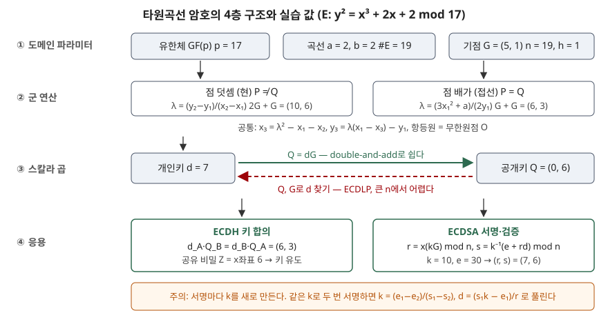

## 들어가며

타원곡선 암호는 단답형에서는 정의와 RSA 대비 키 길이로, 계산형에서는 "곡선과 기점을 주고 2P, 3P를 구하라"는 형태로 나온다. 실무에서는 TLS의 ECDHE 키 교환과 인증서·코드 서명의 ECDSA로 매일 쓰인다. 공식을 외워도 기울기를 어느 쪽으로 쓰는지, 무한원점이 언제 나오는지에서 계산이 자주 틀린다. 이 글은 점이 19개뿐인 작은 곡선에서 표준의 절차를 그대로 따라 계산하고, 같은 코드로 P-256까지 검산했다.

## 정의

**타원곡선 암호(ECC)**: 유한체 위 타원곡선의 점들이 이루는 군에서, 기점 G와 Q = dG가 주어졌을 때 d를 구하는 **타원곡선 이산대수 문제(ECDLP)**가 어렵다는 데 안전성을 두는 공개키 암호 방식이다.

NIST SP 800-186은 ECC의 쓰임을 전자서명(ECDSA)과 키 합의(ECDH) 두 갈래로 든다(배경 절 §1.1). ECC는 알고리즘 하나가 아니라 **이 두 응용이 올라서는 수학 구조**라는 점을 정의 다음 줄에 붙이면 답안이 정확해진다.

## 등장 배경

RSA와 유한체 디피-헬만은 소인수분해와 유한체 이산대수의 어려움에 기댄다. 두 문제에는 지수 시간보다 빠른 풀이법이 있어서, 보안 강도를 올리면 키가 빠르게 길어진다. NIST SP 800-57 Part 1의 비교 보안 강도 표(§5.6.1.1)에서 128비트 강도는 RSA 3072비트, ECC 256비트다. 타원곡선 위 이산대수에는 그런 풀이법이 알려져 있지 않아 같은 강도를 짧은 키로 얻는다. 키와 서명이 짧으면 인증서 크기, 핸드셰이크 전송량, 스마트카드의 저장 공간이 같이 줄어든다.

## 구성요소 / 절차

### 도메인 파라미터 6가지 (SP 800-186 짧은 바이어슈트라스 형 §2.1.1, 보조인수 §3.1.1)

| 기호 | 뜻 | 실습 값 |
|---|---|---|
| ① p | 소수체 GF(p)의 크기 | 17 |
| ② a | 곡선 계수 (y² = x³ + ax + b) | 2 |
| ③ b | 곡선 계수. 4a³ + 27b² ≠ 0 이어야 한다 | 2 (판별식 mod 17 = 4) |
| ④ G | 기점 | (5, 1) |
| ⑤ n | G의 위수. nG = O 인 가장 작은 양의 정수, 소수 | 19 |
| ⑥ h | 보조인수 = 곡선 위 점 개수 / n | 19 / 19 = 1 |

점 개수는 p + 1 − t이고 |t| ≤ 2√p다(하세 정리). 실습 [1]에서 t = −1이라 범위 안에 들었다. 점 개수가 소수 19라서 무한원점이 아닌 어떤 점이든 위수가 19다.

### 군 연산 2가지 (SP 800-186 소수체 바이어슈트라스 군 법칙, 부록 A.1.1)

| 연산 | 조건 | 기울기 λ | 실습 |
|---|---|---|---|
| 점 덧셈 (현) | P₁ ≠ ±P₂ | (y₂ − y₁)/(x₂ − x₁) | (6, 3) + (5, 1): λ = 2 → (10, 6) |
| 점 배가 (접선) | P = Q, P ≠ −P | (3x₁² + a)/(2y₁) | (5, 1) + (5, 1): λ = 13 → (6, 3) |

두 경우 모두 x₃ = λ² − x₁ − x₂, y₃ = λ(x₁ − x₃) − y₁이다. 나눗셈은 mod p의 역원 곱셈이다. 배가에서 λ = (3·25 + 2)·(2)⁻¹ = 77·9 ≡ 13 (mod 17)이 된다. P + (−P)는 세로 직선이 셋째 점을 만나지 않으므로 항등원인 **무한원점 O**다. −G = (5, 16)이고 G + (−G) = O였다.

### 응용 2가지의 절차

| 응용 | 절차 | 근거 |
|---|---|---|
| ECDH | ① 각자 Q = dG 공개 → ② 상대 공개키에 내 개인키를 곱함 → ③ 그 점의 x좌표를 공유 비밀 Z로 → ④ Z를 키 유도 함수에 넣음 | SP 800-56A Rev. 3 ECC CDH 기본 연산(§5.7.1.2), 키 유도(§5.8) |
| ECDSA 서명 | ① e = 해시의 왼쪽 len(n)비트 → ② 비밀 난수 k → ③ R = kG → ④ r = x(R) mod n → ⑤ s = k⁻¹(e + rd) mod n → ⑥ r 또는 s가 0이면 k를 다시 고른다 | FIPS 186-5 서명 생성(§6.4.1) |
| ECDSA 검증 | ① 1 ≤ r, s ≤ n−1 확인 → ② w = s⁻¹ → ③ u₁ = ew, u₂ = rw → ④ R = u₁G + u₂Q → ⑤ x(R) mod n = r 이면 통과 | FIPS 186-5 서명 검증(§6.4.2) |

검증이 맞는 이유는 한 줄이다. u₁G + u₂Q = s⁻¹(e + rd)G = kG 이므로 서명할 때의 R이 다시 나온다.

## 도식



> **출처**: 곡선 형태와 파라미터는 [NIST SP 800-186 §2.1.1 Curves in Short-Weierstrass Form, 부록 A.1.1 Group Law for Weierstrass Curves](https://nvlpubs.nist.gov/nistpubs/SpecialPublications/NIST.SP.800-186.pdf), 서명 식은 [FIPS 186-5 §6.4.1 ECDSA Signature Generation Algorithm](https://nvlpubs.nist.gov/nistpubs/FIPS/NIST.FIPS.186-5.pdf), 공유 비밀은 [NIST SP 800-56A Rev. 3 §5.7.1.2 ECC CDH Primitive](https://nvlpubs.nist.gov/nistpubs/SpecialPublications/NIST.SP.800-56Ar3.pdf). 실습 값은 `code/ecc_by_hand.py` 로 계산했다.

답안에는 ①~④ 네 층 이름과 ③의 두 화살표만 옮겨도 된다. 초록 실선은 계산이 쉬운 방향, 빨간 점선은 어려운 방향이다.

## 실습 — 작은 곡선에서 검산

실습 번호는 [`code/ecc_by_hand.py`](code/ecc_by_hand.py)의 단계 번호이고, 출력 전체는 수행 기록 [`code/output.txt`](code/output.txt)에 있다.

### G의 배수와 스칼라 곱

```text
[3] G 의 배수 1G..19G
    1G=(5, 1)  2G=(6, 3)  3G=(10, 6)  4G=(3, 1)  5G=(9, 16)
    6G=(16, 13)  7G=(0, 6)  8G=(13, 7)  9G=(7, 6)  10G=(7, 11)
    11G=(13, 10)  12G=(0, 11)  13G=(16, 4)  14G=(9, 1)  15G=(3, 16)
    16G=(10, 11)  17G=(6, 14)  18G=(5, 16)  19G=O(무한원점)

[4] 스칼라 곱 13G 를 double-and-add 로 (13 = 0b1101)
    비트 1 → 시작 G = (5, 1)
    비트 1 → 배가 후 +G  (10, 6)
    비트 0 → 배가       (16, 13)
    비트 1 → 배가 후 +G  (16, 4)
    연산 횟수: 배가 3번 + 더하기 2번 = 5번 (G 를 반복해 더하면 12번)
```

kG와 (n−k)G는 x좌표가 같고 y좌표만 부호가 반대다(7G = (0, 6), 12G = (0, 11)). double-and-add는 d의 비트 수만큼만 배가하므로 256비트 d도 배가 255번, 더하기 많아야 255번이면 된다. 반대로 Q에서 d를 찾는 쪽은 실습 [8]처럼 1G부터 차례로 맞춰 보는 수밖에 없는데, 이 곡선에서는 7번 만에 끝났다. n이 2²⁵⁶ 근처면 같은 방법이 성립하지 않는다는 것이 ECDLP의 뜻이다.

### ECDH와 ECDSA

```text
[5] ECDH 키 합의
    A: d_A=3, Q_A=(10, 6)  /  B: d_B=7, Q_B=(0, 6)
    A 가 계산 d_A*Q_B = (6, 3),  B 가 계산 d_B*Q_A = (6, 3)
    공유 비밀 Z (x 좌표) = 6, 일치: True, 21G = (6, 3)

[6] ECDSA 서명과 검증
    개인키 d=7, 공개키 Q=(0, 6), k=10, kG=(7, 11)
    e = SHA-256 왼쪽 5비트 = 30 (n 보다 클 수 있다. 식 안에서 mod n 으로 줄어든다)
    서명 (r, s) = (7, 6)
    검증: True
    메시지 변조(b'transfer 900') 검증: False
    s 변조(s+1) 검증: False
```

ECDH의 공유점은 3·7 = 21 ≡ 2 (mod 19)이므로 2G = (6, 3)과 같다. 서명은 손으로도 맞춰 볼 수 있다. 10⁻¹ ≡ 2 (mod 19)이고 e + rd = 30 + 49 = 79 ≡ 3이므로 s = 2·3 = 6이다.

### 같은 k를 두 번 쓰면

```text
[7] 같은 k 를 두 번 쓰면 개인키가 풀린다
    서명1 (e=30, r=7, s=6),  서명2 (e=5, r=7, s=13)  → r 이 같다
    k = (e1-e2)/(s1-s2) mod n = 10
    d = (s1*k - e1)/r mod n = 7, 실제 d 와 같음: True
```

r은 k만으로 정해지므로 같은 k로 만든 두 서명은 r이 같다. 두 서명 식을 빼면 d가 지워져 k가 나오고, k를 첫 식에 넣으면 d가 나온다. 공개된 서명 두 개와 메시지 두 개만으로 개인키가 풀린 것이다.

### P-256에서 같은 연산

```text
[9] P-256 (SP 800-186 도메인 파라미터)로 같은 연산 검산
    G 가 곡선 위: True
    p 비트 수 = 256, n 비트 수 = 256
    n*G = 무한원점: True
    ECDH 공유 비밀 일치: True
    ECDSA 서명 검증: True
```

SP 800-186의 P-256 파라미터(§3.2.1.3, a = −3)를 넣어도 같은 덧셈 공식과 같은 서명 식이 그대로 동작했다. 작은 곡선과 다른 것은 숫자의 크기뿐이다.

## 비교

### ECC와 RSA (SP 800-57 Part 1 비교 보안 강도 표, §5.6.1.1)

| 구분 | RSA | ECC |
|---|---|---|
| 기반 문제 | 소인수분해 (RSA 문제) | 타원곡선 이산대수 (ECDLP) |
| 128비트 강도의 키 | 3072비트 | 256비트 |
| 핵심 연산 | 모듈러 거듭제곱 mᵉ mod n | 스칼라 곱 dG (덧셈·배가 반복) |
| 서명의 난수 의존 | PSS는 salt, PKCS1-v1_5는 결정적 | 서명마다 k 필수. 새면 개인키 노출 |
| 암호화 직접 지원 | 있음 (OAEP) | 없음. ECDH로 키를 합의해 대칭키로 암호화 |
| 양자 컴퓨터 | 쇼어 알고리즘에 취약 | 쇼어 알고리즘에 취약 |

### ECDH와 ECDSA

| 구분 | ECDH | ECDSA |
|---|---|---|
| 목적 | 키 합의 (기밀성의 출발점) | 무결성·인증·부인 방지 |
| 쓰는 키 | 내 개인키 + 상대 공개키 | 서명은 개인키, 검증은 공개키 |
| 결과 | 공유 비밀 Z (점의 x좌표) | 정수 쌍 (r, s) |
| 매번 새로 만드는 값 | 임시 키 쌍 (ECDHE일 때) | 비밀 난수 k |
| 표준 | SP 800-56A Rev. 3 | FIPS 186-5 |

## 적용 시 고려사항

1. **k는 서명마다 새로 만들고 개인키처럼 지킨다.** FIPS 186-5는 서명마다 k를 생성해야 하고 k와 k⁻¹을 개인키와 같은 수준으로 보호하라고 적는다(서명 생성 절 §6.4.1). 실습 [7]이 그 이유다. 난수 생성기를 믿기 어려운 기기에서는 메시지와 개인키로 k를 정하는 결정적 ECDSA(§6.3.2)나 EdDSA를 쓴다.
2. **받은 공개키와 공유점을 검사한다.** ECDH에서 상대 공개키가 곡선 위의 점인지, 위수가 n인지 확인하지 않으면 작은 위수의 점을 보내 개인키를 조금씩 알아내는 공격이 가능하다. SP 800-56A Rev. 3은 공유점이 무한원점이면 오류로 끝내도록 정한다(ECC CDH 기본 연산 §5.7.1.2). 보조인수 h가 1이 아닌 곡선에서는 이 검사가 더 중요하다.
3. **공유 비밀 Z를 그대로 키로 쓰지 않는다.** Z는 곡선 위 점의 x좌표라 비트가 고르게 퍼져 있지 않다. SP 800-56A는 Z를 키 유도 함수에 넣어 쓰라고 정한다(§5.8).
4. **곡선과 구현 방식을 고른다.** 새 구현은 P-256·P-384나 Edwards25519 같은 소수체 곡선을 쓰고 이진체 곡선은 폐지 예정이다(SP 800-186 요약). 이 글의 코드처럼 비트에 따라 덧셈 여부가 갈리는 double-and-add는 시간 차이로 d의 비트가 새므로, 실제 구현은 고정 시간 연산을 쓴다.
5. **양자 전환을 함께 계획한다.** ECC도 RSA와 함께 양자 취약 알고리즘이다. 전환 일정은 이 저장소의 [양자 내성 암호 글](../../emerging-tech/2026-10-15-post-quantum-cryptography-transition/index.md)에서 다뤘다.

## 정리

- 도메인 파라미터 **6가지**: p, a, b, G, n, h — "체·곡선 둘·점·위수·보조인수"
- 군 연산 **2가지**: 덧셈 λ = Δy/Δx, 배가 λ = (3x² + a)/2y, 공통 x₃ = λ² − x₁ − x₂, y₃ = λ(x₁ − x₃) − y₁
- 일방향성: **Q = dG는 쉽고(double-and-add), d 찾기는 어렵다(ECDLP)**
- ECDH **4단계**: 공개 → 곱 → x좌표 → 키 유도 / ECDSA 서명 **6단계**: e → k → kG → r → s → 0 검사
- 암기 단서: **"r은 k가, s는 d가"** — r은 k만으로 정해지고 s에 개인키가 들어간다. 그래서 k 재사용이 치명적이다
- 검산 값: y² = x³ + 2x + 2 (mod 17), G = (5, 1), n = 19 → 2G = (6, 3), d = 7 → Q = (0, 6), k = 10 → (r, s) = (7, 6)

> 기출 답안: [기출문제 — 타원곡선 암호(ECC)](../../exam/2026-11-21-elliptic-curve-cryptography-ecc/index.md)

## 참고 자료

- [NIST SP 800-186, Recommendations for Discrete Logarithm-based Cryptography: Elliptic Curve Domain Parameters (2023-02)](https://nvlpubs.nist.gov/nistpubs/SpecialPublications/NIST.SP.800-186.pdf) — §1.1 배경(ECDSA·ECDH), §2.1.1 짧은 바이어슈트라스 형, §3.1.1 보조인수, §3.2.1.3 P-256, 부록 A.1.1 소수체 바이어슈트라스 곡선의 군 법칙, 요약(이진체 곡선 폐지 예정)
- [FIPS 186-5, Digital Signature Standard (2023-02)](https://nvlpubs.nist.gov/nistpubs/FIPS/NIST.FIPS.186-5.pdf) — §6.3.2 결정적 ECDSA의 k 생성, §6.4.1 서명 생성(해시 절단, r·s 계산, k 보호), §6.4.2 서명 검증
- [NIST SP 800-56A Rev. 3, Recommendation for Pair-Wise Key-Establishment Schemes Using Discrete Logarithm Cryptography (2018-04)](https://nvlpubs.nist.gov/nistpubs/SpecialPublications/NIST.SP.800-56Ar3.pdf) — §5.7.1.2 ECC CDH 기본 연산, §5.8 키 유도
- [NIST SP 800-57 Part 1 Rev. 5, Recommendation for Key Management (2020-05)](https://nvlpubs.nist.gov/nistpubs/SpecialPublications/NIST.SP.800-57pt1r5.pdf) — §5.6.1.1 비교 보안 강도 표
- [RSA 공개키 암호 — 키 생성, 암복호, 서명을 작은 수로 계산하기](../2026-11-15-rsa-key-generation-encrypt-sign/index.md) — 같은 저장소에서 RSA를 같은 방식으로 계산한 글
