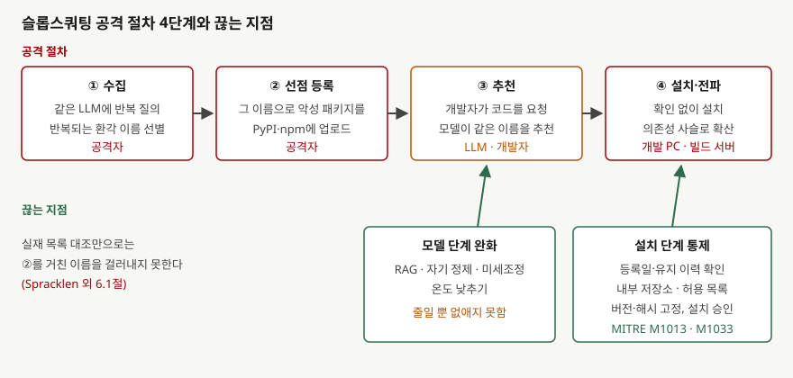

> **실행 검증 없음.** 패키지 환각의 정의와 수치는 원 논문(Spracklen 외, USENIX Security 2025)에서
> 가져왔다. **"슬롭스쿼팅"이라는 이름은 표준 용어가 아니다.** 이름의 유래는 2차 자료(Socket 블로그,
> 2025-04-08)에만 있어 그렇게 밝혀 둔다. 실제 저장소에 패키지를 올려 본 실험은 하지 않았다.

## 들어가며

LLM 도입 시 보안 위험을 묻는 문제에서 프롬프트 인젝션과 정보 유출은 누구나 쓴다. 점수가 갈리는 곳은
**개발 과정 고유의 위험**이고, 그 대표가 패키지 환각이다. 실무에서는 이렇게 일어난다. 코딩 어시스턴트가
내놓은 코드 첫 줄에 `pip install` 할 패키지가 적혀 있고, 개발자는 이름이 그럴듯하니 그대로 설치한다.
그 이름이 원래는 없던 것이고, 누군가 미리 등록해 둔 악성 패키지라면 코드 리뷰 전에 이미 개발자 PC와
빌드 서버에서 설치 스크립트가 돌아간 뒤다.

## 정의

**패키지 환각**(package hallucination)은 코드 생성 LLM이 **실제로 존재하지 않는 패키지를 추천하거나
코드에서 참조하는** 사실 상충형 환각이다(Spracklen 외, 2025, 1절·2.1절).

**슬롭스쿼팅**(slopsquatting)은 이렇게 환각된 이름을 공격자가 공개 패키지 저장소에 **먼저 등록해**,
AI가 시킨 대로 설치하는 사용자를 노리는 공급망 공격이다. Socket 블로그(2025-04-08)는 이 말을
PSF(파이썬 소프트웨어 재단)의 Seth Larson이 만들었다고 소개하며, 사용자의 오타 대신 **AI의 실수에
기대는 타이포스쿼팅의 변형**으로 설명한다.

## 등장 배경

기존 패키지 공급망 공격은 **사람의 실수**를 노렸다. MITRE ATT&CK의 의존성 공급망 침해 기법(T1195.001)은
인기 패키지와 비슷한 이름을 고르는 타이포스쿼팅, 소유자가 지운 패키지 이름을 다시 등록하는 방식을 든다.
공격자는 사람이 어떤 오타를 낼지 추측해야 했다.

LLM이 코드를 쓰기 시작하면서 추측할 필요가 줄었다. 같은 모델에 같은 질문을 던지면 **같은 가짜 이름이
다시 나오기** 때문이다. 공격자는 피해자와 같은 모델을 쓰며 환각 이름을 모으고, 그중 반복되는 것만
등록하면 된다. 2024-03-28 Lasso Security의 Bar Lanyado는 반복 환각된 이름(`huggingface-cli`)으로
빈 패키지를 올려 석 달간 3만 건 넘는 내려받기가 생겼다고 보고했다(2차 자료, 저자 보고 수치).
이를 16개 모델·576,000개 코드 표본으로 체계적으로 측정한 것이 Spracklen 외의 연구다.

## 구성요소 — 환각의 특성 3가지와 공격 절차 4단계

공격이 성립하는 이유는 환각의 **특성 3가지**에 있다(Spracklen 외, 5.3·5.4절).

| 특성 | 측정 결과 | 공격자에게 뜻하는 것 |
|---|---|---|
| **① 반복성** | 환각을 낸 질문 500개를 10번씩 다시 묻자 환각 이름의 43%가 10번 모두 다시 나왔고, 39%는 한 번도 반복되지 않았다 | 반복되는 이름만 골라 등록하면 된다 |
| **② 비유사성** | 환각 이름의 48.6%가 가장 가까운 실제 패키지와 편집 거리 6 이상, 1~2인 것은 13.4% | 오타가 아니므로 유사 이름 탐지로는 잡히지 않는다 |
| **③ 생태계 혼동** | 파이썬 환각 이름의 8.7%가 npm에 실제로 있는 패키지 이름이다 | 다른 언어의 이름이 섞여 나온다 |

전체로는 생성된 패키지 223만 개 중 19.7%가 환각이었고, 상용 모델은 평균 5.2% 이상, 공개 모델은
평균 21.7%였다(같은 논문, 초록·5.1절). 서로 다른 환각 이름만 205,474개다.

공격은 **4단계**로 진행된다(같은 논문, 3절).

1. **수집** — 공격자가 피해자와 같은 LLM에 질문을 던져 환각 이름을 모으고, 저장소에 없는 이름을 고른다
2. **선점 등록** — 그 이름으로 악성 코드를 담은 패키지를 PyPI·npm에 올린다
3. **추천** — 피해자가 LLM에 코드를 요청하고, 모델이 같은 가짜 이름을 다시 추천한다
4. **설치·전파** — 피해자가 확인 없이 설치하고, 악성 패키지가 코드베이스와 의존성 사슬을 따라 퍼진다

## 도식

> **출처**: [Spracklen 외, We Have a Package for You!, USENIX Security 2025 §3 Threat Model, §6 Mitigation](https://www.usenix.org/conference/usenixsecurity25/presentation/spracklen), [MITRE ATT&CK T1195.001 Mitigations (M1013, M1033)](https://attack.mitre.org/techniques/T1195/001/)

## 비교

| 구분 | 타이포스쿼팅 | 삭제된 이름 재등록 | 슬롭스쿼팅 |
|---|---|---|---|
| 노리는 실수 | 사람의 오타 | 사람이 옛 이름을 계속 씀 | **LLM의 환각** |
| 이름의 출처 | 인기 패키지를 살짝 바꿈 | 과거에 실재하던 이름 | 모델이 지어낸 이름 (오타와 무관한 것이 다수) |
| 공격자의 추측 | 어떤 오타가 날지 추측 | 누가 아직 쓰는지 추측 | **같은 모델에 물어 확인** |
| 유사 이름 탐지 | 효과 있음 | 해당 없음 | 대부분 못 잡음 (특성 ②) |
| 근거 | MITRE T1195.001 | MITRE T1195.001 | Spracklen 외 2025 |

논문은 삭제된 PyPI 패키지 이름이 환각 이름에 섞이는 비율이 0.17%로 무시할 만하다고 보고한다(5.4절).
즉 환각 이름은 **과거에 있던 이름의 기억이 아니라 새로 지어낸 이름**이다.

## 적용 시 고려사항

1. **"저장소에 있는가"만 확인하면 안 된다.** 논문은 실재 목록과 대조하는 필터를 방어로 쓰기 어렵다고
   본다(6.1절). 공격자가 이미 등록했으면 목록에 있기 때문이다. 등록일·유지 이력·내려받기 추이까지 본다
2. **설치 경로를 좁힌다.** MITRE는 검증된 패키지만 둔 내부 저장소에서 받기(M1033), 라이브러리 선택
   신중·버전 고정(M1013)을 권한다. 사내 미러와 허용 목록, 잠금 파일의 해시 고정이 여기에 해당한다
3. **모델 쪽 완화는 비용이 따른다.** 논문 실험에서 DeepSeek 6.7B의 환각률은 미세조정으로 16.14%에서
   2.66%로 줄었지만, 코드 정답률(HumanEval pass@1)도 51.4%에서 25.3%로 떨어졌다(6.2절, 표 4·5).
   설치 단계 통제를 대신할 수 없다
4. **에이전트가 직접 설치하면 사람의 확인 단계가 사라진다.** 코딩 에이전트에 패키지 설치 권한을 주면
   3단계와 4단계 사이에 사람이 없다. 설치 명령은 승인 대상으로 둔다
5. **온도를 낮추면 줄지만 없어지지 않는다.** 논문은 온도가 높을수록 환각률이 오른다고 보고한다(5.2절)

## 정리

- 정의: **패키지 환각** = 존재하지 않는 패키지를 추천, **슬롭스쿼팅** = 그 이름을 먼저 등록해 노림
- 특성 **3가지** — **반복**·**비유사**·**생태계 혼동** ("반·비·혼")
- 절차 **4단계** — **수집 → 선점 등록 → 추천 → 설치·전파**
- 대응은 실재 여부가 아니라 **이력 확인 + 내부 저장소·허용 목록 + 버전·해시 고정 + 설치 승인**

> 기출 답안: [기출문제 — AI 기반 소프트웨어 개발에 LLM을 도입할 때의 보안 위험과 대응 방안](../../exam/2026-11-23-llm-adoption-security-risks-in-software-development/index.md)
>
> 함께 보기: [DevSecOps와 CI/CD 파이프라인 공급망 보안](../2026-11-21-devsecops-cicd-supply-chain-security/index.md)

## 참고 자료

- [Spracklen, Wijewickrama, Sakib, Maiti, Viswanath, Jadliwala, We Have a Package for You! A Comprehensive Analysis of Package Hallucinations by Code Generating LLMs, 34th USENIX Security Symposium, pp. 3687–3706 (2025-08)](https://www.usenix.org/conference/usenixsecurity25/presentation/spracklen) — 정의, 3절 위협 모델, 5절 측정 결과, 6절 완화 실험
- [arXiv 2406.10279v3 (2025-03-02)](https://arxiv.org/abs/2406.10279) — 같은 논문의 공개본
- [MITRE ATT&CK T1195.001 Compromise Software Dependencies and Development Tools](https://attack.mitre.org/techniques/T1195/001/) — 타이포스쿼팅·재등록, 완화 M1013·M1033
- [OWASP, LLM09:2025 Misinformation](https://genai.owasp.org/llmrisk/llm092025-misinformation/) — 안전하지 않은 코드 생성, 환각 패키지 공격 시나리오
- [Gooding, The Rise of Slopsquatting, Socket 블로그 (2025-04-08)](https://socket.dev/blog/slopsquatting-how-ai-hallucinations-are-fueling-a-new-class-of-supply-chain-attacks) — 2차 자료, 용어 유래
- [Lanyado, Diving Deeper into AI Package Hallucinations, Lasso Security 블로그 (2024-03-28)](https://www.lasso.security/blog/ai-package-hallucinations) — 2차 자료, `huggingface-cli` 실험
