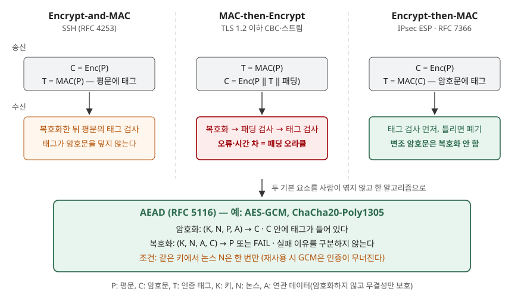

> **실행 검증 없음.** AEAD의 정의와 인터페이스는 RFC 5116에서, GCM의 논스 요건은 NIST SP 800-38D에서,
> TLS의 레코드 보호 방식과 공격 정리는 RFC 5246·7366·7457·8446에서 가져왔다. 일반 결합 3가지의 안전성 결론은
> 원 논문(Bellare·Namprempre, ASIACRYPT 2000) 본문을 열지 못해, 그 결론을 요약한 후속 논문(Namprempre·Rogaway·Shrimpton,
> EUROCRYPT 2014)의 초록 문장으로 적었다. 공격 소요 시간 같은 수치는 쓰지 않았다.

## 들어가며

TLS 1.3의 변경 사항을 쓰라는 문제에서 "AEAD만 남겼다"는 한 줄은 누구나 쓴다. 점수가 갈리는 곳은 그 앞, **암호화와 MAC을 따로 쓰면 무엇이 문제였는가**다. TLS는 20년 가까이 MAC-then-Encrypt 순서를 썼고, 그 순서에서 패딩 오라클 계열 공격이 거듭 나왔다. 실무에서는 "암호화했으니 안전하다"가 아니라 "변조된 암호문을 받았을 때 무엇을 먼저 하는가"가 안전성을 가른다는 점을 이해하는 데 쓰인다.

## 정의

**AEAD(Authenticated Encryption with Associated Data, 연관 데이터 인증 암호)**: 평문의 **기밀성과 무결성**에 더해, 암호화하지 않고 함께 보내는 **연관 데이터의 무결성과 출처 인증**까지 한 알고리즘으로 보장하는 대칭 암호 방식이다.

AEAD 인터페이스 명세(RFC 5116)는 서론(§1)에서 AEAD를 인증 암호에 **연관 데이터(AD)의 무결성·인증 검사 능력을 더한 것**으로 설명하고, 인터페이스 절(§2)에서 AEAD 알고리즘이 **인증 암호화와 인증 복호화 두 연산**을 가진다고 정한다. 연관 데이터는 라우팅에 필요해 숨길 수 없지만 바뀌면 안 되는 값, 예를 들어 레코드·패킷 머리다.

## 등장 배경

AEAD 이전에는 블록 암호 모드(CBC 등)와 MAC(HMAC 등)을 **설계자가 직접 엮었다.** 엮는 순서가 정해져 있지 않아 프로토콜마다 달랐다.

- SSH는 평문에 MAC을 계산해 암호문 옆에 붙인다(RFC 4253 데이터 무결성 절 §6.4)
- TLS 1.2 이하의 스트림·CBC 레코드는 평문에 MAC을 먼저 붙이고 함께 암호화한다(RFC 5246 레코드 보호 절 §6.2.3.1~6.2.3.2)
- IPsec ESP는 먼저 암호화하고 암호문에 무결성 값(ICV)을 계산하며, 받는 쪽은 ICV를 검증한 뒤 복호화한다(RFC 4303 §3.3.2.1, §3.4.4.1)

Bellare와 Namprempre(ASIACRYPT 2000)가 이 세 결합 방식을 처음으로 나눠 분석했다. 그 뒤 통념은 **"일반 결합 3가지 중 범용으로 안전한 것은 Encrypt-then-MAC 하나"**로 굳었다고 2014년 후속 논문(Namprempre·Rogaway·Shrimpton)의 초록이 정리한다. TLS의 Encrypt-then-MAC 확장 명세(RFC 7366)도 서론에서 TLS가 쓰는 MAC-then-Encrypt를 "더는 안전하다고 보지 않는다"고 적는다.

실제 피해는 **패딩 오라클**로 나타났다. CBC는 평문을 블록 길이에 맞추려고 패딩을 붙이는데, MAC-then-Encrypt에서는 받는 쪽이 **복호화부터 하고 패딩을 검사한 뒤에야** MAC을 볼 수 있다. 패딩이 틀렸을 때와 MAC이 틀렸을 때의 오류 메시지나 처리 시간이 다르면, 공격자는 암호문을 조금씩 바꿔 보내며 그 차이로 평문을 한 바이트씩 알아낸다. 알려진 TLS 공격 정리(RFC 7457 §2.4)는 패딩 오라클이 MAC-then-Encrypt 설계의 결과라고 적고, 시간 차를 쓰는 Lucky Thirteen이 AES-GCM이나 Encrypt-then-MAC으로 완화된다고 든다. 이 계열의 출발점은 Vaudenay(EUROCRYPT 2002)다.

## 구성요소 — 인터페이스 2연산·입력 4요소, 일반 결합 3가지

### AEAD 인터페이스 (RFC 5116 §2)

| 연산 | 입력 | 출력 |
|---|---|---|
| **인증 암호화** | ① 키 K ② 논스 N ③ 평문 P ④ 연관 데이터 A | 암호문 C (인증 태그 포함) 또는 오류 |
| **인증 복호화** | K, N, A, C | 평문 P 또는 **FAIL** |

복호화가 내놓는 실패는 **FAIL 한 가지**다. 패딩이 틀렸는지 태그가 틀렸는지를 구분해 돌려주지 않으므로, 앞의 패딩 오라클이 기댄 "실패 이유의 차이"가 인터페이스에서부터 없다. 논스는 같은 키 안에서 **값마다 한 번만** 써야 한다(§2.1).

### 일반 결합 3가지

| 방식 | 송신 순서 | 수신 순서 | 쓰는 곳 |
|---|---|---|---|
| **Encrypt-and-MAC** | C = Enc(P), T = MAC(P) | 복호화 후 평문의 태그 검사 | SSH |
| **MAC-then-Encrypt** | T = MAC(P), C = Enc(P ‖ T) | 복호화 → 패딩 검사 → 태그 검사 | TLS 1.2 이하 스트림·CBC |
| **Encrypt-then-MAC** | C = Enc(P), T = MAC(C) | **태그 검사 먼저**, 통과한 것만 복호화 | IPsec ESP, TLS의 RFC 7366 확장 |

## 도식

> **출처**: [RFC 4253 §6.4 Data Integrity](https://www.rfc-editor.org/rfc/rfc4253#section-6.4), [RFC 5246 §6.2.3 Record Payload Protection](https://www.rfc-editor.org/rfc/rfc5246#section-6.2.3), [RFC 4303 §3.3.2.1, §3.4.4.1 Integrity Check Value Verification](https://www.rfc-editor.org/rfc/rfc4303#section-3.4.4.1), [RFC 5116 §2 AEAD Interface](https://www.rfc-editor.org/rfc/rfc5116#section-2), [NIST SP 800-38D Appendix A](https://nvlpubs.nist.gov/nistpubs/Legacy/SP/nistspecialpublication800-38d.pdf)

세 칸을 가르는 질문은 **"태그가 무엇을 덮는가"**와 **"받는 쪽이 무엇을 먼저 하는가"** 두 가지다. 태그가 암호문을 덮고 수신 측이 그것부터 검사해야 변조된 암호문이 복호화 단계에 닿지 않는다. 답안지에는 위의 세 칸(송신 한 줄, 수신 한 줄)과 아래 AEAD 상자만 옮기면 된다.

## 비교

### 결합 방식과 AEAD

| 항목 | MAC-then-Encrypt | Encrypt-then-MAC | AEAD |
|---|---|---|---|
| 엮는 주체 | 프로토콜 설계자 | 프로토콜 설계자 | 알고리즘 하나 |
| 키 | 암호 키 + MAC 키 | 암호 키 + MAC 키 | 키 하나 |
| 변조 암호문 처리 | 복호화한 뒤 거부 | 복호화 전에 거부 | 복호화 결과를 내놓지 않고 FAIL |
| 실패 종류 | 패딩 오류·MAC 오류가 갈릴 수 있다 | MAC 오류 하나 | FAIL 하나 |
| 머리 보호 | 구현마다 MAC 입력에 넣음 | 구현마다 | 연관 데이터 A로 인터페이스에 있음 |
| 새 요건 | — | — | 논스 유일성 |

### TLS 1.2와 TLS 1.3의 레코드 보호

| 항목 | TLS 1.2 (RFC 5246 §6.2.3) | TLS 1.3 (RFC 8446 §5.2~5.3) |
|---|---|---|
| 보호 방식 | 스트림, CBC(MAC-then-Encrypt), AEAD **3가지** | AEAD **1가지** |
| 연관 데이터 (AEAD 스위트) | 시퀀스 번호와 레코드 머리 | 레코드 머리(타입·버전·길이) |
| 논스 (AEAD 스위트) | 일부를 레코드에 실어 보냄 | 64비트 시퀀스 번호를 write_iv와 XOR, 전송하지 않음 |
| 암호 스위트 | 키 교환·인증·암호·MAC 조합 | AEAD와 HKDF 해시만 정함 (AES-GCM 2개, ChaCha20-Poly1305, AES-CCM 2개) |

TLS 1.3 명세의 변경 요약(RFC 8446 §1.2)은 옛 대칭 알고리즘을 정리하고 **남은 것은 모두 AEAD**라고 적는다. 결합 순서를 고를 여지 자체를 지운 것이다. 논스를 시퀀스 번호에서 만드는 것은 RFC 5116이 요구한 "같은 키에서 논스 한 번만"을 구현 실수 없이 지키게 하는 장치다.

## 적용 시 고려사항

1. **논스 재사용을 막는 구조를 먼저 정한다.** GCM 명세(NIST SP 800-38D)는 같은 키·같은 IV로 서로 다른 입력을 암호화할 확률을 2^-32 이하로 두라고 요구하고(유일성 요건 절 §8), 부록 A에서 IV가 반복되면 공격자가 해시 부분키를 알아내 **태그를 위조할 수 있다**고 설명한다. RFC 5116도 GCM 논스 재사용이 그 키의 인증·무결성 보호를 모두 무너뜨린다고 적는다(§5.1.1). 여러 장비가 같은 키를 나눠 쓰면 장비별 고정 필드를 나눠 주는 결정적 구성(SP 800-38D §8.2.1)을 쓴다.
2. **키 하나로 처리할 양에 한도를 둔다.** RFC 8446은 키 하나로 안전하게 암호화할 수 있는 레코드 수에 한도를 두고(§5.5), 넘기 전에 KeyUpdate로 키를 바꾸게 한다. 장기 연결을 쓰는 서비스는 이 갱신이 실제로 일어나는지 확인한다.
3. **TLS 1.2를 남긴다면 CBC 스위트를 닫거나 Encrypt-then-MAC을 켠다.** RFC 7366 확장은 확장 하나로 순서를 Encrypt-then-MAC으로 바꾸지만 블록 암호 스위트에만 적용되고 스트림·AEAD 스위트에는 쓰지 않는다(§3). 가장 단순한 것은 1.2에서도 AEAD 스위트만 여는 것이다.
4. **연관 데이터에 무엇을 넣을지 설계한다.** 응용 프로토콜에서 AEAD를 직접 쓸 때 머리(버전·타입·길이·순번)를 A에 넣지 않으면 그 값은 보호받지 못한다. 암호문만 지키고 머리를 바꿔 다른 문맥에서 재생하는 공격 여지가 남는다.
5. **FAIL을 그대로 유지한다.** 상위 계층이 실패 원인을 로그·응답 코드·처리 시간으로 다시 갈라 내보내면 인터페이스가 막아 둔 오라클이 다시 생긴다. 복호화 실패는 같은 경로로 처리한다.

## 정리

- 정의 한 줄: **기밀성 + 무결성 + 연관 데이터 인증을 한 알고리즘으로** (RFC 5116)
- 인터페이스 **2연산·입력 4요소 "K·N·P·A"**, 복호화 결과는 **P 또는 FAIL**
- 일반 결합 **3가지 "E&M·MtE·EtM"** — 각각 SSH·TLS 1.2·IPsec. 범용으로 안전하다고 받아들여진 것은 EtM
- MtE는 복호화가 검증보다 먼저라 **패딩 오라클**(Vaudenay 2002 → Lucky Thirteen 2013)
- TLS 1.3은 레코드 보호를 **AEAD 1가지**로 줄였다. AEAD가 새로 요구하는 것은 **논스 유일성** — GCM에서 어기면 인증이 무너진다

> 기출 답안: [기출문제 — TLS 프로토콜 구조와 핸드셰이크, TLS 1.2 취약점과 TLS 1.3 개선 사항](../../exam/2026-11-25-tls-handshake-tls12-weaknesses-tls13/index.md)
>
> 함께 보기: [전방 비밀성(Forward Secrecy) — 임시 키 교환과 키 유출 피해 범위](../2026-11-26-forward-secrecy-ephemeral-key-exchange/index.md)

## 참고 자료

- [RFC 5116, An Interface and Algorithms for Authenticated Encryption (2008-01)](https://www.rfc-editor.org/rfc/rfc5116) — §1 정의, §2 인터페이스, §2.1 논스 요건, §5 등록 알고리즘, §5.1.1 GCM 논스 재사용
- [NIST SP 800-38D, Recommendation for Block Cipher Modes of Operation: Galois/Counter Mode (GCM) and GMAC (2007-11)](https://nvlpubs.nist.gov/nistpubs/Legacy/SP/nistspecialpublication800-38d.pdf) — §8 IV·키 유일성 요건, §8.2 IV 구성, Appendix A 유일성 요건의 중요성
- [Bellare, Namprempre, Authenticated Encryption: Relations among Notions and Analysis of the Generic Composition Paradigm, ASIACRYPT 2000 (IACR ePrint 2000/025)](https://eprint.iacr.org/2000/025) — 일반 결합 3가지의 분석
- [Namprempre, Rogaway, Shrimpton, Reconsidering Generic Composition, EUROCRYPT 2014 (IACR ePrint 2014/206)](https://eprint.iacr.org/2014/206) — "Encrypt-then-MAC만 범용으로 안전하다"는 통념의 정리와 그 한계
- [RFC 4253, The Secure Shell (SSH) Transport Layer Protocol (2006-01)](https://www.rfc-editor.org/rfc/rfc4253) — §6.4 데이터 무결성
- [RFC 4303, IP Encapsulating Security Payload (ESP) (2005-12)](https://www.rfc-editor.org/rfc/rfc4303) — §3.3.2.1 암호화와 무결성 순서, §3.4.4.1 ICV 검증
- [RFC 5246, The Transport Layer Security (TLS) Protocol Version 1.2 (2008-08)](https://www.rfc-editor.org/rfc/rfc5246) — §6.2.3 레코드 보호 3가지
- [RFC 7366, Encrypt-then-MAC for TLS and DTLS (2014-09)](https://www.rfc-editor.org/rfc/rfc7366) — §1 MAC-then-Encrypt의 문제, §3 처리 순서
- [RFC 7457, Summarizing Known Attacks on TLS and DTLS (2015-02)](https://www.rfc-editor.org/rfc/rfc7457) — §2.3 BEAST, §2.4 패딩 오라클·Lucky Thirteen·POODLE
- [RFC 8446, The Transport Layer Security (TLS) Protocol Version 1.3 (2018-08)](https://www.rfc-editor.org/rfc/rfc8446) — §1.2 AEAD만 남긴 변경, §5.2 레코드 보호, §5.3 레코드별 논스, §5.5 키 사용 한도, Appendix B.4 암호 스위트
