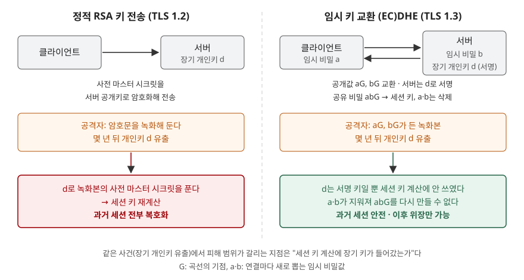

> **실행 검증 없음.** 정의는 인터넷 보안 용어집(RFC 4949)에서, TLS에서의 성질은 TLS 1.2·1.3 명세(RFC 5246, RFC 8446)와
> 보안 사용 권고(RFC 9325)에서 가져왔다. 성능 수치는 쓰지 않았다. RFC 8446은 2026년 7월 같은 버전 번호의
> 개정판 RFC 9846으로 대체됐고, 이 글의 절 번호는 RFC 8446 기준이다.

## 들어가며

TLS 문제에서 "TLS 1.3은 정적 RSA를 없앴다"는 문장은 거의 매번 나온다. 그런데 **왜 없앴는지**를 한 단어로 대라면 그게 전방 비밀성이다. 실무에서는 서버 개인키가 유출됐을 때 "지금까지 오간 트래픽도 다 풀리는가"를 판단하는 기준이 된다. 같은 유출 사고라도 키 교환 방식에 따라 피해가 "앞으로의 위장"에서 멈추기도 하고 "지난 몇 년 치 녹화본 전부"로 번지기도 한다.

## 정의

**전방 비밀성(Forward Secrecy)**: 키 합의 프로토콜에서 **장기 키가 유출되더라도 그 이전에 만든 세션 키는 노출되지 않는** 성질이다.

인터넷 보안 용어집(RFC 4949)은 이 성질을 "perfect forward secrecy(완전 전방 비밀성)" 항목에 정의하고, 장기 키 자료가 노출돼도 그것으로부터 앞서 유도한 세션 키는 노출되지 않는 성질이라고 적는다. 같은 항목은 **전문가 사이에 용어 정의가 일치하지 않았다**는 사실과, "perfect"라는 말이 붙은 것이 적절치 않았다며 빼자는 의견이 있다는 사실도 함께 싣는다. 그래서 답안에서는 "전방 비밀성(PFS, 완전 전방 비밀성)"으로 두 이름을 같이 적는 편이 안전하다. TLS 보안 사용 권고(RFC 9325)도 이 용어를 RFC 4949의 뜻으로 쓴다고 용어 절(§2)에서 밝힌다.

TLS 1.3 명세의 보안 분석 부록(RFC 8446 Appendix E.1)은 같은 성질을 "장기 키에 대한 전방 비밀성"이라는 이름으로 핸드셰이크가 제공할 성질 목록에 넣고, **세션 키 자체가 지워져 있는 한**이라는 조건을 붙인다.

## 등장 배경

TLS 1.2까지 가장 흔하던 키 교환은 **정적 RSA 키 전송**이다. 클라이언트가 사전 마스터 시크릿을 만들어 서버 인증서의 RSA 공개키로 암호화해 보내고, 서버가 개인키로 푼다. 세션 키가 서버의 **장기 개인키 하나**에 묶이는 구조다.

TLS 1.2 명세의 보안 분석 부록(RFC 5246 Appendix F.1.1.2)은 이 구조의 결과를 그대로 적는다 — 서버의 정적 RSA 키가 유출되면 그 키로 보호된 **모든 세션**의 기밀성이 사라지고, 전방 비밀성을 원하면 DHE 스위트를 쓰라고 한다. 공격자가 암호문을 지금 녹화해 두고 몇 년 뒤 개인키를 손에 넣으면 녹화본이 전부 풀린다는 뜻이다. 인증서 안의 고정 DH 값을 쓰는 **정적 DH** 스위트도 서버 쪽 값이 바뀌지 않으므로 같은 문제를 안는다.

그래서 TLS 1.3은 정적 RSA와 정적 DH 스위트를 지웠다. 명세의 변경 요약(RFC 8446 §1.2)은 그 결과를 "공개키 기반 키 교환은 모두 전방 비밀성을 제공한다"로 정리한다.

## 구성요소 — 성립 조건 3가지와 TLS 1.3 절차 4단계

### 성립 조건 3가지

명세 문장에서 전방 비밀성이 성립하는 조건을 뽑으면 **3가지**다. RFC 8446 Appendix E.1의 "연결마다 새 (EC)DHE 키를 쓰면 출력 키가 전방 비밀이다", "세션 키가 지워져 있는 한", RFC 5246 Appendix F.1.1.3의 "핸드셰이크마다 새 키를 쓰면 전방 비밀성을 제공한다"를 묶은 것이다.

| 조건 | 내용 | 깨지는 경우 |
|---|---|---|
| ① 임시성 | 세션 키 계산에 **연결마다 새로 뽑은** 임시 비밀값을 쓴다 | 정적 RSA·정적 DH, 임시 키를 여러 연결에 재사용 |
| ② 역할 분리 | 장기 키는 **인증(서명)에만** 쓰고 세션 키 계산에 넣지 않는다 | 장기 키로 사전 마스터 시크릿을 암호화(RSA 키 전송) |
| ③ 삭제 | 임시 비밀값과 세션 키를 쓰고 나면 **지운다** | 메모리·디스크에 남김, 세션 티켓 암호화 키를 오래 유지 |

### TLS 1.3 (EC)DHE 절차 4단계

| 단계 | 메시지 | 하는 일 |
|---|---|---|
| ① 임시 키쌍 생성 | — | 클라이언트·서버가 각자 임시 비밀 a, b를 새로 뽑는다 |
| ② 공개값 교환 | ClientHello·ServerHello의 key_share | aG와 bG를 주고받고 각자 공유 비밀 abG를 계산한다 |
| ③ 인증 | CertificateVerify | 서버가 장기 개인키로 핸드셰이크 기록 전체에 서명한다. 장기 키는 여기만 쓰인다 |
| ④ 키 유도·삭제 | — | 공유 비밀에서 HKDF로 트래픽 키를 유도하고 a, b를 지운다 |

## 도식

> **출처**: [RFC 5246 Appendix F.1.1.2 RSA Key Exchange and Authentication, F.1.1.3 Diffie-Hellman Key Exchange with Authentication](https://www.rfc-editor.org/rfc/rfc5246#appendix-F.1.1.2), [RFC 8446 §1.2 Major Differences from TLS 1.2, Appendix E.1 Handshake](https://www.rfc-editor.org/rfc/rfc8446#appendix-E.1)

같은 사건(장기 개인키 유출)에서 결과를 가르는 것은 **세션 키 계산에 장기 키가 들어갔는가** 하나다. 오른쪽에서 유출된 개인키로 할 수 있는 일은 서명 위조, 즉 **앞으로의 연결에서 서버를 위장하는 것**뿐이다. 이미 끝난 연결은 a, b가 지워져 공유 비밀을 다시 만들 수 없다. 답안지에는 좌우 두 칸과 빨간·초록 결과 상자만 옮기면 된다.

## 비교

### 키 교환 방식별 전방 비밀성

| 방식 | 세션 키의 근거 | 전방 비밀성 | 근거 |
|---|---|---|---|
| 정적 RSA 키 전송 (1.2) | 서버 RSA 개인키 | 없음 | RFC 5246 F.1.1.2, 1.3에서 삭제 |
| 정적 DH (1.2) | 인증서 안의 고정 DH 값 | 없음 | 1.3에서 삭제 (RFC 8446 §1.2) |
| DHE·ECDHE (1.2·1.3) | 연결마다 새 임시 값 | 있음 | RFC 5246 F.1.1.3, RFC 8446 E.1 |
| PSK 단독 `psk_ke` (1.3) | 사전 공유 키 | 응용 데이터에 없음 | RFC 8446 §2.2, E.1 |
| PSK + (EC)DHE `psk_dhe_ke` (1.3) | 사전 공유 키 + 임시 값 | 있음 | RFC 8446 §2.2 |
| 0-RTT 조기 데이터 (1.3) | PSK에서만 유도한 키 | 없음, 연결 사이 재전송 방지도 없음 | RFC 8446 §2.3 |

### 유사 개념과의 대비

| 개념 | 무엇이 유출됐다고 보는가 | 무엇을 지키는가 |
|---|---|---|
| **전방 비밀성** | 장기 키 | **과거** 세션 키 |
| **키 갱신 후 전방 비밀성** (RFC 8446 Appendix E.2) | 연결 중 현재 트래픽 키 | 같은 연결에서 KeyUpdate **이전** 데이터 |
| **키 손상 위장 내성(KCI)** (RFC 8446 Appendix E.1) | 한쪽의 장기 키 | 그 당사자에게 **상대를 사칭**하는 것 |
| **인증** | — | 유출이 없는 동안 상대가 맞는지 |

전방 비밀성은 **미래를 지키지 않는다.** 장기 키가 유출된 뒤의 연결은 위장 공격에 열리므로, 유출을 알면 인증서 폐기와 재발급이 따로 필요하다.

## 적용 시 고려사항

1. **세션 티켓 암호화 키를 순환한다.** 서버가 자기 암호화한 티켓을 쓰면 티켓 암호화 키가 사실상 장기 키가 된다. TLS 1.3 명세의 보안 분석 부록(RFC 8446 Appendix E.1)은 재개용 PSK의 전방 비밀성이 티켓을 지울 수 있는 데이터베이스에 둘 때 의미가 크다고 적고, 보안 사용 권고(RFC 9325 §3.4)는 티켓 암호화 키를 주기적으로(예: 1주) 바꾸라고 요구한다.
2. **PSK 단독 모드와 0-RTT를 제한한다.** 재개 시 `psk_dhe_ke`를 쓰면 재개 연결에도 전방 비밀성이 남는다. 0-RTT 조기 데이터는 전방 비밀성도, 연결 사이의 재전송 방지도 없으므로(RFC 8446 §2.3) 재전송돼도 문제없는 요청에만 연다.
3. **임시 키를 재사용하지 않는다.** 구현이 성능을 이유로 (EC)DHE 비밀값을 여러 연결에 쓰면 조건 ①이 깨져, 그 값이 살아 있는 기간의 연결이 함께 노출된다. 명세의 전방 비밀성 문장은 "연결마다 새 키"를 전제로 한다(Appendix E.1).
4. **수동 복호화 장비는 동작하지 않는다.** 서버 개인키를 넘겨받아 녹화한 트래픽을 푸는 방식의 감시·분석 장비는 (EC)DHE에서 세션 키를 얻지 못한다. 가시성이 필요하면 프록시에서 TLS를 종단하는 구조로 바꿔야 한다.
5. **키 교환 알고리즘 자체가 깨지는 위협은 별개다.** 전방 비밀성은 장기 키 유출을 가정한 성질이다. 녹화된 aG, bG에서 abG를 계산할 수 있게 되는 공격(이산대수 풀이)은 이 성질로 막을 수 없다.

## 정리

- 정의 한 줄: **장기 키가 유출돼도 이미 만든 세션 키는 안전한 성질** (RFC 4949)
- 성립 조건 3가지 **"임·분·삭"** — 임시 키, 역할 분리(장기 키는 서명만), 사용 후 삭제
- TLS 1.2 정적 RSA·정적 DH는 없음, (EC)DHE는 있음. TLS 1.3은 정적 방식을 지워 공개키 키 교환 전부가 전방 비밀
- TLS 1.3의 예외 2가지 — PSK 단독 모드, 0-RTT 조기 데이터
- 지키는 것은 과거뿐. 유출 뒤 위장은 인증서 폐기로 따로 막는다

> 기출 답안: [기출문제 — TLS 프로토콜 구조와 핸드셰이크, TLS 1.2 취약점과 TLS 1.3 개선 사항](../../exam/2026-11-25-tls-handshake-tls12-weaknesses-tls13/index.md)
>
> 함께 보기: [타원곡선 암호(ECC) — 점 덧셈과 스칼라 곱, ECDH·ECDSA를 작은 체에서 계산하기](../2026-11-22-ecc-point-addition-ecdh-ecdsa-small-field/index.md)

## 참고 자료

- [RFC 4949, Internet Security Glossary, Version 2 (2007-08)](https://www.rfc-editor.org/rfc/rfc4949) — "perfect forward secrecy" 항목의 정의와 용어 사용 주석
- [RFC 5246, The Transport Layer Security (TLS) Protocol Version 1.2 (2008-08)](https://www.rfc-editor.org/rfc/rfc5246) — Appendix A.4.2 키 교환 방식, Appendix F.1.1.2 RSA 키 교환, F.1.1.3 DH 키 교환
- [RFC 8446, The Transport Layer Security (TLS) Protocol Version 1.3 (2018-08)](https://www.rfc-editor.org/rfc/rfc8446) — §1.2 TLS 1.2와의 주요 차이, §2.2 재개와 PSK, §2.3 0-RTT, §4.6.1 세션 티켓, §4.6.3 KeyUpdate, Appendix E.1·E.2 보안 성질
- [RFC 9846, The Transport Layer Security (TLS) Protocol Version 1.3 (2026-07)](https://www.rfc-editor.org/rfc/rfc9846) — RFC 8446을 대체하는 1.3 개정판
- [RFC 9325, Recommendations for Secure Use of TLS and DTLS, BCP 195 (2022-11)](https://www.rfc-editor.org/rfc/rfc9325) — §2 용어, §3.4 세션 재개와 티켓 키 순환, §4.1 정적 RSA 비권고
