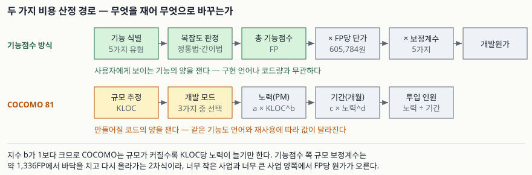

## 들어가며

공공 정보화 사업의 제안요청서를 받으면 예산 금액이 먼저 적혀 있다. 그 숫자가 어디서 나왔는지를
물으면 "기능점수로 뽑았다"는 답이 돌아온다. 반대로 사내 개발 일정을 잡을 때는 "이 정도면 몇
명이 몇 달" 같은 경험치를 쓴다. 전자는 **돈**을 뽑는 식이고 후자는 **노력과 기간**을 뽑는 식인데,
기술사 시험은 둘을 같은 문항 안에서 묻는다. 두 방식이 무엇을 재고, 같은 사업에서 왜 다른 답을
내는지가 이 주제의 핵심이다.

## 정의

- **기능점수(Function Point, FP)**: 사용자 관점에서 사용자가 요구하고 사용자에게 인도되는 기능을
  정량적으로 산정하는 소프트웨어 규모 측정 방법이다. 기능적 규모 측정(FSM)의 국제표준은
  ISO/IEC 14143이다.
- **COCOMO(COnstructive COst MOdel)**: 소프트웨어의 코드 규모(KLOC)를 입력으로 받아 노력(PM,
  person-month)과 기간을 회귀식으로 산출하는 비용 산정 모델이다. Boehm이 1981년에 제시했다.

한 문장으로 끊으면 이렇다. **기능점수는 "사용자에게 보이는 기능의 양"을 재고, COCOMO는
"만들어질 코드의 양"을 잰다.**

## 등장 배경

1970년대의 산정은 코드 라인 수(LOC)에 기댔다. 문제는 셋이었다. 첫째, 설계가 끝나기 전에는
LOC를 알 수 없어서 **가장 필요한 시점인 기획 단계에서 쓸 수 없다.** 둘째, 같은 기능도 언어에
따라 LOC가 몇 배로 갈린다. 셋째, 코드를 많이 쓸수록 값을 많이 받는 구조라 **생산성을 올릴수록
손해**가 된다.

기능점수는 이 세 가지를 모두 피해 간다. 요구사항만 정의되면 셀 수 있고, 구현 언어와 무관하며,
같은 기능을 짧게 짜도 값이 줄지 않는다. 한국에서는 LOC 방식이 2009년 고시 개정으로 폐지되고
기능점수 방식이 원칙으로 남았다.

## 기능점수 산정 절차 — 6단계

대가산정 가이드가 정한 단계는 **6단계**다.

1. **사전준비** — 개발 대상 업무와 기능 요구사항을 정의하고, 산정 방법(정통법·간이법)을 정한다
2. **기능점수 산정** — 기능을 식별하고 복잡도를 매겨 총 기능점수를 구한다
3. **보정전 개발원가 산정** — `기능점수 × 기능점수당 단가`
4. **보정후 개발원가 산정** — `보정전 개발원가 × 보정계수`
5. **직접경비 및 이윤 산정** — 이윤은 개발원가의 25% 이내
6. **소프트웨어 개발비 산정** — `개발원가 + 직접경비 + 이윤`

기능 유형은 **5가지**다. 데이터 기능 2가지(내부논리파일 ILF, 외부연계파일 EIF)와 트랜잭션 기능
3가지(외부입력 EI, 외부출력 EO, 외부조회 EQ)다.

복잡도를 매기는 방법은 **2가지**다. 기능마다 데이터요소유형(DET)과 레코드요소유형(RET) 또는
참조파일유형(FTR)을 세어 낮음·보통·높음을 가리는 **정통법**, 평균복잡도 가중치 하나를 일률
적용하는 **간이법**이다. 가중치는 아래와 같다.

| 기능유형 | 간이법(평균) | 정통법 낮음 | 보통 | 높음 |
|---|---|---|---|---|
| 내부논리파일 ILF | 7.5 | 7 | 10 | 15 |
| 외부연계파일 EIF | 5.4 | 5 | 7 | 10 |
| 외부입력 EI | 4.0 | 3 | 4 | 6 |
| 외부출력 EO | 5.2 | 4 | 5 | 7 |
| 외부조회 EQ | 3.9 | 3 | 4 | 6 |

보정계수는 **5가지**다. 규모, 연계복잡성, 성능 요구수준, 운영환경 호환성, 보안성 수준.

## COCOMO의 구성 — 3단계 × 3모드

COCOMO 81은 **3단계**로 쓴다. 비용 요인 없이 규모만 쓰는 **기본형(Basic)**, 15개 비용 요인으로
노력조정계수(EAF)를 곱하는 **중간형(Intermediate)**, 공정 단계별 영향까지 반영하는
**발전형(Detailed)**이다.

개발 **모드는 3가지**다.

| 모드 | 성격 | 기본형 a | b | c | d |
|---|---|---|---|---|---|
| 유기형(organic) | 익숙한 업무, 작은 팀, 느슨한 제약 | 2.4 | 1.05 | 2.5 | 0.38 |
| 반결합형(semi-detached) | 중간 규모, 혼합된 경험 | 3.0 | 1.12 | 2.5 | 0.35 |
| 내장형(embedded) | 강한 하드웨어·규제 제약 | 3.6 | 1.20 | 2.5 | 0.32 |

노력 `PM = a × KLOC^b`, 기간 `TDEV = c × PM^d`, 평균 인원 `PM ÷ TDEV`로 이어진다.

COCOMO II(2000)는 데스크톱·재사용·상용 부품 사용을 반영해 다시 보정한 후속 모델이고,
Post-Architecture 모델에서 **5개 스케일 요인**과 **17개 노력 승수**를 쓴다.

## 도식



> **출처**: [소프트웨어사업 대가산정 가이드 2024년 개정판](https://data.cmpi.or.kr/program/board/%5B2024.05.13%5D%20%EC%86%8C%ED%94%84%ED%8A%B8%EC%9B%A8%EC%96%B4%EC%82%AC%EC%97%85%20%EB%8C%80%EA%B0%80%EC%82%B0%EC%A0%95%20%EA%B0%80%EC%9D%B4%EB%93%9C.pdf) 표 3-5·3-21의 산정 절차 및 B. Boehm, *Software Engineering Economics*(1981)의 기본형 계수

## 직접 계산해 본 것

계산 기록: [`code/output.txt`](code/output.txt) · 소스: [`code/`](code/)

### 간이법과 정통법은 총합에서 서로 비슷해진다

가상의 시스템(ILF 12·EIF 4·EI 26·EO 10·EQ 16)을 두 방법으로 세었다.

```text
  간이법 총 기능점수     330.0 FP
  정통법 총 기능점수     337.0 FP
  차이                    +7.0 FP  (+2.1%)

  기능유형별 대조 (간이법 / 정통법)
    ILF  개수  12개 →    90.0 /   118.0
    EIF  개수   4개 →    21.6 /    22.0
    EI   개수  26개 →   104.0 /    96.0
    EO   개수  10개 →    52.0 /    47.0
    EQ   개수  16개 →    62.4 /    54.0
```

총합 차이는 2.1%뿐인데 **유형별로는 방향이 갈린다.** 데이터 기능에서는 간이법이 28.4FP 적게 잡고,
트랜잭션 기능에서는 21.4FP 많게 잡아 서로 상쇄된다. 간이법이 "대충 맞는" 이유가 여기 있고,
데이터 기능 비중이 큰 시스템에서는 상쇄가 안 되어 간이법이 과소 산정 쪽으로 기운다는 뜻도 된다.

### 규모 보정계수는 단조 감소가 아니다

규모 보정계수 식은 `0.4057 × (ln(FP) − 7.1978)² + 0.8878`이다. 흔히 "규모가 커지면 단가가
내려간다"고 외우는데, 실제로 그려 보면 **2차식이라 바닥을 친 뒤 다시 올라간다.**

```text
  기능점수   규모보정계수   FP당 보정후 원가(원)
       500         1.2800            775,389
       800         0.9946            602,541
     1,336         0.8878            537,815
     2,000         0.9537            577,750
     5,000         1.5940            965,645
    20,000         3.8578          2,337,009

  식의 최소점   FP = e^7.1978 = 1,336.5 FP, 이때 계수 0.8878
  500FP 에서의 계수 1.2800 — 가이드가 하한으로 못박은 1.28 과 같은 값
```

최소점은 약 1,336FP이고, 가이드가 "500FP 미만은 1.28"이라고 못박은 값은 식에 500을 넣은 값과
정확히 같다. 즉 하한선은 임의의 숫자가 아니라 **곡선을 500FP에서 잘라 수평으로 눕힌 것**이다.

### COCOMO는 커질수록 단위당 노력이 늘기만 한다

```text
  KLOC    모드            노력(PM)    기간(개월)   평균 인원   KLOC당 노력
     10   organic              26.9         8.7         3.1          2.69
    100   organic             302.1        21.9        13.8          3.02
    400   organic            1295.3        38.1        34.0          3.24
     10   embedded             57.1         9.1         6.3          5.71
    400   embedded           4772.8        37.6       126.9         11.93
```

지수 `b`가 1보다 크므로 KLOC당 노력은 규모와 함께 **단조 증가한다.** 규모가 40배가 되어도
기간은 4.4배밖에 안 늘고 대신 평균 인원이 11배로 뛴다. "일정을 못 줄이면 사람을 넣는다"가
식에 그대로 박혀 있는 셈이다.

## 비교

| 구분 | 기능점수 방식 | COCOMO 81 |
|---|---|---|
| 재는 대상 | 사용자에게 인도되는 기능 | 작성될 코드 규모(KLOC) |
| 산출물 | 개발원가(금액) | 노력(PM), 기간, 인원 |
| 측정 가능 시점 | 요구사항 정의 직후 | 설계 이후(규모 추정 가능해야) |
| 구현 언어 의존 | 없음 | 큼 |
| 규모 대비 단위값 | 2차식, 약 1,336FP에서 최저 | 지수 1 초과, 단조 증가 |
| 조정 수단 | 보정계수 5가지 | 비용 요인 15가지(중간형) |
| 표준·근거 | ISO/IEC 14143, 대가산정 가이드 | Boehm의 회귀 모델(63개 사업) |

## 적용 시 고려사항

- **발주 단계에서는 간이법, 정산 단계에서는 정통법이 원칙이다.** 가이드는 재개발·유지관리
  대가 산정 시 정통법 적용을 원칙으로 둔다. 발주 때 간이법으로 잡은 규모를 그대로 정산에
  쓰면 데이터 기능 비중에 따라 한쪽으로 치우친다.
- **단가는 공표 시점마다 바뀐다.** 2024년 개정판 기준 기능점수당 단가는 605,784원이고, 분할
  발주 시에는 단계별 가중치(분석 19.0%·설계 24.0%·구현 32.0%·시험 25.0%)를 곱해 합산한다.
  답안에 숫자를 쓸 때는 **어느 판 기준인지를 함께 적는다.**
- **COCOMO의 입력인 KLOC을 어떻게 얻을지가 실제 난점이다.** 기능점수를 먼저 구하고 언어별
  환산 계수로 KLOC을 뽑는 방식이 널리 쓰이는데, 그 환산 계수 자체가 조직마다 다르다.
  환산 계수의 출처를 밝히지 않은 추정치는 근거가 되지 못한다.
- **두 방식을 섞어 검증하면 과소 산정을 잡아낼 수 있다.** 기능점수로 뽑은 금액을 인건비로
  환산해 COCOMO가 내놓은 노력과 맞춰 보는 식이다. 차이가 크면 요구사항 누락이나 모드
  선택 오류를 의심한다.
- **기능점수는 비기능 요구사항을 세지 않는다.** 성능·보안·호환성은 기능점수가 아니라
  보정계수가 흡수한다. 비기능 요구가 무거운 사업에서 보정계수를 보수적으로 잡으면
  그 비용이 어디에도 안 잡힌다.

## 정리

- 기능점수 산정은 **6단계**, 기능 유형은 **5가지**, 복잡도 판정은 **2가지**(정통법·간이법),
  보정계수는 **5가지**다. 두문자는 **"6-5-2-5"**로 묶는다.
- COCOMO 81은 **3단계**(기본형·중간형·발전형) × **3모드**(유기·반결합·내장)이고,
  중간형의 비용 요인은 **15가지**다.
- 기능점수는 기능의 양을, COCOMO는 코드의 양을 잰다. 전자는 언어 독립이고 후자는 아니다.
- 대가산정 가이드의 규모 보정계수는 2차식이라 약 1,336FP에서 최소이고 그 양쪽에서 올라간다.
  COCOMO는 지수가 1을 넘어 단위 규모당 노력이 단조 증가한다.
- 숫자를 답안에 쓸 때는 **어느 판·어느 모델 기준인지**를 함께 적는다.

## 참고 자료

- [소프트웨어사업 대가산정 가이드 2024년 개정판 (한국소프트웨어산업협회)](https://data.cmpi.or.kr/program/board/%5B2024.05.13%5D%20%EC%86%8C%ED%94%84%ED%8A%B8%EC%9B%A8%EC%96%B4%EC%82%AC%EC%97%85%20%EB%8C%80%EA%B0%80%EC%82%B0%EC%A0%95%20%EA%B0%80%EC%9D%B4%EB%93%9C.pdf)
- [ISO/IEC 14143-1:2007 — Functional size measurement](https://www.iso.org/standard/38931.html)
- B. Boehm, *Software Engineering Economics*, Prentice-Hall, 1981 (ISBN 0-13-822122-7)
- B. Boehm 외, *Software Cost Estimation with COCOMO II*, Prentice-Hall, 2000 (ISBN 0-13-026692-2)
