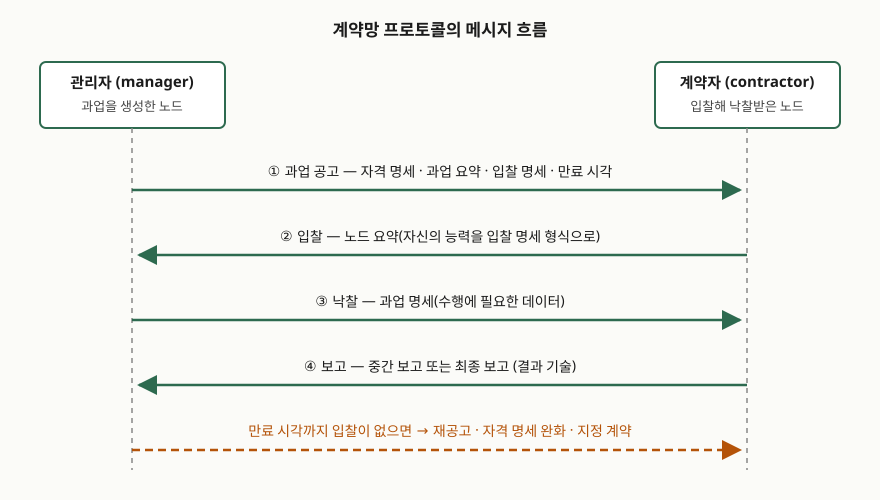

> 실행 검증 없음. 원 논문과 FIPA 표준 명세의 기술만 근거로 썼고, 측정값이나 실행
> 출력은 싣지 않았다.

## 들어가며

여러 처리 주체에게 일을 나눠 줄 때 가장 먼저 떠오르는 구조는 중앙 스케줄러다.
그런데 스케줄러는 "어느 주체가 이 일에 맞는지"를 미리 알아야 하고, 주체가 늘면
그 판단과 통신이 한곳에 몰린다. 어느 쪽이 적합한지를 당사자가 더 잘 아는 상황,
그리고 일이 동적으로 생겨나는 상황에서는 이 전제가 깨진다. 계약망 프로토콜은
1980년에 이 문제를 중앙 제어 없이 푸는 방법으로 제안된 규약이고, 오늘날 다중
에이전트 조정과 분산 과업 할당을 묻는 문항에서 거의 매번 원형으로 인용된다.

## 정의

**계약망 프로토콜은, 과업을 생성한 노드가 관리자(manager)가 되어 과업을 공고하고
수행 가능한 노드가 입찰하면 관리자가 낙찰해 계약을 맺는 방식으로, 분산 문제 해결의
연결 문제(connection problem)를 중앙 통제 없이 해결하는 상호작용 규약이다.**
원 논문은 노드 집합을 계약망(contract net)이라 부르고, 과업 하나의 수행을 두 노드
사이의 계약으로 다룬다. 각 노드는 개별 과업마다 **관리자 또는 계약자(contractor)**
중 하나의 역할을 맡으며, 역할은 노드에 고정되지 않는다.

원 논문은 이 규약이 전제하는 협상을 **4가지 요건**으로 정의한다. ① 중앙 통제를
거치지 않는 국소적 과정이고, ② 정보가 양방향으로 오가며, ③ 각 당사자가 자기
관점에서 상대 정보를 평가하고, ④ 최종 합의가 **상호 선택(mutual selection)** 으로
이루어진다. 네 번째가 핵심이다. 관리자만 고르는 것이 아니라 계약자도 공고를
순위 매겨 고르므로, 양쪽이 서로를 선택해야 계약이 성립한다.

## 등장 배경

연결 문제는 두 방향에서 동시에 발생한다. 과업을 가진 노드는 그 과업을 수행할 수
있는 노드를 찾아야 하고, 놀고 있는 노드는 자신이 수행할 수 있는 과업을 찾아야
한다. 전통적 작업 할당은 앞쪽만 본다 — 중앙이 "지금 가용한 가장 적절한 노드"에
배정한다. 원 논문은 이 방식이 두 가지에서 막힌다고 지적한다. 첫째, 배정 판단과
통신이 중앙에 몰려 병목이 된다. 둘째, 새 노드가 망에 들어오려면 기존 노드들과
명시적으로 연결돼야 한다.

비교 대상으로 든 선행 시스템 DCS는 이미 견적 요청과 입찰이라는 형태를 썼지만,
요청에는 실행할 프로세스 이름과 필요 메모리만 담겼고 입찰은 노드의 여유 메모리
한 값이었다. 평가 축이 하나로 고정돼 있었다는 뜻이다. 계약망 프로토콜은
**과업마다 평가 축이 다르다**는 점을 받아들여, 관리자가 "이 과업에서는 무엇을
근거로 고를 것인지"를 공고에 직접 적게 했다. 그래서 이 규약은 부하 분산보다
넓은 문제를 다룬다.

## 구성요소 — 공고의 4개 슬롯과 메시지 6종

과업 공고 메시지는 **4개 슬롯**으로 이루어진다.

| 슬롯 | 내용 | 역할 |
|---|---|---|
| 자격 명세 (eligibility specification) | 입찰하려면 갖춰야 할 조건 목록 | 받을 가치 없는 입찰을 미리 쳐낸다 |
| 과업 요약 (task abstraction) | 과업의 종류와 관리자의 위치 등 간략한 기술 | 계약자가 다른 공고들과 **순위를 매긴다** |
| 입찰 명세 (bid specification) | 입찰서에 담길 정보의 형식 | 입찰 간 비교 기준을 공통으로 만든다 |
| 만료 시각 (expiration time) | 입찰 접수 마감 시각 | 관리자가 기다릴 상한을 정한다 |

자격 명세는 수신자 슬롯의 확장이다. 관리자가 적합한 노드의 **이름을 알 때**는
수신자를 좁히는 집중 주소지정(focused addressing)으로 통신량을 줄이고, 이름은
모르지만 **조건을 기술할 수 있을 때**는 자격 명세로 좁힌다. 입찰 명세는 반대
방향으로 작동한다. 계약자가 자기 능력을 전부 적는 대신 이 과업에 관련된 것만
적게 하므로, 메시지가 짧아지고 관리자의 비교가 단순해진다.

기본 메시지는 **6종**이다 — 과업 공고, 입찰, 낙찰, 정보(information), 보고(report),
종료(termination). 보고는 과업이 부분 수행됐음을 알리는 **중간 보고**와 완료를
알리는 **최종 보고**로 나뉜다. 중간 보고는 생성기 방식의 제어에 쓰인다. 계약자가
결과 하나를 내고 과업을 멈춰 두었다가, 관리자가 정보 메시지로 지시하면 다음
결과를 만든다.

## 절차 — 4단계

> **출처**: [R. G. Smith, "The Contract Net Protocol: High-Level Communication and Control in a Distributed Problem Solver", IEEE Transactions on Computers C-29(12), pp. 1104–1113 (1980)](https://doi.org/10.1109/TC.1980.1675516) — §IV-A The Basic Messages(과업 공고 4슬롯, 입찰의 노드 요약, 낙찰의 과업 명세, 보고·종료 메시지)

① **공고** — 과업을 생성한 노드가 전체 방송, 제한 방송, 점대점 중 하나로 공고한다.
② **순위·입찰** — 각 노드는 받은 공고의 자격 명세를 검사해 자격이 되면 종류별로
순위 목록에 넣어 두고, 자기 처리기가 비면 그중 하나에 입찰한다. 입찰서의 노드 요약
슬롯은 입찰 명세가 지정한 형식으로 자기 능력을 적는다. ③ **낙찰** — 관리자는 들어온
입찰을 순위 매기고, 만족스러운 입찰이 나오면 **만료 시각을 기다리지 않고 즉시**
낙찰한다. 평균 협상 시간이 줄어드는 지점이다. ④ **수행·보고** — 낙찰 메시지의 과업
명세 슬롯에 수행에 필요한 데이터가 담기고, 계약자는 중간·최종 보고로 결과를 돌려준다.

만료 시각까지 낙찰이 안 되면 선택지는 세 가지다 — 가장 나은 입찰자에게 낙찰하거나,
입찰이 아예 없었으면 재공고하거나, 받아들일 입찰이 없었으면 잠시 기다렸다 재공고한다.

확장도 **4가지**가 정의돼 있다. ① **즉시 응답 입찰** — 입찰이 하나도 안 들어올 때
원인을 알 수 없는 문제를 풀기 위해, 노드가 BUSY·INELIGIBLE·LOW RANKING 세 가지 중
하나로 즉시 답하게 한다. 전부 BUSY면 기다렸다 재공고하고, 전부 INELIGIBLE이면 자격
명세를 완화한다. ② **지정 계약** — 적합한 노드를 이미 알면 공고와 입찰을 건너뛰고
지정 낙찰을 보낸다. 이때는 받은 쪽이 거절할 수 있고, 거절 메시지에 거절 사유 슬롯이
붙는다. ③ **요청·정보 메시지** — 단순한 정보 전달은 협상 없이 요청·응답으로 끝낸다.
④ **노드 가용 메시지** — 망 부하가 높아 공고에 입찰이 붙지 않을 때, 유휴 노드가
거꾸로 자기를 알린다. 이때 상호 선택은 **양방향 대조**로 유지된다. 관리자는 가용
메시지의 자격 명세를 자기 과업 요약들과 맞춰 보고, 다시 과업의 자격 명세를 그 노드의
노드 요약과 맞춰 본 뒤, 둘 다 맞을 때만 지정 낙찰을 보낸다.

## 비교 — 원 규약과 FIPA 표준판

FIPA는 이 패턴을 상호작용 규약으로 표준화했다. 명세는 자신을 원 패턴의 **사소한
수정**이라 밝히면서, 더한 것이 **거절(rejection)과 확인(confirmation) 행위**라고
적는다. 그 한 문장이 두 판의 차이를 거의 전부 설명한다.

| | 원 규약 (Smith 1980) | FIPA 표준판 (SC00029H, 2002) |
|---|---|---|
| 공고 | 과업 공고 (4슬롯) | `cfp`, 마감은 `reply-by` 파라미터 |
| 응답 | 입찰. 입찰하지 않으면 **무응답** | `propose` 또는 명시적 `refuse` |
| 탈락 통보 | **없다.** 통신량 증가를 이유로 두지 않았다 | `reject-proposal`로 탈락을 알린다 |
| 낙찰 | 낙찰 메시지. 거절 불가(지정 계약만 예외) | `accept-proposal`. 제안은 수락 시 구속력을 갖는다 |
| 완료 | 중간 보고 / 최종 보고 / 종료 메시지 | `inform-done`, `inform-result`, 실패 시 `failure` |
| 마감 처리 | 늦은 입찰도 치명적이지 않다 — 차선 선택에 그친다 | 늦은 제안은 **늦었다는 사유로 자동 거절** |
| 중단 | 관리자의 종료 메시지 | `cancel` 메타 프로토콜. 참여자가 `inform-done` 또는 `failure`로 답한다 |
| 대화 식별 | 계약 번호 슬롯 | 전역 유일한 `conversation-id`를 개시자가 부여 |

원 규약이 탈락 통보를 두지 않은 것은 설계 실수가 아니라 **의도된 교환**이다. 원
논문은 탈락을 알리면 입찰자가 여럿일 때 메시지가 크게 늘고, 그 이득도 만료 전에
낙찰된 계약에만 생긴다고 적는다. 대신 입찰을 구속력 있게 두고 한 노드가 여러 입찰을
걸 수 있게 했으므로, **한 노드가 낙찰을 여럿 받는 상황**을 받아들인다. 그 비용은
부하가 덜 고르게 퍼진다는 것이다. FIPA는 반대쪽을 골랐다. 거절·확인 행위를 넣어
각 대화의 종결을 명확히 하는 대신 메시지 수를 늘렸다.

## 적용 시 고려사항 — 5가지

1. **공고 방향을 부하에 따라 뒤집어야 한다.** 부하가 높으면 모든 노드가 바빠
   공고에 입찰이 붙지 않고, 공고만 채널을 채운다. 이때 중요한 사건은 "과업이
   생겼다"가 아니라 "노드가 비었다"이므로 노드 가용 메시지 쪽이 맞는다. 원 논문도
   어느 모드를 쓸지는 망 부하에 달렸다고 적는다
2. **상호 선택을 깨뜨리지 않아야 한다.** 역방향 흐름에서도 자격 명세와 노드 요약을
   양쪽으로 맞춰 보는 이유가 이것이다. 한쪽 판단만으로 배정하면 그 순간 이 규약은
   중앙 스케줄러와 같아지고, 당사자가 더 잘 아는 정보를 쓰지 못한다
3. **슬롯 내용을 해석할 공통 언어가 전제된다.** 원 논문은 모든 노드가 이해하는
   공통 노드간 언어를 두고, 객체·속성·값 표현과 미리 정의된 도메인 독립 용어를
   제공한다. 도메인 고유 용어는 사용자가 보태야 한다. 오늘의 에이전트 구조에서
   능력 기술 스키마를 먼저 맞추는 일이 이 자리에 해당한다
4. **과업 단위가 너무 잘면 협상 비용이 이득을 넘는다.** 원 논문은 계약으로 수행되는
   과업이라는 개념 자체가 **비교적 큰 과업 크기**를 시사한다고 적는다. 분산으로 얻는
   속도 향상이 분산시키는 노력에 묻히지 않으려면 분할 단위를 먼저 정해야 한다
5. **만료 시각은 최적성이 아니라 종료성을 위한 장치다.** 원 규약에서 늦은 입찰은
   최악이라도 차선 선택에 그친다. 반면 FIPA판은 개시자가 무한정 기다리는 것을 막기
   위해 `reply-by`를 두고 늦은 제안을 자동 거절한다. 어느 쪽을 따르는지에 따라
   재시도·타임아웃 설계가 달라지므로 구현 전에 정해야 한다

## 정리

암기 단서는 **"공–입–낙–보"**(공고·입찰·낙찰·보고) 네 단계와, 공고 슬롯의
**"자–과–입–만"**(자격 명세·과업 요약·입찰 명세·만료 시각) 넷이다.

- 정의: 관리자–계약자 역할을 과업마다 맡아 공고·입찰·낙찰로 연결 문제를 중앙 통제
  없이 푸는 상호작용 규약
- 협상의 4가지 요건: 국소성, 양방향 정보 교환, 각자의 관점에서 평가, 상호 선택
- 공고의 4개 슬롯: 자격 명세, 과업 요약, 입찰 명세, 만료 시각
- 기본 메시지 6종: 공고, 입찰, 낙찰, 정보, 보고(중간·최종), 종료
- 확장 4가지: 즉시 응답 입찰(BUSY·INELIGIBLE·LOW RANKING 3종), 지정 계약,
  요청·정보 메시지, 노드 가용 메시지
- FIPA판이 더한 것: 거절(`refuse`, `reject-proposal`)과 확인(`accept-proposal`,
  `inform-done`) 행위, `reply-by` 마감, `conversation-id`, `cancel` 메타 프로토콜
- 고려사항 5가지: 부하에 따른 방향 전환, 상호 선택 유지, 공통 언어 전제,
  과업 크기, 만료 시각의 성격

> 기출 답안: [기출문제 — 다중 에이전트 시스템이 기업 업무 구조에 미치는 영향](../../exam/2026-10-16-multi-agent-system-enterprise/index.md)

## 참고 자료

- [R. G. Smith, "The Contract Net Protocol: High-Level Communication and Control in a Distributed Problem Solver", IEEE Transactions on Computers C-29(12), pp. 1104–1113 (1980)](https://doi.org/10.1109/TC.1980.1675516) — 규약의 원 출처. §IV가 메시지와 슬롯, §IV-B가 확장 4가지를 정의한다
- [FIPA Contract Net Interaction Protocol Specification, SC00029H, Standard (2002-12-03)](http://www.fipa.org/specs/fipa00029/SC00029H.html) — §1.1 Explanation of the Protocol Flow와 §1.2 Exceptions to Interaction Protocol Flow
- [FIPA Communicative Act Library Specification, SC00037J](http://www.fipa.org/specs/fipa00037/) — `cfp`·`propose`·`refuse`·`accept-proposal`·`reject-proposal`·`inform-done`의 정의
- [FIPA Iterated Contract Net Interaction Protocol Specification, SC00030H](http://www.fipa.org/specs/fipa00030/SC00030H.html) — 여러 차례 입찰을 되풀이하는 확장판
- [J. Odell, H. Van Dyke Parunak, B. Bauer, "Representing Agent Interaction Protocols in UML", Agent-Oriented Software Engineering, Springer, pp. 121–140 (2001)](https://doi.org/10.1007/3-540-44564-1_8) — FIPA 명세의 규약 도식이 따르는 표기법
