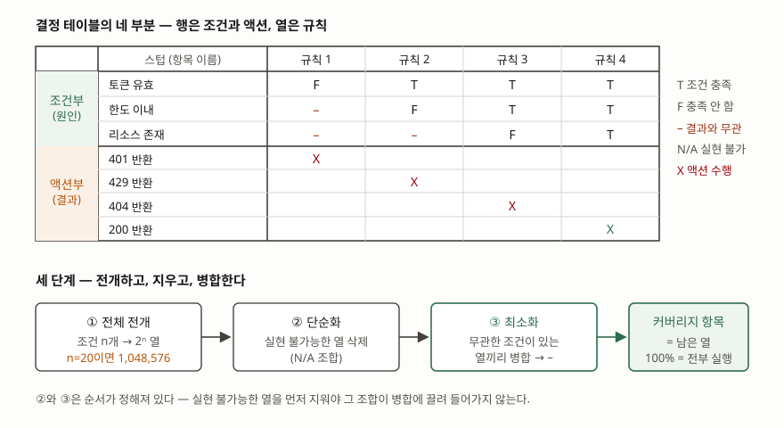

> 전체 전개·실현 불가능 열 삭제·열 병합을 파이썬으로 계산해 검산했다. 계산 기록은
> [code/output.txt](code/output.txt)에 있다. 표기법과 커버리지 정의는
> ISTQB CTFL Syllabus v4.0.1(2024-09-15)의 결정 테이블 테스팅 절(§4.2.3)을, 기법 분류는
> ISO/IEC/IEEE 29119-4:2021을 근거로 했다.

## 들어가며

요구사항 명세에 "유효한 토큰이 있고, 호출 한도를 넘지 않았고, 요청한 리소스가 있으면 200을
반환한다"는 문장이 들어 있다고 하자. 테스트 케이스를 뽑을 때 대부분 정상 흐름 하나와 토큰이
없는 경우 하나를 적고 넘어간다. 조건이 셋이면 조합은 여덟 가지인데 둘만 적은 것이고, 더
나쁜 것은 **몇 가지를 빠뜨렸는지조차 모른다**는 점이다. 결정 테이블 테스팅은 이 "모른다"를
없애는 기법이다. 조건의 조합을 빠짐없이 적어 놓고 시작하므로, 빠진 것이 있으면 표에서
빈칸으로 드러난다.

## 정의

ISTQB CTFL v4.0.1은 결정 테이블을 **조건의 조합이 서로 다른 결과로 이어지는 방식을 기록하는
표**로 설명한다(§4.2.3). 조건과 액션이 행이 되고, 각 열이 **조건의 고유한 조합과 그에 딸린
액션을 묶은 결정 규칙(decision rule)** 하나에 대응한다.

답안 첫 줄은 이렇게 끊는다. **결정 테이블 테스팅은 요구사항의 조건과 액션을 행으로, 조건의
고유한 조합을 열로 전개한 표를 만들어, 실현 가능한 열마다 테스트 케이스를 하나씩 도출하는
명세 기반(블랙박스) 테스트 설계 기법이다.**

국제표준에서는 ISO/IEC/IEEE 29119-4:2021이 이 기법을 명세 기반 테스트 설계 기법의 하나로
두고(§5.2.6), 커버리지 측정을 따로 규정한다(§6.2.6).

## 등장 배경

동등 분할과 경계값 분석은 **입력 하나하나를 따로 본다.** 나이를 구간으로 나누고 각 구간의
대표값과 경계값을 뽑는 식이다. 이 방식은 입력끼리 **상호작용**할 때 무너진다. 할인율이
회원 등급과 결제 수단과 구매 금액의 조합으로 정해지면, 세 입력을 각각 분할해 봐야 어느
조합이 어느 할인율을 내는지는 나오지 않는다.

조합을 다루려면 조합을 적는 수밖에 없고, 그 적는 방식을 정해 둔 것이 결정 테이블이다.
ISTQB는 이 기법의 강점을 **조합을 체계적으로 식별해 놓치는 것을 막고, 그 과정에서 요구사항의
공백과 모순을 찾아낸다**는 두 가지로 적는다. 두 번째가 실무에서 더 자주 쓸모 있다. 표를
채우다 보면 "이 조합일 때 뭘 해야 하는지 명세에 없다"가 반드시 몇 개 나온다.

## 구성요소 — 네 부분

| 부분 | 무엇이 들어가는가 | 표기 |
|---|---|---|
| ① 조건 스텁 | 조건의 이름 (원인) | 행 이름 |
| ② 조건 항목 | 각 규칙에서 그 조건의 값 | `T` 충족 / `F` 미충족 / `–` 무관 / `N/A` 실현 불가 |
| ③ 액션 스텁 | 액션의 이름 (결과) | 행 이름 |
| ④ 액션 항목 | 각 규칙에서 그 액션을 수행하는가 | `X` 수행 / 빈칸 미수행 |

값을 참·거짓으로만 적으면 **제한 진입(limited-entry) 결정 테이블**, 숫자 범위나 동등
분할이나 이산값을 적으면 **확장 진입(extended-entry) 결정 테이블**이다(§4.2.3).

## 도식



> **출처**: [ISTQB Certified Tester Foundation Level Syllabus v4.0.1 §4.2.3 Decision Table Testing (2024-09-15)](https://www.istqb.org/wp-content/uploads/2024/11/ISTQB_CTFL_Syllabus_v4.0.1.pdf) — 표기법(`T`·`F`·`–`·`N/A`·`X`), 전체 테이블·단순화·최소화의 구분, 커버리지 항목 정의. 아래 `–` 자리의 값은 [code/output.txt](code/output.txt)의 계산 결과다

답안지에는 위쪽 표 하나와 아래 세 칸만 그리면 된다.

## 절차 — 세 단계

**① 전체 전개.** 전체 결정 테이블은 조건의 모든 조합을 덮을 만큼 열을 가진다. 조건이 n개면
열이 2ⁿ개다.

**② 단순화.** 실현 불가능한 조합의 열을 지운다. 같은 변수의 범위를 둘로 나눠 조건으로
세웠다면 둘 다 참인 조합은 만들 수 없다 — "만 19세 미만"과 "만 65세 이상"이 그렇다.

**③ 최소화.** 일부 조건이 결과를 바꾸지 않는 열끼리 하나로 묶는다. 묶인 자리는 `–`가 된다.
ISTQB는 최소화 알고리즘 자체를 범위 밖으로 두지만, 같은 액션을 내면서 조건 하나만 다른 열을
반복해 합치는 절차(Quine-McCluskey의 소항 생성과 같다)로 계산된다.

앞의 API 예제를 계산한 결과다.

```text
[예 1 · API 요청] 전체 결정 테이블 — 조건 3개, 열 8개 (2^3)
                 1    2    3    4    5    6    7    8
토큰 유효        T    T    T    T    F    F    F    F
한도 이내        T    T    F    F    T    T    F    F
리소스 존재      T    F    T    F    T    F    T    F
액션           200  404  429  429  401  401  401  401

[예 1 · API 요청] 병합 후 — 열 4개 (조건 순서: 토큰 유효, 한도 이내, 리소스 존재)
    T    T    T  →  200
    F    –    –  →  401
    T    T    F  →  404
    T    F    –  →  429
```

토큰이 없으면 나머지 두 조건은 결과를 바꾸지 못하므로 네 열이 한 열로 줄었다.
8열이 4열이 됐고, 테스트 케이스도 8개에서 4개가 된다.

**순서를 바꾸면 안 된다.** ②를 먼저 하지 않고 병합부터 하면, 실현 불가능한 조합이 병합에
끌려 들어가 "일어날 수 없는 상황"을 전제로 한 규칙이 만들어진다.

## 커버리지 — 무엇을 세는가

결정 테이블 테스팅의 **커버리지 항목은 실현 가능한 조건 조합을 담은 열**이고, 100%
커버리지는 그 열을 전부 실행하는 것이다. 커버리지는 `실행한 열 ÷ 실현 가능한 열`의
백분율로 측정한다(§4.2.3).

분모가 **전체 열이 아니라 실현 가능한 열**이라는 점이 시험에서 자주 틀리는 곳이다.
요금 구분 예제를 보면 분명하다.

```text
[예 2 · 요금 구분] 전체 결정 테이블 — 조건 2개, 열 4개 (2^2)
                  1    2    3    4
만 19세 미만    N/A    T    F    F
만 65세 이상    N/A    F    T    F
액션            N/A 학생 경로 일반
  실현 가능한 열 3개 / 전체 4개 → 100% 커버리지의 분모는 3
```

세 개를 실행하면 100%다. 4분의 3이라고 적으면 틀린다.

## 비교

| 기법 | 보는 것 | 커버리지 항목 | 조건 간 상호작용 |
|---|---|---|---|
| 동등 분할 | 입력 하나의 값 영역 | 동등 분할 하나하나 | 보지 않는다 |
| 경계값 분석 | 분할의 경계 | 경계값 하나하나 | 보지 않는다 |
| 결정 테이블 테스팅 | 조건의 조합과 그 결과 | 실현 가능한 열 | 전부 본다 |
| 원인-결과 그래프 | 조건과 결과의 논리 관계를 그래프로 | 그래프에서 유도한 규칙 | 전부 본다 |
| 상태 전이 테스팅 | 상태와 사건의 순서 | 상태·전이·전이 쌍 | 시간 순서를 본다 |

원인-결과 그래프(29119-4 §5.2.7)는 결정 테이블과 가장 가깝다. 논리 관계를 그래프로 먼저
그리고 거기서 결정 테이블을 유도한다는 점이 다르다. 조건 사이에 "A이면 반드시 B가 아니다"
같은 제약이 많을 때 그래프 쪽이 제약을 먼저 정리해 주므로 실현 불가능한 열을 덜 만든다.

상태 전이 테스팅은 축이 다르다. 결정 테이블은 **한 시점의 조합**을 보고, 상태 전이는
**시간에 따른 순서**를 본다. 같은 조합이라도 어떤 순서로 도달했는지에 따라 결과가 달라지는
기능이면 결정 테이블만으로는 부족하다.

## 적용 시 고려사항

- **조건 수가 늘면 열이 지수로 늘어난다.** 조건 10개면 1,024열, 20개면 1,048,576열이다.
  ISTQB는 이때 최소화한 결정 테이블을 쓰거나 **위험 기반으로 규칙을 골라 줄이는** 방법을
  든다. 더 앞단의 대응은 조건을 쪼개는 것이다 — 서로 독립인 조건 묶음을 찾아 표를 둘로
  나누면 2^(m+n)이 2^m + 2^n이 된다.
- **표를 채우다 빈칸이 나오면 그것이 결함 보고 대상이다.** 명세에 그 조합의 동작이 없다는
  뜻이므로 테스트 케이스를 지어내지 말고 요구사항 쪽에 질문을 넣는다. 결정 테이블의 값은
  테스트 케이스보다 이 질문에서 더 자주 나온다.
- **`–`와 `N/A`를 구분해 적는다.** `–`는 그 조합이 일어나지만 결과에 영향이 없다는 뜻이고,
  `N/A`는 그 조합 자체가 성립하지 않는다는 뜻이다. 둘을 섞으면 커버리지의 분모가 틀어진다.
- **최소화한 표로 테스트하면 결함 검출력이 떨어질 수 있다.** 병합된 열은 `–` 자리의 값을
  하나만 골라 실행하므로, 그 자리가 실제로는 결과에 영향을 주는데 명세가 틀렸던
  경우를 놓친다. 안전이 중요한 기능이면 최소화 전의 열로 테스트한다.
- **확장 진입 테이블의 칸에는 동등 분할을 넣는다.** 숫자 범위를 그대로 적으면 그 범위에서
  어느 값을 넣을지가 또 정해지지 않는다. 분할을 적고 대표값·경계값은 경계값 분석으로 뽑는다.

> 기출 답안: [기출문제 — 소프트웨어 테스트 7대 원리와 동등 분할·경계값 분석 테스트 케이스 설계](../../exam/2026-10-19-test-principles-equivalence-boundary/index.md)

## 정리

- 표는 **네 부분**: 조건 스텁·조건 항목·액션 스텁·액션 항목. 행이 조건과 액션, 열이 규칙.
- 절차는 **세 단계**: 전개(2ⁿ) → 단순화(실현 불가능 열 삭제) → 최소화(열 병합). 암기 단서는
  "**전·단·최**". 순서를 바꾸면 안 된다.
- 표기 **다섯 가지**: `T`·`F`·`–`(무관)·`N/A`(실현 불가)·`X`(액션 수행).
- 커버리지 항목은 **실현 가능한 열**. 분모는 전체 2ⁿ이 아니다.
- 강점 **둘**: 조합을 빠짐없이 식별한다, 요구사항의 공백과 모순을 드러낸다.
  약점 **하나**: 조건 수에 지수로 늘어난다.

## 참고 자료

- [ISTQB Certified Tester Foundation Level Syllabus v4.0.1 (2024-09-15)](https://www.istqb.org/wp-content/uploads/2024/11/ISTQB_CTFL_Syllabus_v4.0.1.pdf) — §4.2.3 결정 테이블 테스팅의 표기법·제한 진입과 확장 진입·전체 테이블과 최소화·커버리지 항목 정의, §4.2.4 상태 전이 테스팅 (1차)
- [ISO/IEC/IEEE 29119-4:2021 Software and systems engineering — Software testing — Part 4: Test techniques](https://www.iso.org/standard/79430.html) — §5.2.6 Decision table testing, §5.2.7 Cause-effect graphing, §6.2.6 Decision table testing coverage. 목차는 [VDE 미리보기](https://assets.vde-verlag.de/iec-normen/preview-pdf/info_isoiecieee29119-4%7Bed2.0%7Den.pdf)에서 확인했다 (1차)
