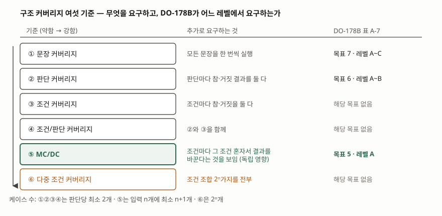
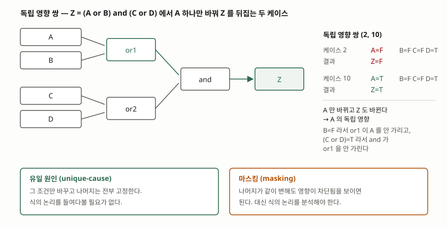

> 독립 영향 쌍과 최소 테스트 집합을 진리표 전수 계산으로 검산해, NASA/TM-2001-210876
> 부록 B 표 1의 값과 맞춰 봤다. 계산 기록은 [code/output.txt](code/output.txt)에 있다.
> 정의와 평가 절차는 같은 문서를, 기법 분류는 ISO/IEC/IEEE 29119-4:2021을 근거로 했다.

## 들어가며

단위 테스트 커버리지를 "분기 100%"로 잡고 통과시킨 코드에서 운영 중에 결함이 나오는 일이
있다. `if (a && b)` 한 줄이면 `a=T,b=T`와 `a=F,b=F` 두 케이스로 분기 커버리지가 100%가
되는데, 이 둘로는 `&&`가 `||`로 잘못 적혀 있어도 알 수 없다. 조건이 여럿 들어간 판단에서
커버리지 숫자와 실제로 검증된 것 사이가 벌어지는 지점이다. 항공 소프트웨어는 이 간극을
메우려고 조합을 전부 돌리는 대신 **조건 수에 비례하는 수의 케이스**로 같은 수준을 확보하는
기준을 쓴다. 그것이 MC/DC다.

## 정의

DO-178B 용어집은 **조건**을 논리 연산자를 포함하지 않는 불리언 식으로, **판단**을 조건과
0개 이상의 논리 연산자로 이루어진 불리언 식으로 정의한다. 판단 안에 같은 조건이 두 번
나오면 각각을 **별개의 조건으로 센다.**

MC/DC는 네 가지를 함께 요구한다. ① 프로그램의 모든 진입점과 종료점이 한 번씩 호출되고,
② 판단 안의 모든 조건이 가능한 결과를 모두 가져 보고, ③ 모든 판단이 가능한 결과를 모두
가져 보고, ④ **각 조건이 그 판단의 결과에 독립적으로 영향을 준다는 것이 보여져야 한다.**

답안 첫 줄은 이렇게 끊는다. **MC/DC는 조건/판단 커버리지에 더해, 판단 안의 각 조건이
단독으로 판단의 결과를 바꾼다는 것을 보이도록 요구하는 구조 커버리지 기준이다.**

ISO/IEC/IEEE 29119-4:2021은 이 기법을 구조 기반 테스트 설계 기법의 하나로 둔다(§5.3.6).

## 등장 배경

구조 커버리지 기준은 약한 것부터 강한 것까지 여섯 단계로 늘어선다. 가장 강한 **다중 조건
커버리지**는 판단 입력의 조합 2ⁿ가지를 전부 실행하라고 요구한다. 이론상 가장 바람직하지만
실무에서는 쓸 수 없다. NASA 튜토리얼의 연습문제는 입력 36개짜리 식을 초당 100건씩 돌리면
약 21.79년이 걸리고, 결과를 한 줄씩 출력하면 보고서 높이가 약 67.8마일이 된다고 계산한다.

MC/DC는 그 사이를 메우려고 만들어졌다. Chilenski와 Miller(1994)의 표현대로, **다중 조건
테스트의 이점을 상당 부분 얻으면서 케이스 수의 증가는 조건/판단 커버리지처럼 선형으로
유지**하는 것이 목적이다. 그 대가로 케이스를 아무렇게나 고를 수 없고, 어떤 쌍이
독립 영향을 보이는지 따져야 한다.

## 도식 — 여섯 기준과 DO-178B 목표



> **출처**: [Hayhurst, Veerhusen, Chilenski, Rierson, A Practical Tutorial on Modified Condition/Decision Coverage, NASA/TM-2001-210876 (2001-05)](https://shemesh.larc.nasa.gov/fm/papers/Hayhurst-2001-tm210876-MCDC.pdf) — 표 1(구조 커버리지의 종류), §2.3 목표 5·6·7과 적용 레벨, §2.3.5 MC/DC의 최소 n+1, §2.3.6 다중 조건 커버리지의 2ⁿ

DO-178B 부속서 A 표 A-7은 구조 커버리지를 세 목표로 나눈다. 문장 커버리지는 목표 7로
레벨 A~C에, 판단 커버리지는 목표 6으로 레벨 A~B에, **MC/DC는 목표 5로 레벨 A에만** 걸린다.
레벨 A는 고장이 항공기의 파국적 손실로 이어질 수 있는 소프트웨어다.

## 독립 영향 — 이 기준의 전부

나머지 세 요구는 다른 커버리지 기준에도 있다. MC/DC만 가진 것은 ④다.



> **출처**: [NASA/TM-2001-210876 부록 B Certification Authorities Software Team Position Paper on Masking MC/DC, 표 1 및 §3.2 Evaluation Method](https://shemesh.larc.nasa.gov/fm/papers/Hayhurst-2001-tm210876-MCDC.pdf) — 유일 원인·마스킹의 정의와 독립 영향 쌍. 쌍의 번호는 [code/output.txt](code/output.txt)의 계산 결과이며 같은 문서 표 1과 일치한다

독립 영향을 보이는 두 케이스를 **독립 영향 쌍(independence pair)** 이라 한다. 이것을 확인하는
방식이 둘이다.

- **유일 원인(unique-cause)**: 그 조건만 값을 바꾸고 나머지 조건은 전부 고정한다. DO-178B
  용어집이 기술한 원래 방식이다. 식의 논리를 분석할 필요가 없다는 것이 장점이다.
- **마스킹(masking)**: 다른 조건이 같이 변해도, 불리언 논리로 그 조건들이 결과에 영향을 주지
  못함을 보이면 된다. `and` 게이트는 입력 하나가 거짓이면 나머지를 가리고, `or` 게이트는
  입력 하나가 참이면 나머지를 가린다. 인증 당국 소프트웨어 팀(CAST)은 2001년에 마스킹
  방식도 DO-178B 목표 5를 충족하는 방법으로 인정했다.

`Z = (A or B) and (C or D)`로 계산한 결과다.

```text
[2] 조건별 독립 영향 쌍
  A: 유일 원인 [(2, 10), (3, 11), (4, 12)]
     마스킹에서만 추가로 성립 [(2, 11), (2, 12), (3, 10), (3, 12), (4, 10), (4, 11)]
  B: 유일 원인 [(2, 6), (3, 7), (4, 8)]
     마스킹에서만 추가로 성립 [(2, 7), (2, 8), (3, 6), (3, 8), (4, 6), (4, 7)]
  C: 유일 원인 [(5, 7), (9, 11), (13, 15)]
     마스킹에서만 추가로 성립 [(5, 11), (5, 15), (7, 9), (7, 13), (9, 15), (11, 13)]
  D: 유일 원인 [(5, 6), (9, 10), (13, 14)]
     마스킹에서만 추가로 성립 [(5, 10), (5, 14), (6, 9), (6, 13), (9, 14), (10, 13)]
```

유일 원인 쌍 열두 개는 NASA 튜토리얼 부록 B 표 1의 목록과 정확히 같다. 마스킹 쪽은
조건마다 여섯 쌍씩이 더 성립한다 — 예를 들어 C의 쌍 (5, 11)은 A와 C가 같이 바뀌지만,
두 케이스 모두 D가 거짓이라 `or2`가 C를 가리지 않고 `(A or B)`가 참이라 `and`가 `or2`를
가리지 않으므로 C의 효과가 Z까지 전달된다.

## 케이스 수 — n+1로 억제되는 이유

```text
[3] 최소 케이스 수 — 입력 4개
  유일 원인 MC/DC 최소 집합 (2, 5, 6, 7, 10) → 5개
  마스킹 MC/DC 최소 집합  (2, 5, 6, 11) → 4개
  n+1 = 5, 다중 조건 커버리지 2^n = 16
```

유일 원인 방식은 입력 n개에 **최소 n+1개**가 필요하다. 조건마다 "그 조건만 다른" 쌍이
있어야 하는데, 한 케이스를 여러 쌍이 나눠 쓸 수 있는 정도에 한계가 있기 때문이다. 위
계산에서도 입력 4개에 5개가 나왔다. 반면 마스킹 방식은 나머지 조건이 같이 바뀌어도 되므로
쌍끼리 케이스를 더 많이 공유할 수 있고, **이 식에서는 4개로 끝났다.** DO-178B 용어집이
기술한 것은 유일 원인 쪽이므로, 흔히 인용되는 n+1은 그 기준의 수치다.

조건 수가 늘면 두 기준의 차이가 벌어진다.

| 조건 수 n | MC/DC 최소 (n+1) | 다중 조건 커버리지 (2ⁿ) |
|---|---|---|
| 2 | 3 | 4 |
| 4 | 5 | 16 |
| 8 | 9 | 256 |
| 16 | 17 | 65,536 |
| 36 | 37 | 68,719,476,736 |

2입력 연산자 하나를 시험하는 데 필요한 최소 집합도 계산으로 확인했다. Chilenski와 Miller가
제시한 값 그대로다.

```text
[4] 2입력 연산자별 최소 테스트 집합 (Chilenski·Miller)
  and  1가지 — (FT, TF, TT)
  or   1가지 — (FF, FT, TF)
  xor  4가지 — (FF, FT, TF); (FF, FT, TT); (FF, TF, TT); (FT, TF, TT)
```

`and`와 `or`는 최소 집합이 하나뿐이라 선택의 여지가 없고, `xor`는 네 가지 중 아무거나
써도 된다. **`xor`는 입력이 언제나 출력에 전달되므로 마스킹이 일어나지 않기 때문이다.**

## 평가 절차 — 다섯 단계

NASA 튜토리얼이 제시하는 방법은 커버리지 도구 없이 사람이 확인할 수 있게 짜여 있다(§3.2).

| 단계 | 할 일 |
|---|---|
| ① 도식화 | 소스 코드의 판단을 논리 게이트 도식으로 그린다 |
| ② 매핑 | 요구사항 기반 테스트 케이스의 값을 도식의 각 선에 적는다 |
| ③ 마스킹 제거 | 상위 게이트에 가려 출력까지 전달되지 않는 케이스를 지운다 |
| ④ MC/DC 판정 | 게이트마다 최소 테스트 집합이 남아 있는지 대조해 모자란 케이스를 찾는다 |
| ⑤ 출력 확인 | 계산한 출력이 테스트의 기대 출력과 맞는지 본다 |

이 절차의 바탕은 논리 회로 시험에서 가져온 **제어 가능성(controllability)** 과
**관찰 가능성(observability)** 두 개념이다. 입력값을 정해 게이트를 시험할 수 있는가가
앞의 것이고, 그 게이트의 출력이 관찰 가능한 지점까지 전달되는가가 뒤의 것이다. ③이
관찰 가능성을, ④가 제어 가능성을 확인한다.

## 비교

| 기준 | 요구 | 케이스 수 | `(A or B)`에서 쓰는 집합 |
|---|---|---|---|
| 판단 커버리지 | 판단 결과 참·거짓 | 판단당 2개 | `TF`, `FF` — B의 효과는 시험되지 않음 |
| 조건 커버리지 | 조건마다 참·거짓 | 판단당 2개 | `TF`, `FT` — 판단은 둘 다 참 |
| 조건/판단 커버리지 | 위 둘을 함께 | 판단당 2개 | `TT`, `FF` — `A`·`B`·`A and B`와 구분 못 함 |
| MC/DC | 조건마다 독립 영향 | 입력 n개에 n+1개 | `TF`, `FT`, `FF` |
| 다중 조건 커버리지 | 조합 전부 | 2ⁿ개 | 네 조합 전부 |

포함 관계는 `다중 조건 ⊃ MC/DC ⊃ 조건/판단 ⊃ 조건·판단 ⊃ 문장`이다. MC/DC는 조건/판단
커버리지를 포함하므로 MC/DC 100%면 아래 기준은 자동으로 충족된다.

같은 "조합을 빠짐없이 본다"는 목표라도 **명세 쪽에서 접근하면
[결정 테이블 테스팅](../2026-10-23-decision-table-testing/index.md)이고, 코드 쪽에서
접근하면 MC/DC다.** 결정 테이블은 명세에 적힌 조건의 조합을 전부 열로 펼치고, MC/DC는
코드에 구현된 판단의 조건이 각각 제 몫을 하는지 본다. 29119-4가 둘을 명세 기반(§5.2.6)과
구조 기반(§5.3.6)으로 나눠 둔 이유다.

## 적용 시 고려사항

- **같은 조건이 판단에 두 번 나오면 독립 영향을 보일 수 없는 경우가 있다.** `(A and B) or
  (A and C)`는 입력 3개지만 조건은 4개로 센다. 앞의 `A`를 고정하고 뒤의 `A`만 뒤집는 일은
  보통 할 수 없다. 이런 결합(coupling)이 있으면 식을 고쳐 조건의 중복을 없애는 쪽이 낫다.
- **소스 코드에서 달성한 MC/DC가 목적 코드에서도 성립한다는 보장은 없다.** 컴파일러가
  소스 문장과 바로 대응하지 않는 코드를 만들면 레벨 A에서는 추가 검증이 필요하다
  (DO-178B §6.4.4.2b). 단축 평가(`&&`, `and then`)를 쓰면 평가 순서가 정해지므로 이
  분석이 간단해진다.
- **MC/DC는 요구사항 기반 테스트를 대신하지 않는다.** 구조 커버리지 분석은 "요구사항에서
  뽑은 테스트가 코드 구조를 충분히 훑었는가"를 묻는 검사이지, 그 자체가 테스트 설계 기법이
  아니다. 커버리지를 채우려고 구조만 보고 케이스를 만들면 의도하지 않은 기능을 찾아내는
  효과가 사라진다.
- **커버리지 미달은 네 가지 중 하나를 뜻한다.** 요구사항 기반 테스트가 모자라거나,
  요구사항이 모자라거나, 코드에 요구사항에 없는 기능이 들어 있거나, 코드가 틀렸다.
  숫자를 채우기 전에 어느 쪽인지부터 가린다.
- **도구를 쓰면 도구 자격 인정(tool qualification)이 따라온다.** 커버리지 도구의 판정을
  그대로 인증 근거로 쓰려면 그 도구가 올바로 판정한다는 것을 입증해야 한다. 다섯 단계
  절차는 도구 없이도 확인할 수 있게, 또 도구의 판정을 확인할 수 있게 만들어졌다.

> 기출 답안: [기출문제 — 소프트웨어 테스트 7대 원리와 동등 분할·경계값 분석 테스트 케이스 설계](../../exam/2026-10-19-test-principles-equivalence-boundary/index.md)

## 정리

- MC/DC는 **네 가지**를 요구한다: 진입·종료점 호출, 조건마다 모든 결과, 판단마다 모든 결과,
  **조건마다 독립 영향**. 앞 셋은 조건/판단 커버리지와 같고 넷째가 MC/DC다.
- 독립 영향을 보이는 방식 **둘**: 유일 원인(나머지 고정), 마스킹(영향 차단을 논리로 입증).
  암기 단서는 "**유·마**".
- 케이스 수는 입력 n개에 **최소 n+1개**. 다중 조건 커버리지의 2ⁿ을 n+1로 억제한 것이
  이 기준의 존재 이유다.
- DO-178B 표 A-7에서 **목표 5, 레벨 A 전용**. 목표 6은 판단 커버리지(레벨 A~B),
  목표 7은 문장 커버리지(레벨 A~C).
- 평가 **다섯 단계**: 도식화 → 매핑 → 마스킹 제거 → 판정 → 출력 확인.
  바탕 개념은 제어 가능성과 관찰 가능성 **둘**.

## 참고 자료

- [K. J. Hayhurst, D. S. Veerhusen, J. J. Chilenski, L. K. Rierson, A Practical Tutorial on Modified Condition/Decision Coverage, NASA/TM-2001-210876 (2001-05)](https://shemesh.larc.nasa.gov/fm/papers/Hayhurst-2001-tm210876-MCDC.pdf) — §1 DO-178B 표 A-7 목표 5, §2.3 구조 커버리지 여섯 종류와 목표·레벨 대응, §2.3.5 MC/DC와 n+1, §2.3.6 다중 조건 커버리지, §2.5.1 소스·목적 코드 커버리지, §2.6 DO-178B 용어집의 조건·판단·MC/DC 정의와 조건 결합, §3.2 다섯 단계 평가 절차와 제어·관찰 가능성, §3.6 단축 평가, 부록 A 연습문제 해답, 부록 B 마스킹 MC/DC에 관한 CAST 입장 문서와 표 1 (1차)
- [J. J. Chilenski, S. P. Miller, Applicability of modified condition/decision coverage to software testing, Software Engineering Journal, pp. 193–200 (1994-09)](https://doi.org/10.1049/sej.1994.0025) — MC/DC 원 논문. 연산자별 최소 테스트 집합의 출처이며, 본문에서는 위 NASA 문서 부록 B가 옮겨 적은 값을 근거로 삼았다. 유료라 본문은 보지 못했다 (1차)
- [ISO/IEC/IEEE 29119-4:2021 Software and systems engineering — Software testing — Part 4: Test techniques](https://www.iso.org/standard/79430.html) — §5.3.6 Modified condition/decision coverage (MCDC) testing, §5.3.5 Branch condition combination testing. 목차는 [VDE 미리보기](https://assets.vde-verlag.de/iec-normen/preview-pdf/info_isoiecieee29119-4%7Bed2.0%7Den.pdf)에서 확인했다 (1차)
