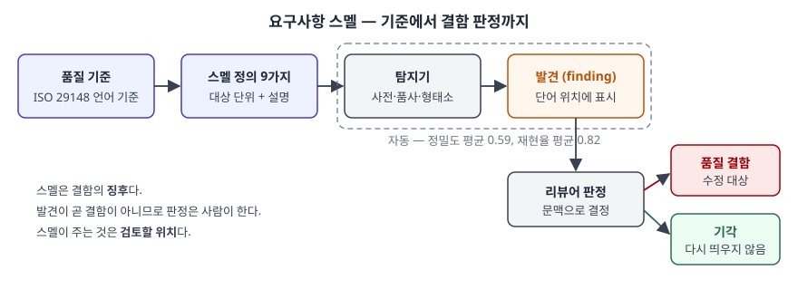

> 실행 검증 없음. 정의·스멜 목록·탐지 결과는 동료심사 논문(Femmer 외 2017) 원문에서
> 확인했다. ISO/IEC/IEEE 29148은 유료 표준이라 본문을 직접 읽지 않았고, 이 논문이 인용한
> **2011년판의 언어 기준 범위까지만** 썼다. 2018년판에서 이 목록이 바뀌었는지는 확인하지 못했다.

## 들어가며

요구사항 품질을 묻는 문항에서 "모호성을 없앤다"는 문장은 누구나 쓴다. 점수가 갈리는 것은
**모호함을 어디서 어떻게 찾는가**를 쓸 수 있느냐다. 요구사항 스멜은 그 답으로, 코드 정적
분석이 하던 일을 요구사항 문서에 옮겨 리뷰 전에 문제 위치를 먼저 짚어 준다. 리뷰가 늦게
돌아 결함이 설계·구현까지 넘어가는 문제를 앞단에서 줄이는 수단이다.

## 정의

**요구사항 스멜은 결함으로 이어질 수 있는 품질 위반의 징후로서, 구체적인 위치와 구체적인
탐지 수단을 갖는 것이다**(Femmer 외 2017, 용어 절 §3.1).

원 논문은 이 정의를 **4가지 성질**로 풀어 쓴다.

1. **품질 위반의 지표다** — 품질은 그 문서를 쓰는 후속 활동에 미치는 영향(사용 품질)으로 본다
2. **반드시 결함인 것은 아니다** — 문맥에 따라 판단하며, 리뷰 같은 후속 활동이 결정한다
3. **구체적인 위치가 있다** — 단어나 구절을 가리킨다. 완전성 같은 추상적 품질 특성과 다른 점이다
4. **구체적인 탐지 수단이 있다** — 정확도에 차이는 있어도 탐지 기법이 정해져 있다

같은 논문은 스멜의 한 사례를 **발견(finding)**, 문서에 실제로 나타난 위반을 **품질 결함**으로
구분한다. 스멜이 위반의 징후이듯 발견은 결함의 징후다.

## 등장 배경

배경은 2가지다. 첫째, 요구사항 품질 보증은 대부분 **사람의 리뷰**로 이루어지고, 리뷰는
비싸고 반복 주기가 길다. 결함이 늦게 드러날수록 고치는 비용이 커진다. 둘째, 표준이 정한
품질 특성은 "비모호해야 한다", "검증 가능해야 한다"처럼 **판정 기준이 추상적**이어서 문서의
어느 줄을 고쳐야 하는지 알려주지 않는다.

코드 쪽에는 이미 답이 있었다. Fowler와 Beck이 *Refactoring* 에서 제시한 코드 스멜은 "언제
리팩토링할 만큼 품질이 낮은가"를 객관적으로 정할 수 없다는 전제에서, 표면에 드러나는
징후로 판단을 돕는 개념이다. Femmer 외는 이 발상을 요구사항으로 옮기면서, 기준으로
ISO/IEC/IEEE 29148:2011의 **요구사항 언어 기준**을 택했다. 이 표준이 IEEE 830 등 기존
표준을 조화시켜 만든 것이라 합의 수준이 높고, 언어 기준을 어기면 검증이 어렵거나 여러
해석이 가능한 요구사항이 된다고 적고 있기 때문이다.

## 구성요소 — 언어 기준에서 도출한 스멜 9가지

| # | 스멜 | 대상 단위 | 무엇이 문제인가 | 탐지 기법 |
|---|---|---|---|---|
| 1 | 주관적 언어 | 단어 | "사용하기 쉬운", "비용 효율적인"처럼 의미가 객관적으로 정해지지 않음 | 사전 |
| 2 | 모호한 부사·형용사 | 부사·형용사 | "거의 항상", "상당한", "최소한의"처럼 본래 불특정함 | 사전 |
| 3 | 빠져나갈 구멍 | 단어 | "가능한 한"처럼 지켜야 할 정도가 열려 있음 | 사전 |
| 4 | 열린·검증 불가 용어 | 단어 | "충분한 측정 정확도"처럼 선택지를 남겨 검증이 어려움 | 사전 |
| 5 | 최상급 | 부사·형용사 | 다른 **모든** 시스템과의 관계를 표현함 | 형태소 분석 또는 품사 태깅 |
| 6 | 비교급 | 부사·형용사 | **특정** 다른 시스템이나 이전 상태와의 관계를 표현함 | 형태소 분석 또는 품사 태깅 |
| 7 | 부정 서술 | 단어 | 제공하지 **않을** 기능을 서술해 그때의 반응이 빠지기 쉬움 | 품사 태깅 + 사전 |
| 8 | 모호한 대명사 | 대명사 | 대명사가 무엇을 가리키는지 불분명함 | 품사 태깅(대체 대명사) |
| 9 | 불완전한 참조 | 문서 참조 | 위치가 없어 독자가 따라갈 수 없는 참조 | 연구 범위 밖 |

정의는 9가지지만 **실제로 도구에 구현해 평가한 것은 8가지**다. 평가 대상 문서에 참조가
없어서 불완전한 참조는 도구에서 뺐다(§4.3). 답안에 "9가지 정의, 8가지 자동 탐지"로 쓰면
정확하다.

1~4번은 서로 겹친다. 원 논문도 주관적 언어·모호한 부사와 형용사·검증 불가 용어가 강하게
연관된다고 적는다. 주관적 언어는 모호성의 특수한 경우이고, 모호성은 결국 검증 문제로
이어지기 때문이다. 그래서 재현율은 이 갈래를 하나로 묶어 측정했다.

## 도식

> **출처**: [H. Femmer, D. Méndez Fernández, S. Wagner, S. Eder, "Rapid Quality Assurance with Requirements Smells", Journal of Systems and Software 123 (2017) §3.1 Requirements Smell terminology(Fig. 1), §4 Smella(Fig. 2), §6.2.3 RQ 2.1](https://arxiv.org/abs/1611.08847)

답안에는 상자 다섯 개면 된다. 기준 → 스멜 → 탐지기 → 발견 → 사람의 판정. **판정이
사람에게 있다**는 화살표 하나가 이 개념의 성격을 보여준다.

## 탐지 결과 — 스멜마다 정확도가 크게 갈린다

원 논문은 산업 3곳(자동차·화학·애자일 전문 기업)과 대학 1곳의 요구사항 문서에 도구를
적용했다. 정밀도는 사람이 발견을 하나씩 수용·기각해 쟀다(Table 7).

| 스멜 | 검토한 발견 | 수용 | 정밀도 |
|---|---|---|---|
| 주관적 언어 | 69 | 66 | 0.96 |
| 모호한 부사·형용사 | 21 | 17 | 0.81 |
| 빠져나갈 구멍 | 60 | 43 | 0.72 |
| 검증 불가 용어 | 23 | 16 | 0.70 |
| 최상급 | 39 | 19 | 0.49 |
| 비교급 | 88 | 42 | 0.48 |
| 부정 서술 | 129 | 42 | 0.33 |
| 모호한 대명사 | 187 | 48 | 0.26 |
| 평균 / 전체 | 77 / 616 | 36.6 / 293 | 0.59 / 0.48 |

재현율은 문서 4건, 약 16,000 단어를 사람이 직접 읽어 찾은 200건을 기준으로 쟀다(Table 8).
모호성 갈래 0.86, 최상급 0.50, 비교급 0.95, 부정 서술 0.84, 모호한 대명사 0.92로 평균
0.82다. 최상급은 4건뿐이라 저자들도 이 값을 조심해서 읽으라고 적는다.

읽을 것은 2가지다. **사전 기반 스멜이 정밀도가 높고, 문법 기반 스멜이 낮다.** 단어 목록과
맞춰 보는 것은 틀릴 여지가 적지만, 비교급이 숫자를 비교하는 정상적인 문장인지는 문법만으로
가려지지 않는다. 그리고 **놓친 원인은 대부분 언어 처리 라이브러리의 오류**였다. 표제어
추출이 복수형을 원형으로 돌리지 못했고, 형태소 분석이 비교급 굴절을 잘못 분류했다. 평가
문서가 굴절이 많은 독일어였다는 점도 저자들이 한계로 든다.

## 비교 — 이웃 개념과의 대비

| 구분 | 요구사항 스멜 | 코드 스멜 | 품질 특성(29148) | 품질 결함 |
|---|---|---|---|---|
| 대상 | 요구사항 문서의 문장 | 소스 코드 | 개별 요구사항·요구사항 집합 | 문서의 실제 위반 |
| 성격 | 징후 | 징후 | 판정 기준 | 확정된 문제 |
| 위치 | 단어·구절 | 함수·클래스 | 없음(추상) | 있음 |
| 탐지 | 사전·품사·형태소 자동 탐지 | 정적 분석 + 사람 | 리뷰·검사 | 스멜 발견의 사람 판정 |
| 기원 | Femmer 외(2017), 기준은 29148 | Fowler·Beck(*Refactoring*) | 표준 | — |
| 조치 | 문장 수정 또는 기각 | 리팩토링 | 기준에 맞게 재작성 | 수정 |

코드 스멜과 같은 점은 **징후라는 성격**이다. 둘 다 문제 자체가 아니라 들여다볼 곳을
알려준다. 다른 점은 **탐지 단위**다. 코드 스멜은 구조를 보지만, 요구사항 스멜은 자연어
단어를 보므로 언어 처리의 정확도가 곧 탐지의 한계가 된다.

## 적용 시 고려사항 — 4가지

1. **리뷰를 대체하지 않고 보완한다.** 원 논문의 결론도 리뷰의 보완 수단이다. 스멜은 겉으로
   드러나는 단어 문제만 잡고, 요구사항이 빠졌거나 서로 모순되는 것은 잡지 못한다
2. **스멜별로 켜고 끈다.** 정밀도가 0.26인 모호한 대명사를 그대로 띄우면 발견 4건 중 3건이
   헛것이다. 저자들은 거짓 경보 하나를 확인하는 데 몇 초면 된다고 보지만, 그것도 쌓이면
   리뷰어가 도구를 무시하게 된다. 정밀도가 높은 갈래부터 켠다
3. **사전은 조직과 언어에 맞춘다.** 사전 기반 탐지의 품질은 사전에 달려 있다. 한국어 문서라면
   "가급적", "적절한", "신속히" 같은 표현을 조직의 기준으로 모으고, 기각된 발견을 다시 사전에
   반영한다. 원 논문의 도구도 기각한 발견을 다시 띄우지 않는 기능을 둔다
4. **작성 시점에 돌린다.** 이 접근의 이름이 *빠른* 품질 보증인 이유다. 요구사항 관리 도구의
   저장 단계나 문서 저장소의 변경 검사에 붙여, 리뷰 회의 전에 작성자가 먼저 고치게 한다

## 정리

암기 단서는 **"징후·위치·수단, 9가지 정의 8가지 탐지, 정밀도 0.59 재현율 0.82"** 다.

- 정의: 결함으로 이어질 수 있는 품질 위반의 징후로서, 구체적 위치와 구체적 탐지 수단을 갖는 것
- 성질 4가지: 품질 위반의 지표, 결함과 동일하지 않음, 구체적 위치, 구체적 탐지 수단
- 스멜 9가지: 주관적 언어, 모호한 부사·형용사, 빠져나갈 구멍, 검증 불가 용어, 최상급,
  비교급, 부정 서술, 모호한 대명사, 불완전한 참조
- 탐지 기법 3갈래: 사전(4가지), 형태소·품사(최상급·비교급), 품사+사전(부정 서술·대명사)
- 고려사항 4가지: 리뷰 보완, 스멜별 선택, 사전 현지화, 작성 시점 적용

> 기출 답안: [기출문제 — 불명확한 요구사항이 만드는 품질저하를 기술부채·코드스멜·리팩토링으로 설명하기](../../exam/2026-10-16-unclear-requirements-debt-smell-refactoring/index.md)
>
> 관련 개념: [리팩토링 — 코드 스멜 분류와 적용 시점](../2026-10-03-refactoring-code-smells-when-to-apply/index.md) ·
> [요구공학 — 도출부터 검증까지 4단계](../2026-09-18-requirements-engineering-four-phases/index.md)

## 참고 자료

- [H. Femmer, D. Méndez Fernández, S. Wagner, S. Eder, "Rapid Quality Assurance with Requirements Smells", Journal of Systems and Software 123, pp. 190–213 (2017)](https://doi.org/10.1016/j.jss.2016.02.047) — §3.1 정의와 4가지 성질, §3.2 스멜 9가지, §4 탐지 도구, Table 7 정밀도, Table 8 재현율. [arXiv 사전 인쇄본](https://arxiv.org/abs/1611.08847)
- [ISO/IEC/IEEE 29148:2011, *Systems and software engineering — Life cycle processes — Requirements engineering*](https://www.iso.org/standard/45171.html) — 요구사항 언어 기준. 유료 표준이라 위 논문의 인용 범위에서만 사용
- [Martin Fowler, "CodeSmell" (2006-02-09)](https://martinfowler.com/bliki/CodeSmell.html) — 코드 스멜의 정의
