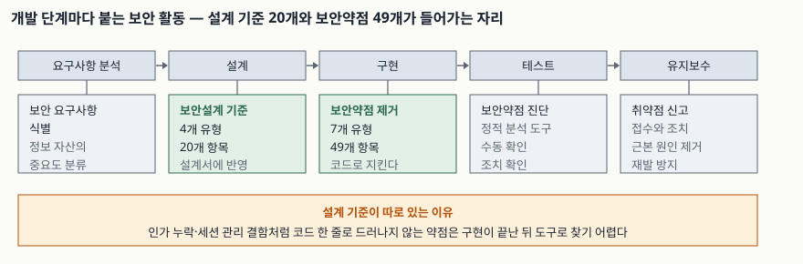

> **실행 검증 없음.** 이 글은 공개된 표준·가이드 문서의 근거만으로 쓴다. 측정값이나 도구 실행
> 결과는 싣지 않는다.

## 들어가며

보안 사고가 나면 가장 먼저 나오는 조치가 "시큐어 코딩 교육"이다. 개발자를 모아 SQL 삽입과
크로스사이트 스크립트를 설명하고, 정적 분석 도구를 붙이고, 진단 결과를 0건으로 만든다. 그런데
다음 점검에서 또 걸린다. 이번에는 권한 확인이 빠진 관리자 기능이고, 그다음은 로그아웃 뒤에도
살아 있는 세션이다.

도구가 못 찾는 것이 아니라 **코드 한 줄로 드러나지 않는 약점**이기 때문이다. "이 기능은 누가
호출할 수 있는가"는 설계에서 정해지고, 코드는 그 결정을 따라 쓰였을 뿐이다. 개발보안이
구현 단계가 아니라 생명주기 전체를 다루는 이유가 여기에 있다. 시험에서도 "시큐어 코딩"과
"개발보안"을 같은 말로 쓴 답안은 범위를 좁게 잡은 답안으로 읽힌다.

## 정의

- **소프트웨어 개발보안(Software Development Security)**: 소프트웨어 개발 생명주기(SDLC)
  전반에서 보안약점을 줄여 안전한 소프트웨어를 만드는 활동을 말한다
  ([소프트웨어 개발보안 가이드 §1.1 배경](https://www.kisa.or.kr/2060204/form?postSeq=5&lang_type=KO)).
- **시큐어 코딩(Secure Coding)**: 그중 **구현 단계**에서 보안약점을 만들지 않거나 제거하는
  활동이다. 개발보안의 부분집합이다.
- **보안약점(Weakness)과 보안취약점(Vulnerability)**: 보안약점은 공격에 악용될 **수 있는**
  소스코드·설계상의 결함이고, 보안취약점은 그 약점이 실제 공격 경로로 성립한 상태다.
  답안에서 둘을 섞어 쓰지 않는다.
- **SDL(Security Development Lifecycle)**: 마이크로소프트가 자사 개발 공정에 보안 활동을
  넣어 만든 프로세스다. 현재 공개된 활동은 **10가지**다
  ([Microsoft SDL Practices](https://www.microsoft.com/en-us/securityengineering/sdl/practices)).
- **SSDF(Secure Software Development Framework)**: 특정 생명주기 모델에 매이지 않고 보안
  활동만 뽑아 정리한 미국 NIST의 프레임워크다
  ([NIST SP 800-218](https://csrc.nist.gov/pubs/sp/800/218/final)).

## 등장 배경

경계 방어가 다루지 못하는 영역이 남는다는 것이 출발점이다. 방화벽은 들어오는 트래픽이 정상
요청인지 공격인지를 응용 수준에서 판단하지 못한다. 정상 입력란에 정상 형식으로 들어온 문자열이
질의문으로 해석되는 일은 네트워크 계층에서 보이지 않는다. 개발보안 가이드의 배경 절은 최근
사이버 공격 시도의 **약 75%**가 소프트웨어 보안약점을 악용한다고 적는다.

국내 제도는 세 걸음으로 자리를 잡았다. 2009년부터 개발 단계의 보안약점 진단·제거 연구가
시작됐고, 2009~2011년에 전자정부 지원사업을 대상으로 진단 시범사업이 돌았으며, 그 결과를
반영해 **2012년에 소프트웨어 개발보안 제도가 도입**되고 단계적으로 의무화됐다.

## 구성요소

### 설계단계 — 보안설계 기준 4개 유형 20개 항목

| 유형 | 항목 수 | 예 |
|---|---|---|
| 입력데이터 검증 및 표현 | 10 | DBMS 조회 및 결과 검증, 업로드·다운로드 파일 검증 |
| 보안기능 | 8 | 인증 대상 및 방식, 암호키 관리, 중요정보 전송 |
| 에러처리 | 1 | 예외처리 |
| 세션통제 | 1 | 세션통제 |

### 구현단계 — 보안약점 7개 유형 49개 항목

| 유형 | 항목 수 | 대표 약점 |
|---|---|---|
| 입력데이터 검증 및 표현 | 17 | SQL 삽입, 크로스사이트 스크립트, 서버사이드 요청 위조 |
| 보안기능 | 16 | 부적절한 인가, 하드코드된 중요정보, 솔트 없이 일방향 해시 함수 사용 |
| 시간 및 상태 | 2 | 경쟁 조건(TOCTOU), 종료되지 않는 반복문 |
| 에러처리 | 3 | 오류 메시지 정보노출, 부적절한 예외 처리 |
| 코드오류 | 5 | Null Pointer 역참조, 신뢰할 수 없는 데이터의 역직렬화 |
| 캡슐화 | 4 | 제거되지 않고 남은 디버그 코드 |
| API 오용 | 2 | DNS lookup에 의존한 보안 결정, 취약한 API 사용 |

**세션통제는 설계 기준에만 있고 구현 유형에는 없다.** 반대로 시간 및 상태, 코드오류, 캡슐화,
API 오용은 구현 유형에만 있다. 두 목록을 같은 것으로 외우면 개수를 틀린다.

### SSDF — 4개 그룹 19개 활동 42개 태스크

| 그룹 | 뜻 | 활동 수 |
|---|---|---|
| PO (Prepare the Organization) | 조직의 사람·프로세스·도구를 준비한다 | 5 |
| PS (Protect the Software) | 산출물을 변조·무단 접근에서 보호한다 | 3 |
| PW (Produce Well-Secured Software) | 취약점이 적은 소프트웨어를 만든다 | 8 |
| RV (Respond to Vulnerabilities) | 남은 취약점에 대응하고 재발을 막는다 | 3 |

## 도식

> **출처**: [소프트웨어 개발보안 가이드 제3장 분석·설계단계 보안강화 활동, 제4장 구현단계 시큐어 코딩 가이드, 부록 제1·2절 (KISA, 2021.12)](https://www.kisa.or.kr/2060204/form?postSeq=5&lang_type=KO)

## 비교

| 구분 | 국내 개발보안 가이드 | NIST SSDF 1.1 | Microsoft SDL |
|---|---|---|---|
| 성격 | 발주·감리를 전제한 적용 기준 | 생명주기 중립적 활동 목록 | 한 기업의 개발 공정 |
| 구성 단위 | 유형 → 보안약점 항목 | 그룹 → 활동 → 태스크 | 활동 |
| 개수 | 설계 4유형 20항목 / 구현 7유형 49항목 | 4그룹 19활동 42태스크 | 10활동 |
| 초점 | **무엇을 없앨 것인가**(약점 목록) | **무엇을 할 것인가**(활동 목록) | 공정에 끼워 넣는 실행 방법 |
| 강제성 | 공공 정보화 사업에 적용 | 권고. 미국 연방 조달에서 참조 | 사내 표준 |
| 기준 시점 | 2021년 12월판 | 2022년 2월 | 2026년 10월 확인 |

세 문서는 경쟁 관계가 아니다. **약점 목록과 활동 목록은 서로를 대체하지 못한다.** 49개 항목을
다 외워도 "누가 언제 진단하고 누가 승인하는가"는 나오지 않고, SSDF의 19개 활동을 다 해도
"이 코드의 어느 줄이 약점인가"는 나오지 않는다.

## 적용 시 고려사항

- **진단 도구의 범위를 먼저 확인한다.** 정적 분석은 데이터 흐름이 코드 안에서 닫히는 약점에
  강하고, 인가 누락이나 세션 설계 결함처럼 **의도를 알아야 판단되는 약점**에는 약하다. 도구
  결과 0건을 설계 결함이 없다는 뜻으로 읽지 않는다.
- **오탐과 미탐을 함께 관리한다.** 오탐이 많으면 개발자가 결과를 보지 않게 되고, 그 순간부터
  미탐은 보이지도 않는다. 오탐을 예외 처리할 때 **근거와 승인자를 남기는 절차**를 같이 만든다.
- **설계 산출물에 보안 기준을 반영했는지 확인할 수단을 둔다.** 20개 설계 기준은 설계서에
  반영되지 않으면 추적할 곳이 없다. 요구사항 추적표에 보안 요구사항을 같은 형식으로 올린다.
- **외부 구성요소를 범위에 넣는다.** 직접 쓴 코드가 깨끗해도 가져다 쓴 라이브러리가 취약하면
  결과는 같다. SSDF가 산출물 보호(PS)와 취약점 대응(RV)을 따로 둔 이유가 이쪽이다.
- **운영 중 발견을 되먹임한다.** 같은 유형의 약점이 반복되면 개인의 실수가 아니라 표준이나
  프레임워크의 문제다. 공통 모듈로 막을 수 있는지를 먼저 본다.

## 정리

- 개수로 외운다. **설계 4유형 20항목 · 구현 7유형 49항목 · SSDF 4그룹 19활동 42태스크 ·
  SDL 10활동.**
- 구현 7유형은 **입·보·시·에·코·캡·API**로 묶는다 (입력데이터 검증 및 표현 / 보안기능 /
  시간 및 상태 / 에러처리 / 코드오류 / 캡슐화 / API 오용).
- 설계 4유형은 **입·보·에·세**다. 구현 유형과 달리 세션통제가 들어가고 나머지 셋이 빠진다.
- 시큐어 코딩 ⊂ 개발보안이다. 답안 첫 줄에서 범위를 구분하면 그 뒤가 쉬워진다.
- 약점 목록(국내 가이드)과 활동 목록(SSDF·SDL)은 묻는 것이 다르다. 비교 문항이 나오면
  "무엇을 없앨 것인가 대 무엇을 할 것인가"로 축을 잡는다.

## 참고 자료

- [KISA — 소프트웨어 개발보안 가이드 (2021.12)](https://www.kisa.or.kr/2060204/form?postSeq=5&lang_type=KO)
- [NIST SP 800-218 — Secure Software Development Framework (SSDF) Version 1.1](https://csrc.nist.gov/pubs/sp/800/218/final)
- [Microsoft — Security Development Lifecycle Practices](https://www.microsoft.com/en-us/securityengineering/sdl/practices)
- [KISA — 소프트웨어 보안약점 진단가이드](https://www.kisa.or.kr/2060204/form?postSeq=9&page=1)
