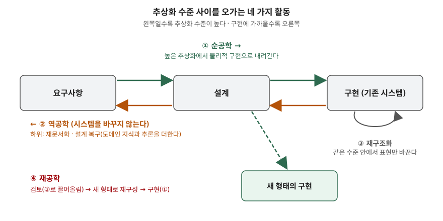

> **실행 검증 없음.** 이 글은 원 논문과 저자 문서의 정의만으로 쓴다. 측정값이나 도구 실행 결과는
> 싣지 않는다.

## 들어가며

20년 된 시스템을 넘겨받으면 설계서는 없거나 코드와 맞지 않고, 처음 만든 사람은 회사에 없다.
이때 나오는 말이 "역공학해서 재공학한다"인데, 실무에서는 두 단어가 섞여 쓰인다. 시험에서는
이 둘을 가르는 것이 출제 의도다. **역공학은 시스템을 바꾸지 않고, 재공학은 바꾼다.** 이 한 줄과
추상화 수준을 오가는 방향을 쓰지 못하면 나머지 항목을 다 써도 정의 문항에서 점수가 깎인다.

## 정의

용어는 IEEE 컴퓨터학회의 역공학 위원회 분류 작업을 정리한 Chikofsky·Cross의 논문
([IEEE Software 7(1), 1990](https://doi.org/10.1109/52.43044))이 기준이다. 새 용어를 만든 것이
아니라 이미 쓰이던 용어를 정리한 논문이다.

- **역공학(Reverse Engineering)**: 대상 시스템을 분석해 ① 구성요소와 그 상호관계를 식별하고
  ② 시스템을 다른 형태나 **더 높은 추상화 수준**으로 표현하는 과정. 검토하는 과정이며 시스템을
  바꾸지 않는다.
- **재공학(Reengineering)**: 대상 시스템을 검토해 **새 형태로 재구성하고 그 형태를 구현하는 것**.
  renovation, reclamation이라고도 부른다.

## 등장 배경

소프트웨어는 쓰이는 동안 계속 바뀌어야 하고, 바뀔수록 구조가 복잡해진다. Lehman이 소프트웨어
진화 법칙의 첫째(지속적 변경)와 둘째(복잡도 증가)로 정리한 현상이다(Proceedings of the IEEE
68(9), 1980). 유지보수가 쌓이면 문서와 코드가 어긋나고, 코드가 유일하게 믿을 수 있는 산출물이 된다.

종래에는 개발을 요구사항 → 설계 → 구현의 한 방향으로만 다뤘다. 그러나 유지보수 단계에서는
**구현에서 거꾸로 설계를 알아내는 일**이 먼저 필요했고, 이를 부르는 말이 업계마다 달랐다.
1990년 논문이 이 용어들을 생명주기의 추상화 수준을 축으로 정리했다.

## 구성요소 — 4개 활동, 6개 용어

| # | 활동 | 추상화 수준 이동 | 시스템 변경 |
|---|---|---|---|
| 1 | **순공학** (Forward Engineering) | 높음 → 낮음. 구현 독립적 설계에서 물리적 구현으로 | 새로 만든다 |
| 2 | **역공학** (Reverse Engineering) | 낮음 → 높음 | 바꾸지 않는다 |
| 2-1 | └ 재문서화 (Redocumentation) | 같은 수준에서 의미가 같은 표현을 새로 만들거나 고친다 | 바꾸지 않는다 |
| 2-2 | └ 설계 복구 (Design Recovery) | 관찰 결과에 **도메인 지식·외부 정보·추론**을 더해 상위 추상화를 식별한다 | 바꾸지 않는다 |
| 3 | **재구조화** (Restructuring) | 같은 수준. 의미와 외부 동작을 보존하며 표현 형태를 바꾼다 | 내부만 바꾼다 |
| 4 | **재공학** (Reengineering) | 낮음 → 높음 → 낮음. 역공학으로 끌어올린 뒤 변환하고 순공학으로 내려온다 | 새 형태로 바꾼다 |

재공학의 흐름은 먼저 더 높은 추상화 수준의 명세를 만들고, 설계 수준에서 변환을 적용한 뒤
순공학으로 내려오는 순서다([P. Klint, What is software renovation?](https://homepages.cwi.nl/~paulk/publications/FASE99.html/node4.html)).

재문서화는 같은 수준에서 일어나는데도 역공학의 하위로 분류된다. **시스템을 바꾸지 않고
이해를 위한 표현만 만든다**는 점이 묶는 기준이다. 설계 복구는 코드만 봐서는 나오지 않는
"왜 이렇게 했는가"를 찾으므로 사람의 지식이 들어간다.

같은 논문은 역공학의 목적을 **6가지**로 든다 —
① 복잡도 대처, ② 대안 관점 생성, ③ 잃어버린 정보 복구, ④ 부작용 탐지, ⑤ 상위 추상화 합성,
⑥ 재사용 촉진 ([논문 요약, Georgia Tech](https://sites.cc.gatech.edu/morale/tools/isvis/2009/summaries/Reverse_Engineering_and_Design_Recovery_A_Tax.pdf)).

## 도식

> **출처**: [Chikofsky & Cross, Reverse Engineering and Design Recovery: A Taxonomy, IEEE Software 7(1) pp.13-17 (1990)](https://doi.org/10.1109/52.43044), [Georgia Tech 역공학 용어 정리 (같은 논문 기준)](https://sites.cc.gatech.edu/reverse/bibliography/terminology.html)

답안에는 박스 세 개(요구사항·설계·구현)를 가로로 놓고, 위에 오른쪽 화살표(순공학), 아래에
왼쪽 화살표(역공학), 구현 박스에 제자리 고리(재구조화), 설계에서 새 구현으로 내려가는 점선(재공학)을
그리면 된다.

## 비교

| 구분 | 역공학 | 재구조화 | 리팩토링 | 재공학 | 재개발(대체) |
|---|---|---|---|---|---|
| 목적 | 이해 | 내부 품질 개선 | 내부 품질 개선 | 새 형태로 전환 | 새 시스템으로 교체 |
| 기존 시스템 | 그대로 둔다 | 외부 동작 보존 | 외부 동작 보존 | 기능을 이어받아 바꾼다 | 버린다 |
| 추상화 이동 | 위로 | 없음 | 없음 | 위로 갔다 아래로 | 아래로만 |
| 산출물 | 문서·모델·설계 | 바뀐 코드·구조 | 작은 변환의 연속 | 새 구현 | 새 구현 |
| 근거 | Chikofsky & Cross | Chikofsky & Cross | Fowler | Chikofsky & Cross | — |

리팩토링은 Fowler가 "기존 코드를 재구조화하는 규율 있는 기법"으로 정의한다
([refactoring.com](https://refactoring.com/)). 재구조화의 한 방식이며, 작은 변환마다 테스트로
동작 보존을 확인하는 점이 다르다. 재구조화와 리팩토링의 차이는
[리팩토링 — 코드 스멜 분류와 적용 시점](../2026-10-03-refactoring-code-smells-when-to-apply/index.md)에서 다뤘다.

재개발은 기존 시스템을 검토하지 않고 요구사항부터 다시 내려오므로 역공학 단계가 없다. 재공학과
가르는 기준이 이것이다.

## 적용 시 고려사항

- **역공학 결과의 신뢰 수준을 표시한다.** 코드에서 기계적으로 뽑은 호출 관계와, 설계 복구로
  사람이 추론한 업무 규칙은 확실성이 다르다. 후자는 현업 확인을 거쳤는지 산출물에 남긴다.
- **재구조화 전에 외부 동작을 고정한다.** 정의의 조건이 "외부 동작 보존"이므로, 바꾸기 전에
  현재 동작을 기록하는 회귀 테스트가 없으면 보존했는지 증명할 수단이 없다.
- **재공학과 재개발 중 하나를 고를 근거를 남긴다.** 기존 시스템에 담긴 업무 규칙이 문서로 남아
  있지 않으면, 재개발은 그 규칙을 잃을 위험을 진다. 반대로 구조가 너무 낡아 역공학 비용이
  재개발 비용을 넘으면 재공학의 이점이 사라진다.
- **타사 소프트웨어의 역공학은 권리 범위를 먼저 본다.** 라이선스가 역분석을 금지할 수 있고,
  저작권법의 프로그램코드역분석 조항(제101조의4)은 **다른 프로그램과의 호환에 필요한 정보를
  얻는 목적**으로, 그 정보를 달리 얻기 어려울 때 필요한 부분에 한해 허용한다
  ([한국저작권위원회, 저작권법상 역분석 규정 연구](https://copyright.or.kr/eng/doc/quarterly_pdf/231%20Law%20and%20Policy%20Study%20on%20Reverse%20Engineering%20Provisions%20under%20the%20Copyright%20Act.pdf)).
  레거시 이해를 위한 역공학이 이 목적에 들어가는지는 따로 판단해야 한다.
- **자동화 도구의 한계를 안다.** 도구는 구성요소와 관계(역공학의 ①)는 잘 뽑지만, 설계 복구가
  요구하는 도메인 지식은 대신하지 못한다.

## 정리

- **"역은 안 바꾸고, 재는 바꾼다."** 역공학은 검토, 재공학은 검토 + 재구성 + 구현이다.
- **4활동 6용어**: 순공학 · 역공학(재문서화 · 설계 복구) · 재구조화 · 재공학.
- 방향으로 외운다 — 순공학 ↓, 역공학 ↑, 재구조화 →(제자리), 재공학 ↑ 후 ↓.
- 역공학 목적 6가지: **복·대·잃·부·상·재** (복잡도 대처 / 대안 관점 / 잃어버린 정보 /
  부작용 탐지 / 상위 추상화 / 재사용).
- 리팩토링 ⊂ 재구조화. 재개발은 역공학 단계가 없다는 점에서 재공학과 다르다.

## 참고 자료

- [E. J. Chikofsky, J. H. Cross II, Reverse Engineering and Design Recovery: A Taxonomy, IEEE Software 7(1) pp.13-17 (1990-01)](https://doi.org/10.1109/52.43044)
- [Georgia Tech — Reverse Engineering Terminology](https://sites.cc.gatech.edu/reverse/bibliography/terminology.html)
- [Georgia Tech — Reverse Engineering and Design Recovery: A Taxonomy 요약](https://sites.cc.gatech.edu/morale/tools/isvis/2009/summaries/Reverse_Engineering_and_Design_Recovery_A_Tax.pdf)
- [Martin Fowler — refactoring.com](https://refactoring.com/)
- [P. Klint — What is software renovation? (CWI)](https://homepages.cwi.nl/~paulk/publications/FASE99.html/node4.html)
- [한국저작권위원회 — Law and Policy Study on Reverse Engineering Provisions under the Copyright Act](https://copyright.or.kr/eng/doc/quarterly_pdf/231%20Law%20and%20Policy%20Study%20on%20Reverse%20Engineering%20Provisions%20under%20the%20Copyright%20Act.pdf)
- M. M. Lehman, Programs, Life Cycles, and Laws of Software Evolution, Proceedings of the IEEE 68(9) (1980)
