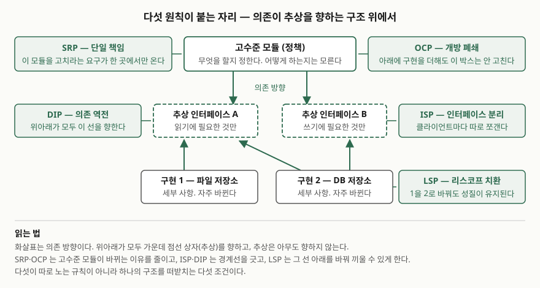

> 실행 검증 없음. 설계 원칙은 돌려 볼 대상이 아니므로 원전 문헌의 진술만을 근거로 정리했다.

## 들어가며

SOLID는 소프트웨어공학 과목에서 단답형으로도, 논술형의 한 중항목으로도 나온다.
단답형이면 다섯 가지를 빠짐없이 들고 각각을 한 줄로 끊는 것이 곧 점수다.
논술형에서는 유지보수성·확장성을 논할 때 근거로 끌어오게 된다.

실무에서 이 원칙들이 푸는 문제는 하나다. **요구사항이 바뀔 때 고쳐야 하는 파일의 수**다.
한 줄짜리 요구가 들어왔는데 스무 곳을 고쳐야 한다면 설계가 그렇게 만든 것이다.
다섯 원칙은 그 스무 곳을 한 곳으로 줄이는 서로 다른 각도의 조건이다.

## 정의

**SOLID는 객체지향 클래스 설계의 다섯 가지 원칙을 가리키는 두문자어다.**
단일 책임(SRP), 개방 폐쇄(OCP), 리스코프 치환(LSP), 인터페이스 분리(ISP),
의존 역전(DIP)의 머리글자를 모았다.

출처를 밝힐 때 주의할 점이 하나 있다. 로버트 C. 마틴의 2000년 논문
"Design Principles and Design Patterns"가 객체지향 클래스 설계 원칙으로 든 것은
**OCP·LSP·DIP·ISP 네 가지**이고, SRP는 이 논문의 클래스 설계 원칙 목록에 없다.
SRP는 마틴의 이후 저작에서 같은 이름으로 정리되고, SOLID라는 두문자어 자체는
2000년대 중반에 마이클 페더스가 붙인 것으로 알려져 있다.
**"마틴이 2000년에 SOLID를 발표했다"고 쓰면 사실과 어긋난다.**

## 등장 배경

같은 논문은 설계가 썩는 원인을 **의존 관계**로 지목한다. 변경이 설계를 망가뜨리는 이유는
새롭고 계획되지 않은 의존이 생기기 때문이고, 따라서 모듈 사이의 의존을 관리해야 한다는
것이 논문의 출발점이다. 다섯 원칙은 그 의존 관리를 각각 다른 자리에서 거는 조건이다.

절차적 설계에서 의존은 위에서 아래로, 정책에서 세부 사항으로 내려간다. 고수준 모듈이
저수준 모듈에 직접 기대므로, 저수준이 바뀔 때마다 고수준이 함께 흔들린다. 객체지향
구조는 이 방향을 뒤집어 양쪽이 모두 추상을 향하게 만든다.

## 구성요소 — 5가지

### ① SRP (Single Responsibility Principle) — 단일 책임

하나의 모듈은 **변경되어야 할 이유가 하나뿐**이어야 한다. 마틴은 여기서 "이유"가
사람이라고 설명한다. 변경을 요구하는 집단이 둘이면 책임도 둘이다.

- **위반**: `Employee` 클래스가 급여 계산·근태 보고서 출력·DB 저장을 모두 가진다.
  급여 규정이 바뀌어도, 보고서 양식이 바뀌어도, 스키마가 바뀌어도 이 파일을 고친다
- **고친 모습**: 계산·표현·저장을 셋으로 나눈다. 요구를 내는 집단과 클래스가 1:1로 붙는다

### ② OCP (Open-Closed Principle) — 개방 폐쇄

모듈은 **확장에는 열려 있고 변경에는 닫혀** 있어야 한다. 논문은 이 원칙을 객체지향 설계
원칙 가운데 가장 중요한 것으로 꼽고, 버트런드 마이어의 작업에서 비롯됐다고 밝힌다.
뜻은 간단하다. 모듈이 하는 일을 바꾸되 모듈의 소스 코드는 건드리지 않는다.

- **위반**: 결제 수단이 하나 늘 때마다 `switch (type)` 문에 분기를 하나 더 넣는다
- **고친 모습**: `PaymentMethod` 추상을 두고 구현을 더한다. 분기문이 있던 파일은 그대로다

### ③ LSP (Liskov Substitution Principle) — 리스코프 치환

하위 클래스는 **상위 클래스를 대신할 수 있어야** 한다. 원전인 Liskov·Wing의 치환 요구는
더 엄밀하다. 타입 T의 객체에 대해 증명할 수 있는 성질은 T의 하위 타입 S의 객체에 대해서도
참이어야 한다는 것이다. 논문은 이를 보장하는 조건을 **시그니처 규칙 3가지**(인자 반공변,
반환 공변, 예외 축소)와 **메서드 규칙 2가지**(사전조건, 사후조건)로 나눠 적는다. 합쳐 5가지다.

| 규칙 | 하위 타입에 요구되는 것 |
|---|---|
| 사전조건 | 상위 타입보다 **더 강해질 수 없다** (같거나 약하게) |
| 사후조건 | 상위 타입보다 **더 약해질 수 없다** (같거나 강하게) |
| 인자 타입 | 반공변 — 하위 타입 메서드의 인자 타입이 상위 타입의 것보다 **넓어야** 한다 |
| 반환 타입 | 공변 — 하위 타입 메서드의 반환 타입이 상위 타입의 것보다 **좁아야** 한다 |
| 예외 | 상위 타입이 알리는 예외 집합 안에 들어야 한다 |

- **위반**: `Rectangle`을 상속한 `Square`가 `setWidth`에서 높이까지 바꾼다.
  "너비를 바꿔도 높이는 그대로"라는 성질이 깨진다
- **고친 모습**: 상속을 끊고 `Shape` 추상 아래 둘을 나란히 둔다.
  논문은 LSP 위반을 억지로 `if (타입이 X라면)` 으로 막으면 그것이 곧 OCP 위반이 된다고 적는다

### ④ ISP (Interface Segregation Principle) — 인터페이스 분리

**클라이언트별 인터페이스 여럿이 범용 인터페이스 하나보다 낫다.** 한 클래스에 여러
클라이언트가 붙을 때, 모든 메서드를 한 덩어리로 싣는 대신 클라이언트마다 인터페이스를
따로 만들어 그 클래스가 함께 구현하게 한다.

- **위반**: `Printer` 인터페이스에 인쇄·스캔·팩스가 모두 들어 있어, 인쇄만 하는 기기가
  나머지를 빈 구현으로 채운다
- **고친 모습**: `Print`·`Scan`·`Fax`로 나눈다. 논문은 동시에 과용을 경계하며,
  클라이언트별·버전별로 쪼갠 인터페이스가 수백 개가 되는 쪽도 문제라고 적는다

### ⑤ DIP (Dependency Inversion Principle) — 의존 역전

**추상에 의존하고 구체에 의존하지 않는다.** 설계의 모든 의존은 인터페이스나 추상 클래스를
향해야 하고, 구체 클래스를 향하는 의존은 없어야 한다. 논문은 OCP가 목표를 말한다면
DIP는 그 목표를 이루는 주된 수단이라고 정리한다.

- **위반**: 주문 서비스가 `MySqlOrderRepository`를 직접 `new` 한다
- **고친 모습**: `OrderRepository` 추상에 기대고 구현은 바깥에서 넣는다.
  객체 생성이 구체 클래스를 피할 수 없는 지점이므로, 논문은 그 의존을
  추상 팩토리 패턴으로 한 곳에 몰라고 권한다

## 도식

> **출처**: [Robert C. Martin, Design Principles and Design Patterns (2000)](http://staff.cs.utu.fi/~jounsmed/doos_06/material/DesignPrinciplesAndPatterns.pdf) — Figure 2-18 (객체지향 구조의 의존 방향), Figure 2-20 (분리된 인터페이스), Figure 2-14 (LSP 도식)

## 비교

### SRP와 ISP — 자주 헷갈리는 짝

| | SRP | ISP |
|---|---|---|
| 보는 대상 | 모듈(클래스)의 변경 이유 | 인터페이스가 클라이언트에 노출하는 범위 |
| 쪼개는 기준 | 변경을 요구하는 집단 | 인터페이스를 쓰는 클라이언트 |
| 위반의 증상 | 한 요구에 여러 파일이 흔들린다 | 쓰지 않는 메서드를 빈 구현으로 채운다 |
| 결과물 | 클래스가 여럿으로 나뉜다 | 클래스는 하나, 인터페이스가 여럿이다 |

### OCP와 DIP — 목표와 수단

| | OCP | DIP |
|---|---|---|
| 진술 | 확장에 열리고 변경에 닫힌다 | 추상에 의존하고 구체에 의존하지 않는다 |
| 성격 | 달성하려는 상태(목표) | 달성하는 방법(수단) |
| 확인하는 법 | 기능을 더할 때 기존 파일이 안 바뀌는가 | 의존 화살표가 전부 추상을 향하는가 |

## 적용 시 고려사항

1. **추상은 공짜가 아니다.** 인터페이스를 하나 더 두면 읽을 파일이 하나 더 는다.
   논문도 DIP의 "구체 클래스에 전혀 의존하지 말라"는 요구가 가혹하다고 인정하고,
   `string.h` 처럼 구체적이지만 거의 바뀌지 않는 모듈에 기대는 것은 해롭지 않다고 적는다.
   **판단 기준은 구체성이 아니라 변동성이다.**
2. **ISP는 과용하면 역효과가 난다.** 클라이언트별·버전별로 쪼갠 인터페이스가 수백 개로
   늘어난 상태를 논문은 "끔찍하다"고 표현한다. 쪼개는 단위는 클라이언트의 수이지
   메서드의 수가 아니다.
3. **LSP는 컴파일러가 잡아 주지 않는다.** 시그니처가 맞아도 사전조건을 강화하거나 사후조건을
   약화하면 위반이다. 이 규칙은 문서와 테스트로만 지켜지므로, 상위 타입의 계약을 명시하지
   않은 코드베이스에서는 LSP 준수 여부를 판정할 근거 자체가 없다.
4. **원칙끼리 충돌하면 변경 빈도로 가른다.** 다섯이 동시에 최대가 되는 설계는 없다.
   바뀔 일이 없는 부분까지 추상으로 감싸면 비용만 남는다.

## 정리

- **SOLID = SRP + OCP + LSP + ISP + DIP**, 객체지향 클래스 설계 원칙 **5가지**
- 한 줄씩: 변경 이유 하나 / 확장은 열고 변경은 닫고 / 치환 가능 /
  클라이언트별로 쪼개고 / 추상을 향해 의존
- LSP의 계약 규칙은 **5가지** — 시그니처 쪽 3가지(인자 반공변, 반환 공변, 예외 축소)와
  메서드 쪽 2가지(사전조건 약화, 사후조건 강화)
- 다섯을 잇는 축은 하나다. **의존 방향을 추상으로 모으는 것.**
  SRP·OCP는 고수준이 바뀔 이유를 줄이고, ISP·DIP는 경계를 긋고, LSP는 경계 아래를 바꿔 끼운다
- 출처 함정: 2000년 논문의 클래스 설계 원칙은 **네 가지**이고 SRP는 거기 없다

## 참고 자료

- [Robert C. Martin, "Design Principles and Design Patterns" (2000)](http://staff.cs.utu.fi/~jounsmed/doos_06/material/DesignPrinciplesAndPatterns.pdf) — OCP·LSP·DIP·ISP 원문 진술
- [Barbara Liskov, Jeannette Wing, "A Behavioral Notion of Subtyping", ACM TOPLAS 16(6), 1994](https://www.cs.columbia.edu/~wing/publications/LiskovWing94.pdf) — §2 Subtype Requirement, §5 Definition of the Subtype Relation
- [Robert C. Martin, "The Single Responsibility Principle" (2014)](https://blog.cleancoder.com/uncle-bob/2014/05/08/SingleReponsibilityPrinciple.html) — SRP의 "변경 이유는 사람이다" 진술
- Bertrand Meyer, *Object-Oriented Software Construction*, 2nd ed., Prentice Hall, 1997 — OCP의 출처로 2000년 논문이 지목하는 문헌
