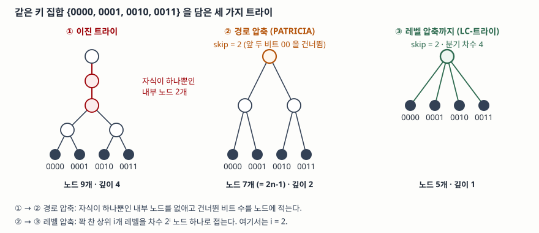

> 구조적 성질(노드 수, 깊이, 삽입 순서 무관성, 최장 접두사 일치 결과)은 예제를 직접 돌려
> 검산했다. 원 논문의 설명과 복잡도 표기는 문헌 근거로만 싣고 성능 측정값은 지어내지 않았다.

## 들어가며

탐색 자료구조를 물으면 대개 이진 탐색 트리와 해시 테이블이 먼저 나온다. 둘 다 **키끼리
비교**하거나 **키 전체를 한 값으로 뭉개는** 방식이고, 그래서 키의 일부만 보고 답해야 하는
문제에는 잘 맞지 않는다. IP 포워딩 테이블 조회, 문자열 자동 완성, 사전 접두사 검색이
그런 문제다.

트라이는 셋째 길을 쓴다. 키를 비교하지도 않고 뭉개지도 않으며, **키를 구성하는 비트나
문자를 하나씩 보고 그 값으로 분기한다.** 이 한 가지 차이에서 "삽입 순서를 바꿔도 모양이
같다", "깊이가 데이터 양이 아니라 키 길이에 묶인다" 같은 성질이 전부 따라 나온다.
시험에서는 단독 용어로도 나오고, 라우팅 테이블 탐색과 묶여 자료구조의 변형을 묻는
형태로도 나온다.

## 정의

**트라이(trie)는 키를 구성하는 기호를 한 자리씩 분기 기준으로 삼아, 루트에서 어떤 노드에
이르는 경로 자체가 그 노드가 담당하는 접두사가 되도록 구성한 탐색 트리다.**

**PATRICIA는 트라이에서 자식이 하나뿐인 내부 노드를 부모와 합쳐 압축한 표현이다.**
미국 표준기술연구소(NIST)의 알고리즘·자료구조 사전은 PATRICIA 트리를 "자식이 하나뿐인
노드를 부모와 합친 트라이의 압축 표현"으로 정의하고, radix 트리를 이진 PATRICIA 트리로
본다고 적으며 출처로 Morrison의 1968년 논문을 든다.

이름의 유래도 답안에 쓸 수 있다. 트라이는 **retrieval**의 가운데 음절에서, PATRICIA는
**P**ractical **A**lgorithm **T**o **R**etrieve **I**nformation **C**oded **I**n
**A**lphanumeric의 머리글자에서 왔다.

## 등장 배경

이진 탐색 트리를 쓰면 두 가지가 걸린다.

**첫째, 모양이 삽입 순서에 끌려다닌다.** 이진 탐색 트리의 모양은 키를 어떤 순서로
넣었느냐로 정해진다. 정렬된 순서로 들어오면 한쪽으로 늘어져 탐색이 O(N)이 되고, 이를
막으려면 삽입·삭제마다 회전으로 높이를 되돌려야 한다. 그 비용은 데이터가 바뀔 때마다
든다.

**둘째, 비교 한 번의 값이 비싸다.** 키가 긴 문자열이나 128비트 주소면 비교 한 번에 키
전체를 훑는다. 트리 높이가 log N이어도 실제 비용은 log N × 키 길이다. 게다가 비교
결과는 "크다 / 같다 / 작다" 셋뿐이어서, 두 키가 **앞부분을 얼마나 공유하는지**는 알려
주지 않는다. 접두사를 다루는 문제에서는 그 정보가 답 자체인데 버려지는 것이다.

트라이는 둘을 동시에 피한다. 1959년 de la Briandais가 컴퓨터 맥락에서 이 구조를 기술했고,
1960년 Fredkin이 *Communications of the ACM*에 발표한 "Trie Memory"가 이름을 붙였다.
대신 새 문제가 생겼다. 키가 공유하는 접두사가 길면 **자식이 하나뿐인 내부 노드가 길게
이어져** 아무 분기도 하지 않는 자리에서 메모리 참조만 소비한다. 1968년 Morrison의
PATRICIA가 이 낭비를 없앤 것이고, 그 뒤 30년간 나온 개량은 대부분 "분기하지 않는 자리를
어떻게 더 줄이는가"에 집중한다.

## 구성요소 / 절차

### 트라이의 구성요소 — 3가지

① **분기 기준(알파벳)** — 한 자리에서 몇 갈래로 나뉘는지. 비트면 2갈래, 바이트면 256갈래
② **경로** — 루트에서 노드까지의 기호열. 이것이 곧 그 노드의 접두사다
③ **값 표시** — 그 경로가 실제로 등록된 키인지 여부. 키가 다른 키의 접두사일 수 있으므로
   내부 노드도 값을 가질 수 있다

③이 이진 탐색 트리와 가장 다른 지점이다. 이진 탐색 트리는 노드 하나가 키 하나를 가지지만,
트라이는 **키를 노드에 저장하지 않는다.** 키는 경로에 분산돼 있고 노드는 그 경로가 끝났는지만
표시한다.

### 깊이를 줄이는 압축 — 2가지

| 구분 | 무엇을 없애는가 | 무엇을 노드에 적어 두는가 | 출처 |
|---|---|---|---|
| 경로 압축 | 자식이 하나뿐인 내부 노드 | 건너뛴 비트 수(skip 값) | Morrison 1968 |
| 레벨 압축 | 꽉 찬 상위 i개 레벨 | 분기 차수 2ⁱ | Andersson·Nilsson 1993 |

**경로 압축**은 분기하지 않는 노드를 지우고, 지워진 만큼 몇 비트를 건너뛰었는지를 노드에
적는다. Nilsson과 Karlsson은 잎이 n개인 경로 압축 이진 트라이의 노드 수가 **정확히 2n-1개**이고
평균 깊이가 log n에 비례한다고 적는다.

**레벨 압축**은 조밀한 부분을 겨냥한다. 어떤 부분 트라이의 위쪽 i개 레벨이 꽉 차 있으면
그 부분을 **자손 2ⁱ개를 가진 노드 하나**로 바꾸고, 남은 각 부분 트라이에 같은 일을
재귀적으로 적용한다. 두 압축을 합친 것이 LC-트라이이고, 저자들은 그 평균 깊이가
log log n에 비례해 항목 수가 늘어도 아주 느리게 자란다고 밝힌다.

꽉 찬 레벨만 접으면 **거의** 꽉 찬 부분을 놓친다. 그래서 저자들은 가능한 자리 중 일정
비율(**fill factor**)만 차 있어도 접는 완화 기준을 쓴다. 깊이는 더 줄지만 빈 잎이 생겨
크기가 늘어나는 교환이다. 저자들이 1998년 기사에서 밝힌 측정에서는 fill factor 0.30일 때
평균 메모리 접근이 3회 미만, 최악 5회였다.



> **출처**: [Stefan Nilsson, Gunnar Karlsson, "Fast IP Routing with LC-Tries", Dr. Dobb's Journal (1998-08)](https://jacobfilipp.com/DrDobbs/articles/DDJ/1998/9808/9808i/9808i.htm), [NIST DADS, Patricia tree](https://xlinux.nist.gov/dads/HTML/patriciatree.html)

### 세 성질을 직접 세어 확인한다

IPv4 접두사 8개짜리 포워딩 테이블로 트라이를 만들고, 압축 전후를 세었다. 전체 코드는
[`code/trie_properties.py`](code/trie_properties.py)에 있고 실행 기록은
[`code/output.txt`](code/output.txt)에 있다.

```text
[1] 경로 압축이 줄이는 양 — 포워딩 테이블 항목 8개
    압축 전  노드   54개 · 최대 깊이  24
    압축 후  노드    9개 · 최대 깊이   3

[2] 잎만 가진 트라이의 압축 후 노드 수 — 2n-1 이 되는지
    n=   4  노드    7개  2n-1 =    7  일치
    n= 256  노드  511개  2n-1 =  511  일치

[3] 삽입 순서를 바꿔도 모양이 같은지 — 무작위 순열 20가지
    서로 다른 모양 1가지
    모두 같다
```

읽을 것은 셋이다. 압축 전 깊이 24는 가장 긴 접두사 `10.1.2.0/24`의 길이와 같다 —
**깊이가 항목 수가 아니라 키 길이에 묶여 있다는 뜻**이다. 잎 n개 트라이의 노드 수가
2n-1로 떨어진 것은 압축 뒤 모든 내부 노드가 자식 둘을 갖기 때문이고, 이는 "자식이 하나뿐인
노드가 남지 않는다"는 압축의 정의가 그대로 센 숫자로 나타난 것이다. 순열 20가지가 모두
같은 모양을 낸 것은 분기가 비교가 아니라 **주소 공간의 이진 분할**로 정해지기 때문이다.

같은 코드로 압축 트라이의 최장 접두사 일치 결과를 무작위 주소 50,000개에 대해 전수
비교와 대조했고 불일치는 0건이었다. 다만 이 코드는 건너뛴 비트를 문자열로 들고 있어
내려가면서 바로 검증한다. **원 논문 계열의 구현은 건너뛴 비트 "수"만 저장하므로**
잎에 닿은 뒤 키 전체를 한 번 비교해야 한다. 노드를 한 워드에 담기 위한 선택이고,
그 마지막 비교를 빠뜨리는 것이 이 구조의 대표적인 구현 결함이다.

## 비교

| 구분 | 이진 탐색 트리 | 이진 트라이 | PATRICIA (경로 압축) | LC-트라이 |
|---|---|---|---|---|
| 분기 기준 | 키 대소 비교 | 키의 한 비트 | 지정된 위치의 한 비트 | 상위 여러 비트 묶음 |
| 키 저장 위치 | 노드 | 경로(분산) | 경로 + skip 값 | 경로 + skip 값 |
| 한 번 분기 비용 | 키 전체 비교 | 비트 1개 | 비트 1개 | 비트 i개 |
| 모양의 결정 요인 | **삽입 순서** | 키 집합 | 키 집합 | 키 집합 + fill factor |
| 재균형 | 회전 필요 | 불필요 | 불필요 | 불필요 |
| 깊이 | O(log N), 균형 시 | O(W) | 평균 ∝ log n | 평균 ∝ log log n |
| 최장 접두사 일치 | 직접 지원 못 함 | 경로 위 마지막 적중 | 같음 | 같음 |
| 약점 | 편향, 긴 키 비교 | 분기 없는 노드 낭비 | 잎에서 전체 키 재확인 | 빈 잎으로 크기 증가 |

W = 키의 비트 수, N·n = 항목 수다. 네 번째 행이 이 비교의 핵심이다. 이진 탐색 트리만
모양이 삽입 순서로 정해지고, 나머지 셋은 **키 집합만으로 정해진다.** 재균형이 필요 없는
이유도 여기서 나온다 — 되돌릴 편향이 애초에 생기지 않는다.

여섯 번째 행은 변수가 다르다는 점을 봐야 한다. 이진 트라이의 O(W)는 **항목 수와 무관하고**
키 길이에만 묶이며, LC-트라이의 log log n은 **키 길이와 무관하고** 항목 수와 분포에만
묶인다. 어느 쪽이 유리한지는 W와 n 중 무엇이 지배 변수인지로 갈린다.

## 적용 시 고려사항

**① 전순서가 아니라 기호열 표현이 가능한지를 먼저 본다.** 트라이는 키끼리 대소를 정할
필요가 없고, 대신 키를 **같은 알파벳의 기호열로 쓸 수 있어야** 한다. 또 한 키가 다른 키의
접두사일 수 있으므로 종료 표시나 길이 정보가 함께 있어야 한다. 이 전제를 확인하지 않고
구조부터 고르면 "등록은 됐는데 조회가 안 되는" 결함이 나온다.

**② 분기 차수를 늘리는 것은 깊이와 메모리의 교환이다.** 비트 하나씩 보면 깊이가 W까지
가고, 여러 비트를 묶어 보면 깊이는 줄지만 노드마다 2ⁱ개의 포인터 자리가 생겨 빈 칸이
늘어난다. fill factor 같은 조정 손잡이가 존재하는 이유가 이 교환이고, 적정값은 **키의
분포**에 달려 있어 일반적인 기본값을 그대로 쓰면 안 된다.

**③ 복잡도가 아니라 메모리 접근 횟수로 판단한다.** 포워딩이든 사전 조회든 병목은 비교
연산이 아니라 메모리 참조다. Nilsson과 Karlsson이 노드 하나를 분기 차수·skip 값·맨 왼쪽
자식 포인터 세 숫자로 묶어 한 워드에 담은 것은 깊이를 줄이려는 설계가 아니라 **한 번의
참조로 읽히게 하려는** 설계다. 설계 검토에서 들 근거는 트리 높이가 아니라 예상 캐시 미스
횟수다.

**④ 압축 구현에는 마지막 검증 단계를 반드시 둔다.** 경로 압축은 건너뛴 비트를 **보지 않고**
지나간다. 따라서 잎에 도달했다는 사실만으로는 그 키가 실제로 일치한다고 말할 수 없고,
도달한 뒤 전체 키를 한 번 비교해야 한다. 이 단계를 생략하면 등록되지 않은 키가 엉뚱한
값을 돌려받는다.

## 정리

- **정의 한 줄** — 트라이는 기호 한 자리씩으로 분기해 **경로가 곧 접두사**가 되게 한 탐색
  트리, PATRICIA는 자식이 하나뿐인 내부 노드를 없앤 그 압축 표현
- **구성요소 3가지** — 분기 기준(알파벳), 경로, 값 표시
- **압축 2가지** — 경로 압축(세로 방향, skip 값), 레벨 압축(가로 방향, 분기 차수 2ⁱ)
- **검산으로 확인한 수치 3가지** — 잎 n개 압축 트라이의 노드 수 **2n-1**, 압축 전 깊이가
  **가장 긴 키 길이와 같음**, 삽입 순열 20가지가 **같은 모양 1가지**
- **암기 단서** — 이진 탐색 트리는 **순서가 모양을 정하고**, 트라이는 **키 집합이 모양을
  정한다.** 그래서 트라이에는 재균형이 없다

> 기출 답안: [기출문제 — 이진 탐색 트리와 라우팅 테이블 탐색 알고리즘의 상관관계](../../exam/2026-10-20-bst-and-routing-table-lookup/index.md)

> 같이 읽을 글: [최장 접두사 일치와 포워딩 테이블 탐색](../../network/2026-10-25-longest-prefix-match-forwarding-lookup/index.md) — 트라이가 풀어 주는 그 조회 문제가 표준에 어떻게 정의돼 있는지

## 참고 자료

- [NIST Dictionary of Algorithms and Data Structures, "Patricia tree"](https://xlinux.nist.gov/dads/HTML/patriciatree.html) — 자식이 하나뿐인 노드를 부모와 합친 트라이의 압축 표현이라는 정의, radix 트리를 이진 PATRICIA 트리로 보는 관계
- [Stefan Nilsson, Gunnar Karlsson, "Fast IP Routing with LC-Tries", *Dr. Dobb's Journal* (1998-08)](https://jacobfilipp.com/DrDobbs/articles/DDJ/1998/9808/9808i/9808i.htm) — 저자들이 직접 쓴 해설. skip 값, 잎 n개에 노드 2n-1개, 평균 깊이 log n과 LC-트라이의 log log n, fill factor와 0.30일 때의 측정, 노드를 한 워드에 담는 구성, 깊이가 키 길이가 아니라 항목 수와 분포에만 달렸다는 서술
- Stefan Nilsson, Gunnar Karlsson, "IP-Address Lookup Using LC-Tries", *IEEE Journal on Selected Areas in Communications*, Vol. 17, No. 6 (1999-06), pp. 1083–1092 — 위 기사의 학술 원본. 유료 구독이 필요해 원문을 열지 못했으므로 서지 정보와 저자들의 해설 기사로만 근거를 삼았다
- D. R. Morrison, "PATRICIA — Practical Algorithm To Retrieve Information Coded In Alphanumeric", *Journal of the ACM*, Vol. 15, No. 4 (1968-10), pp. 514–534 — 경로 압축의 원형. 원문을 열지 못해 서지 정보와 NIST 사전의 인용으로 근거를 삼았다
- E. Fredkin, "Trie Memory", *Communications of the ACM*, Vol. 3, No. 9 (1960-09), pp. 490–499 — 용어 trie 의 출처. 원문을 열지 못해 서지 정보로만 적는다
- [Linux `net/ipv4/fib_trie.c`](https://git.kernel.org/pub/scm/linux/kernel/git/torvalds/linux.git/tree/net/ipv4/fib_trie.c) — IPv4 포워딩 테이블 구현. 파일 머리말이 Nilsson·Karlsson 의 LC-트라이 논문과 Nilsson·Tikkanen 의 LPC-trie 논문(*Algorithmica*, 2002)을 근거 문헌으로 적고, 최초 도입 커밋은 Robert Olsson 의 "[IPV4]: Add LC-Trie FIB lookup algorithm"이다
- Donald E. Knuth, *The Art of Computer Programming, Volume 3: Sorting and Searching*, 2nd ed. — §6.3 Digital Searching 이 트라이와 PATRICIA 를 다룬다
