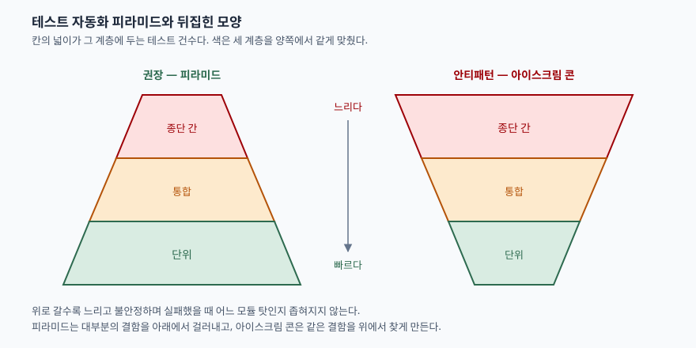

> 실행 검증 없음. 테스트 전략은 특정 조직의 코드베이스 위에서만 측정되는 대상이므로,
> 공개된 표준 문서와 원전 문헌의 진술만을 근거로 정리했다. 본문의 조합 수 계산은
> 명시한 가정에서 나온 산술이지 측정값이 아니다.

## 들어가며

테스트 자동화는 소프트웨어공학 과목에서 단답형으로도, 품질 보증을 묻는 논술형의 한
중항목으로도 나온다. 단답형이면 피라미드의 **3계층을 빠짐없이 들고 각 계층의 비용과
검출 범위를 한 줄로 끊는 것**이 점수다. 논술형에서는 CI/CD 파이프라인의 피드백 주기나
품질 비용을 논할 때 근거로 끌어오게 된다.

실무에서 이 개념이 푸는 문제는 하나다. **결함 하나를 찾는 데 드는 시간과, 찾은 뒤
원인을 좁히는 데 드는 시간**이다. 자동화 테스트를 1,000건 만들어도 전부 화면을 띄워
돌리는 것이면 한 번 돌리는 데 몇 시간이 걸리고, 빨간불이 떠도 어느 모듈 탓인지 모른다.
피라미드는 그 1,000건을 어느 계층에 몇 건씩 둘 것인지를 정하는 배분 규칙이다.

## 정의

**테스트 자동화 피라미드는 자동화된 테스트를 실행 비용과 검출 범위에 따라 계층으로 나누고,
아래 계층일수록 더 많은 건수를 두도록 권하는 배분 모형이다.**

유의할 점이 하나 있다. 이 모형은 **표준 문서에 정의된 개념이 아니다.** 마이크 콘이 2009년
저서 *Succeeding with Agile* 에서 "테스트 자동화 피라미드"라는 이름으로 제시한 것이 널리
알려진 출발점이고, 마틴 파울러는 콘이 2003~4년 리사 크리스핀과의 대화에서 처음 그렸다고
적는다([Martin Fowler, TestPyramid, 2012-05-01](https://martinfowler.com/bliki/TestPyramid.html)).
따라서 답안에 **"ISO 표준이 정한 모형"이라고 쓰면 틀린다.** 표준이 정의하는 것은
테스트 레벨이고, 피라미드는 그 레벨에 건수를 어떻게 배분할지에 대한 경험칙이다.

파울러가 정리한 핵심 주장은 한 줄이다. **높은 수준의 테스트보다 낮은 수준의 테스트를
훨씬 많이 두라**는 것이다.

## 등장 배경

자동화 이전에는 테스트가 사람의 수작업이었다. 회귀 시험을 돌리려면 매번 같은 화면을
사람이 눌러야 했고, 그래서 배포 주기가 길어졌다. 자동화는 이 비용을 없애려고 들어왔다.

그런데 자동화를 **화면 조작 기록·재생** 방식으로 시작한 조직이 많았다. 기존 수작업
절차를 그대로 녹화하면 되니 진입이 쉬웠기 때문이다. 결과가 뒤집힌 모양이었다.
파울러는 이런 모양을 **아이스크림 콘**이라 부르며 그 테스트들이
"깨지기 쉽고, 작성에 비용이 많이 들며, 돌리는 데 시간이 오래 걸린다"고 적는다.

깨지기 쉬운 이유가 중요하다. 종단 간 테스트는 **지나가는 모든 모듈의 변경에 반응한다.**
화면 문구 하나, 네트워크 지연 하나로도 빨간불이 뜬다. 실패가 잦고 그 실패가 결함 때문이
아닌 경우가 섞이면, 팀은 빨간불을 보고도 다시 돌려 보게 된다. 이 지점에서 테스트는
품질 신호이기를 멈춘다.

## 구성요소 — 3계층

| 계층 | 대상 | 돌리는 비용 | 실패했을 때 좁혀지는 범위 |
|---|---|---|---|
| ① 단위 (unit) | 함수·클래스 하나 | 가장 싸다. 외부 의존 없이 메모리에서 끝난다 | 그 함수 하나 |
| ② 통합 (integration) | 모듈 사이의 연결, 서비스 계층 | 중간. DB·메시지 큐 등 일부 외부가 붙는다 | 연결된 두 쪽 |
| ③ 종단 간 (end-to-end) | 사용자 관점의 전체 흐름 | 가장 비싸다. 화면·네트워크·외부 시스템이 전부 붙는다 | 전체 경로 |

파울러는 ② 를 **피하 테스트(subcutaneous test)** 라는 이름으로 설명한다. UI 프레임워크를
거치지 않고 **서비스 계층을 통해 동작시키는** 테스트이며, 웹 애플리케이션이라면 API 계층을
두드리는 것이 여기 해당한다.

이 3계층은 ISTQB 기초 수준 실러버스가 정한 **5가지 테스트 레벨**과 일대일로 맞지 않는다.
실러버스가 드는 레벨은 컴포넌트 테스팅, 컴포넌트 통합 테스팅, 시스템 테스팅,
시스템 통합 테스팅, 인수 테스팅의 다섯이다
([ISTQB CTFL v4.0 §2.2.1 Test Levels](https://astqb.org/2-2-test-levels-and-test-types/)).
답안에서는 **"레벨은 5가지, 자동화 배분 모형은 3계층"** 으로 갈라 쓰는 편이 안전하다.
굳이 대응시키면 ① 이 컴포넌트, ② 가 컴포넌트·시스템 통합, ③ 이 시스템·인수 쪽에 걸친다.

## 도식

> **출처**: [Martin Fowler, TestPyramid (2012-05-01)](https://martinfowler.com/bliki/TestPyramid.html), [ISTQB CTFL v4.0 §2.2.1 Test Levels](https://astqb.org/2-2-test-levels-and-test-types/)

## 비교 — 피라미드와 아이스크림 콘

| 항목 | 피라미드 | 아이스크림 콘 |
|---|---|---|
| 건수가 가장 많은 계층 | 단위 | 종단 간 |
| 한 번 돌리는 시간 | 짧다 | 길다 |
| 결함 검출 시점 | 커밋 직후 | 통합·배포 직전 |
| 실패 원인 지목 | 함수 단위로 좁혀진다 | 경로 전체가 용의자다 |
| 변경에 대한 민감도 | 바뀐 모듈의 테스트만 깨진다 | 무관한 변경에도 깨진다 |
| 자동화 진입 난이도 | 설계가 테스트 가능해야 한다 | 기존 절차를 녹화하면 된다 |

**왜 아래가 넓어야 하는지는 조합 수로 설명된다.** 모듈 4개가 각각 상태 3개를 가진다고
두자. 종단 간에서 조합을 모두 밟으려면 3⁴ = **81가지** 경로가 필요하다. 같은 상태를
단위 수준에서 모듈별로 확인하면 4 × 3 = **12가지**로 끝난다. 모듈이 하나 늘 때 앞은
세 배가 되고 뒤는 3건이 는다. 이 계산은 위 가정에서 나온 산술이며, 실제 조직의 수치가
아니다. 다만 **증가 방향이 다르다**는 점은 가정과 무관하게 성립한다.

그래서 종단 간 테스트의 역할은 조합을 훑는 것이 아니라 **연결이 끊기지 않았음을 확인하는
것**으로 좁혀진다. 파울러도 높은 수준의 테스트를 **2차 방어선**으로 두고, 거기서 걸린
결함은 먼저 단위 테스트로 재현하라고 적는다.

## 적용 시 고려사항 — 5가지

1. **비율보다 절대 시간을 기준으로 삼는다.** "7:2:1" 같은 숫자는 조직마다 다르다.
   정해야 할 것은 **커밋 한 번에 돌아가는 테스트가 몇 분 안에 끝나는가**다.
   그 제한을 먼저 정하면 계층별 건수는 거기서 따라 나온다.
2. **아이스크림 콘을 한 번에 뒤집지 않는다.** 기존 종단 간 테스트를 걷어내는 순서는
   "같은 결함을 잡는 단위 테스트를 먼저 만들고, 그다음 위를 지운다"이다.
   순서를 바꾸면 검출 공백이 생긴다.
3. **불안정한 테스트를 방치하지 않는다.** 가끔 실패하는 테스트는 0건과 다르지 않다.
   팀이 빨간불을 무시하기 시작하면 그 아래 쌓인 모든 계층의 신호가 같이 죽는다.
   고치거나, 못 고치면 떼어 내고 그 사실을 기록한다.
4. **테스트 가능한 설계가 전제다.** 단위 테스트를 많이 두려면 외부 의존이 주입 가능해야
   한다. 피라미드가 안 서는 조직은 대개 테스트 전략이 아니라 결합도가 문제다.
5. **레거시에는 특성화 테스트부터 건다.** 명세가 없는 코드에는 현재 동작을 그대로 고정하는
   테스트를 먼저 두고, 그 보호막 위에서 구조를 바꾼다. 처음부터 피라미드 모양을
   만들려고 하면 착수가 안 된다.

## 정리

- 테스트 자동화 피라미드는 **3계층**이다 — 단위 · 통합 · 종단 간. 아래로 갈수록 싸고 빠르다.
- 표준이 아니라 **경험칙**이다. 표준이 정의하는 것은 ISTQB의 **5가지 테스트 레벨**이다.
- 뒤집힌 모양을 **아이스크림 콘**이라 부른다. 느리고, 깨지기 쉽고, 원인이 안 좁혀진다.
- 아래를 넓히는 근거는 조합 수다. 위에서는 곱으로 늘고 아래에서는 합으로 는다.
- 암기 단서 — 계층은 **"단·통·종"**, 뒤집힌 모양의 문제는 **"느·깨·넓"**(느리다·깨진다·범위가 넓다).

## 참고 자료

- [Martin Fowler, TestPyramid (2012-05-01)](https://martinfowler.com/bliki/TestPyramid.html)
- Mike Cohn, *Succeeding with Agile: Software Development Using Scrum*, Addison-Wesley, 2009 — "Test Automation Pyramid" 원전
- [ISTQB Certified Tester Foundation Level Syllabus v4.0 §2.2.1 Test Levels](https://astqb.org/2-2-test-levels-and-test-types/)
- [Google Testing Blog, "Just Say No to More End-to-End Tests" (2015-04-22)](https://testing.googleblog.com/2015/04/just-say-no-to-more-end-to-end-tests.html) — 2차 자료
