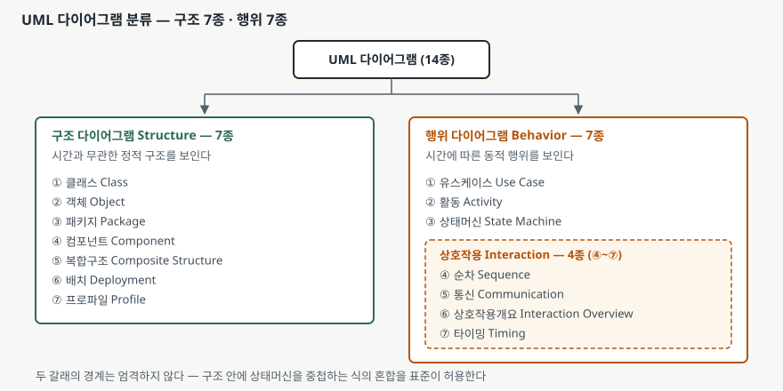

> 실행 검증 없음. 표기법 분류는 돌려 볼 대상이 아니므로 OMG UML 2.5 표준 문서(formal/15-03-01)의
> 부속서 A와 부속서 B의 진술만을 근거로 정리했다. 현행 정식판은 UML 2.5.1(formal/17-12-05)이고,
> 이 글의 인용은 열람한 2.5 판본 기준이다.

## 들어가며

UML 다이어그램 분류는 소프트웨어공학 과목에서 단답형으로 직접 나오기도 하고, 설계 산출물을
논하는 논술형에서 한 중항목으로 들어가기도 한다. 단답형이면 **14종을 빠짐없이 들고 두 갈래로
가르는 것**이 곧 점수다.

실무에서 이 분류가 푸는 문제는 산출물 목록을 정하는 일이다. 설계 단계에서 무슨 그림을 몇 장
그릴지 정할 때, 분류를 모르면 클래스 다이어그램과 순차 다이어그램 두 장으로 끝내고 배치나
상태 전이는 빠뜨린다. 빠뜨린 쪽은 개발이 끝난 뒤 운영에서 문제로 돌아온다.

## 정의

**UML 다이어그램은 UML 모델의 일부를 그래픽으로 표현한 것이다.** 표준은 모델과 다이어그램을
구분한다. 모델은 패키지·클래스·연관 같은 요소의 집합이고, 다이어그램은 그중 일부를 노드와
경로로 그린 그림이다. 같은 모델을 여러 다이어그램이 다른 각도에서 보일 수 있다
([OMG UML 2.5 — Annex A: Diagrams](https://www.omg.org/spec/UML/2.5/PDF), 681쪽).

**부속서 A는 규범(normative)이다.** 참고용 부록이 아니라 표준의 일부라는 뜻이므로, 답안에
"UML 표준이 정한 분류"라고 써도 된다.

## 등장 배경

UML 1.5의 표기법 안내서가 다이어그램으로 다루는 것은 **9종**이다. 정적 구조(클래스·객체),
유스케이스, 상호작용(순차), 협력, 상태차트, 활동, 구현(컴포넌트·배치)이 각각 파트로 나뉘어
있다([OMG UML 1.5 — UML Notation Guide, Part 5~11](https://www.omg.org/spec/UML/1.5/PDF),
3-3쪽). 묶는 단위가 "정적 구조"·"구현"처럼 제각각이라 전체를 꿰는 축은 보이지 않는다.

2.x에서 종류가 14종으로 늘면서 축이 필요해졌다. 지금의 부속서 A는 **정적인가 동적인가**라는
하나의 기준으로 전부를 가른다. 이름도 정리됐다. 협력(collaboration)은 통신(communication)이
되고 상태차트(statechart)는 상태머신(state machine)이 됐으며, 복합구조·프로파일·타이밍·
상호작용개요 넷이 새로 들어왔다.

갈래를 나눈 실익은 산출물 점검에 있다. 구조 쪽만 그리면 "무엇으로 이루어졌는가"는 남지만
"언제 무슨 일이 일어나는가"가 남지 않는다. 두 갈래를 모두 채웠는지가 설계 리뷰의 점검 항목이 된다.

## 구성요소 — 14종, 두 갈래

표준은 다이어그램을 **구조 다이어그램(structure diagram)과 행위 다이어그램(behavior diagram)
두 갈래**로 가른다. 각각의 정의는 이렇다.

- **구조 다이어그램**은 시스템 안 객체들의 **정적 구조**를 보인다. 시간과 무관한 요소들을
  그리며, 동적 행위의 세부는 보이지 않는다.
- **행위 다이어그램**은 객체들의 **동적 행위**를 보인다. 메서드·협력·활동·상태 이력을 포함하며,
  시스템의 동적 행위를 시간에 따른 변화의 연속으로 기술한다.

([OMG UML 2.5 — Annex A](https://www.omg.org/spec/UML/2.5/PDF), 683쪽)

갈래별 소속은 교환 형식을 정의한 부속서 B에서 규범적으로 확인된다. `UMLStructureDiagram`의
하위 클래스가 **7개**, `UMLBehaviorDiagram`의 하위 클래스가 **4개**다
([OMG UML 2.5 — Annex B.7.34, B.7.5](https://www.omg.org/spec/UML/2.5/PDF), 737·724쪽).

| 갈래 | 다이어그램 | 정의하는 절 |
|---|---|---|
| 구조 (7) | 클래스 Class | Structured Classifiers |
| | 객체 Object | Classification |
| | 패키지 Package | Packages |
| | 컴포넌트 Component | Structured Classifiers |
| | 복합구조 Composite Structure | Structured Classifiers |
| | 배치 Deployment | Deployments |
| | 프로파일 Profile | Packages |
| 행위 (7) | 유스케이스 Use Case | Use Cases |
| | 활동 Activity | Activities |
| | 상태머신 State Machine | State Machines |
| | 순차 Sequence | Interactions |
| | 통신 Communication | Interactions |
| | 상호작용개요 Interaction Overview | Interactions |
| | 타이밍 Timing | Interactions |

행위 7종 중 **뒤의 4종은 상호작용(Interaction) 다이어그램으로 한 번 더 묶인다.** 교환
형식에서는 이 넷이 각각의 클래스가 아니라 `UMLInteractionDiagram` 하나에 `kind` 속성으로
구분된다. 그래서 부속서 B의 하위 클래스가 7개가 아니라 4개인 것이다.

## 도식

> **출처**: [OMG UML 2.5 — Annex A, Figure A.5 The taxonomy of structure and behavior diagrams (683쪽)](https://www.omg.org/spec/UML/2.5/PDF), [OMG UML 2.5 — Annex B, Figure B.8 Structure Diagrams (691쪽) · Figure B.12 Behavior Diagrams (695쪽)](https://www.omg.org/spec/UML/2.5/PDF)

## 비교

### 구조와 행위

| 구분 | 구조 다이어그램 | 행위 다이어그램 |
|---|---|---|
| 보이는 것 | 시간과 무관한 정적 구조 | 시간에 따른 동적 행위 |
| 답하는 질문 | 무엇으로 이루어졌는가 | 언제 무슨 일이 일어나는가 |
| 종수 | 7 | 7 (상호작용 4 포함) |
| 교환 형식의 상위 클래스 | `UMLStructureDiagram` | `UMLBehaviorDiagram` |
| 연관 표기 옵션 | 전부 가짐 | 유스케이스만 가짐 |

마지막 줄이 시험에 쓸 만한 비대칭이다. 연관선 표기 옵션을 정의한
`UMLDiagramWithAssociations`를 상속하는 것은 구조 다이어그램 전부와 **유스케이스
다이어그램뿐**이다([OMG UML 2.5 — Annex B.7.15, B.7.37](https://www.omg.org/spec/UML/2.5/PDF),
729·738쪽). 유스케이스 다이어그램이 행위에 속하면서도 액터와 유스케이스를 연관선으로 잇는
구조적 성격을 함께 갖는다는 사실이 모델에 그대로 드러나 있다.

### 상호작용 4종

| 다이어그램 | 축으로 삼는 것 | 강한 점 |
|---|---|---|
| 순차 Sequence | 생명선과 시간 축 | 메시지의 **순서**가 한눈에 보인다 |
| 통신 Communication | 참여자 간 연결 구조 | 누가 **누구와** 이어져 있는지가 보인다 |
| 상호작용개요 Interaction Overview | 제어 흐름(활동 다이어그램 틀) | 여러 상호작용의 **조합**을 묶어 보인다 |
| 타이밍 Timing | 상태 변화와 시간 축 | 상태가 **얼마나 오래** 유지되는지가 보인다 |

순차와 통신은 **같은 상호작용을 다르게 그린 것**이다. 교환 형식에서 둘이 별개 클래스가 아니라
같은 클래스의 `kind` 값인 이유가 여기 있다. 그리고 이 열거형에는 네 가지 외에 `table`이 하나
더 있다. 상호작용을 표로 적는 형식이 부속서 D에 정의되어 있기 때문이다
([OMG UML 2.5 — Annex B.7.18](https://www.omg.org/spec/UML/2.5/PDF), 730쪽).
**다이어그램 분류는 14종이지만 상호작용을 표현하는 형식은 5가지**인 셈이다.

## 적용 시 고려사항

- **두 갈래의 경계가 엄격하지 않다는 것을 답안에 적는다.** 표준이 직접 단서를 단다. 구조와
  행위 요소를 섞는 것을 배제하지 않으며, 그 예로 내부 구조 안에 상태머신을 중첩하는 경우를
  든다([OMG UML 2.5 — Annex A](https://www.omg.org/spec/UML/2.5/PDF), 683쪽). 분류를 외워
  적되 "경계는 엄격하지 않다"를 한 줄 붙이면 표준을 읽은 답안이 된다.
- **프레임 머리말 종류는 14가지가 아니라 8가지다.** 다이어그램 테두리의 오각형 머리말에 쓸 수
  있는 이름은 activity·class·component·deployment·interaction·package·state machine·use case
  여덟 개이고, 약어는 act·cmp·dep·sd·pkg·stm·uc **일곱 개**다(class에는 약어가 없다)
  ([OMG UML 2.5 — Annex A](https://www.omg.org/spec/UML/2.5/PDF), 682쪽). 상호작용 4종이
  머리말에서는 `sd` 하나로 합쳐진다는 뜻이고, 분류의 종수와 표기의 종수가 다르다는 점을
  이 자리에서 보일 수 있다.
- **산출물을 정할 때 두 갈래를 모두 채웠는지 점검한다.** 구조만 있으면 배치와 상태 전이가
  빠지고, 행위만 있으면 무엇을 배포할지가 남지 않는다. 점검 항목을 "클래스·배치 +
  유스케이스·상태머신"처럼 갈래마다 최소 둘로 잡는 편이 실무에서 쓰인다.
- **복합구조 다이어그램은 다른 구조 다이어그램과 제약이 다르다.** 교환 형식에서 구조
  다이어그램은 모두 모델 요소를 갖지 않는데, 복합구조만 정확히 하나를 갖는다. 내부 구조를
  보이려면 그 대상 분류자가 반드시 지정되어야 하기 때문이다
  ([OMG UML 2.5 — Annex B.7.11](https://www.omg.org/spec/UML/2.5/PDF), 726쪽).
- **UML 1.x의 9종과 옛 이름을 섞어 쓰지 않는다.** 협력(collaboration)·상태차트(statechart)는
  1.5의 이름이고, 2.x에서는 통신(communication)·상태머신(state machine)이다. 옛 이름으로
  쓰면 판본을 혼동한 답안이 된다. 답안에는 어느 판 기준인지를 한 줄로 밝히는 편이 안전하다.

## 정리

- 암기 단서는 **7 + 7**이다. 구조 7종, 행위 7종, 합쳐 14종.
- 구조 7종은 **클·객·패·컴·복·배·프**(클래스·객체·패키지·컴포넌트·복합구조·배치·프로파일).
- 행위 7종은 **유·활·상** 셋에 상호작용 4종(**순·통·개·타**)을 더한 것이다.
- 구조는 시간과 무관한 정적 구조, 행위는 시간에 따른 동적 행위다. 경계는 엄격하지 않다고
  표준이 직접 단서를 단다.
- 교환 형식에서는 구조 7 + 행위 4이고, 상호작용 4종이 한 클래스의 `kind` 값으로 묶인다.
  여기에 표 형식까지 더해 `kind`는 5가지다.
- 프레임 머리말은 8종, 약어는 7종이다. 분류의 종수와 표기의 종수는 같지 않다.

## 참고 자료

- [OMG — Unified Modeling Language (UML) Version 2.5, formal/15-03-01, Annex A: Diagrams (normative)](https://www.omg.org/spec/UML/2.5/PDF)
- [OMG — Unified Modeling Language (UML) Version 2.5, formal/15-03-01, Annex B: Diagram Interchange](https://www.omg.org/spec/UML/2.5/PDF)
- [OMG — Unified Modeling Language (UML) Version 1.5, formal/03-03-01, UML Notation Guide](https://www.omg.org/spec/UML/1.5/PDF)
- [OMG — About the Unified Modeling Language Specification Version 2.5.1 (formal/17-12-05)](https://www.omg.org/spec/UML/2.5.1/About-UML/)
