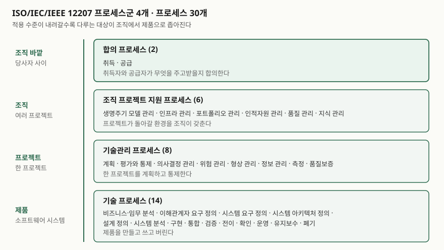
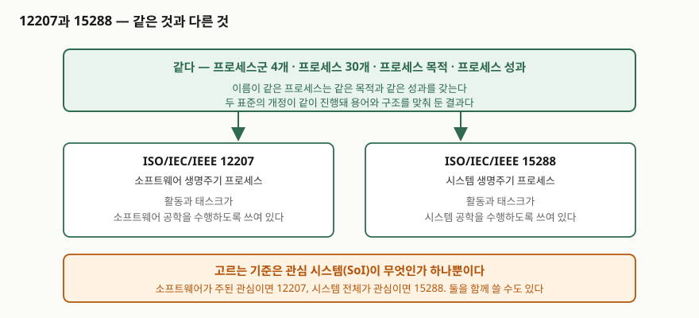

> 실행 검증 없음. 표준 기반 개념 글이므로 공개 자료 근거만으로 정리했다.
>
> 목차의 절 번호·프로세스 이름, 서문의 개정 내역, 서론과 적용범위 본문은 발행처 공인
> 미리보기(VDE Verlag가 공개한 ISO/IEC/IEEE 12207:2017, ISO/IEC/IEEE 12207:2026,
> ISO/IEC/IEEE 15288:2023 앞부분)에서 직접 확인했다. 각 프로세스의 성과·활동·태스크
> 본문은 유료 구간이라 열지 않았으므로, 이 글은 **구조와 경계**만 다룬다.

## 들어가며

소프트웨어 생명주기를 묻는 문항은 폭포수·나선형 같은 **모델**을 묻는 것처럼 보이지만,
채점표가 보는 것은 보통 **프로세스**다. 둘은 다르다. 모델은 일을 어떤 순서로 돌릴지를
정하고, 프로세스는 그 순서와 무관하게 "어떤 일이 수행돼야 하는가"를 정한다. 12207은
뒤쪽이고, **어떤 생명주기 모델도 요구하지 않는다**고 적용범위에 직접 적는다. 실무에서도
같은 혼동이 생긴다. 애자일로 돌리니 12207은 안 맞는다는 말이 나오는데, 2026년 제2판의
적용범위는 **애자일 접근법과 방법에 적용 가능하다**고 못 박는다. 모델을 고르는 표준이
아니기 때문이다.

## 정의

**ISO/IEC/IEEE 12207은 소프트웨어 시스템·제품·서비스의 취득, 공급, 개발, 운영, 유지보수,
폐기 전 구간에 적용할 수 있는 프로세스·활동·태스크를 담아 소프트웨어 생명주기 프로세스의
공통 프레임워크를 정한 국제표준이다.** 작성 주체는 ISO/IEC JTC 1의 소프트웨어·시스템
공학 분과위원회(SC 7)이고, IEEE 컴퓨터 소사이어티의 시스템·소프트웨어 공학 표준위원회와
공동으로 만든다.

현행판은 **2026년에 나온 제2판(ISO/IEC/IEEE 12207:2026)** 이고, 2017년 제1판을 기술적으로
개정해 대체했다. 답안에 판을 적을 때는 이 점을 주의한다. 국내 교재는 대부분 2017년판을
기준으로 쓰여 있다.

## 등장 배경

12207의 뿌리는 1995년 초판이다. 2008년판까지는 ISO/IEC 단독 표준이었고, 시스템 생명주기를
다루는 ISO/IEC/IEEE 15288과 **프로세스 이름도 구조도 서로 달랐다.** 그래서 소프트웨어가
들어간 시스템을 만드는 조직은 같은 일에 두 벌의 프로세스 목록을 들고 있어야 했고, 둘을
대응시키는 작업이 프로젝트마다 반복됐다.

2017년 제1판이 고친 것이 이 지점이다. 서문이 개정 목표를 **3가지**로 적는다.
**15288 개정판과 공통 용어를 제공할 것**, **가능한 곳에서 공통 프로세스 이름과 프로세스
구조를 제공할 것**, 그리고 **사용자 집단이 완전히 조화된 표준으로 옮겨 가되 하위 호환은
유지할 수 있게 할 것**이다. 두 표준의 개정이 같이 진행된 것도 그래서다. 2008년판과의
대응은 2017년판 부속서 I에 비교표로 남아 있다.

2026년 제2판은 이 조화를 끝까지 밀었다. 2017년판에서 `시스템/소프트웨어 요구사항 정의`,
`아키텍처 정의`로 적혀 있던 두 프로세스가 제2판에서 **`시스템 요구사항 정의`,
`시스템 아키텍처 정의`** 로 바뀌었는데, 이것이 15288:2023이 쓰는 이름과 글자까지 같다.
이제 두 표준의 프로세스 30개는 **이름이 전부 일치한다.**

## 구성요소

### 프로세스군 — 4개, 프로세스 30개

| 프로세스군 | 개수 | 프로세스 |
|---|---|---|
| 합의 (6.1) | **2** | 취득, 공급 |
| 조직 프로젝트 지원 (6.2) | **6** | 생명주기 모델 관리, 인프라 관리, 포트폴리오 관리, 인적자원 관리, 품질 관리, 지식 관리 |
| 기술관리 (6.3) | **8** | 프로젝트 계획, 프로젝트 평가와 통제, 의사결정 관리, 위험 관리, 형상 관리, 정보 관리, 측정, 품질보증 |
| 기술 (6.4) | **14** | 비즈니스·임무 분석, 이해관계자 요구사항 정의, 시스템 요구사항 정의, 시스템 아키텍처 정의, 설계 정의, 시스템 분석, 구현, 통합, 검증, 전이, 확인, 운영, 유지보수, 폐기 |

합이 **30개**다. 답안에서는 **2·6·8·14**를 먼저 적고 들어간다. 개수가 곧 점수이므로
프로세스군 이름만 쓰고 개수를 빼면 손해다.

네 군을 가르는 축은 **적용 수준**이다. 합의는 조직 바깥의 당사자와 주고받는 일, 조직
프로젝트 지원은 조직이 여러 프로젝트에 공통으로 깔아 두는 환경, 기술관리는 한 프로젝트를
계획하고 통제하는 일, 기술은 제품 자체를 만들고 쓰고 버리는 일이다. 이 축을 잡아 두면
새 프로세스가 나와도 어느 군에 들어갈지 추론할 수 있다.

### 프로세스를 기술하는 구조 — 4가지

각 프로세스는 같은 틀로 기술된다. **목적(purpose)**, **성과(outcomes)**,
**활동(activities)**, **태스크(tasks)** 다. 이 네 칸의 구분이 뒤에 나올 15288과의 비교에서
결정적이므로 여기서 한 줄로 정리해 둔다. **목적과 성과는 "무엇을 달성해야 하는가"이고,
활동과 태스크는 "그것을 어떻게 수행하는가"다.**

### 적합성 — 2가지, 완전 적합성은 다시 2갈래

| 구분 | 무엇을 주장하는가 |
|---|---|
| **완전 적합성 (4.2)** | 선언한 프로세스 집합의 요구를 모두 만족한다. **성과 기반(4.2.1)** 과 **태스크 기반(4.2.2)** 두 갈래가 있다 |
| **테일러링 적합성 (4.3)** | 부속서 A의 테일러링 프로세스를 거쳐 정한 집합에 대해 적합하다 |

테일러링은 예외가 아니라 **정규(normative) 부속서**로 표준 안에 들어 있다. "표준을 다
따르기 어렵다"가 아니라 "표준이 정한 절차로 잘라 쓴다"가 맞는 서술이다. 답안에서 자주
틀리는 대목이다.

### 활용 모드 — 4가지

서론이 이 표준을 쓰는 방식을 **네 가지**로 든다.

| # | 누가 | 무엇에 |
|---|---|---|
| ① | 조직 | 원하는 프로세스 환경을 갖추고, 그 환경이 표준의 규정에 적합한지 평가하는 데 |
| ② | 프로젝트 | 갖춰진 환경의 요소를 골라 쓰고, 프로젝트가 그 환경에 적합한지 평가하는 데 |
| ③ | 취득자와 공급자 | 프로세스·활동에 관한 합의를 만드는 지침으로 |
| ④ | 프로세스 심사원 | 프로세스 심사에 쓰는 **프로세스 참조모델(PRM)** 로 |

④가 SPICE(ISO/IEC 330xx 계열) 심사와 이어지는 자리다. 12207은 부속서 C에 프로세스
참조모델을 두고 **ISO/IEC 33004 적합**을 선언한다. 심사 문항에서 "프로세스 참조모델을
어디서 가져오는가"를 물으면 이 부속서가 답이다.

## 도식

> **출처**: [ISO/IEC/IEEE 12207:2026, Systems and software engineering — Software life cycle processes, Contents 6.1~6.4 / 5.6 Process groups (VDE Verlag 공개 미리보기)](https://assets.vde-verlag.de/iec-normen/preview-pdf/info_isoiecieee12207%7Bed2.0%7Den.pdf) — 프로세스군 4개와 각 군의 프로세스 이름·개수

> **출처**: [ISO/IEC/IEEE 12207:2026, Introduction (VDE Verlag 공개 미리보기)](https://assets.vde-verlag.de/iec-normen/preview-pdf/info_isoiecieee12207%7Bed2.0%7Den.pdf) · [ISO/IEC/IEEE 15288:2023, Systems and software engineering — System life cycle processes, Contents 6.1~6.4 (VDE Verlag 공개 미리보기)](https://assets.vde-verlag.de/iec-normen/preview-pdf/info_isoiecieee15288%7Bed2.0%7Den.pdf) — 목적·성과는 같고 활동·태스크가 다르다는 서술, 양쪽의 동일한 프로세스 목록

## 비교

### 12207과 15288 — 무엇이 같고 무엇이 다른가

두 표준의 서론이 이 질문에 직접 답한다. **두 문서의 프로세스는 프로세스 목적과 프로세스
성과가 같고, 소프트웨어 공학을 수행하느냐 시스템 공학을 수행하느냐에 따라 활동과 태스크가
다르다.** 시험에서 이 한 문장을 그대로 쓸 수 있으면 비교 문항은 끝난다.

| 축 | ISO/IEC/IEEE 12207 | ISO/IEC/IEEE 15288 |
|---|---|---|
| 다루는 생명주기 | 소프트웨어 | 시스템 |
| 프로세스군 | 4개 | 4개 (이름 동일) |
| 프로세스 | 30개 | 30개 (이름 동일) |
| 프로세스 목적·성과 | **같다** | **같다** |
| 활동·태스크 | 소프트웨어 공학을 수행하도록 기술 | 시스템 공학을 수행하도록 기술 |
| 고르는 기준 | 관심 시스템(SoI)이 소프트웨어 중심일 때 | 관심 시스템이 시스템 전체일 때 |
| 현행판 | 2026 (제2판) | 2023 |

**둘 중 하나를 골라야 하는 것은 아니다.** 12207은 소프트웨어가 포함된 시스템을 취득할 때
자신의 프로세스를 **단독으로 또는 15288과 함께** 적용할 수 있다고 적는다. 소프트웨어가
거의 없는 시스템부터 소프트웨어가 전부인 시스템까지 연속체이므로, 경계를 칼로 긋는 대신
관심 시스템을 보고 정하라는 것이다.

### 2017년 제1판과 2026년 제2판

서문이 주요 변경을 항목으로 든다. 답안에 쓸 만한 것은 셋이다.

| 축 | 2017 (제1판) | 2026 (제2판) |
|---|---|---|
| 프로세스 이름 | `시스템/소프트웨어 요구사항 정의`, `아키텍처 정의` | **`시스템 요구사항 정의`, `시스템 아키텍처 정의`** — 15288:2023과 일치 |
| 애자일 | 부속서 H `애자일의 적용` (참고) | 부속서가 사라지고 **적용범위 본문**이 애자일 적용 가능을 명시 |
| 부속서 | 부속서 I에 2008년판 대응표 | 대응표가 빠지고 **부속서 D(MBSSE)**, **부속서 E(보증과 보증 케이스)** 가 들어옴 |

제2판이 손본 곳은 그 밖에도 있다. 서문은 **비즈니스·임무 분석, 시스템 아키텍처 정의, 구현,
통합, 운영, 유지보수** 같은 기술 프로세스를 현행 실무에 맞게 다듬었고, **위험 관리와 형상
관리**를 포함한 기술관리 프로세스를 개선했으며, 5절의 핵심 개념에서 **반복(iteration),
재귀(recursion), 시스템의 시스템, 품질 특성**의 서술을 더 정확히 했다고 적는다.

## 적용 시 고려사항

- **프로세스와 생명주기 모델을 같은 칸에 쓰지 않는다.** 12207은 특정 생명주기 모델,
  개발 방법론, 모델링 접근법을 식별하거나 요구하지 않는다고 적용범위에 적는다. "12207은
  폭포수 기반이다"는 서술은 틀렸다. 조직이 모델을 고르고, 그 모델에 프로세스를 대응시킨다.
- **도입은 테일러링 프로세스를 거친다.** 30개를 전부 세우는 것이 목표가 아니다. 부속서 A가
  정규 부속서로 절차를 정해 두었으므로, 잘라 낸 근거를 그 절차에 따라 남긴다. 근거 없이
  줄이면 테일러링 적합성조차 주장할 수 없다.
- **합의 프로세스군을 조직 내부에도 적용할 수 있다.** 취득·공급은 외부 계약에만 쓰는 것이
  아니다. 서론은 당사자가 같은 조직에 속할 수도 있고, 상황이 비공식 합의부터 정식 계약까지
  걸칠 수 있다고 적는다. 사내 플랫폼팀과 서비스팀 사이에도 성립한다.
- **프로세스는 동시·반복·재귀로 적용된다.** 적용범위가 생명주기 프로세스를 소프트웨어
  시스템에 **동시적·반복적·재귀적**으로, 그 요소에는 **점증적**으로 적용할 수 있다고 적는다.
  프로세스 목록을 공정 순서로 읽는 순간 이 네 가지가 전부 사라진다.
- **심사를 염두에 둔다면 프로세스 참조모델을 먼저 본다.** 심사 대상은 활동 기록이 아니라
  프로세스 성과다. 성과를 증거로 남기는 설계를 해 두지 않으면 나중에 활동 기록만 쌓인다.
- **판을 확인하고 쓴다.** 현행판은 2026년 제2판이다. 사내 표준이나 제안서가 2017년판을
  인용하고 있으면 프로세스 이름 두 개가 바뀌었다는 점부터 확인한다. 이름이 달라 같은
  프로세스를 두 번 세는 사고가 가장 흔하다.

## 정리

- 정의 한 줄: **12207은 소프트웨어 시스템·제품·서비스의 취득부터 폐기까지에 적용할
  프로세스·활동·태스크를 담은 소프트웨어 생명주기 프로세스 공통 프레임워크다.**
- **2·6·8·14 = 30**으로 외운다 — 합의 **2**, 조직 프로젝트 지원 **6**, 기술관리 **8**,
  기술 **14**. 가르는 축은 **조직 바깥 → 조직 → 프로젝트 → 제품**이라는 적용 수준이다.
- 프로세스 기술은 **목적·성과·활동·태스크 4칸**이고, 적합성은 **완전(성과 기반·태스크 기반)과
  테일러링 2가지**, 활용 모드는 **조직·프로젝트·당사자 간 합의·프로세스 심사 4가지**다.
- 15288과의 관계는 한 문장이다. **목적과 성과는 같고, 활동과 태스크가 소프트웨어 공학이냐
  시스템 공학이냐로 갈린다.** 고르는 기준은 관심 시스템(SoI)이다.
- 판을 적는다. **현행은 2026년 제2판**이고, 2017년 제1판과는 프로세스 이름 두 개와
  애자일·부속서 구성이 다르다.

> 기출 답안: [기출문제 — 선도개발을 위한 개발방법론 테일러링](../../exam/2026-10-25-development-methodology-tailoring/index.md) — 부속서 A의 테일러링 프로세스를 답안 형태로 적용한 글
>
> 함께 보기: [요구공학 4단계](../2026-09-18-requirements-engineering-four-phases/index.md) — 12207의 이해관계자 요구사항 정의·시스템 요구사항 정의 프로세스가 실제로 수행하는 일

## 참고 자료

- [ISO/IEC/IEEE 12207:2026, Systems and software engineering — Software life cycle processes (ISO 카탈로그)](https://www.iso.org/standard/90219.html) — 현행 제2판(2026-04 발행)의 발행 정보와 적용 범위
- [ISO/IEC/IEEE 12207:2026 공개 미리보기 — 목차·서문·서론·적용범위 (VDE Verlag)](https://assets.vde-verlag.de/iec-normen/preview-pdf/info_isoiecieee12207%7Bed2.0%7Den.pdf) — 프로세스군 4개와 프로세스 30개, 제2판 주요 변경, 활용 모드 4가지, 15288과의 관계
- [ISO/IEC/IEEE 12207:2017 공개 미리보기 — 목차·서문·서론·적용범위 (VDE Verlag)](https://assets.vde-verlag.de/iec-normen/preview-pdf/info_isoiecieee12207%7Bed1.0%7Den.pdf) — 제1판의 프로세스 이름과 부속서 구성, 15288 조화 목표 3가지
- [ISO/IEC/IEEE 15288:2023, Systems and software engineering — System life cycle processes (ISO 카탈로그)](https://www.iso.org/standard/81702.html) — 시스템 생명주기 프로세스의 발행 정보
- [ISO/IEC/IEEE 15288:2023 공개 미리보기 — 목차 (VDE Verlag)](https://assets.vde-verlag.de/iec-normen/preview-pdf/info_isoiecieee15288%7Bed2.0%7Den.pdf) — 12207과 동일한 프로세스군·프로세스 목록의 확인 근거
- [ISO/IEC 33004:2015, Information technology — Process assessment — Requirements for process reference, process assessment and maturity models (ISO 카탈로그)](https://www.iso.org/standard/54178.html) — 12207 부속서 C의 프로세스 참조모델이 적합을 선언하는 대상
