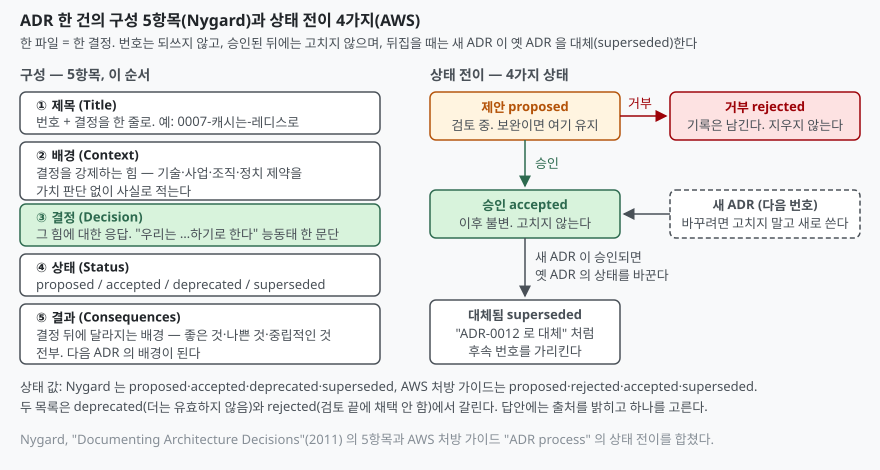

> 실행 검증 없음. 공개된 원문(Nygard 의 2011년 글, MADR 프로젝트 문서, AWS 처방
> 가이드, adr.github.io 템플릿 페이지)을 직접 읽고 정리했다. ISO/IEC/IEEE 42010 은
> 열람 페이지가 열리지 않아 이 글에서 근거로 쓰지 않았다.

## 들어가며

설계 문서는 **지금 구조가 무엇인지**를 적는다. 그런데 운영 2년 차에 정말 필요한
것은 "왜 이 구조인가" 다. 메시지 큐를 왜 둘 다 쓰는지, 캐시를 왜 DB 앞이 아니라
API 앞에 뒀는지는 설계서 어디에도 없고, 당시 사람은 이직했다. 그래서 같은 논의가
분기마다 다시 열리고, 결론은 그때 사람들의 기억으로 정해진다. ADR 은 이 한 가지,
**결정과 그 이유를 결정 시점에 짧게 남기는 것**만 한다. 시험에서는 아키텍처 문서화,
기술부채, TA·AA 협업 문항의 "산출물" 자리에서 나온다.

## 정의

**아키텍처 결정 기록(ADR, Architecture Decision Record)은 아키텍처상 중요한 결정
하나와 그 배경·결과를 짧은 텍스트 파일 한 건으로 남긴 문서이며, 프로젝트가
쌓아 온 ADR 의 모음이 그 프로젝트의 결정 로그(decision log)다.**

출처마다 정의의 초점이 조금 다르다. 답안에는 하나를 고르고 출처를 붙인다.

| 출처 | 정의의 초점 |
|---|---|
| Nygard (2011) | "알렉산더 패턴과 비슷한 형식의 **짧은 텍스트 파일**". 형식과 분량을 정의에 넣었다 |
| adr.github.io | "**단일 아키텍처 결정(AD) 하나와 그 근거**를 담는다". 한 건 = 한 결정 |
| AWS 처방 가이드 | "소프트웨어 아키텍처의 **중요한 측면에 관해 팀이 내린 선택**을 기술하는 문서" |

어느 결정이 "아키텍처상 중요한가" 는 Nygard 가 범위를 정해 두었다. **구조,
비기능 특성, 의존성, 인터페이스, 구축 기법**에 영향을 주는 결정이다. AWS 가이드도
같은 다섯 가지를 그대로 든다. MADR 는 더 넓게 "아키텍처에 어떤 식으로든 영향을
줄 수 있는 결정은 모두" 라고 적는다.

## 등장 배경

Nygard 가 2011년 글에서 든 문제는 둘이다. 첫째, **큰 설계 문서는 쓰이지도 읽히지도
않는다.** 애자일 팀일수록 문서를 줄이는데, 그러면 결정의 근거가 함께 사라진다.
둘째, 근거 없는 결정을 만난 뒤 사람은 두 가지 중 하나를 한다. **맹목적으로
따르거나, 맹목적으로 바꾼다.** 전자는 바꿔야 할 결정을 못 바꾸고, 후자는 지킬
이유가 있던 결정을 깨뜨린다. 둘 다 "왜" 가 없어서 생긴다.

그래서 제안이 **설계 문서를 더 잘 쓰자**가 아니라 **결정만 따로, 짧게, 결정 시점에**
남기자로 간 것이다. 큰 문서 하나가 아니라 한두 쪽짜리 파일 여러 개이고, 코드와
같은 저장소에 두어 코드와 함께 버전 관리된다.

## 구성요소

### ADR 한 건 — Nygard 의 5항목, 이 순서

| # | 항목 | 무엇을 적나 |
|---|---|---|
| ① | **제목 (Title)** | 번호와 결정을 한 줄로 |
| ② | **배경 (Context)** | 결정을 둘러싼 **힘**. 기술·사업·조직·정치적 제약을 **가치 판단 없이 사실로** |
| ③ | **결정 (Decision)** | 그 힘에 대한 응답. "우리는 …하기로 한다" 능동태 |
| ④ | **상태 (Status)** | proposed, accepted, deprecated, superseded |
| ⑤ | **결과 (Consequences)** | 결정 뒤에 달라지는 배경. **좋은 것, 나쁜 것, 중립적인 것 전부** |

순서가 그렇게 된 이유가 답안의 핵심이다. **배경이 결정보다 앞에 오는 것**은
결정이 배경에 대한 응답이기 때문이다. 배경 없이 결정만 읽으면 "왜" 가 빠진
지시문이 되고, 몇 년 뒤 읽는 사람은 배경이 바뀌었는지 판단할 수 없다. **결과가
마지막에 오는 것**은 결과가 **다음 ADR 의 배경**이 되기 때문이다. 캐시를 두기로
한 결정의 결과(무효화 정책이 필요해짐)가 다음 결정(무효화는 이벤트로)의 배경이
된다. 그래서 ADR 은 낱장이 아니라 사슬이다.

### 운용 원칙 — 4가지

| 원칙 | 출처 | 내용 |
|---|---|---|
| **한 건 = 한 결정** | Nygard, adr.github.io | 한 ADR 은 특정 프로젝트의 중요한 결정 하나를 다룬다 |
| **번호는 단조 증가, 재사용 없음** | Nygard, MADR | `NNNN-제목.md` 형식. 지워진 번호도 다시 쓰지 않는다 |
| **승인 뒤 불변** | AWS 처방 가이드 | 승인·거부된 ADR 은 **불변 문서**로 취급한다. 바꾸려면 새 ADR 을 쓴다 |
| **뒤집으면 대체(superseded)** | Nygard, AWS | 옛 ADR 은 남겨 두고 상태만 바꾸며, 새 ADR 번호를 가리킨다 |

불변성이 왜 필요한가. ADR 의 가치는 **그 시점의 판단을 그 시점의 배경과 함께**
보존하는 데 있다. 나중에 고쳐 쓰면 배경과 결정이 어긋나고, 왜 바꿨는지가 또
사라진다. 바꾸는 행위 자체를 새 결정으로 기록하라는 것이다.

### 상태 전이 — AWS 처방 가이드의 4가지 상태

**proposed → accepted** 또는 **proposed → rejected**, 그리고 새 ADR 이 승인되면
옛 ADR 이 **accepted → superseded** 로 바뀐다. 검토에서 보완이 필요하면 proposed
에 머문다. Nygard 의 목록은 **deprecated** 를 두고 rejected 가 없다. 거부된 안도
기록으로 남긴다는 점은 양쪽이 같다.

## 도식

> **출처**: [Michael Nygard, Documenting Architecture Decisions (2011-11-15)](https://cognitect.com/blog/2011/11/15/documenting-architecture-decisions) — 5항목과 상태 값 · [AWS Prescriptive Guidance — ADR process](https://docs.aws.amazon.com/prescriptive-guidance/latest/architectural-decision-records/adr-process.html) — 상태 전이와 불변성

## 비교

### ADR 과 다른 문서

| 축 | ADR | 설계 문서 | 회의록 | 위키 페이지 |
|---|---|---|---|---|
| 단위 | 결정 **하나** | 시스템 전체 | 회의 한 번 | 주제 하나 |
| 시점 | 결정 시점에 쓰고 고정 | 계속 갱신 | 회의 시점 | 수시 갱신 |
| 핵심 내용 | **왜** (배경·결과) | **무엇** (구조) | 논의 과정 | 현재 상태 |
| 변경 | 새 ADR 로 대체 | 제자리 수정 | 수정 안 함 | 제자리 수정 |
| 저장 | 코드 저장소 | 문서 저장소 | 협업 도구 | 위키 |

설계 문서와 ADR 은 경쟁하지 않는다. 설계 문서가 "지금 모습" 을 보여 주고,
ADR 이 "그 모습이 된 이유" 를 결정별로 댄다. 위키와의 차이는 **제자리 수정을
하느냐**다. 위키는 최신 상태만 남기므로 바뀐 이유가 사라진다.

### 템플릿 3가지

| 템플릿 | 절 구성 | 특징 |
|---|---|---|
| **Nygard** | 제목·배경·결정·상태·결과 **5절** | 가장 짧다. 대안 비교 절이 없다 |
| **MADR 4.0.0** | 배경과 문제 정의·결정 동인·고려한 선택지·결정 결과·선택지별 장단점·추가 정보 **6절** (필수는 배경과 문제, 고려한 선택지, 결정 결과 **3절**) | **대안과 그 장단점**을 명시적으로 남긴다 |
| **Y-statement** | 문장 **하나** | "…의 맥락에서, …라는 관심사에 직면해, …을 택하고 …을 버렸으며, …을 얻기 위해, …을 감수한다" |

Y-statement 는 adr.github.io 가 긴 형식을 이렇게 적는다. **In the context of
〈use case〉, facing 〈concern〉, we decided for 〈option〉 and neglected 〈other
options〉, to achieve 〈quality〉, accepting 〈downside〉, because 〈rationale〉.**
한 문장이라 가볍지만 요소는 **맥락·관심사·선택·버린 대안·얻는 품질·감수하는
단점·근거 7개**가 다 들어간다. Nygard 형식에 없는 "버린 대안" 이 여기 있다.

## 적용 시 고려사항

- **무엇을 기록할지 선을 긋는다.** 전부 기록하면 결정 로그가 읽히지 않는다.
  Zimmermann 은 **아키텍처상 중요한 요구와 결정, 바꾸기 어렵고 비싼 것**에
  집중하라고 적고, 결정 로그가 100건을 넘으면 읽는 사람도 쓰는 사람도 지친다고
  경고한다. Nygard 의 범위 5가지(구조·비기능·의존성·인터페이스·구축 기법)가
  기준이 된다.
- **코드 저장소에 둔다.** Nygard 는 `doc/arch/adr-NNN.md`, Google Cloud 는
  "애플리케이션 코드 가까이" 를 권한다. 결정과 코드가 같은 커밋 이력 안에 있어야
  "이 결정 이후 코드가 어떻게 바뀌었는가" 를 따라갈 수 있다. 별도 문서 저장소에
  두면 코드와 어긋난 채 남는다.
- **템플릿은 하나를 골라 고수한다.** Zimmermann 의 조언이다. 대안 비교가 중요한
  조직이면 MADR, 가볍게 시작하려면 Nygard, 한 줄 요약이 필요하면 Y-statement 를
  고르되 섞지 않는다. 섞이면 결정 로그를 훑어 셀 수 없다.
- **배경에 가치 판단을 넣지 않는다.** Nygard 는 배경을 "긴장 속의 힘" 으로
  **가치 중립적 언어**로 쓰라고 적는다. 배경에 "당연히 A 가 낫다" 가 들어가면
  결정이 배경에 대한 응답이 아니라 배경의 반복이 되고, 몇 년 뒤 배경이 바뀌었는지
  판단할 근거가 없어진다.
- **결과에 나쁜 것을 적는다.** 결과 절에 장점만 적힌 ADR 은 다음 결정의 배경이
  되지 못한다. 캐시를 둔 결과로 "무효화 정책이 필요해졌다" 가 적혀 있어야 다음
  ADR 이 그 자리에서 시작한다.
- **뒤집을 때 지우지 않는다.** 옛 ADR 의 상태를 superseded 로 바꾸고 새 번호를
  가리킨다. 거부된 제안도 rejected 로 남긴다. "왜 그 대안을 택하지 않았는가" 가
  다음 사람이 가장 먼저 묻는 질문이다.

## 정리

- 정의 한 줄: **ADR 은 아키텍처상 중요한 결정 하나와 그 배경·결과를 짧은 텍스트
  파일 한 건으로 남긴 문서이고, 그 모음이 결정 로그다.**
- Nygard 의 **5항목**은 **제목·배경·결정·상태·결과** 순이다. 배경이 결정보다
  앞인 것은 결정이 배경에 대한 응답이라서, 결과가 끝인 것은 결과가 **다음 ADR 의
  배경**이라서다.
- 운용 원칙 **4가지** — 한 건 한 결정, 번호 단조 증가, 승인 뒤 불변, 뒤집으면
  대체(superseded).
- 상태 **4가지** — AWS 는 proposed·accepted·rejected·superseded, Nygard 는
  rejected 대신 deprecated. 출처를 밝히고 하나를 쓴다.
- 기록 범위 **5가지** — 구조·비기능 특성·의존성·인터페이스·구축 기법.
- 템플릿 **3가지** — Nygard 5절, MADR 6절(필수 3절), Y-statement 한 문장(요소 7개).

> 기출 답안: [기출문제 — 클라우드 네이티브 전환 사업의 TA와 AA, 역할 분담과 협업](../../exam/2026-10-29-ta-aa-role-split-and-collaboration/index.md) — 두 역할의 협업 절차에서 ADR 을 산출물로 둔 답안
>
> 함께 보기: [기술부채의 측정과 상환](../2026-10-03-technical-debt-measurement-repayment/index.md) — 의도적으로 진 부채를 ADR 로 남겨야 상환 시점을 정할 수 있다

## 참고 자료

- [Michael Nygard, Documenting Architecture Decisions (2011-11-15)](https://cognitect.com/blog/2011/11/15/documenting-architecture-decisions) — ADR 의 원 제안. 5항목, 상태 값, 번호 규칙, 대체 처리, 기록 범위 5가지
- [adr.github.io — Architectural Decision Records](https://adr.github.io/) — 정의("단일 AD 와 그 근거"), 결정 로그 개념
- [adr.github.io — ADR templates (2024-10-25 게시, 2026-11-02 갱신)](https://adr.github.io/adr-templates/) — Nygard·MADR·Y-statement 템플릿 비교, Y-statement 긴 형식 원문
- [MADR — Markdown Architectural Decision Records 4.0.0 (2024-09-17)](https://adr.github.io/madr/) — 6절 구성과 필수 3절, 파일명 `NNNN-title-with-dashes.md`, 상태 값
- [AWS Prescriptive Guidance — ADR process](https://docs.aws.amazon.com/prescriptive-guidance/latest/architectural-decision-records/adr-process.html) — 정의, 상태 전이 4가지, 승인 뒤 불변, 기록 범위 5가지
- [Google Cloud — Architecture decision records overview](https://cloud.google.com/architecture/architecture-decision-records) — 코드 가까이 두기, 변경 시 이전 결정과 이유 포함
- [Olaf Zimmermann, Architectural Decision Making (2020-04-27, 2026-09-12 갱신)](https://ozimmer.ch/practices/2020/04/27/ArchitectureDecisionMaking.html) — 무엇을 기록할지, 100건 경고, 템플릿 하나 고수
- [Tran, Zimmermann, Capilla, Zdun — Sustainable Architectural Design Decisions (InfoQ, 2014-03-09, IEEE Software 전재)](https://www.infoq.com/articles/sustainable-architectural-design-decisions/) — Y-statement 의 원 출처
