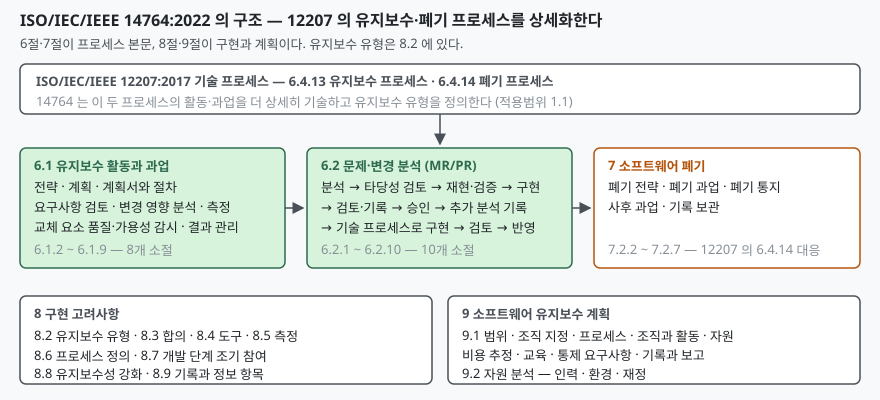
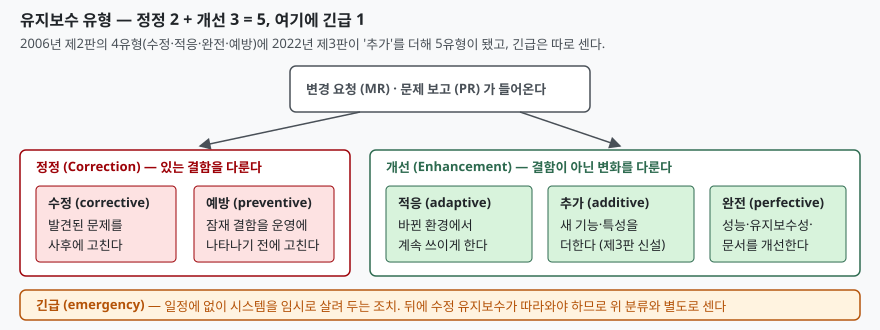

> 실행 검증 없음. 표준 기반 개념 글이므로 공개 자료 근거만으로 정리했다.
>
> 14764:2022 의 목차, 서문의 개정 내역, 서론, 적용범위, 그리고 용어 3.1.1(적응)·3.1.2(추가)의
> 정의는 발행처 공인 미리보기(VDE Verlag 가 공개한 앞부분)에서 직접 확인했다. 나머지 유형의
> 정의와 정정·개선 묶음은 미리보기 범위 밖이라, 이 표준을 인용해 정리한 IEEE 컴퓨터
> 소사이어티의 SWEBOK Guide V4.0a 7장(소프트웨어 유지보수)을 근거로 썼다. 6.1·6.2 각 소절의
> 과업 본문은 유료 구간이라 열지 않았으므로, 이 글은 **구조와 유형, 경계**를 다룬다.

## 들어가며

유지보수 문항은 두 갈래로 나온다. 하나는 "유지보수 유형을 설명하라"이고, 다른 하나는
재공학·역공학·형상관리처럼 **유지보수 단계에서 벌어지는 일**을 묻는 문항이다. 어느
쪽이든 채점자가 먼저 보는 것은 유형의 개수와 이름이다. 그런데 국내 교재 대부분은
2006년 제2판 기준의 **4유형**(수정·적응·완전·예방)을 싣고 있고, 현행 제3판(2022)은
여기에 하나를 더해 **5유형**으로 세며 긴급 유지보수를 따로 둔다. 어느 판을 기준으로
쓰는지 밝히지 않으면 4개를 쓰든 5개를 쓰든 감점 사유가 된다. 실무에서도 같은 문제가
생긴다. 유지보수 계약에서 "기능 추가"가 유지보수 범위인지 새 개발인지를 가르는 기준이
바로 이 유형 정의다.

## 정의

**ISO/IEC/IEEE 14764 는 ISO/IEC/IEEE 12207 이 정한 유지보수 프로세스(6.4.13)와 폐기
프로세스(6.4.14)의 활동·과업을 더 상세히 기술하고, 유지보수의 여러 유형을 정의하는
소프트웨어 유지보수 지침 표준이다.** 적용범위가 이 문장 그대로다. 현행판은 **2022년 1월
발행 제3판(ISO/IEC/IEEE 14764:2022)** 이고, 제2판(ISO/IEC 14764:2006)을 기술적으로 개정해
대체했다. 작성 주체는 ISO/IEC JTC 1/SC 7 과 IEEE 컴퓨터 소사이어티의 공동 작업이다.

서론은 유지보수를 **12207 이 정한 소프트웨어 제품 생명주기의 기술 프로세스 하나**로
자리매김하고, 이 표준이 **ISO/IEC 14764 와 IEEE Std 1219 를 조화시킨 결과**이며
12207:2017 에 맞춰 갱신한 것이라고 적는다. 답안의 정의 줄에는 "12207 의 유지보수
프로세스를 상세화한 지침"이라는 관계를 넣는 편이 좋다. 이 표준은 **지침(guidance)** 이고,
활동·과업을 어떻게 수행할지는 합의와 조직 요구사항에 달렸다고 스스로 한계를 적는다.

## 등장 배경

서론이 배경을 두 줄로 적는다. 첫째, **유지보수가 생명주기 재정 자원의 큰 몫을 소비**하므로
프로젝트의 중요한 고려사항이어야 한다. 둘째, 검증·확인·인수에서 잡히지 않은 문제가 운영
중에 드러나고, 새로운 요구사항·운영체제나 데이터베이스 같은 구성요소의 업그레이드·외부
인터페이스 변경이 유지보수를 요구한다. 유지보수가 개발의 뒷정리가 아니라 **별도의
프로세스와 기법을 가진 일**이라는 인식이 이 표준의 출발점이다.

제3판의 개정 목표는 서문에 **2가지**로 적혀 있다. **12207:2017 과의 정렬**(그리고 다른
SC 7 표준에 맞춘 갱신), 그리고 **유지보수의 현대적 접근법 도입**이다. 적용범위는 이
표준이 점증·폭포수·진화·나선·애자일·연속 반복 개발 등 **생명주기 모델에 무관하게**
쓰인다고 적고, "버리는" 단기 소프트웨어에는 쓰지 않는다고 못 박는다. 유지보수 대상도
프로그램·코드·데이터·문서·기록이며, 테스트 소프트웨어와 테스트 데이터베이스, 소프트웨어
공학 환경까지 포함한다.

## 구성요소

### 유지보수 유형 — 5가지, 그리고 긴급 1가지

제3판은 유지보수 요청을 분류하는 유형을 **5가지**로 표준화했고, 이것을 **정정(correction)**
과 **개선(enhancement)** 두 묶음으로 다시 묶는다. 긴급 유지보수는 **여섯째 유형**으로
따로 정의한다. 아래 표의 적응·추가 정의는 표준 3.1.1·3.1.2 원문을 옮긴 것이고, 나머지는
SWEBOK V4.0a 가 이 표준을 인용해 적은 정의를 옮겼다.

| 묶음 | 유형 | 정의 (인도 후 소프트웨어 제품의 변경) |
|---|---|---|
| 정정 | **수정 (corrective)** | 발견된 문제를 고치기 위한 **사후(reactive)** 변경 |
| 정정 | **예방 (preventive)** | 잠재 결함이 운영 시스템에서 나타나기 **전에** 고치는 변경 |
| 개선 | **적응 (adaptive)** | 바뀌었거나 바뀌는 환경에서 제품이 **계속 쓰이게** 하는 변경. 운영체제 업그레이드로 응용이 바뀌는 경우가 표준의 예 |
| 개선 | **추가 (additive)** | 제품 사용을 높이기 위해 **기능이나 특성을 더하는** 변경 |
| 개선 | **완전 (perfective)** | 사용자용 개선, 문서 개선, 성능·유지보수성 등 속성 향상을 위한 재코딩 |
| 별도 | **긴급 (emergency)** | 수정 유지보수를 기다리는 동안 시스템을 **임시로** 운영 가능하게 하는 **일정에 없는** 변경 |

가르는 축은 둘이다. **결함이 있는가**(정정 / 개선)와 **선제적인가 대응적인가**(proactive /
reactive). 제2판을 인용한 SWEBOK V3.0 의 표가 이 두 축으로 4유형을 놓는다. **예방·완전이
선제**, **수정·적응이 대응**이다. 적응이 대응 쪽에 놓이는 점을 틀리기 쉽다. 운영체제가
바뀐 **뒤에** 따라가는 변경이므로 대응이다. 추가는 제3판에서 들어와 그 표에 없고 개선
묶음에만 속한다. 긴급은 정의상 대응이되 "임시"라는 점에서 수정과 갈린다.

**추가 유지보수가 제3판에서 들어온 이유**는 표준의 정의 노트가 직접 적는다. 완전과 구분해
따로 두는 것은, 비교적 큰 추가·변경을 유지보수로 다룰 때 **전략·방법·자원·합의·서비스
수준을 공급자와 취득자가 다시 협상할 기회**를 식별하기 위해서다. 추가와 개선은 유지보수
프로세스로 처리할 수 있지만, **더 큰 변경은 새 개발로 넘어갈 수 있다**는 단서도 같은
노트에 있다. 유지보수 계약의 범위 다툼이 이 한 줄에서 갈린다.

또 하나의 노트가 시험에 쓸 만하다. 가용성·복구성·MTBF 처럼 **신인성(dependability)**
맥락에서는 "이전 운영 수준으로 되돌리는 것"이 유지보수이므로, 추가 유지보수가 그 정의에서
**제외될 수 있다**고 적는다. 같은 단어가 분야마다 범위가 다르다는 사실을 답안에 쓰면
정의를 외운 수준을 넘어선다.

### 유지보수 프로세스 — 활동 4가지, 소절 8 + 10

12207 의 유지보수 프로세스가 가진 활동은 **4가지**다. **유지보수 준비, 유지보수 수행,
군수 지원 수행, 유지보수·군수 결과 관리**. SWEBOK V4.0a 가 14764 를 인용해 이 네 활동을
적는다. 14764 는 이 네 활동을 6절에서 두 축으로 펼친다.

| 절 | 무엇 | 소절 |
|---|---|---|
| **6.1 유지보수 활동과 과업** | 전략 · 계획 · 계획서와 절차 · 요구사항 검토 · 변경 영향 분석 · 측정 · 교체 요소의 품질·가용성 감시 · 유지보수·군수 결과 관리 | 6.1.2 ~ 6.1.9, **8개** |
| **6.2 문제·변경 분석** | 분석 → MR/PR 타당성 검토 → 재현·검증 → 구현 → 검토·기록 → 승인 → 추가 분석 기록 → 기술 프로세스를 이용한 구현 → 변경된 시스템 검토 → 승인·반영 | 6.2.1 ~ 6.2.10, **10개** |

6.1 이 유지보수 조직이 **상시로 갖춰 두는 것**(전략·계획·측정·감시)이라면, 6.2 는
**요청 하나가 들어올 때마다 도는 것**이다. 변경 요청(MR)과 문제 보고(PR)가 들어오면
타당성을 보고, 재현해 확인하고, 구현한 뒤, 검토·승인을 거쳐 반영한다. 구현은 14764 가
따로 정하지 않고 **12207 의 기술 프로세스**(요구사항 정의·설계·구현·통합·검증 등)를
다시 부른다. 유지보수가 작은 개발이라는 말이 표준 구조에 그대로 들어 있다.

### 소프트웨어 폐기 — 7절

14764 는 운영(백업·복구·시스템 관리)은 다루지 않지만 **폐기는 다룬다.** 12207 의 폐기
프로세스(6.4.14)에 대응하는 7절은 **폐기 전략 → 폐기 과업 → 폐기 통지 → 사후 과업 →
기록 보관**(7.2.2 ~ 7.2.7)으로 이어진다. 유지보수 단계가 "소프트웨어가 폐기될 때까지"
이어지므로 끝을 정하는 절차가 유지보수 표준 안에 있는 것이다.

### 구현 고려사항과 유지보수 계획 — 8절·9절

8절은 유지보수 유형(8.2)·합의(8.3)·도구(8.4)·측정(8.5)·프로세스 정의(8.6)·**개발 단계
조기 참여**(8.7)·**생명주기 프로세스로 유지보수성 강화**(8.8)·기록(8.9)을 다룬다. 8.7 과
8.8 은 유지보수 조직이 개발이 끝난 뒤가 아니라 **개발 중에** 관여해야 한다는 제3판의
"현대적 접근"이다. 9절은 유지보수 계획서의 항목(범위·조직 지정·프로세스·자원·비용 추정·
교육·통제 요구사항·기록)과 자원 분석(인력·환경·재정)을 적는다.

## 도식

> **출처**: [ISO/IEC/IEEE 14764:2022, Software engineering — Software life cycle processes — Maintenance, Contents · 1.1 Overview (VDE Verlag 공개 미리보기)](https://assets.vde-verlag.de/iec-normen/preview-pdf/info_isoiecieee14764%7Bed3.0%7Den.pdf) — 6.1 ~ 9.2 의 소절 이름과 개수, 12207:2017 의 6.4.13·6.4.14 에 기반한다는 서술

> **출처**: [ISO/IEC/IEEE 14764:2022, 3.1.1 adaptive maintenance · 3.1.2 additive maintenance (VDE Verlag 공개 미리보기)](https://assets.vde-verlag.de/iec-normen/preview-pdf/info_isoiecieee14764%7Bed3.0%7Den.pdf) · [SWEBOK Guide V4.0a, Chapter 7 Software Maintenance, 1.6 Categories of Software Maintenance, Figure 7.2 (IEEE Computer Society, 2024)](https://ieeecs-media.computer.org/media/education/swebok/swebok-v4.pdf) — 5유형과 긴급, 정정·개선 묶음

## 비교

### 제2판(2006)과 제3판(2022)

| 축 | ISO/IEC 14764:2006 (제2판) | ISO/IEC/IEEE 14764:2022 (제3판) |
|---|---|---|
| 유지보수 유형 | **4** — 수정·적응·완전·예방 (SWEBOK V3.0 이 이 판을 인용해 적는 분류) | **5** — 수정·예방·적응·추가·완전, 긴급은 별도 |
| 긴급 유지보수 | **수정 유지보수에 포함**된 것으로 기술 | **여섯째 유형**으로 따로 정의 |
| 기준 생명주기 표준 | ISO/IEC 12207:2008 계열 | **ISO/IEC/IEEE 12207:2017** (6.4.13 · 6.4.14) |
| 작성 주체 | ISO/IEC | ISO/IEC 와 IEEE 공동 (IEEE Std 1219 와 조화) |
| 강조점 | 유지보수 프로세스 | 유지보수성, 유지보수 서비스 모델, 유지보수 전략, 개발 단계 조기 참여 |

답안에 유형을 쓸 때는 **판을 먼저 적는다.** "제3판 기준 5유형, 제2판에서는 추가가
완전에 포함돼 4유형"이라고 쓰면 두 교재 어느 쪽으로 채점하더라도 틀리지 않는다.

### 유지보수 유형끼리

| 질문 | 수정 | 예방 | 적응 | 추가 | 완전 | 긴급 |
|---|---|---|---|---|---|---|
| 결함이 계기인가 | 예 | 예 (잠재) | 아니오 | 아니오 | 아니오 | 예 |
| 선제인가 대응인가 | 대응 | 선제 | 대응 | (제2판 표에 없음) | 선제 | 대응 (일정 없음) |
| 바뀌는 것 | 결함 | 결함 | 환경 대응 | 기능 범위 | 품질 속성 | 임시 우회 |
| 묶음 | 정정 | 정정 | 개선 | 개선 | 개선 | 별도 |

적응과 완전이 가장 자주 헷갈린다. **바깥이 바뀌어서** 손대면 적응이고, **바깥은 그대로인데
안을 더 좋게** 만들면 완전이다. 추가는 완전과 겹쳐 보이지만, 표준은 "비교적 큰 추가"를
따로 세어 **재협상의 계기**로 삼으라고 적는다.

### 유지보수와 재공학

표준은 재공학 절차를 따로 정하지 않는다. 재공학 과제는 이 프로세스 안에서 **6.2 의
변경 요청 하나**로 들어와 타당성 검토와 영향 분석을 거치고, 구현은 12207 의 기술
프로세스로 수행된다. 유형으로는 대개 **완전**(유지보수성 향상)이거나 **적응**(플랫폼
이전)이고, 규모가 크면 추가 유지보수의 노트가 말하는 "새 개발로 넘어가는" 경계에
걸린다. 재공학이 유지보수의 하위 기법이면서 동시에 새 개발과의 경계에 서는 이유다.

## 적용 시 고려사항

- **유형 판정을 계약 전에 합의한다.** 추가와 완전의 경계, 새 개발로 넘어가는 규모를
  문서로 정해 두지 않으면 요청마다 범위 다툼이 된다. 표준이 추가 유형을 둔 이유가 바로
  재협상 계기의 식별이다.
- **긴급 유지보수는 뒤처리를 전제로 한다.** 정의 자체가 "수정 유지보수를 기다리는 동안의
  임시 조치"다. 긴급으로 넣은 우회 코드를 수정 유지보수로 되돌리는 MR 을 함께 발행하지
  않으면 임시 조치가 영구 구조가 된다.
- **유지보수 조직을 개발 중에 참여시킨다.** 8.7 조기 참여와 8.8 유지보수성 강화가
  제3판의 핵심 변경이다. 인수 뒤에 처음 코드를 받는 조직은 6.1.5 요구사항 검토를 할
  근거가 없다.
- **측정 항목을 유형별로 둔다.** 6.1.7 측정과 8.5 가 유형별 공수 집계를 권한다.
  수정 비중이 높으면 품질 문제, 적응 비중이 높으면 플랫폼 노후화라는 신호를 읽을 수 있다.
- **폐기까지가 유지보수 범위다.** 7절의 폐기 통지·사후 과업·기록 보관을 계획에 넣지
  않으면 시스템을 내린 뒤 데이터 이관과 기록 보존이 공중에 뜬다.
- **운영과 섞지 않는다.** 백업·복구·시스템 관리는 이 표준 범위 밖이다. 답안에서
  운영 활동을 유지보수 활동으로 적으면 적용범위를 모른다는 표시가 된다.

## 정리

- 정의 한 줄: **14764 는 12207 의 유지보수 프로세스(6.4.13)와 폐기 프로세스(6.4.14)를
  상세화하고 유지보수 유형을 정의하는 지침 표준이다.** 현행은 2022년 제3판이다.
- 유형은 **정정 2(수정·예방) + 개선 3(적응·추가·완전) = 5, 그리고 긴급 1**. 축은
  "결함이 있는가"와 "선제인가 대응인가" 둘이고, **예방·완전이 선제, 수정·적응이 대응**이다.
  제2판은 추가가 없는 4유형이고 긴급을 수정에 포함했다.
- 프로세스는 **활동 4(준비·수행·군수 지원·결과 관리)** 를 **6.1 상시 활동 8개 소절**과
  **6.2 요청별 분석 10개 소절**로 펼치고, 구현은 12207 의 기술 프로세스를 부른다.
- **폐기(7절)까지가 범위**이고 운영은 범위 밖이다.
- 제3판의 방향은 **조기 참여와 유지보수성**이다. 개발이 끝난 뒤 받는 조직이 아니라
  개발 중에 관여하는 조직을 전제한다.

> 기출 답안: [기출문제 — 소프트웨어 재공학 절차와 역공학](../../exam/2026-10-30-software-reengineering-process-and-reverse-engineering/index.md) — 재공학 과제가 이 프로세스의 6.2 변경 요청으로 들어온다는 관계를 답안에 적용한 글
>
> 함께 보기: [소프트웨어 재공학과 역공학](../2026-10-23-software-reengineering-reverse-engineering/index.md) — 유지보수 기법으로서의 재공학·역공학 정의 · [ISO/IEC/IEEE 12207 소프트웨어 생명주기 프로세스](../2026-10-30-iso-iec-ieee-12207-software-life-cycle-processes/index.md) — 14764 가 상세화하는 기술 프로세스 14개의 자리

## 참고 자료

- [ISO/IEC/IEEE 14764:2022, Software engineering — Software life cycle processes — Maintenance (ISO 카탈로그)](https://www.iso.org/standard/80710.html) — 현행 제3판(2022-01)의 발행 정보
- [ISO/IEC/IEEE 14764:2022 공개 미리보기 — 목차·서문·서론·적용범위·용어 3.1.1~3.1.2 (VDE Verlag)](https://assets.vde-verlag.de/iec-normen/preview-pdf/info_isoiecieee14764%7Bed3.0%7Den.pdf) — 6.1·6.2·7·8·9 절 구조, 제3판 주요 변경 2가지, 적응·추가 유지보수 정의와 노트
- [SWEBOK Guide V4.0a, Chapter 7 Software Maintenance (IEEE Computer Society, 2024)](https://ieeecs-media.computer.org/media/education/swebok/swebok-v4.pdf) — 1.6 유지보수 유형 5가지와 긴급, Figure 7.2 정정·개선 묶음, 3.1 유지보수 프로세스 활동 4가지
- [SWEBOK Guide V3.0, Chapter 5 Software Maintenance (IEEE Computer Society, 2014)](https://ieeecs-media.computer.org/media/education/swebok/swebok-v3.pdf) — 제2판(2006)을 인용한 4유형 분류, 긴급을 수정에 포함한 서술, Table 5.1 의 선제·대응 × 정정·개선 표
- [ISO/IEC/IEEE 12207:2017, Systems and software engineering — Software life cycle processes (ISO 카탈로그)](https://www.iso.org/standard/63712.html) — 14764 가 기반으로 삼는 유지보수(6.4.13)·폐기(6.4.14) 프로세스
