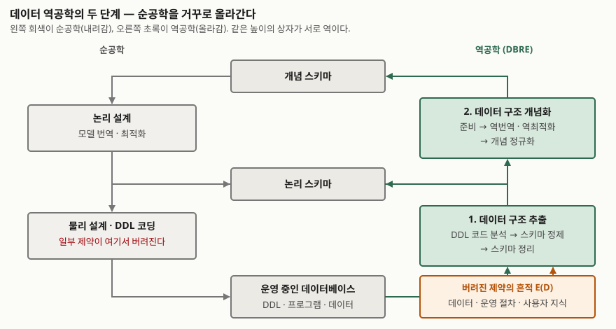

> **실행 검증 없음.** 원 논문과 방법론 문서에 적힌 정의·절차만으로 쓴다.
> 도구 실행 결과나 측정값은 싣지 않는다.

## 들어가며

레거시 시스템을 새 플랫폼으로 옮기는 과제를 받으면 가장 먼저 열어 보는 것이 데이터베이스
스키마다. 그런데 테이블 40개짜리 DDL에 외래키 선언이 하나도 없다. 조인은 분명 돌아가고
있으니 관계는 있는데, 그 관계가 어디에 적혀 있는지는 코드를 뒤져야 안다. 컬럼 하나에
구분 코드와 일련번호가 붙어 들어가 있고, 널이 들어오면 안 되는 컬럼이 널 허용으로
선언돼 있다.

이 상태에서 전환 규칙을 쓰면 **DDL에 없는 제약을 전부 놓친다.** 데이터 역공학은 이
빠진 제약을 코드·화면·데이터에서 되찾아 논리 모델을 복원하는 활동이다. 시험에서는
소프트웨어 역공학의 한 유형으로 묻고, 실무에서는 데이터 전환과 통합의 첫 단계로 쓴다.

## 정의

**데이터베이스 역공학(Database Reverse Engineering, DBRE)** 은 운영 중인 데이터베이스의
DDL·프로그램·데이터를 분석해 **명시적·암묵적 구조와 제약을 모두 담은 논리 스키마를
복원하고, 그 논리 스키마의 바탕이 되는 개념 스키마를 되찾는 과정**이다
([J-L Hainaut, Introduction to Database Reverse Engineering, 4장 초록](https://staff.info.unamur.be/dbm/Documents/Publications-LIBD/Ouvrages-Web/Database-Reverse-Engineering/DBRE-2002.pdf)).

상위 개념인 역공학의 정의는 Chikofsky·Cross가 정리했다. 대상 시스템을 분석해 구성요소와
상호관계를 식별하고, 더 높은 추상화 수준으로 표현하되 **시스템을 바꾸지 않는** 과정이다
([IEEE Software 7(1), 1990](https://doi.org/10.1109/52.43044)). 소프트웨어 공학 지식체계는
역공학의 유형을 재문서화·설계 복구·데이터 역공학 셋으로 들고, 데이터 역공학을 물리
데이터베이스에서 논리 스키마를 복원하는 활동으로 둔다
([SWEBOK Guide V4.0a, Software Maintenance KA](https://www.computer.org/education/bodies-of-knowledge/software-engineering)).

## 등장 배경

순공학이 완전했다면 역공학은 DDL만 읽으면 끝난다. 그렇지 않은 이유를 Hainaut는
**7가지**로 분류한다(같은 문서 1장).

| # | 원인 | 무엇이 벌어지는가 |
|---|---|---|
| ① | 문서 부재 | 문서가 없거나, 있어도 부분적·구식·불일치 상태다 |
| ② | 데이터 모델의 표현력 한계 | 파일 시스템·IMS·CODASYL은 개념 스키마의 제약 일부만 선언할 수 있어 나머지가 프로그램으로 밀려난다 |
| ③ | 암묵 구조 | 선언할 수 있는데도 **일부러 DDL에 적지 않고** 프로그램에서 관리한다 |
| ④ | 최적화 구조 | 응답 시간을 위해 비정규화·중복·분할을 넣어 의미와 무관한 구조가 섞인다 |
| ⑤ | 서툰 설계 | 훈련되지 않은 설계자가 잘못된 구조를 만든다 |
| ⑥ | 폐기된 구조 | 더 이상 어느 프로그램도 쓰지 않는 테이블·컬럼이 남아 있다 |
| ⑦ | 다른 모델의 영향 | 관계형 DB가 사실은 IMS 구조나 스프레드시트를 그대로 옮긴 것이다 |

③이 이 주제의 핵심이다. 외래키는 관계형 DBMS가 선언할 수 있는 제약인데도 성능이나
적재 편의 때문에 빼는 일이 흔했고, 그 검사는 응용 프로그램·트리거·화면 검증 코드로
흩어졌다. Hainaut는 이렇게 흩어진 제약의 구현 방식을 DBMS 안쪽 기법 4가지(검사 술어,
검사 옵션 뷰, 트리거, 저장 프로시저)와 바깥쪽 기법 5가지(접근 모듈, 흩어진 코드 조각,
화면 검증 코드, 사전 검증 프로그램, 사후 검증 프로그램)로 나누고, **바깥쪽이 훨씬 흔하면서
찾기도 훨씬 어렵다**고 적는다(같은 문서 3장).

## 구성요소 — 2단계 6소단계

Hainaut의 방법론은 역공학을 순공학의 역순으로 세운다. 순공학이 개념 스키마 → 논리 설계 →
물리 설계·코딩으로 내려오므로, 역공학은 **코드에서 논리 스키마를 뽑는 추출**과 **논리
스키마를 개념 스키마로 해석하는 개념화** 두 단계로 올라간다(같은 문서 4장).

| 단계 | 소단계 | 하는 일 | 산출물 |
|---|---|---|---|
| **1. 데이터 구조 추출** (Data Structure Extraction) | ① DDL 코드 분석 | 스키마 스크립트·시스템 카탈로그에서 선언된 구조를 뽑는다 | 명시적 물리 스키마 |
| | ② 스키마 정제 | 프로그램·화면·데이터·문서에서 **암묵 구조와 제약**을 찾아 보탠다 | 완전한 물리 스키마 |
| | ③ 스키마 정리 | 인덱스·저장 공간 같은 물리 전용 요소를 걷어낸다 | **논리 스키마** |
| **2. 데이터 구조 개념화** (Data Structure Conceptualization) | ④ 준비 | 폐기된 구조와 기술용 구조(프로그램 카운터, 마지막 사용자 이름)를 버리고 이름을 다듬는다 | 정리된 논리 스키마 |
| | ⑤ 기본 개념화 | **역번역**(외래키 → 관계 타입)과 **역최적화**(비정규화·중복·분할 되돌리기) | 원시 개념 스키마 |
| | ⑥ 개념 정규화 | 다대다 관계·서브타입·속성 엔티티를 드러내고 이름을 표준화한다 | **개념 스키마** |

둘 중 어려운 쪽은 ②다. DDL 분석은 도구가 거의 자동으로 하지만, 정제는 **DDL 바깥의 정보
출처**를 사람이 읽어야 한다. 실무 과제에서 시간이 가장 많이 드는 소단계이고, 시험 답안에서도
점수가 갈리는 자리다. 추출 앞에는 분석 대상 식별·아키텍처 복구·자원 산정·일정을 정하는
**프로젝트 준비** 단계가 붙지만, 방법론의 본체는 위 두 단계다.

### 정제가 읽는 정보 출처 — 9가지

| # | 출처 | 무엇을 얻는가 |
|---|---|---|
| ① | DBMS 코드 조각 (검사 술어·트리거·저장 프로시저) | 제약을 가장 간결하게 적어 둔 곳 |
| ② | 응용 프로그램 | 검증 루틴에서 유효 값과 제약을 읽는다. 사용 패턴 분석이라 부른다 |
| ③ | 화면·대화 처리 절차 | 입력 이벤트에 걸린 검증 코드 |
| ④ | 화면·양식·보고서 레이아웃 | 라벨과 배치가 필드의 뜻과 묶음을 드러낸다 |
| ⑤ | 현행 문서 | 부분적이고 낡았지만 핵심 구성요소의 단서가 된다 |
| ⑥ | 외부 데이터 사전·CASE 저장소 | 비공식적이지만 의미 파악에 유용. DB와 자동 동기화되지 않아 낡을 수 있다 |
| ⑦ | 도메인 지식 | 분석자가 먼저 가진 개념 모델. 현업·개발자 인터뷰로 검증한다 |
| ⑧ | 데이터 | 유일성·포함 관계·값 패턴으로 식별자·외래키·분해·선택 필드 가설을 확인하거나 깨뜨린다 |
| ⑨ | 비DB 자료 (스프레드시트 등) | 소규모 데이터가 DB 밖에 있는 경우 |

프로그램을 읽는 기법은 **4가지**다. 데이터플로 분석, 의존성 분석, 프로그래밍 클리셰 분석,
프로그램 슬라이싱이다(같은 문서 5장). 클리셰 분석은 "제약 하나를 검사하는 트리거의 모양"을
패턴으로 정해 두고 수천 쪽 스크립트에서 같은 모양을 전부 찾는 방식이고, 슬라이싱은 한
필드에 영향을 주는 문장만 큰 프로그램에서 잘라내는 방식이다.

### 암묵 구조 하나를 확정하는 절차 — 가설 4단계

정제는 결정론적 변환이 아니라 **가설을 세우고 증거를 모으는 결정 과정**이다. Hainaut는
각 암묵 구조에 대한 기법을 네 가지로 분류한다(같은 문서 5장).

1. **가설 촉발** — 가능성을 드러낸다. 컬럼 이름에 참조 대상 테이블 이름이 들어 있다
2. **가설 완성** — 가설을 온전한 문장으로 만든다. "B.B2는 A.A1을 참조하는 외래키다"
3. **가설 입증** — 신뢰를 높인다. B2에 인덱스가 있고, 타입·길이가 A1과 같고, 데이터에서 B2 값이 전부 A1에 포함된다
4. **가설 반증** — 신뢰를 낮춘다. A1에 없는 B2 값이 발견된다

마지막 판단은 분석자가 한다. 문서는 이 때문에 암묵 구조 추출이 **형식적·결정적 절차가 될 수
없다**고 못 박는다. 찾아야 할 암묵 구조의 종류는 필드 세분 구조, 선택 필드, 필드 묶음,
다중값 필드, 식별자, 외래키, 배열 뒤의 집합, 함수 종속, 존재 제약, 최소·최대 카디널리티,
중복, 열거 도메인, 도메인 제약, 의미 있는 이름까지 **17가지**로 열거된다.

## 도식

> **출처**: [J-L Hainaut, Introduction to Database Reverse Engineering (LIBD, 2002), Figure 4-1 The main DBRE processes as the inverse of forward processes · Figure 4-2 General architecture of the reference DBRE methodology](https://staff.info.unamur.be/dbm/Documents/Publications-LIBD/Ouvrages-Web/Database-Reverse-Engineering/DBRE-2002.pdf)

답안지에 옮길 때는 위에서 아래로 순공학, 아래에서 위로 역공학 화살표를 긋고 **추출 ↔
물리 설계·코딩, 개념화 ↔ 논리 설계**가 서로 역이라는 대응만 보이면 된다.

## 비교

### 순공학 단계와의 대응

| 순공학 (내려감) | 역공학 (올라감) | 관계 |
|---|---|---|
| 개념 정규화 | 개념 정규화 | 같다 |
| 최적화 | 역최적화 | 역 |
| 모델 번역 (관계 → 외래키) | 역번역 (외래키 → 관계) | 역 |
| 물리 설계·DDL 코딩 | 스키마 정리·DDL 코드 추출 | 역 |
| (버려진 의미 D) | 스키마 정제가 E(D)에서 되찾는다 | 순공학에 짝이 없다 |

마지막 줄이 역공학을 어렵게 만든다. 순공학에서 **버려진 의미**는 사라진 것이 아니라 데이터와
운영 절차, 사용자 지식에 흔적으로 남아 있고(문서는 이를 E(D)라 부른다), 정제는 그 흔적을
읽는 일이다.

### 유사 개념과의 구분

| 구분 | 데이터 역공학 | 코드 역공학 (설계 복구) | 데이터 프로파일링 | 데이터 전환 |
|---|---|---|---|---|
| 대상 | 스키마·데이터·접근 코드 | 소스 코드 | 데이터 값 | 데이터 |
| 산출물 | 논리·개념 스키마 | 설계 문서·호출 관계 | 통계·패턴 보고서 | 옮겨진 데이터 |
| 시스템 변경 | 없음 | 없음 | 없음 | 새 저장소에 적재 |
| 관계 | 재공학의 앞 구간 | 재공학의 앞 구간 | 역공학의 **정보 출처 ⑧**을 다루는 기법 | 역공학의 **결과를 입력**으로 쓴다 |

데이터 프로파일링은 데이터 역공학과 자주 혼동된다. 프로파일링은 "현재 데이터가 어떤
성질을 보이는가"를 세는 기법이고, 역공학은 그 결과를 증거로 삼아 "설계자가 의도한 제약이
무엇인가"를 판단하는 활동이다. 데이터에 널이 없다고 해서 그 컬럼이 필수라는 보장은 없다.

## 적용 시 고려사항

- **데이터 분석은 반증에 강하고 입증에 약하다.** A1에 없는 B2 값 하나면 외래키 가설이
  깨지지만, 전부 포함된다는 사실은 외래키였을 가능성을 높일 뿐이다. 데이터로 세운
  가설은 코드나 현업 확인으로 한 번 더 받친다.
- **산출물에 근거를 붙인다.** DDL에서 뽑은 구조와 이름 분석으로 추측한 외래키는 확실성이
  다르다. 논리 스키마의 각 제약에 어느 출처에서 어떻게 확인했는지를 남기지 않으면,
  전환 규칙을 쓸 때 어느 제약을 강제해도 되는지 판단할 수 없다.
- **폐기된 구조를 먼저 걸러낸다.** 어느 프로그램도 참조하지 않고, 행이 없거나 오래
  갱신되지 않은 테이블은 준비 소단계에서 빼야 한다. 빼지 않으면 없는 의미를 만들어
  붙이는 데 시간을 쓴다.
- **역최적화의 되돌림은 의미가 아니라 성능을 바꾼다.** 비정규화를 풀어 개념 스키마에
  올리는 것은 맞지만, 새 시스템의 물리 설계에서 같은 최적화가 다시 필요할 수 있다.
  개념 스키마와 전환 대상 물리 스키마를 혼동하지 않는다.
- **실제 데이터를 읽는 권한을 확인한다.** 정보 출처 ⑧은 운영 데이터다. 개인정보가
  포함된 테이블의 값 분포를 보려면 가명처리나 접근 승인이 먼저다.
- **도구는 촉발과 완성까지 돕는다.** DDL 추출, 이름 패턴 검색, 포함 관계 질의 생성은
  도구가 하지만, 입증·반증을 종합해 구조로 확정하는 판단은 분석자가 한다.

## 정리

- **2단계**: 추출(코드 → 논리 스키마) → 개념화(논리 → 개념 스키마). 각각 순공학의 물리
  설계·코딩과 논리 설계의 역이다
- **추출 3소단계**: DDL 코드 분석 → 스키마 정제 → 스키마 정리. 정제가 본체다
- **개념화 3소단계**: 준비 → 기본 개념화(역번역·역최적화) → 개념 정규화
- **정보 출처 9가지**, 프로그램 분석 기법 **4가지**, 가설 **4단계**(촉발·완성·입증·반증)
- 외우는 단서: **"추·개 — 정·제·가"**. 추출과 개념화, 추출의 핵심은 정제, 정제는 가설로 한다

> 기출 답안: [기출문제 — 소프트웨어 재공학의 개념·목적·절차와 역공학의 활용](../../exam/2026-10-30-software-reengineering-process-and-reverse-engineering/index.md)
>
> 상위 개념: [소프트웨어 재공학과 역공학](../2026-10-23-software-reengineering-reverse-engineering/index.md)

## 참고 자료

- [J-L Hainaut, Introduction to Database Reverse Engineering, LIBD, University of Namur (2002, 2007 개정)](https://staff.info.unamur.be/dbm/Documents/Publications-LIBD/Ouvrages-Web/Database-Reverse-Engineering/DBRE-2002.pdf) — 1장 문제의 원인 7가지, 3장 제약 구현 기법, 4장 방법론 구조, 5장 추출 과정(정보 출처·분석 기법·가설 4단계·암묵 구조 17가지), 6장 개념화 과정
- [J-L Hainaut et al., Data Structure Extraction in Database Reverse Engineering (University of Namur 연구 포털)](https://researchportal.unamur.be/fr/publications/data-structure-extraction-in-database-reverse-engineering) — 추출 단계의 결정 과정
- [E. J. Chikofsky, J. H. Cross II, Reverse Engineering and Design Recovery: A Taxonomy, IEEE Software 7(1) pp.13-17 (1990-01)](https://doi.org/10.1109/52.43044) — 역공학·설계 복구의 정의
- [SWEBOK Guide V4.0a, Chapter 7 Software Maintenance (IEEE Computer Society, 2024)](https://www.computer.org/education/bodies-of-knowledge/software-engineering) — 역공학의 세 유형
