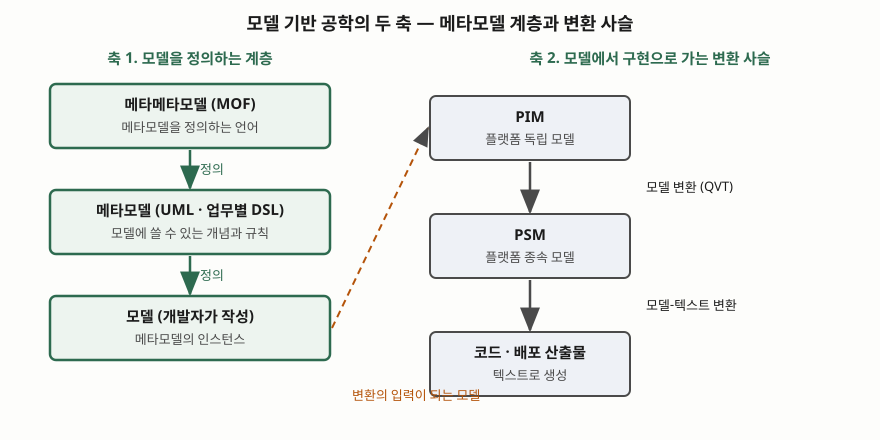

> 실행 검증 없음. OMG 명세와 공식 페이지의 진술만을 근거로 정리했다. MOF 2.5.1은 PDF 본문을 읽었고,
> XMI·QVT·MDA·EMF는 공식 개요 페이지까지만 읽었다. MDA 지침서(rev 2.0) 본문은 열람하지 못해
> CIM의 정의는 쓰지 않았다.

## 들어가며

로우코드 플랫폼의 한계를 묻는 문제에서 "모델 기반 공학과의 관계"가 따라붙는 일이 잦다. 같은 질문이
앞쪽 기출에서 나온다. 로우코드가 공급자 종속과 이식 불가를 안고 있다면, 이미 표준을 쌓아 온 MDE가
그 해법이 되는가, 아니면 둘은 별개인가를 묻는 것이다.

실무 문제는 단순하다. 같은 업무 규칙을 Java와 .NET에 각각 구현하고, 규칙이 바뀔 때마다 두 곳을
고친다. 모델을 한 곳에 두고 구현을 기계가 얻도록 하면 고치는 곳은 하나가 된다. 이 구조가 MDE의
출발점이다.

## 정의

**모델 기반 공학(MDE)은 모델을 설계 문서가 아닌 1급 산출물로 두고, 모델 변환과 코드 생성으로 구현을
얻는 소프트웨어 개발 방식이다.**

주의할 점은 MDE라는 이름에 **단일 표준 정의가 없다**는 것이다. OMG가 표준화한 것은 MDA(Model Driven
Architecture)이고, OMG는 MDA를 "소프트웨어 설계·개발·구현에 대한 접근 방식"이라고 소개한다
([OMG, Model Driven Architecture](https://www.omg.org/mda)). MDE는 그 접근을 더 넓게 부르는 학계·산업의
우산 용어로 쓰인다. 위 정의는 OMG 표준들이 공통으로 전제하는 구조(모델 → 변환 → 코드)를 요약한 것이다.

## 등장 배경

코드 중심 개발은 추상화 수준이 구현 언어에 묶인다. 플랫폼이 바뀌면(CORBA → Java EE → 웹 서비스)
같은 업무 로직을 새 플랫폼에 다시 써야 했다. OMG의 MDA 개요 페이지는 개발이 플랫폼 독립 모델(PIM)에서
시작해 플랫폼 종속 모델(PSM)을 거쳐 코드에 이르는 사슬을 설명한다
([OMG, MDA Executive Overview](https://www.omg.org/mda/executive_overview.htm)).

MOF 명세도 같은 문제의식을 설계 목표로 적는다. 메타모델 정의가 **기술 플랫폼에 독립적**이면서
J2EE·.Net·CORBA·웹 서비스 같은 여러 플랫폼으로 매핑하기 쉬워야 한다는 것이다
([OMG MOF 2.5.1 — 7.2 MOF 2 Design Goals 4번 항목](https://www.omg.org/spec/MOF/2.5.1/PDF)).

## 구성요소 — 6가지

MOF 명세의 범위 절은 MOF 위에 쌓인 표준을 나열한다. MDE를 구성하는 요소는 이 목록과 맞춰
**6가지**로 외운다([MOF 2.5.1 — 1 Scope](https://www.omg.org/spec/MOF/2.5.1/PDF)).

| 번호 | 구성요소 | 역할 | 대응 표준 |
|---|---|---|---|
| ① | 메타모델 | 모델에 쓸 개념과 규칙을 정의한다 | MOF(UML 클래스 모델링의 단순화에 기반) |
| ② | 모델 | 메타모델의 인스턴스. 개발자가 작성한다 | UML, 업무별 DSL |
| ③ | 제약 | 모델이 지켜야 할 규칙을 표현한다 | OCL |
| ④ | 모델 변환 | 모델에서 모델을 얻는다 | QVT |
| ⑤ | 모델-텍스트 변환 | 모델에서 코드 같은 텍스트를 생성한다 | MOF Models to Text |
| ⑥ | 모델 교환 | 모델을 XML로 저장하고 주고받는다 | XMI |

**DSL(도메인 특화 언어)은 ①의 메타모델이 도메인에 맞춰진 결과다.** UML처럼 범용 메타모델을 쓰면
범용 모델링이고, 업무 용어로 메타모델을 직접 정의하면 DSL이 된다. 이 글은 DSL의 별도 표준 정의를
읽지 않았으므로 이 관계를 표준 문장이 아니라 구조상의 설명으로만 적는다.

**QVT는 변환 언어를 3가지 둔다.** Relations, Operational Mappings, Core이다
([OMG QVT 1.3](https://www.omg.org/spec/QVT/)). 각 언어의 동작 방식은 본문을 읽지 못해 쓰지 않는다.

## 도식

> **출처**: [OMG MOF 2.5.1 — 1 Scope, 7.3 How Many Meta Layers?](https://www.omg.org/spec/MOF/2.5.1/PDF) · [OMG MDA Executive Overview](https://www.omg.org/mda/executive_overview.htm)

**계층 수를 "4계층"으로 외우되 고정으로 쓰지 않는다.** MOF 명세는 7.3절에서 흔히 말하는 4계층 구조가
오해를 부른다고 적는다. 핵심 개념은 분류자와 인스턴스이고 계층은 몇 개든 가능하며, 예로 2계층(클래스/객체),
3계층(관계형 DB의 시스템 테이블/테이블/행), 4계층(MOF/UML/사용자 모델/사용자 객체)을 든다. 답안에는
계층 수보다 "정의하는 쪽과 정의되는 쪽의 관계"를 쓰는 편이 안전하다.

## 동작 원리 — 정의와 변환

MDE에서 일어나는 일은 두 축이다. 먼저 메타모델로 모델링 언어를 정의한다. 개발자는 그 언어로 모델을
쓴다. 다음에 변환기가 모델을 읽어 다른 모델이나 코드를 만든다. MOF 명세는 이 변환 단계를 MOF 위의 별도
표준(QVT, MOF Models to Text)으로 나누어 둔다.

도구 쪽 예로 Eclipse EMF는 Ecore라는 메타모델로 모델을 기술하고, XMI로 적은 모델 명세에서 그 모델의
Java 클래스 집합을 생성하는 도구와 런타임을 제공한다고 소개한다([Eclipse EMF](https://eclipse.dev/emf)).

## 비교 — 로우코드와 겹치는 영역, 갈라지는 축

[로우코드 기출 답안](../../exam/2026-11-03-low-code-platform-characteristics-and-limits/index.md)이
SoSyM 논문(Di Ruscio 외, 2022)의 벤 다이어그램을 인용해 정리한 결론은 **부분 집합도 동의어도 아니다**이다.
모든 MDE가 코드량 감축을 노리지 않고, 모든 로우코드가 명시적 메타모델을 쓰지도 않는다.

| 축 | MDE | 로우코드 플랫폼 |
|---|---|---|
| 실행 기반 | 데스크톱 도구가 다수 | 대체로 클라우드 |
| 대상 사용자 | 개발 프로세스 안의 전문 개발자 | 비기술 배경의 시민 개발자를 겨냥 |
| 적용 도메인 | 자동차·전력 등 전문 공학 영역 포함 | 업무 앱에서 시작해 확장 중 |
| 교환 표준 | UML·BPMN·MOF·XMI 축적 | 대부분 독점·폐쇄 |

**교환 표준이 종속 완화 수단으로 거론되는 이유**는 마지막 행에 있다. 모델이 표준 메타모델(MOF)로 정의되고
표준 형식(XMI)으로 저장되면, 다른 도구가 같은 모델을 읽을 수 있다. XMI는 MOF 기반 모델을 XML로 주고받는
형식으로 MOF 명세가 규정한 필수 매핑이다(MOF 2.5.1 — 2 Conformance). 그래서 로우코드 산출물을 표준 모델로
내보낼 수 있는지가 탐색 과제로 남는다. 다만 그 가능성이 입증된 것은 아니다.

## 적용 시 고려사항

1. **모델과 코드의 동기화 방향을 정한다.** 생성된 코드를 사람이 고치면 모델과 어긋난다. 생성 코드를
   수정 금지 영역으로 두고 확장 지점을 따로 두는 설계가 필요하다.
2. **메타모델 설계가 가장 비싸다.** DSL을 직접 정의하면 문법·제약·변환기·도구를 함께 유지해야 한다.
   모델링 대상이 반복되고 안정적일 때만 투자 대비 효과가 난다.
3. **교환 표준의 지원 정도를 확인한다.** 도구가 XMI를 낸다고 해도 도구마다 해석이 다를 수 있다.
   이식을 요구사항으로 걸었다면 실제 가져오기·내보내기를 시험한다.
4. **플랫폼 독립이 공짜가 아니다.** PIM 한 벌로 여러 플랫폼을 얻으려면 PSM으로 가는 변환 규칙을
   플랫폼마다 유지해야 한다. 변환 규칙이 곧 새 구현 자산이 된다.
5. **조직 역량을 본다.** 모델링 언어·변환 언어를 읽고 고칠 사람이 없으면 도구가 블랙박스가 된다.

## 정리

- MDE의 구성요소는 **메타모델 · 모델 · 제약 · 모델 변환 · 모델-텍스트 변환 · 교환 6가지**
- 두 축: **정의 계층**(메타모델이 모델을 정의)과 **변환 사슬**(PIM → PSM → 코드)
- 계층 수는 고정이 아니다(MOF 7.3절). 핵심은 분류자와 인스턴스 관계다
- 로우코드와는 **실행 기반 · 대상 사용자 · 적용 도메인** 3축으로 갈린다
- 암기 단서: "**정의하고(MOF), 쓰고(모델), 변환하고(QVT), 생성하고(M2T), 주고받는다(XMI)**"

> 기출 답안: [기출문제 — 로우코드 플랫폼의 특징, 노코드와의 비교, 적용 한계](../../exam/2026-11-03-low-code-platform-characteristics-and-limits/index.md)

## 참고 자료

- [OMG, Meta Object Facility (MOF) Core Specification 2.5.1 (formal/2019-10-01)](https://www.omg.org/spec/MOF/2.5.1/PDF) — 1 Scope, 2 Conformance, 7.3 How Many Meta Layers?
- [OMG, MOF Query/View/Transformation 1.3](https://www.omg.org/spec/QVT/) — 변환 언어 3종
- [OMG, XML Metadata Interchange 2.5.1](https://www.omg.org/spec/XMI/2.5.1) — 모델 교환 형식
- [OMG, Model Driven Architecture](https://www.omg.org/mda) · [MDA Executive Overview](https://www.omg.org/mda/executive_overview.htm)
- [Eclipse Modeling Framework (EMF)](https://eclipse.dev/emf)
- [D. Di Ruscio 외, Low-code development and model-driven engineering: Two sides of the same coin?, Software and Systems Modeling 21(2) (2022)](https://doi.org/10.1007/s10270-021-00970-2)
