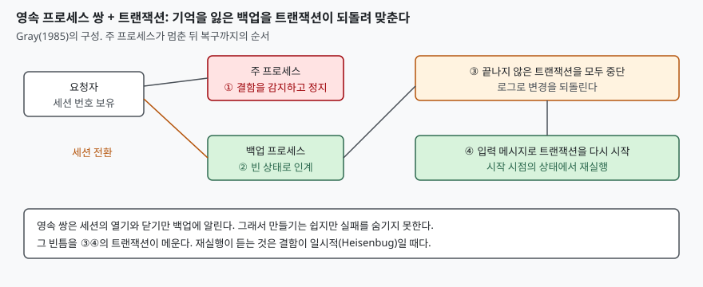

> 실행 검증 없음. Gray(1985) 보고서 원문(PDF 24쪽)을 읽고 정리했다. 이 보고서는 N-버전 프로그래밍과
> 복구 블록을 다루지 않고(본문 검색으로 확인), 두 기법의 원문은 열람하지 못했다. 그래서 둘과의 비교는
> 이름을 짚는 데서 멈춘다. 쪽 번호는 보고서에 인쇄된 번호다.

## 들어가며

장애가 났을 때 가장 먼저 하는 일은 서비스를 재시작하는 것이다. 재시작하면 대개 해결된다.
그런데 그 이유를 물으면 답이 흐려진다. 버그가 고쳐진 것은 아닌데 왜 두 번째에는 되는가.
기술사 시험에서 결함 허용(fault tolerance)을 묻는 문제는 하드웨어 이중화로 답하기 쉽지만,
Gray는 가동 중단의 큰 몫이 하드웨어가 아니라 운영과 소프트웨어에서 온다는 측정에서 출발했다.
그 해법이 프로세스 쌍과 트랜잭션의 결합이다.

## 정의

**소프트웨어 결함 허용은 결함을 감지하면 해당 모듈을 멈추고, 이중화된 모듈이 이어받아 트랜잭션으로
상태를 되돌린 뒤 재실행해 서비스를 지속하는 설계 방식이다.**

이 정의는 Gray(1985)의 구성을 요약한 것이며 표준 용어 정의가 아니다. 같은 보고서가 소프트웨어 결함을
"재시작하고 재시도하면 두 번째에는 대개 실패하지 않는다"는 가설(p.11)로 설명한다.

## 등장 배경

Gray는 상용 결함 허용 시스템의 장애 통계를 분석했다(pp.5-8). 가동 중단 원인으로 시스템 관리
(운영자 동작, 구성, 유지보수)가 42%로 가장 컸고, 소프트웨어가 25%였다. 응용 소프트웨어 장애가
30%만 보고된다고 가정하면 소프트웨어는 전체의 30%로 오른다. 하드웨어는 보고 누락을 감안해도
가장 작은 원인이었다. 결론은 "고가용성의 열쇠는 운영 결함과 소프트웨어 결함을 견디는 것"이다(p.8).
이 비율은 한 시스템, 한 시기의 측정이므로 오늘의 시스템에 그대로 옮기면 안 된다.

## 구성요소 — 네 가지

1. **프로세스와 메시지로 나눈 모듈성.** 프로세스가 모듈성·서비스·결함 격리·장애의 단위다(p.10).
2. **페일패스트 모듈.** 올바르게 동작하거나, 결함을 감지해 실패를 알리고 멈춘다. 입력·중간 결과·
   출력·자료구조를 항상 검사하는 방어적 프로그래밍으로 만들고, 다른 프로세스와 상태를 공유하지
   않는다(p.11). 결함 감지 지연이 짧다는 뜻이다.
3. **프로세스 쌍.** 모듈이 멈춰도 쌍의 다른 프로세스가 수 밀리초 안에 잇는다. 셋 이상은 이득이 없다고
   본다. 시스템의 다른 부분(예: 운영자)의 MTBF 가 훨씬 나쁘기 때문이다(p.13).
4. **트랜잭션.** 끝나지 않은 트랜잭션을 되돌릴 수 있어 쌍이 남긴 어수선한 상태를 정리한다(p.16).

## 도식

> **출처**: [Gray, Why Do Computers Stop and What Can Be Done About It? (Tandem TR 85.7) — 쪽 14-16, 프로세스 쌍과 트랜잭션](https://jimgray.azurewebsites.net/papers/TandemTR85.7_WhyDoComputersStop.pdf)

## Heisenbug 가설

Gray는 하드웨어 결함 대부분이 일시적인 것처럼 **상용 소프트웨어의 결함 대부분도 일시적**이라고
추정한다(p.11). 구조적 설계·검토·시험·장기 운영을 거친 소프트웨어에서는 재시도해도 항상 실패하는
결함(Bohrbug)이 대부분 제거되고, 남는 것은 드문 하드웨어 조건, 한계 조건(저장 공간 부족, 카운터
오버플로, 인터럽트 유실), 경쟁 조건(세마포어 요청 누락)이다. 프로그램을 조용한 상태로 되돌려 다시
실행하면 "환경이 조금 달라졌기 때문에" 성공할 가능성이 높다(p.12).

- **Bohrbug**: 항상 재현돼 표준 기법으로 쉽게 잡히는 결함
- **Heisenbug**: 들여다보면 사라지는 결함. 디버거가 상황을 흔들어 사라지게 하기도 한다

보고서는 이를 정량화하기 어렵다고 쓰고 두 근거를 든다. 스풀러(페일패스트 프로세스 쌍)의 오류 로그에서
소프트웨어 결함 132건 중 1건만 Bohrbug 였다. MVS/XA 에서는 시스템 소프트웨어 결함의 약 90%에 복구
루틴(FRR)이 있었고 그 성공률은 76%여서 소프트웨어 MTBF 를 약 4배 늘렸다(p.12). 둘 다 1980년대 특정
시스템의 측정이다.

## 프로세스 쌍의 다섯 유형

| 유형 | 방식 | 보고서의 평가 |
|---|---|---|
| 락스텝 | 두 프로세서가 같은 명령을 동기 실행 | 하드웨어 결함에는 강하지만 **Heisenbug 는 못 견딘다** |
| 상태 체크포인트 | 주 프로세스가 중요한 사건 전에 상태 변화를 백업에 전송 | 허용 능력은 뛰어나나 프로그래밍이 어렵다 |
| 자동 체크포인트 | 커널이 메시지를 기록해 두었다가 인계 시 재생 | 전송 데이터가 많아 비효율적으로 보인다 |
| 델타 체크포인트 | 물리가 아닌 논리적 갱신을 전송 | 성능이 좋고 주-백업 결합이 논리적이나 프로그래밍이 어렵다 |
| 영속(persistent) | 백업이 빈 상태(기억 상실)로 인계, 세션 열기·닫기만 전달 | 가장 쉽고 오버헤드가 낮으나 **실패를 숨기지 못한다** |

락스텝이 Heisenbug 를 못 견디는 이유가 이 가설의 핵심을 보여 준다. 두 프로세서가 같은 명령을 같은
순서로 실행하니 환경이 달라지지 않고, 결함이 같은 순서로 재현된다. 재실행이 듣는 이유는 결함이 일시적이어서
이기보다 **재실행 시점의 환경이 첫 실행과 다르기 때문**이다.

## 트랜잭션과의 결합

영속 쌍의 약점은 주 프로세스가 죽으면 데이터베이스와 장치가 어수선하게 남고 백업이 아무것도
기억하지 못한다는 점이다. 트랜잭션은 끝나지 않은 변경을 모두 취소하는 방법을 알고 있으므로,
**실패한 영속 프로세스에 속한 미완료 트랜잭션을 모두 중단하고 입력 메시지로 다시 시작한다**(p.16).
데이터베이스와 시스템 상태가 트랜잭션 시작 시점으로 돌아간다. 보고서는 이 조합이 가장 쉬운 프로그래밍
모델이자 하드웨어 결함과 Heisenbug 를 견디는 열쇠라고 본다.

보고서는 트랜잭션의 성질을 ACID 로 든다(p.15). 원자성(전부 또는 전무), 일관성(동시 트랜잭션이
갱신 중이어도 올바른 상태를 봄), 무결성(올바른 상태 변환), 지속성(커밋 후 결과 보존) 네 가지다.
보고서가 적은 두 번째·세 번째 항목은 오늘 흔히 말하는 일관성·격리성과 이름이 다르다.

## 적용 시 고려사항

1. **재실행이 안전하려면 요청이 멱등해야 한다.** 보고서는 세션 번호로 중복·유실 메시지를 걸러내
   요청과 응답을 멱등하게 만든다고 쓴다(p.17). 재실행되는 쪽이 같은 요청을 두 번 받아도 결과가 같아야 한다.
2. **Bohrbug 에는 소용없다.** 재실행해도 같은 결함이 반복된다. 재시도 횟수에 상한을 두고,
   넘으면 격리해 사람에게 알린다.
3. **페일패스트는 검사가 있어야 성립한다.** 자신의 입력과 결과를 점검하지 않는 모듈은 틀린 값을 낸 채
   계속 돈다. 감지 지연이 길수록 쌍이 이어받을 때 오염이 크다.
4. **설계 다양성 기법과 구분한다.** N-버전 프로그래밍과 복구 블록은 Gray 의 보고서와 별개로 나온
   기법이다. 이 글은 두 원문을 확인하지 못해 비교하지 않고, 이름만 짚는다.

## 정리

- 구성요소 네 가지: 프로세스 모듈성 · 페일패스트 · 프로세스 쌍 · 트랜잭션
- 프로세스 쌍 다섯 유형: 락스텝 · 상태 · 자동 · 델타 · 영속. 락스텝만 Heisenbug 를 못 견딘다
- 영속 쌍은 쉽지만 기억을 잃는다. 그 틈을 트랜잭션이 되돌려 메운다
- 재실행이 듣는 이유는 결함이 일시적이어서가 아니라 재실행 시점의 환경이 달라서다
- 암기 단서: **멈추고(페일패스트) · 잇고(쌍) · 되돌리고(트랜잭션) · 다시(재실행)**

## 참고 자료

- [Gray, Why Do Computers Stop and What Can Be Done About It? (Tandem TR 85.7, June 1985, 개정 Nov 1985)](https://jimgray.azurewebsites.net/papers/TandemTR85.7_WhyDoComputersStop.pdf)
