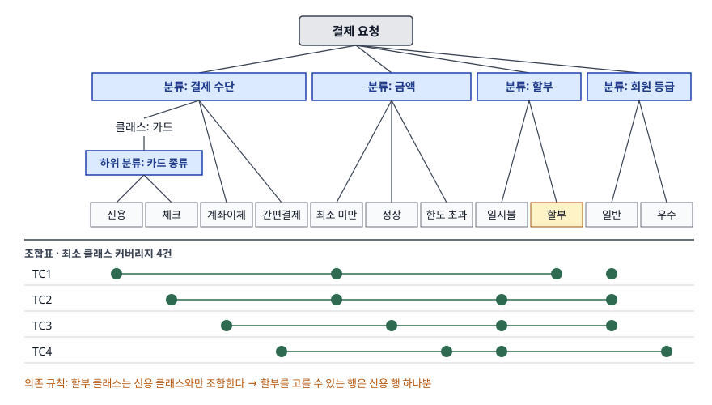

> 조합 수와 커버리지 기준별 케이스 수는 파이썬으로 계산해 검산했다. 계산 기록은
> [code/output.txt](code/output.txt)에 있다. 정의는 ISO/IEC/IEEE 29119-4:2021(유료라 발행처 공개
> 미리보기의 목차·용어 정의만 확인)을, 분류·클래스·커버리지·한계는 ISTQB CTAL-TA v3.1.2를 근거로 했다.
> 원 논문(Grochtmann·Grimm, 1993)은 유료라 읽지 못했다.

## 들어가며

입력 필드가 네댓 개인 화면을 받으면 조합이 금방 수십 개가 된다. 동등 분할로 필드마다 파티션을 나누는 것까지는 쉽지만, 파티션 안에 다시 갈래가 있거나(카드 안의 신용·체크) 필드끼리 함께 올 수 없는 값이 있으면(체크카드 할부) 평면 목록으로는 그 관계를 적을 자리가 없다. 분류 트리 기법은 이 관계를 트리와 조합표로 드러내는 방법이다. 기출에서는 동등 분할과 나란히 "케이스를 직접 도출하라"는 형태로 나온다.

## 정의

ISO/IEC/IEEE 29119-4:2021 은 분류 트리를 **프로그램 입력 데이터를 분류(시험 관점)와 클래스(입력값)로 나타낸 계층 트리 모델**로(용어 정의 3.10), 분류 트리 기법을 **분류 트리의 클래스를 실행하는 데 기반한 명세 기반 테스트 설계 기법**으로 정의한다(용어 정의 3.11).

답안 첫 줄은 이렇게 끊는다. **분류 트리 기법은 시험 대상의 입력 영역을 분류와 클래스로 계층 분할한 트리를 그리고, 조합표에서 커버리지 기준에 맞는 클래스 조합을 골라 테스트 데이터를 도출하는 명세 기반(블랙박스) 테스트 설계 기법이다.**

## 등장 배경

동등 분할은 입력 하나를 겹치지 않는 파티션으로 나눈다. 입력이 여럿이면 두 가지가 비어 있다.

- **세분의 자리**: 파티션 하나를 다시 나눠야 할 때 이를 적을 구조가 없다
- **조합의 자리**: 여러 입력의 파티션을 어떻게 묶어 케이스로 만들지, 어떤 묶음이 불가능한지를 적을 곳이 없다

분류 트리는 Grochtmann·Grimm(1993)이 분할 테스트(partition testing)를 체계화하려고 제안했다. 트리가 세분을, 트리 아래의 조합표가 조합을 맡는다.

## 구성요소 — 5가지

ISTQB CTAL-TA v3.1.2 의 분류 트리 절(§3.2.5)과 pairwise 절(§3.2.6)에 나온 요소를 묶으면 다섯 가지다.

| # | 요소 | 내용 |
|---|---|---|
| ① | **분류**(classification) | 데이터 공간의 매개변수. 입력 매개변수(환경 상태·사전 조건 포함)와 출력 매개변수 |
| ② | **클래스**(class) | 분류가 가질 수 있는 값. 각 클래스가 곧 동등 파티션이다 |
| ③ | **계층 세분** | 클래스 아래에 하위 분류를 다시 단다. "클래스와 하위 클래스"를 몇 개든 둘 수 있다 |
| ④ | **조합표** | 트리 아래에 잎 클래스를 열로 두고, 케이스마다 고른 클래스를 표시한다 |
| ⑤ | **의존 규칙** | 양립 불가 조합을 뺀다. 변수 간 논리 관계까지 담은 트리를 **feature model** 이라 부른다 |

절차는 **분류·클래스 식별 → 계층 세분 → 의존 규칙 → 커버리지 기준 선택 → 기대 결과 부여** 의 5단계로 적는다. 마지막 단계가 따로 있는 이유는 같은 실라버스의 한계 항목에 있다. 분류 트리는 **완전한 테스트 케이스가 아니라 테스트 데이터 조합만** 만들므로, 조합마다 결과를 테스트 분석가가 붙여야 한다.

## 도식

결제 요청 기능을 예로 들었다. 분류 4개, 결제 수단의 `카드` 클래스 아래 하위 분류 `카드 종류`, 잎 클래스 11개다. 할부는 신용카드에서만 된다는 제약이 있다.

> **출처**: [ISTQB CTAL-TA Syllabus v3.1.2 §3.2.5 Classification Tree Technique, §3.2.6 Pairwise Testing](https://www.istqb.org/wp-content/uploads/2024/11/ISTQB_CTAL-TA_Syllabus_v3.1.2.pdf)(p.31-33), [ISO/IEC/IEEE 29119-4:2021 §3.10 classification tree (iTeh 공개 미리보기)](https://cdn.standards.iteh.ai/samples/79430/6c93dfe4a05b46a8895e04dfd74ddd24/ISO-IEC-IEEE-29119-4-2021.pdf). 조합표의 4건은 이 글의 계산 결과다.

답안지에는 분류 상자 4개와 하위 분류 1개, 그 아래 클래스 이름과 조합표 줄 몇 개만 그리면 된다.

### 커버리지 기준별 케이스 수 — 직접 계산

CTAL-TA v3.1.2 는 커버리지 예로 **최소 클래스 커버리지**(분류의 모든 값을 최소 한 번)를 들고, pairwise·three-wise 같은 조합 기준을 고를 수도 있다고 적는다.

| 기준 | 케이스 수 | 근거 |
|---|---|---|
| 전체 조합 | 48 | 4 × 3 × 2 × 2 |
| 의존 규칙으로 제외 | 18 | 할부 × (체크·계좌이체·간편결제) × 금액 3 × 등급 2 |
| 실현 가능 조합 | 30 | 48 − 18 |
| pairwise | 13 (하한 12) | 덮을 쌍 41개를 탐욕 선택으로 모두 덮음 |
| 최소 클래스 | 4 | 가장 큰 분류(결제 수단)의 잎 클래스 수와 같다 |

예상과 다른 결과가 하나 나왔다. **최소 클래스 커버리지를 탐욕 선택으로 고르면 5건이 나왔다.** 첫 행에 신용카드·일시불을 고른 탓에, `할부` 클래스를 넣을 수 있는 유일한 자리(신용카드)를 이미 써 버렸기 때문이다. 전수 탐색으로는 신용카드 행에 할부를 붙인 4건이 나왔다. 의존 규칙이 있으면 **제약이 걸린 클래스부터 배치해야** 하한에 닿는다.

## 비교

| 구분 | 동등 분할 | 분류 트리 | pairwise | 결정 테이블 |
|---|---|---|---|---|
| 모델 | 입력별 평면 파티션 목록 | 분류·클래스 계층 트리 + 조합표 | 매개변수-값 표 | 조건·액션 표 |
| 세분 | 없음 | 하위 분류로 계층 세분 | 없음 | 없음 |
| 조합 | 다루지 않음 | 기준을 골라 조합 | 모든 값 쌍을 한 번 이상 | 조건 조합 전부(병합 가능) |
| 제약 표현 | 없음 | 의존 규칙, feature model | 도구의 포함·제외 기능 | 실현 불가능 열 삭제 |
| 기대 결과 | 파티션별로 정함 | 따로 부여해야 함 | 따로 부여해야 함 | 액션 행에 들어 있음 |
| 29119-4 커버리지 절 | 6.2.1 | 6.2.2 | 6.2.5(조합 기법) | 6.2.6 |

결정 테이블은 조건과 **결과(액션)** 를 한 표에 담고, 분류 트리는 **입력 조합만** 담는다는 것이 가장 자주 묻는 차이다. ISTQB CTAL-TA v4.0(2025)은 분류 트리와 pairwise 학습 목표를 조합 테스팅 하나(TA-3.1.2)로 합쳤고, 매개변수와 값을 분류 트리나 feature model 로 잡아 두는 것이 조합 테스팅을 돕는다고 적는다.

## 적용 시 고려사항

1. **분류가 늘면 트리가 커져 다루기 어렵다.** CTAL-TA v3.1.2 의 한계 항목이 그대로 적는다. 분류를 "결과를 가르는 관점"으로만 좁히고, 조합 기준은 최소 클래스나 pairwise 로 낮춘다. 이 예제에서 전체 30건이 pairwise 13건, 최소 클래스 4건으로 줄었다.
2. **세분은 제약을 적기 위해 한다.** 카드를 한 클래스로 두면 `카드 + 할부` 6조합의 기대 결과가 신용이면 성공, 체크면 실패로 갈려 하나로 정할 수 없다. 기대 결과가 갈리는 클래스는 쪼갠다.
3. **조합 선택은 도구로 하되 하한과 비교한다.** 최소 해를 손으로 찾기는 어렵고, 탐욕 선택은 하한보다 많은 건수를 낼 수 있다(최소 클래스 5건 대 4건, pairwise 13건 대 하한 12건). CTAL-TA 는 도구로 특정 조합을 강제로 넣거나 빼는 기능을 쓰라고 적는다.
4. **경계값은 트리를 보고 따로 뽑는다.** 같은 실라버스는 트리를 분석하면 경계값을 식별할 수 있다고 적는다. `금액` 처럼 순서가 있는 분류는 클래스 대표값 대신 경계값을 더한다.
5. **pairwise 는 세 변수 이상의 상호작용을 놓칠 수 있다.** 같은 실라버스는 이 잔여 위험을 밝힌다. 결제 수단 × 금액 × 등급이 함께 걸리는 규칙이 명세에 있으면 그 조합은 직접 넣는다.

## 정리

- **정의**: 분류(시험 관점)·클래스(입력값) 계층 트리 + 조합표로 데이터 조합을 고르는 명세 기반 기법
- **5요소 "분·클·세·조·의"**: 분류, 클래스, 계층 세분, 조합표, 의존 규칙(feature model)
- **커버리지 3단**: 전체 조합 ⊃ pairwise ⊃ 최소 클래스. 예제에서 30 → 13 → 4건
- **한계 2가지**: 분류가 늘면 트리가 커진다, 기대 결과는 따로 붙인다

> 기출 답안: [기출문제 — 동적 테스트: 명세 기반과 구조 기반 비교, 동등 분할·분류 트리 테스트 케이스 작성](../../exam/2026-11-12-dynamic-testing-equivalence-classification-tree/index.md)
>
> 관련 개념: [결정 테이블 테스팅 — 조건 조합을 빠짐없이 케이스로 바꾸는 절차](../2026-10-23-decision-table-testing/index.md)

## 참고 자료

- [ISO/IEC/IEEE 29119-4:2021 Software and systems engineering — Software testing — Part 4: Test techniques (iTeh 공개 미리보기)](https://cdn.standards.iteh.ai/samples/79430/6c93dfe4a05b46a8895e04dfd74ddd24/ISO-IEC-IEEE-29119-4-2021.pdf) — 용어 정의 3.10·3.11, 목차 5.2.2 Classification tree method, 6.2.2 Classification tree method coverage. 본문은 [ISO 카탈로그](https://www.iso.org/standard/79430.html)에서 구매한다
- [ISTQB Certified Tester Advanced Level Test Analyst Syllabus v3.1.2 (2021-05-15)](https://www.istqb.org/wp-content/uploads/2024/11/ISTQB_CTAL-TA_Syllabus_v3.1.2.pdf) — §3.2.5 Classification Tree Technique(분류·클래스, 적용성, 한계, 최소 클래스 커버리지), §3.2.6 Pairwise Testing(feature model, 포함·제외 기능, 잔여 위험)
- [ISTQB Certified Tester Advanced Level Test Analyst Syllabus v4.0 (2025-05-02)](https://www.istqb.org/certifications/certified-tester-advanced-level-test-analyst) — §3.1.2 조합 테스팅(분류 트리·feature model), 변경 이력(분류 트리와 pairwise 학습 목표 통합)
- Grochtmann, M., Grimm, K. (1993). Classification Trees for Partition Testing. *Software Testing, Verification and Reliability*, 3(2), 63–82. [doi:10.1002/stvr.4370030203](https://doi.org/10.1002/stvr.4370030203) — 원 논문(유료, 이 글에서는 읽지 못했다)
