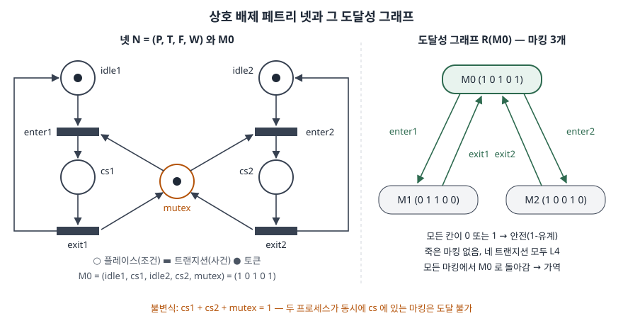

> 도달성 그래프·활성 수준·불변식·코버러빌리티 트리는 파이썬으로 계산해 검산했다. 계산 기록은
> [code/output.txt](code/output.txt)에 있다. 정의와 성질은 Murata(1989) 튜토리얼 논문을 근거로 했다.
> 페트리의 1962년 학위 논문 원문은 읽지 못했다.

## 들어가며

UML 활동 다이어그램을 그리다 보면 "포크 뒤의 두 흐름이 조인에서 정말 만나는가", "이 흐름은 어디서 멈출 수 있는가"를 묻게 된다. 그림만으로는 답할 수 없고, 토큰이 어떻게 움직이는지 규칙이 있어야 한다. 그 규칙의 원형이 페트리 넷이다. 기출에서는 활동 다이어그램, 교착 상태, 병행 시스템 모델링 문항의 배경으로 나오고, "구성요소와 분석 기법을 쓰라"는 단답형으로도 나온다.

## 정의

Murata(1989)는 페트리 넷을 **병행·비동기·분산·비결정적 정보 처리 시스템을 기술하고 분석하는 그래프이자 수학적 모델링 도구**로 소개하고(I절), 형식적으로는 **5-튜플 PN = (P, T, F, W, M0)** 로 정의한다(Table 2).

답안 첫 줄은 이렇게 끊는다. **페트리 넷은 플레이스(조건)와 트랜지션(사건)을 아크로 잇는 이분 방향 그래프에 토큰으로 상태를 표시하고, 발화 규칙에 따라 토큰을 옮겨 병행 시스템의 동작과 교착·유계성을 분석하는 형식 모델이다.**

## 등장 배경

Murata 의 I절에 따르면 페트리 넷은 칼 아담 페트리가 1962년 다름슈타트 공과대학에 제출한 학위 논문에서 출발했고, 1970년대 MIT 에서 연구가 활발했다. 앞선 모델과 비교하면 빈자리가 분명하다.

- **유한 상태 기계**는 시스템 전체를 상태 하나로 본다. 독립된 두 프로세스를 그리려면 상태를 곱해야 해서 상태 수가 곱으로 늘어난다
- **흐름도**는 순서는 보이지만 "두 일이 동시에 일어날 수 있다", "둘 중 하나만 일어난다"를 구분해 적을 기호가 없다

페트리 넷은 상태를 플레이스 여러 곳에 흩어진 토큰으로 나타내, 병행(동시에 가능)·충돌(둘 중 하나)·동기화(모두 모여야 진행)를 구조로 그린다(III절).

## 구성요소 — 4가지와 발화 규칙 3단계

| # | 요소 | 형식 정의(Table 2) | 모델링 해석(Table 1) |
|---|---|---|---|
| ① | **플레이스** | P, 유한 집합. 원으로 그린다 | 조건, 버퍼, 자원 |
| ② | **트랜지션** | T, 유한 집합. 막대로 그린다 | 사건, 계산 단계, 작업 |
| ③ | **아크와 가중치** | F ⊆ (P×T) ∪ (T×P), W: F → {1,2,…} | 사전·사후 조건, 필요 자원 수 |
| ④ | **토큰(마킹)** | M0: P → {0,1,2,…} | 조건이 참, 자원이 k개 있음 |

P 와 T 는 겹치지 않는다. 아크는 플레이스와 트랜지션 사이에만 있어 그래프가 **이분 그래프**가 된다.

**발화 규칙 3단계**(II절)
1. **활성화(enabled)**: 모든 입력 플레이스 p 에 w(p,t) 개 이상 토큰이 있으면 t 가 활성화된다
2. **선택적 발화**: 활성화된 트랜지션은 발화할 수도, 안 할 수도 있다(비결정성)
3. **발화**: 입력 플레이스마다 w(p,t) 개를 빼고 출력 플레이스마다 w(t,p) 개를 더한다

용량 상한 K(p) 를 두면 출력 플레이스가 넘치지 않을 때만 활성화된다(엄격 규칙). 보완 플레이스를 더하면 용량 없는 넷으로 바꿀 수 있다.

## 도식

> **출처**: [Murata (1989) Petri Nets: Properties, Analysis and Applications, Table 2 Formal Definition, IV Behavioral Properties, V-B Incidence Matrix and State Equation](https://doi.org/10.1109/5.24143) (p.543, 547-548, 551-552). 도달성 그래프와 불변식은 실습 [1] 의 계산 결과다.

답안지에는 원 5개, 막대 4개, 토큰 3개, 오른쪽에 마킹 3개짜리 그래프를 그리면 된다.

### 행위 속성과 분석 기법 — 직접 계산

Murata IV절은 마킹에 따라 달라지는 행위 속성 8가지(도달성, 유계성, 활성, 가역성, 코버러빌리티, 지속성, 동기 거리, 공정성)를 든다. 시험에 주로 나오는 넷은 이렇다.

| 속성 | 정의 |
|---|---|
| **도달성** | 발화열로 M0 에서 M 에 갈 수 있다. 그 집합이 R(M0) |
| **유계성** | 모든 도달 마킹에서 플레이스마다 토큰이 k 개 이하(k-유계). 1-유계를 **안전**이라 한다 |
| **활성** | 어느 마킹에 이르든 모든 트랜지션을 다시 발화할 수 있다. 수준 5단계: L0(죽음)·L1(한 번이라도)·L2(k번)·L3(무한히)·L4(어느 도달 마킹에서든 L1) |
| **가역성** | 모든 도달 마킹에서 M0 로 돌아올 수 있다 |

분석 기법은 **3가지**다(V절). ① **코버러빌리티(도달성) 트리** — 도달 마킹을 전부 나열한다. 모든 넷에 쓸 수 있지만 상태 폭발 때문에 작은 넷에 한정된다. ② **행렬 방정식** — 결합 행렬 A 로 M = M0 + Aᵀx 를 세운다. 해가 있다는 것은 도달의 **필요조건**일 뿐이다(Theorem 2). ③ **축소·분해** — 활성·안전·유계를 보존하는 변환으로 넷을 줄인다.

세 넷을 계산했다.

| 넷 | 도달 마킹 | 유계 | 죽은 마킹 | 활성 | 가역 |
|---|---|---|---|---|---|
| [1] 상호 배제 | 3 | 1 (안전) | 없음 | 모두 L4 | 있음 |
| [2] 자원 a·b 를 반대 순서로 획득 | 6 | 1 (안전) | 1개 | 모두 L4 아님 | 없음 |
| [3] 같은 순서로 획득 | 5 | 1 (안전) | 없음 | 모두 L4 | 있음 |

예상과 다른 점이 하나 있었다. **교착이 생기는 [2] 도 안전했다.** 토큰이 넘치지 않는 것과 멈추지 않는 것은 별개의 속성이다. Murata 도 유계성·활성·가역성이 서로 독립이라고 적는다(IV-D, Example 4). [2] 의 죽은 마킹은 `(0 1 0 0 1 0 0 0)`, 즉 P1 이 a 를, P2 가 b 를 쥔 채 서로 기다리는 상태다. 획득 순서를 통일한 [3] 에서는 이 마킹이 도달 집합에서 빠졌다.

[1] 에서는 결합 행렬 A 와 y = (0 1 0 1 1) 의 곱이 0 이었다. 그래서 cs1 + cs2 + mutex 가 모든 도달 마킹에서 1 로 일정하다(S-불변식). 두 프로세스가 동시에 임계 구역에 들어가는 마킹은 도달할 수 없다.

[4] 는 t3 가 발화할 때마다 p2 에 토큰이 쌓이는 무한 넷이다. 코버러빌리티 트리는 `(1 0 0) → (0 0 1) dead-end`, `(1 0 0) → (1 ω 0) → (0 ω 1)` 로 나왔고, 나머지 두 간선은 old 였다. Murata V-A 의 예제 서술과 마킹·꼬리표가 같다. ω 가 나타났으므로 유계가 아니다.

## 비교

| 구분 | 유한 상태 기계 | 페트리 넷 | UML 활동 다이어그램 |
|---|---|---|---|
| 상태 표현 | 현재 상태 하나 | 플레이스별 토큰 수(벡터) | 노드·엣지 위의 토큰 |
| 병행 | 상태 곱으로만 | 구조로 표현 | 포크·조인 |
| 충돌(선택) | 전이 분기 | 입력 플레이스를 공유하는 트랜지션 | 결정 노드 |
| 형식 분석 | 상태 탐색 | 도달성·불변식·축소 | 표준이 정한 분석 기법 없음 |
| 관계 | 페트리 넷의 하위 클래스(SM) | — | 의미를 페트리 넷 유사 그래프로 설명 |

Murata VI절은 모든 트랜지션이 입력·출력 플레이스를 정확히 하나씩 갖는 넷을 **상태 기계(SM)**, 모든 플레이스가 입력·출력 트랜지션을 하나씩 갖는 넷을 **마크드 그래프(MG)** 로 정의한다. SM 은 동기화를, MG 는 충돌을 표현하지 못한다. UML 2.5 는 공통 행위 개요(13.2.1)에서 활동을 페트리 넷과 비슷한 그래프로 모델링한다고 적고, 활동의 실행을 토큰 흐름으로 정의한다(15.2.3.1). 다만 UML 토큰은 제안(offer)·수락 단계를 거치므로 발화 규칙이 똑같지는 않다.

## 적용 시 고려사항

1. **상태 폭발을 먼저 따진다.** Murata 는 코버러빌리티 트리가 작은 넷에만 쓰인다고 적는다. 프로세스 둘에 자원 둘인 [2] 도 마킹이 6개였다. 규모가 크면 불변식이나 축소 규칙을 먼저 쓴다.
2. **유계와 활성을 따로 검증한다.** [2] 처럼 안전한 넷도 교착할 수 있다. 버퍼 넘침은 유계성, 교착은 활성으로 각각 확인한다.
3. **코버러빌리티 트리의 한계를 안다.** ω 는 "임의로 커진다"만 남기고 정보를 버린다. Murata 는 활성이 다른 두 넷이 같은 트리를 가지는 예(Fig. 19)를 들어, 무한 넷의 도달성·활성은 트리만으로 판정할 수 없다고 적는다.
4. **상태 방정식은 필요조건이다.** 해가 없으면 도달 불가로 확정되지만, 해가 있다고 도달 가능한 것은 아니다.
5. **시간·데이터가 필요하면 확장 넷을 쓴다.** 기본 넷은 시간과 데이터 값을 다루지 않는다. Murata IX절은 시간 넷·확률 넷·고수준 넷을 확장으로 소개한다.

## 정리

- **정의**: 플레이스·트랜지션 이분 그래프 + 토큰. 5-튜플 (P, T, F, W, M0)
- **구성요소 4 "플·트·아·토"**, 발화 규칙 3단계 "활성화 → 선택 → 발화"
- **행위 속성 4 "도·유·활·가"**, 활성 수준 5단계 L0~L4, 1-유계 = 안전
- **분석 기법 3 "트리·행렬·축소"**, 상태 방정식은 도달의 필요조건
- **계산 결과**: 교착 넷도 안전했다. 유계성과 활성은 독립이다

> 기출 답안: [기출문제 — UML 행위 다이어그램: 활동·상태 머신·유스케이스](../../exam/2026-11-17-uml-activity-state-usecase-diagrams/index.md)
>
> 관련 개념: [UML 다이어그램 분류 — 구조 7종과 행위 7종](../2026-10-26-uml-diagram-classification-structure-behavior/index.md)

## 참고 자료

- Murata, T. (1989). Petri Nets: Properties, Analysis and Applications. *Proceedings of the IEEE*, 77(4), 541–580. [doi:10.1109/5.24143](https://doi.org/10.1109/5.24143) — I 역사, II 발화 규칙과 Table 2 형식 정의, IV 행위 속성(활성 L0~L4, Example 4 속성의 독립), V 분석 기법 3가지(V-A 코버러빌리티 트리 알고리즘, V-B 결합 행렬과 상태 방정식·Theorem 2), VI 하위 클래스(SM·MG·FC). 이 글은 [밀라노 비코카 대학 강의 자료실의 스캔 사본](https://elearning.unimib.it/pluginfile.php/1372798/mod_resource/content/2/Petri%20Nets%20analysis%20and%20applications.pdf)(제3자 전재)을 읽었다
- [OMG — Unified Modeling Language (UML) Version 2.5, formal/15-03-01](https://www.omg.org/spec/UML/2.5/PDF) — 13.2.1 행위 개요(활동은 페트리 넷 유사 그래프), 15.2.3.1 활동의 토큰 의미
