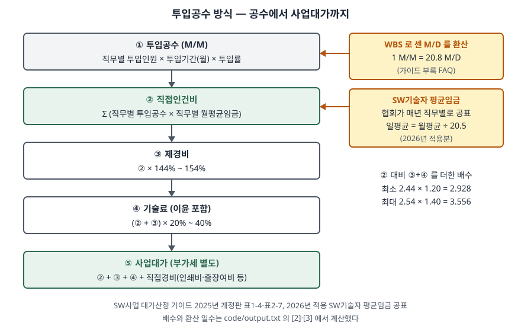

> 산식과 예제는 한국인공지능·소프트웨어산업협회(KOSA)의 「SW사업 대가산정 가이드」 2025년 개정판
> PDF 를 직접 읽어 옮겼고, 쪽수는 인쇄 쪽이다. 가이드 예제 4개와 2026년 평균임금 표는 파이썬으로 다시
> 계산했다. 계산 기록은 [code/output.txt](code/output.txt)에 있다. 평균임금 표는 협회 공표 게시글
> 본문에서 옮겼다.

## 들어가며

공공 SW사업의 예산은 대부분 기능점수로 잡지만, 기능을 셀 수 없는 일이 남는다. 정보전략계획(ISP) 수립, 시스템 운영, 디자인·콘텐츠 제작, 성능 튜닝이 그렇다. 이런 일은 "누가 몇 달 투입되는가"로 값을 매기고, 그 단가가 해마다 공표되는 SW기술자 평균임금이다. 시험에서는 기능점수 방식과 대비해 "어느 사업에 무엇을 쓰는가", "대가가 어떻게 구성되는가"를 묻는다.

## 정의

가이드는 투입공수 방식을 **통상 M/M(Man-Months) 방식이라 부르는 것으로, 엔지니어링산업 진흥법 제31조의 엔지니어링사업 대가 기준 중 실비정액가산방식을 준용해 사업비를 산정하는 방식**으로 정의한다(ISP 수립비 개요, 69쪽). 직접인건비는 소프트웨어 진흥법 제46조에 따라 협회가 공표하는 **IT직무별 SW기술자 평균임금**을 적용하는 것이 원칙이다.

답안 첫 줄은 이렇게 끊는다. **투입공수 방식은 직무별 투입인원·기간·투입률로 공수(M/M)를 구하고, 공표된 SW기술자 평균임금을 곱한 직접인건비에 제경비·기술료·직접경비를 더해 사업대가를 산정하는 실비정액가산 방식이다.**

## 등장 배경

기능점수는 사용자에게 보이는 기능의 양을 센다. 그래서 **산출물이 기능이 아닌 일**은 셀 수 없다. 가이드는 SW 개발비를 기능점수로 산정하는 것을 원칙으로 두고, 다음 **5가지 사업 유형**에 한해 예외로 투입공수 방식을 허용한다(SW 개발비 개요, 129쪽).

| # | 기능점수 적용이 불합리한 사업 유형 |
|---|---|
| ① | 홈페이지 디자인, 웹 접근성 개선, 동영상 등 콘텐츠 관련 사업 |
| ② | R&D 성격의 SW 개발 사업 |
| ③ | 식별되는 기능 규모에 비해 내부 처리 복잡도가 현저히 높은 사업 |
| ④ | 데이터 튜닝·최적화, 테스트 등 기능점수로 산정이 불가능한 경우 |
| ⑤ | SW 개발 예산이 5천만 원 미만(부가세 제외)인 사업 |

개발 밖에서는 투입공수가 기본 방식인 곳이 많다. ISP·ISP/BPR·EA/ITA 수립비는 컨설팅업무량 방식과 투입공수 방식 중 고르고, ISMP·정보보안 컨설팅·SW 운영비·보안관제 서비스비는 투입공수로 산정한다(대가산정 방법별 요약 표1-4, 16쪽).

단가의 기준도 바뀌었다. 가이드 개정 이력은 2019년 12월에 **투입공수 방식 SW 운영비에 IT직무별 평균임금을 적용**하도록 고쳤다고 적는다(6쪽). 지금은 IT기획자·IT PM·응용SW 개발자처럼 직무 이름으로 단가를 고른다.

## 구성요소 — 대가 구성 4가지, 산정 절차 6단계

**대가 구성 4가지** (표1-4, 16쪽)

| # | 항목 | 산식 |
|---|---|---|
| ① | 직접인건비 | Σ(직무별 투입공수 × 직무별 평균임금) |
| ② | 제경비 | 직접인건비 × 144~154% |
| ③ | 기술료 | (직접인건비 + 제경비) × 20~40% |
| ④ | 직접경비 | 인쇄비·출장여비 등 그 사업에 직접 드는 경비 |

기술료에는 이윤이 들어 있다. 부록 FAQ는 기능점수 방식은 이윤을 25%까지 산정하고, 투입공수 방식은 기술료 20~40%에 이윤이 포함된다고 답한다(442쪽).

**산정 절차 6단계** (표2-7, 69쪽): **사전 준비**(업무 범위·요구사항 확정) → **투입공수 산정**(직무별 인원·기간) → **직접인건비 계산** → **제경비·기술료 계산** → **직접경비 계산** → **대가 산정**.

투입공수는 **인원 × 기간(월) × 투입률**이다. 투입률은 한 사람이 그 업무에 쓰는 시간의 비율로, 가이드 예제는 50%·30%·20% 같은 값을 쓴다.

## 도식



> **출처**: [SW사업 대가산정 가이드 2025년 개정판 (한국인공지능·소프트웨어산업협회)](https://www.sw.or.kr/site/sw/ex/board/View.do?cbIdx=276&bcIdx=63607) 표1-4 대가산정 방법별 주요 내용 요약(16쪽)·표2-7 투입공수 방식 ISP 수립비 산정절차(69쪽)·부록 FAQ(442쪽), [2026년 적용 SW기술자 평균임금 공표](https://www.sw.or.kr/site/sw/ex/board/View.do?cbIdx=304&bcIdx=64717)

**가이드 예제 검산.** 가이드 ISP 예제(75~76쪽)는 5개 행의 투입공수가 합해 20 M/M, 직접인건비 209,004,016원이다. 제경비 150%, 기술료 30%, 직접경비 200만 원을 넣으면 681,263,052원이 되고 원 단위까지 맞았다. 혼합방식 고정비 예제(247~248쪽)와 부록 디자인 예제(427쪽)도 원 단위로 맞았다(1원 차이는 반올림 자리 차이).

**운영비 예제는 맞지 않았다.** 표4-23(225쪽)의 직접인건비 241,966,348원, 제경비 362,949,522원, 기술료 120,983,174원은 각각 식대로 맞는다. 그런데 표에 적힌 합계 484,432,696원은 **제경비 + 기술료 + 직접경비**의 합이다. 같은 절의 6단계 산식(직접인건비 + 제경비 + 기술료 + 직접경비)대로 네 항목을 더하면 726,399,042원이다. 표4-22의 행 두 개(게시판 운영 1×12×20%, 연동관리 1×12×30%)도 투입공수가 3.0으로 적혀 있어 식으로 구한 2.4·3.6과 다르다. 두 값의 합이 같아 총 30 M/M 은 맞는다.

```text
    네 항목 합       726,399,042  (가이드 합계: 484,432,696)
    직접인건비를 뺀 합     484,432,695
```

**배수의 폭.** 직접인건비가 같아도 제경비율·기술료율을 범위의 양 끝에서 고르면 배수가 2.928 에서 3.556 까지 움직인다. ISP 예제에 대면 최대가 최소의 1.2145배이고 차액은 131,254,522원이다.

## 비교

| 구분 | 투입공수 방식 | 기능점수 방식 | 컨설팅업무량 방식 |
|---|---|---|---|
| 규모 단위 | 사람 × 기간(M/M) | 기능점수(FP) | 업무 가중치 × 난이도 |
| 단가 | 직무별 SW기술자 평균임금 | 기능점수 단가 | ISP 단가 등 |
| 비용 구성 | 직접인건비 + 제경비 + 기술료 + 직접경비 | 개발원가 + 이윤(25% 이내) + 직접경비 | 업무량 × 단가 + 직접경비 |
| 주로 쓰는 곳 | 기획 컨설팅, 운영, 콘텐츠·R&D·튜닝 | SW 개발, 유지관리 기능 개선 | ISP·ISP/BPR·EA/ITA |
| 관점 | 공급자가 투입하는 노력 | 사용자가 요구한 기능의 양 | 컨설팅 업무의 양과 난이도 |

**혼합 적용**이 원칙이다. 부록 FAQ는 시스템적 요소(데이터·트랜잭션 기능)는 기능점수로 규모를 파악하고, 기능점수 적용이 불합리한 나머지 부분만 투입공수로 산출해 합산하라고 한다(435쪽). 유지관리·운영도 고정비(비기능 개선)는 투입공수, 변동비(기능 개선)는 기능점수로 나눠 더하는 방식이 있다. 기능점수 방식은 [소프트웨어 비용 산정 — 기능점수와 COCOMO](../2026-10-19-function-point-cocomo-cost-estimation/index.md)에서 따로 정리했고, 같은 가이드의 AI 서비스 도입 사업비는 [기출 답안](../../exam/2026-11-18-sw-cost-guide-ai-service-introduction/index.md)에서 다뤘다.

## 적용 시 고려사항

1. **M/D 를 M/M 으로 바꾸는 일수를 맞춘다.** 가이드 부록 FAQ는 WBS 공수를 "1M/M = 20.8M/D"로 환산하되 최신 평균임금 조사 결과를 따르라고 적는다(442쪽). 2026년 적용 공표값은 17개 직무 모두 **월평균 ÷ 20.5일**로 일평균이 맞고, 20.8일로는 하나도 맞지 않았다. 416 M/D 를 20.8로 나눠 월평균을 곱하는 것과 일평균을 직접 곱하는 것은 1.46% 차이가 난다.
2. **임금 연도를 맞춘다.** ISP 예제를 2026년 적용 임금으로 다시 계산하면 직접인건비가 7.27% 올랐다. 직무마다 인상률이 달라(IT기획자 2.20%, IT컨설턴트 10.32%) 투입 직무 구성에 따라 차이가 커진다.
3. **시간 단가는 반올림 전 값에서 나온다.** 2026년 공표의 시간평균 17개 중 2개(IT컨설턴트, IT지원기술자)는 반올림한 일평균을 8로 나눈 값과 1원 달랐다. 월평균을 (20.5 × 8)로 나누면 17개 모두 맞는다.
4. **산정에 쓴 공수는 관리 기준이 아니다.** 가이드는 대가 산정에 쓴 투입공수를 예산·예정가격 산정용으로만 쓰고, 사업 수행 중 실제 투입인력 관리 기준으로 쓸 수 없다고 적는다(ISP/BPR 유의사항, 87쪽).
5. **예제 표를 그대로 베끼지 않는다.** 운영비 예제처럼 표의 합계가 산식과 다른 곳이 있다. 산정 양식은 산식으로 다시 더해 본다.

## 정리

- **구성 4가지**: 직접인건비 · 제경비(144~154%) · 기술료(20~40%, 이윤 포함) · 직접경비 — "직·제·기·경"
- **절차 6단계**: 사전 준비 → 투입공수 → 직접인건비 → 제경비·기술료 → 직접경비 → 대가 산정
- **예외 5가지**: 콘텐츠 · R&D · 내부 처리 복잡 · 튜닝·테스트 · 5천만 원 미만
- **환산**: 투입공수 = 인원 × 기간 × 투입률, 가이드 1M/M = 20.8M/D, 2026년 임금 공표는 20.5일

## 참고 자료

- [SW사업 대가산정 가이드 2025년 개정판 (한국인공지능·소프트웨어산업협회, 2025-08-11 게시)](https://www.sw.or.kr/site/sw/ex/board/View.do?cbIdx=276&bcIdx=63607) — 표1-4(16쪽), 투입공수 방식 ISP 수립비 개요·표2-7·예제(69~76쪽), SW 개발비 예외 유형(129쪽), 운영비 예제 표4-22·4-23(223~225쪽), 혼합방식 고정비 예제(247~248쪽), 부록 혼합사례(427쪽), 부록 FAQ(432~442쪽)
- [2026년 적용 SW기술자 평균임금 공표 (한국인공지능·소프트웨어산업협회, 2025-12-19)](https://www.sw.or.kr/site/sw/ex/board/View.do?cbIdx=304&bcIdx=64717) — 17개 직무의 월·일·시간 평균임금, 일평균 산정에 쓴 근무일수
