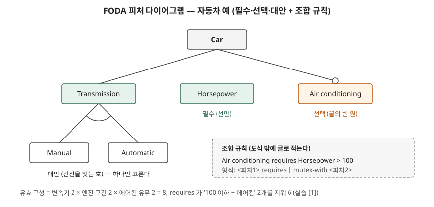

> FODA 원 보고서의 정의·표기·도구 규칙을 그대로 옮겼다. 구성 수는 그 규칙을 코드로 옮겨 직접
> 세어 검산했다(실습 기록 `code/output.txt`). 엔진 출력을 두 구간으로 나눈 것은 계산을 위한 가정이고
> 원 그림에는 없다.

## 들어가며

제품계열 문제에서 "가변성을 관리한다"고만 쓰면 무엇을 어떻게 적어 두는지가 빠진다. 피처 모델은 그
"어떻게"에 대한 가장 오래된 답이고, 필수·선택·대안 표기와 조합 규칙은 지금도 도구들이 그대로 쓴다.
실무에서는 옵션 조합 하나가 빌드는 되는데 실제로는 쓸 수 없는 제품을 만들어 내는 순간이 있는데,
피처 모델의 조합 규칙이 바로 그 조합을 미리 걸러 내는 장치다.

## 정의

**피처**는 최종 사용자에게 직접 영향을 주는, 사용자가 쓸지 말지 정하고 뜻을 알아야 하는 시스템의
속성이다(FODA 모델 기술 절(5.1.2)). **피처 모델**은 한 도메인 시스템 계열의 표준 피처와 그 관계를
나타내는 모델로, **피처 구조 도식·피처 정의·조합 규칙** 3가지로 문서화한다(같은 절).

용어 출처가 둘이다. 가변점·변형·바인딩이라는 말은 ISO/IEC 26550 이 정의하고, 피처 모델의 표기와
바인딩 시점 3분류는 FODA 가 처음 제시했다. 이 글은 FODA 쪽을 다룬다.

## 등장 배경

FODA 는 기존 요구 소통 수단인 **자료 흐름도의 한계**에서 출발한다(피처 분석 목적 절(5.1.1)).

1. 자료 흐름도는 내부 기능 정의를 담는데, 고객은 그 내부에 관심이 없다
2. 고객이 알아야 하는 것은 서비스·성능·하드웨어·비용 같은 **바깥에서 보이는 능력**이다
3. 계열 전체를 다루려면 시스템마다의 공통점과 차이를 한 모델에 담아야 한다

그래서 피처 모델을 사용자와 개발자 사이의 소통 수단으로 두었다. 사용자에게는 표준 피처·고를 수 있는
피처·고르는 시점을 보여 주고, 개발자에게는 무엇을 어떻게 파라미터화할지를 알려 준다(5.1.3).

## 구성요소

**피처 종류 3가지** (5.1.2)

| 종류 | 표기 | 뜻 |
|---|---|---|
| ① 필수 (mandatory) | 선만 | 계열의 모든 시스템이 가진다. 공통성을 나타낸다 |
| ② 선택 (optional) | 끝의 빈 원 | 있어도 없어도 된다 |
| ③ 대안 (alternative) | 간선을 잇는 호 | 일반 피처의 특수화. **둘 이상 고를 수 없다** |

**조합 규칙 2가지** (조합 규칙 절(7.3.2.2)) — 도식에 표현되지 않는 피처 간 의미를 글로 적는다.

| 규칙 | 형식 | 뜻 |
|---|---|---|
| ① requires | `<피처1> requires <피처2>` | 피처1을 고르면 피처2도 있어야 한다 |
| ② mutex-with | `<피처1> mutex-with <피처2>` | 둘은 함께 있을 수 없다 |

**바인딩 시점 3가지** (5.1.2) — 선택·대안 피처의 값을 언제 정하는가.

| 시점 | 뜻 | FODA 가 든 예 | 구현 방식 |
|---|---|---|---|
| ① 컴파일 시 | 소프트웨어 포장 자체가 달라진다. 한 번 정하면 바뀌지 않는다 | 같은 계열의 다른 응용 | 전처리·생성 |
| ② 로드 시 | 실행 시작 때 정하고 실행 중에는 고정 | 단말 종류, 무기체계 임무 파라미터 | 테이블 구동, 시작 시 값 주입 |
| ③ 실행 시 | 실행 중 대화형 또는 자동으로 바뀐다 | 메뉴 구동 소프트웨어 | 실행 중 선택 |

**피처 분석 절차 5단계** (5.1.4) — 원천 문서 수집 → 피처 식별 → 추상화·분류해 모델화 → 피처 정의 →
모델 검증.

## 도식

> **출처**: [Kang 외, FODA Feasibility Study, CMU/SEI-90-TR-21 — Figure 5-1 Example Showing Features of a Car, §5.1.2 Model Description](https://sei.cmu.edu/library/feature-oriented-domain-analysis-foda-feasibility-study). 맨 아래 줄의 구성 수는 실습 [1] 의 계산 결과다.

답안지에는 박스 6개와 호 하나, 빈 원 하나, 점선 상자 하나면 된다. 조합 규칙을 도식 밖 글로 적는
것이 FODA 의 원래 형식이다.

## 계산으로 본 피처 모델

전체 소스: [`code/feature_configs.py`](code/feature_configs.py) · 수행 기록: [`code/output.txt`](code/output.txt)

**[1] 유효 구성 수.** 루트를 뺀 피처 7개(엔진을 '100 이하'·'100 초과' 대안으로 나눔)의 원시 조합은
128개다. 구조 규칙(부모 없는 자식 금지, 필수 포함, 대안은 정확히 하나)만 적용하면 8개, requires
하나를 더하면 6개가 남는다. 128개 중 120개가 구조 규칙만으로 걸러진다는 점이 피처 모델의 첫 번째
쓸모다.

**[2] 부분 선택 전파.** 보고서의 시제품 도구(7.3.2.6)는 표시한 피처에서 출발해 필수 피처와 requires
대상을 "유효", mutex 대상을 "무효"로 퍼뜨리고, 둘 다 붙은 피처를 오류로 낸다. 예제는 여기에 "대안은
둘 이상 고를 수 없다"(5.1.2)를 더해 고른 대안의 형제를 무효로 표시했다. 고객이 에어컨과 수동만
고르면 Horsepower·100 초과·Transmission 이 함께 정해지고 Automatic·100 이하가 무효가 됐다. 여기에
'100 이하'까지 고르면 두 엔진 구간이 유효·무효 양쪽에 걸려 충돌로 잡혔다.

**[3] 조합 규칙 하나의 무게.** 서로 독립인 선택 피처 10개는 1,024개 구성을 만든다.

| 규칙 | 유효 구성 |
|---|---|
| 없음 | 1,024 |
| requires 1개 | 768 |
| mutex-with 1개 | 768 |
| 둘 다 (서로 다른 피처) | 576 |
| requires 2개 연쇄 (f0→f1→f2) | 512 |

규칙 하나가 관련 두 피처의 조합 4가지 중 1가지를 지우므로 전체의 1/4이 사라진다. 시험 관점에서는
규칙이 적힌 만큼 시험할 조합이 줄고, 적히지 않은 규칙은 시험할 수 없는 조합으로 남는다.

## 비교

**피처 모델과 자료 흐름도** (5.1.1, 3.3)

| 구분 | 자료 흐름도 | 피처 모델 |
|---|---|---|
| 관점 | 내부 기능 | 사용자에게 보이는 능력 |
| 다루는 대상 | 시스템 하나 | 시스템 계열의 공통점과 차이 |
| 주 독자 | 개발자 | 사용자·요구 분석가와 개발자 |
| 차이 표현 | 없음 | 필수·선택·대안, 조합 규칙, 바인딩 시점 |

**바인딩 시점 비교** — 늦게 바인딩할수록 유연하지만 판단이 실행 중으로 밀린다. FODA 는 바뀌지 않을
피처를 컴파일 시에 처리하는 이유로 시간·공간 효율을 든다(5.1.2).

| 구분 | 컴파일 시 | 로드 시 | 실행 시 |
|---|---|---|---|
| 배포물 | 제품마다 다르다 | 하나 | 하나 |
| 값을 바꾸려면 | 다시 빌드 | 다시 시작 | 실행 중 변경 |
| 효율 | 가장 높다 (쓰지 않는 코드가 없다) | 중간 | 선택 분기를 늘 들고 있다 |
| 시험 대상 | 제품마다 따로 | 설정값 조합 | 실행 중 전환까지 |

## 적용 시 고려사항

1. **조합 규칙을 도식만큼 엄격히 관리한다.** 구조 규칙이 대부분을 거르지만 남는 무효 조합은 규칙으로만
   막힌다. 규칙이 빠지면 빌드는 되지만 쓸 수 없는 제품이 나온다
2. **피처마다 바인딩 시점을 적는다.** FODA 의 피처 정의 양식(부록 A.1)은 종류를 컴파일·로드·실행 시
   중 하나로 적게 한다. 시점이 정해져야 아키텍처의 파라미터화 방식이 정해진다
3. **도구로 검증한다.** 보고서 스스로 작은 예에서도 수작업으로는 부족해 Prolog 도구를 만들었다고
   적는다(7.3.2.6). 구성 수는 피처 수에 따라 거듭제곱으로 늘기 때문이다
4. **피처는 진화한다.** 보고서는 두 변속기를 동시에 가진 차가 발표된 일을 각주로 들며, 대안이던 피처가
   함께 고를 수 있는 피처로 바뀌는 것을 흔한 진화로 본다(5.1.2 각주, 8.2.1). 대안 표기는 고정이 아니다

## 정리

- 정의: 사용자에게 보이는 피처와 그 관계로 **계열의 공통점과 차이**를 나타내는 모델 — 도식·정의·조합 규칙 **3가지로 문서화**
- 피처 **3종류** — **필·선·대** (필수·선택·대안)
- 조합 규칙 **2가지** — requires, mutex-with
- 바인딩 시점 **3가지** — **컴·로·실** (컴파일·로드·실행)
- 분석 절차 **5단계** — 수집·식별·분류·정의·검증
- 자동차 예: 원시 128 → 구조 규칙 8 → requires 6

> 함께 보기: [소프트웨어 제품계열 공학 — 도메인 공학과 애플리케이션 공학](../2026-11-24-software-product-line-engineering/index.md)
>
> 기출 답안: [기출문제 — 소프트웨어 제품계열(Product Line) 방법론의 개념·특징, 활용 기술과 고려사항](../../exam/2026-11-24-software-product-line-methodology/index.md)

## 참고 자료

- [Kang, Cohen, Hess, Novak, Peterson, Feature-Oriented Domain Analysis (FODA) Feasibility Study, CMU/SEI-90-TR-21 (1990-11)](https://sei.cmu.edu/library/feature-oriented-domain-analysis-foda-feasibility-study) — 5.1.1 목적, 5.1.2 피처 종류·바인딩 시점 3분류(그림 5-1, 5-2), 5.1.3 모델 용도, 5.1.4 분석 절차, 7.3.2.2 조합 규칙, 7.3.2.6 도구 규칙, 부록 A.1 피처 정의 양식
- [ISO/IEC 26550:2015, Reference model for product line engineering and management (iTeh 미리보기)](https://cdn.standards.iteh.ai/samples/69529/b9948cd0e7ae4b71aeff7cbd60fb44a5/ISO-IEC-26550-2015.pdf) — 가변점·변형·바인딩 용어 정의
