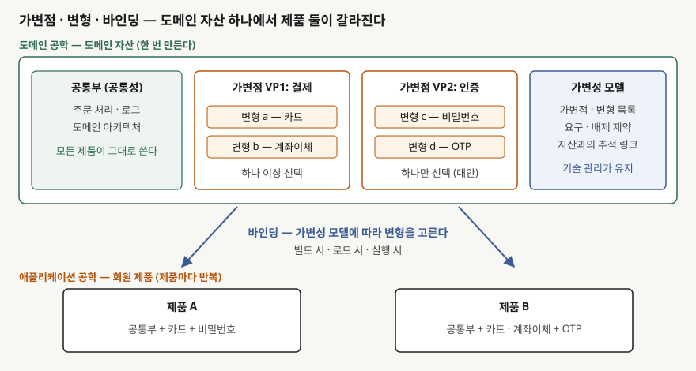

> **실행 검증 없음.** ISO/IEC 26550:2015(제품계열 공학·관리 참조 모델)의 용어 정의와 참조 모델
> 구조를 뼈대로 쓰고, 카네기멜런대 소프트웨어공학연구소(SEI) 기술 노트와 FODA 보고서로 보강했다.
> 비용 절감률 같은 수치는 1차 근거가 사례 보고뿐이라 싣지 않았다.

## 들어가며

재사용을 묻는 문제에서 컴포넌트 기반 개발(CBD)만 쓰면 절반짜리 답안이 된다. 컴포넌트를 만들어 두는
것과, **어떤 제품들에 무엇을 공통으로 쓰고 무엇을 다르게 둘지 먼저 정하는 것**은 다른 일이기 때문이다.
실무에서는 고객사마다 브랜치를 따서 고치다가, 같은 결함을 브랜치 다섯 곳에 따로 반영하는 순간 이 차이를
체감한다. 제품계열 공학은 그 "다르게 둘 부분"을 가변성이라는 이름으로 설계 대상에 올린다.

## 정의

**소프트웨어 제품계열 공학**은 명시적으로 관리되는 **공통 피처와 가변 피처를 공유하고 같은 도메인
아키텍처에 기반한 제품 집합**(제품계열)을, 도메인 자산을 만드는 **도메인 공학**과 그 자산으로 개별
제품을 만드는 **애플리케이션 공학**의 두 생명주기로 개발·관리하는 방법이다(ISO/IEC 26550 제품계열
정의(3.16), 참조 모델(5절)).

SEI는 제품계열을 **공통 핵심 자산으로부터 정해진 방식으로 개발되는** 소프트웨어 중심 시스템의 집합으로
정의한다(CMU/SEI-2003-TN-031이 인용한 Clements·Northrop 정의). ISO는 **도메인 아키텍처와 가변성**을,
SEI는 **핵심 자산과 정해진 방식**을 앞세운다는 차이가 있다.

## 등장 배경

ISO/IEC 26550의 단일 시스템 공학 한계 절(4.1)은 비슷한 제품을 따로 만드는 조직의 대응 **2가지**를 든다.

1. **하나의 제품에 파라미터와 분기를 계속 덧붙인다** — 코드가 커지고 이해·시험이 어려워진다
2. **고객마다 복제해 고치고 나중에 병합한다**(clone-and-own) — 병합 비용과 오류가 쌓이고, 본선 없이
   복제본만 남을 수 있다

두 방식의 공통 문제는 제품 간 차이가 **어디에 있는지 아무 문서에도 없다**는 것이다. 차이는 코드 속
조건문이나 브랜치 이력에 흩어져 있다. 표준은 이 변형 수용을 단일 제품 공급자의 가장 큰 문제로 보고,
가변성을 별도 모델로 꺼내 관리하는 쪽으로 답한다.

## 구성요소 — 두 생명주기와 두 관리 그룹, 그리고 용어 5가지

참조 모델은 **생명주기 2개 + 관리 프로세스 그룹 2개**, 합해 **4개 묶음 16개 프로세스**로 이뤄진다
(ISO/IEC 26550 6절).

| 묶음 | 역할 | 프로세스 |
|---|---|---|
| **도메인 공학** | 공통성·가변성을 정의하고 도메인 자산을 만든다 | 범위 정의, 도메인 요구공학, 도메인 설계, 도메인 구현, 도메인 검증·확인 — **5개** |
| **애플리케이션 공학** | 도메인 자산을 재사용하고 가변성을 바인딩해 제품을 만든다 | 애플리케이션 요구공학, 설계, 구현, 검증·확인 — **4개** |
| **조직 관리** | 조직 차원의 계획과 운영 | 조직 수준 계획, 전환 기반 관리, 제품계열 관리 — **3개** |
| **기술 관리** | 두 생명주기를 기술적으로 지원 | 프로세스 관리, 가변성 관리, 자산 관리, 지원 관리 — **4개** |

도메인 공학에만 **범위 정의**가 하나 더 있다는 점이 핵심이다. 어떤 제품을 계열에 넣을지, 어느 기능
영역이 재사용 가치가 있는지를 정해야 자산을 만들 수 있기 때문이다.

가변성을 다루는 **용어 5가지**는 다음과 같다(ISO/IEC 26550 3절).

| 용어 | 뜻 |
|---|---|
| **공통성** (3.9) | 계열의 모든 제품이 공유하는 특성 |
| **가변성** (3.23) | 제품마다 달라질 수 있는 특성. 기능·품질·환경·사용자·제약·구현 관점에서 잡는다 |
| **가변점** (3.29) | 무엇이 달라지는지를 나타내는 자리 |
| **변형** (3.28) | 가변점을 채우는 대안 하나. 가변점마다 하나 이상 있다 |
| **바인딩** (3.8) | 가변성 모델에 따라 어느 변형을 쓸지 정해 제품을 만드는 작업 |

## 도식

> **출처**: [ISO/IEC 26550:2015 §3 Terms and definitions (3.8 binding, 3.23 variability, 3.28 variant, 3.29 variation point), §6 Two life cycles and two process groups (iTeh 미리보기)](https://cdn.standards.iteh.ai/samples/69529/b9948cd0e7ae4b71aeff7cbd60fb44a5/ISO-IEC-26550-2015.pdf), [Kang 외, FODA, CMU/SEI-90-TR-21](https://sei.cmu.edu/library/feature-oriented-domain-analysis-foda-feasibility-study)

도식의 결제·인증 예는 설명을 위해 붙인 것이고 표준에 있는 예가 아니다. 위쪽이 도메인 공학의 산출물,
아래쪽이 애플리케이션 공학의 산출물이다.

## 비교

**ISO와 SEI의 구분 대응.** 이름은 다르지만 "자산을 만드는 쪽 / 자산으로 제품을 만드는 쪽 / 둘을
통제하는 쪽"이라는 3분할은 같다.

| ISO/IEC 26550 | SEI 관리 영역 (CMU/SEI-2003-TN-031 1.3) |
|---|---|
| 도메인 공학 | 핵심 자산 개발 |
| 애플리케이션 공학 | 제품 개발 |
| 조직 관리 + 기술 관리 | 제품계열 관리 |

**유사 개념과의 대비.**

| 구분 | 컴포넌트 기반 개발 (CBD) | clone-and-own | 제품계열 공학 |
|---|---|---|---|
| 재사용 단위 | 컴포넌트 | 제품 전체 복사 | 아키텍처·요구·컴포넌트·테스트까지 자산 전체 |
| 재사용 시점 | 필요할 때 찾아 씀 | 새 고객이 생길 때 | **범위 정의 단계에서 계획** |
| 차이 관리 | 컴포넌트 교체·설정 | 브랜치에 암묵적 | **가변성 모델에 가변점·변형으로 명시** |
| 생명주기 | 1개 | 1개 (복제마다) | **2개** |
| 결함 수정 | 컴포넌트 단위 | 복제본마다 따로 | 자산에서 고쳐 계열 전체에 반영 |

ISO/IEC 26550 서문은 단일 시스템 공학과 가르는 특성으로 **두 생명주기**와 **명시적 가변성 정의**
두 가지를 든다. CBD는 둘 다 요구하지 않는다.

## 적용 시 고려사항

1. **범위가 성패를 정한다.** 넓으면 가변점이 늘어 자산이 복잡해지고, 좁으면 재사용할 제품이 없다.
   범위 정의에서 자산 범위의 투자 회수를 먼저 따진다(3.7 주석)
2. **바인딩 시점을 정한다.** 빌드 시(조건부 컴파일), 로드 시(설정 파일), 실행 시(파라미터·플러그인)
   중 무엇을 쓸지에 따라 배포물 크기와 시험 범위가 달라진다. 실행 시 바인딩도 **가변성 모델에 등록된
   가변점일 때만** 제품계열 공학이고, 모델에 없는 분기는 4.1절이 지적한 파라미터 덧붙이기와 같다
3. **조합 폭증을 시험으로 다 막을 수 없다.** 가변점이 늘면 조합이 곱으로 늘어난다. 도메인 검증(자산
   단위)과 애플리케이션 검증(제품 단위)을 나누고, 요구·배제 제약을 모델에 적어 도구로 검사한다
4. **변경이 자산으로 돌아오는 경로를 둔다.** 제품 팀이 자산을 복제해 고치기 시작하면 clone-and-own으로
   되돌아간다. 애플리케이션 자산을 도메인 자산으로 승격하는 절차를 기술 관리(자산 관리)에 둔다
5. **표준 스스로 만병통치약이 아니라고 적는다**(4.1). 선투자가 크므로 조직·기술 관리 체계 없이
   도메인 공학만 들이면 투자만 남는다

## 정리

- 정의: 공통·가변 피처를 명시 관리하는 제품 집합을 **두 생명주기**로 개발
- **2 + 2 = 4묶음 16개 프로세스** — 도메인 공학 **5**, 애플리케이션 공학 **4**, 조직 관리 **3**, 기술 관리 **4**
- 용어 **5가지** — **공·가·점·형·바** (공통성·가변성·가변점·변형·바인딩)
- 단일 시스템 공학과 가르는 **2가지** — 생명주기가 둘, 가변성을 명시적으로 정의
- SEI 3영역 — 핵심 자산 개발 / 제품 개발 / 제품계열 관리

> 기출 답안: [기출문제 — 소프트웨어 제품계열(Product Line) 방법론의 개념·특징, 활용 기술과 고려사항](../../exam/2026-11-24-software-product-line-methodology/index.md)
>
> 함께 보기: [형상관리 — 4대 활동과 베이스라인](../2026-09-22-configuration-management-baseline/index.md)

## 참고 자료

- [ISO/IEC 26550:2015, Software and systems engineering — Reference model for product line engineering and management (iTeh 미리보기: 목차·서문·1~4절)](https://cdn.standards.iteh.ai/samples/69529/b9948cd0e7ae4b71aeff7cbd60fb44a5/ISO-IEC-26550-2015.pdf) — 3절 용어, 4.1 단일 시스템 공학의 한계, 5절 참조 모델, 6절 두 생명주기와 두 관리 그룹
- [ISO/IEC 26550:2015 표준 카탈로그](https://www.iso.org/standard/69529.html) — 2판, 2013년 1판을 대체
- [Zubrow, Chastek, Measures for Software Product Lines, CMU/SEI-2003-TN-031 (2003-10)](https://www.sei.cmu.edu/library/file_redirect/2001_005_001_13853.pdf) — 제품계열 정의 인용, 세 관리 영역
- [Kang 외, Feature-Oriented Domain Analysis (FODA) Feasibility Study, CMU/SEI-90-TR-21 (1990-11)](https://sei.cmu.edu/library/feature-oriented-domain-analysis-foda-feasibility-study) — 피처 모델의 필수·선택·대안 관계
