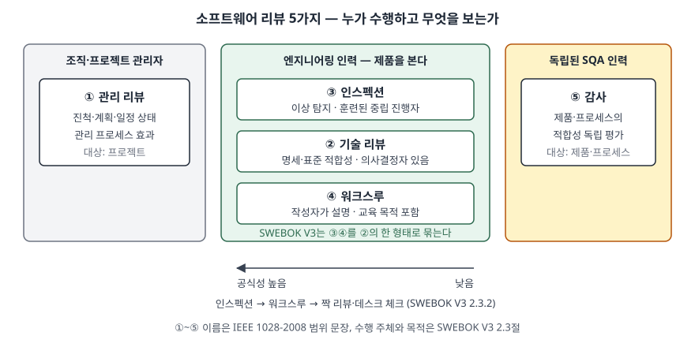

> 실행 검증 없음. IEEE 1028-2008 본문은 유료라 직접 열지 못했다. 리뷰 5가지의 이름과 범위는
> IEEE SA 표준 페이지의 범위 문장으로, 유형별 목적·역할은 IEEE Computer Society의 SWEBOK V3
> 10장 2.3절(1028을 인용한 정리)로 확인했다. ISO/IEC 20246은 공개 미리보기로 범위와 목차까지만 읽었다.

## 들어가며

품질보증 문제에서 "리뷰를 한다"고만 쓰면 누가, 무엇을 보려고, 얼마나 공식적으로 하는지가 빠진다.
IEEE 1028은 이것을 다섯 가지로 갈라 이름을 붙였고, 시험은 그중 둘을 골라 차이를 묻거나 인스펙션의
절차를 묻는 형태로 자주 나온다. 실무에서는 관리자가 동석한 코드 리뷰가 결함을 숨기게 만들고, 감사를
개발팀이 스스로 하면 독립성이 사라진다. 유형을 가르는 기준을 알아야 이런 설계 실수를 피한다.

## 정의

**소프트웨어 리뷰**는 소프트웨어 제품이나 프로젝트 상태를 정해진 사람들이 검토해 계획·명세·표준과의
차이를 찾는 활동이다. IEEE 1028-2008은 이 가운데 **5가지 유형** — 관리 리뷰, 기술 리뷰, 인스펙션,
워크스루, 감사 — 의 정의·요구사항·절차를 정한다고 범위에 적는다. 리뷰가 필요한지를 판단하는 절차와
결과를 어떻게 처리하는지는 이 표준의 범위가 아니다.

ISO/IEC 20246:2017은 대상을 **작업 산출물 리뷰**(work product review)로 좁혀, 어떤 산출물에도 쓸 수 있는
일반 프로세스와 기법을 정한다. 산출물(work product)은 프로세스가 만든 모든 결과물이다(1절 범위).

## 등장 배경

공식 절차를 갖춘 리뷰는 Fagan이 1976년 IBM Systems Journal에 발표한 설계·코드 인스펙션에서 출발한다.
그런데 "리뷰"라는 말은 프로젝트 진척 점검 회의에도, 코드 결함 검사에도, 외부 기준 적합성 감사에도
쓰인다. 셋은 보는 대상(프로젝트 상태·제품·프로세스)도 수행하는 사람도 다르다. 하나의 절차로 묶으면
어느 쪽에도 맞지 않으므로, IEEE 1028은 목적이 다른 활동을 다섯 유형으로 나눠 각각 따로 정의했다.

IEEE SA 표준 페이지에 따르면 1028-2008은 2008년 6월 승인됐고 **2019년 11월 7일부터 비활성(Inactive-Reserved)**
상태다. 이후 판은 그 페이지에 없다. 그 사이 2017년에 국제 표준 ISO/IEC 20246이 나왔고, ISTQB 2024년판
강의계획서는 리뷰 프로세스의 근거로 이 표준을 든다.

## 구성요소 — 리뷰 5가지

| 유형 | 목적 (SWEBOK V3) | 수행 주체 | 역할 |
|---|---|---|---|
| **① 관리 리뷰** | 진척을 감시하고 계획·일정의 상태를 판단, 관리 프로세스의 효과 평가 | 조직·프로젝트 관리자 | — |
| **② 기술 리뷰** | 자격 있는 인원으로 구성된 팀이 제품을 평가해 명세·표준과의 불일치 식별 | 엔지니어링 인력 | 의사결정자, 리뷰 리더, 기록자, 검사자 |
| **③ 인스펙션** | 제품의 이상(anomaly)을 탐지하고 식별 | 엔지니어링 인력, 훈련된 중립 진행자가 이끈다 | 인스펙션 리더, 기록자, 낭독자, 검사자 2~5명, 작성자 |
| **④ 워크스루** | 제품 평가, 청중 교육을 겸할 수 있다 | 작성자가 산출물을 설명하며 진행 | 작성자, 참가자 |
| **⑤ 감사** | 제품·프로세스의 적합성을 독립적으로 평가 | 개발과 독립된 SQA 인력 | 수석 감사자, 감사자, 기록자, 의뢰자, 피감사 조직 대표 |

SWEBOK V3는 인스펙션의 특징을 **5가지**로 든다 — 조직이 정한 기준(규칙)으로 검사, 문서의 정해진 부분을
나눠 검사(표본), 팀원의 관리자는 빠지는 동료 검토, 훈련된 중립 진행자의 진행, 공식 회의. 종료 판정은
**3가지**다 — 재작업 없이(또는 사소한 수정만으로) 수락, 재작업 확인 후 수락, 재인스펙션.

## 도식

> **출처**: [IEEE SA — IEEE 1028-2008 표준 페이지(범위)](https://standards.ieee.org/ieee/1028/4402/), [SWEBOK V3 10장 Software Quality — 2.3 Reviews and Audits (ligurio/swebok-v3 저장소의 마크다운 사본)](https://raw.githubusercontent.com/ligurio/swebok-v3/master/10_software_quality.md)

답안지에는 세 묶음(관리자 / 엔지니어링 / 독립 SQA)과 다섯 상자, 아래 공식성 화살표 하나만 옮기면 된다.
SWEBOK V3는 인스펙션과 워크스루를 기술 리뷰의 한 형태로 묶고, 공식성은 인스펙션이 가장 높고 워크스루,
짝 리뷰·데스크 체크 순으로 낮아진다고 적는다. 기술 리뷰 전체가 이 순서의 어디에 오는지는 적지 않았다.

## 비교

### 셋이 가장 자주 헷갈린다 — 기술 리뷰·인스펙션·워크스루

| 구분 | 기술 리뷰 | 인스펙션 | 워크스루 |
|---|---|---|---|
| 주된 질문 | 명세·표준에 맞는가, 기술 문제를 어떻게 결정할까 | 결함이 어디 있는가 | 작성자의 의도가 전달되는가 |
| 진행 | 리뷰 리더, 결정은 의사결정자 (ISTQB: 진행자가 이끈다) | 훈련된 중립 진행자 | 작성자 |
| 사전 준비 | — | 일반 프로세스 전체를 따르므로 개별 리뷰를 거친다 (ISTQB) | 참가자가 미리 안 봐도 된다 |
| 관리자 | — | 참여하지 않음 | — |
| 지표 수집 | — | 수집해 프로세스 개선에 쓴다 (ISTQB) | — |
| 작성자의 역할 제한 | — | 리뷰 리더·기록자를 맡을 수 없다 (ISTQB) | 진행자 |

"—" 칸은 확인한 자료(SWEBOK V3 2.3절, ISTQB 4.0.1 3.2.4절)에 그 항목이 적혀 있지 않은 곳이다.

### IEEE 1028과 ISO/IEC 20246

| 구분 | IEEE 1028-2008 | ISO/IEC 20246:2017 |
|---|---|---|
| 상태 | 2019-11-07 비활성(Inactive-Reserved) | 국제 표준 1판(2017-02) |
| 범위 | 리뷰·감사 5가지 | 작업 산출물 리뷰 — 서문은 인스펙션·리뷰·워크스루를 예로 든다 |
| 구조 | 유형마다 입력·진입 기준·절차·출력을 따로 정의 | 유형과 무관한 **일반 프로세스 5개 활동**을 정의하고 공식성에 따라 조정 |
| 프로세스 | 유형별 절차 | 계획 → 리뷰 착수 → 개별 리뷰 → 이슈 전달·분석 → 수정·보고 (6.4.1~6.4.5) |
| 기법 | — | 즉흥·체크리스트·시나리오·관점 기반 읽기(PBR)·역할 기반 (7.2) |
| 대응 | — | 부록 E가 IEEE 1028-2008과의 대응을 싣는다 |

ISTQB 4.0.1은 20246을 근거로 흔히 쓰는 리뷰를 **4가지**로 든다 — 비공식 리뷰, 워크스루, 기술 리뷰, 인스펙션.
같은 산출물을 처음엔 비공식으로, 나중엔 공식으로 리뷰할 수도 있다고 적는다.

## 적용 시 고려사항

| 고려사항 | 판단 기준 |
|---|---|
| **목적으로 유형을 고른다** | 결함을 최대한 찾는 것이 목적이면 인스펙션, 이해 공유·교육이면 워크스루, 기술적 결정이 필요하면 기술 리뷰, 일정·자원 판단이면 관리 리뷰, 외부 기준 적합성 증명이면 감사다 |
| **관리자를 동료 검토에서 뺀다** | 인스펙션은 팀원의 관리자가 참여하지 않는다. 결과가 평가에 쓰이면 결함이 드러나지 않는다. ISTQB도 참가자 평가를 리뷰 목적으로 삼지 말라고 적는다 |
| **감사의 독립성** | 감사는 개발과 독립된 인력이 해야 의미가 있다. 개발팀 내부 점검을 감사라 부르면 독립 평가 증거가 되지 않는다 |
| **공식성은 산출물의 위험에 맞춘다** | ISTQB는 개발 생명주기, 프로세스 성숙도, 산출물의 중요도·복잡도, 법규 요구, 감사 추적 필요를 공식성을 정하는 요인으로 든다 |
| **도구로 남기는 기록** | 코드 리뷰 시스템에서 이상 목록·조치 상태·종료 판정이 기록으로 남아야 인스펙션의 지표 수집과 감사 추적이 된다 |

## 정리

- **5유형 = 관·기·인·워·감** — 관리 리뷰, 기술 리뷰, 인스펙션, 워크스루, 감사 (IEEE 1028-2008)
- **수행 주체 3묶음** — 관리자(관리 리뷰) / 엔지니어링 인력(기술·인스펙션·워크스루) / 독립 SQA(감사)
- **인스펙션 = 특징 5, 종료 판정 3** — 규칙·표본·동료·진행자·회의 / 수락, 확인 후 수락, 재인스펙션
- **20246 일반 프로세스 5활동 = 계·착·개·전·수** — 계획, 착수, 개별 리뷰, 이슈 전달·분석, 수정·보고
- IEEE 1028-2008은 2019년 비활성. 답안에는 "작업 산출물 리뷰는 ISO/IEC 20246:2017이 일반 프로세스로 정의"를 함께 쓴다

> 관련 답안: [기출문제 — 소프트웨어 품질의 의미, 품질보증의 목적과 기능, 인스펙션과 인스펙션 프로세스](../../exam/2026-11-27-software-quality-assurance-inspection-process/index.md)

## 참고 자료

- [IEEE SA — IEEE 1028-2008 IEEE Standard for Software Reviews and Audits](https://standards.ieee.org/ieee/1028/4402/) — 범위(5가지 유형), 승인 2008-06-16, 비활성 2019-11-07
- [IEEE Xplore — IEEE 1028-2008 (본문 유료)](https://ieeexplore.ieee.org/document/4601584)
- [ISO/IEC 20246:2017 Software and systems engineering — Work product reviews (VDE 미리보기)](https://assets.vde-verlag.de/iec-normen/preview-pdf/info_isoiec20246%7Bed1.0%7Den.pdf) — 1절 범위, 목차(6.4 활동 5개, 7.2 개별 리뷰 기법, 부록 D 리뷰 유형, 부록 E IEEE 1028-2008 대응)
- [SWEBOK V3 10장 Software Quality — 2.3 Reviews and Audits (ligurio/swebok-v3 저장소의 마크다운 사본)](https://raw.githubusercontent.com/ligurio/swebok-v3/master/10_software_quality.md) — 2.3.1~2.3.5 유형별 목적·역할, 인스펙션 특징 5가지와 종료 판정 3가지, 공식성 순서. 원본은 [IEEE Computer Society SWEBOK 페이지](https://www.computer.org/education/bodies-of-knowledge/software-engineering)
- [ISTQB Certified Tester Foundation Level Syllabus v4.0.1 (2024-09-15)](https://www.istqb.org/wp-content/uploads/2024/11/ISTQB_CTFL_Syllabus_v4.0.1.pdf) — 3.2.2 리뷰 프로세스 활동, 3.2.3 역할, 3.2.4 리뷰 유형 4가지, 3.2.5 성공 요인
- [M. E. Fagan, Design and code inspections to reduce errors in program development, IBM Systems Journal 15(3), 1976](https://doi.org/10.1147/sj.153.0182)
