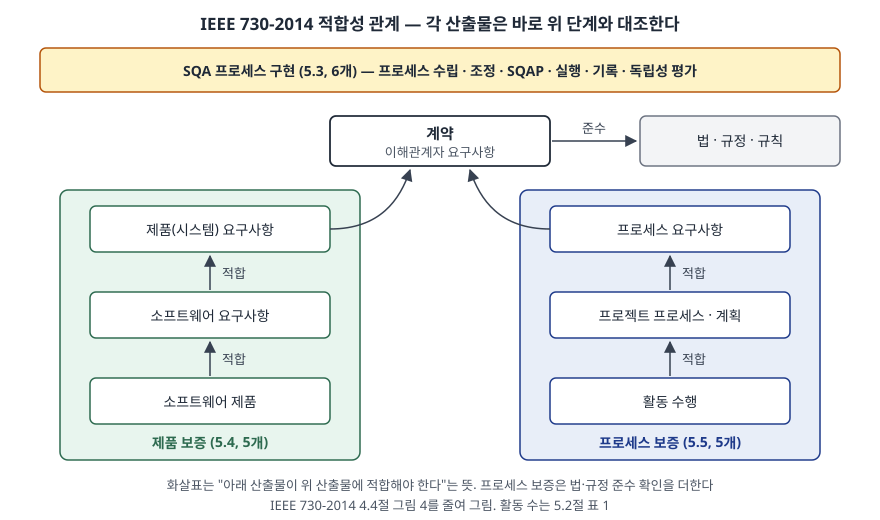

> 실행 검증 없음. IEEE 730-2014 본문(1·3·4·5절, 부록 A·C)을 직접 읽고 정리했다.
> IEEE 730-2014는 2025-03-27에 비활성화됐고 현행판은 2026-08-21에 발행된 IEEE 730-2026이다.
> 2026판은 IEEE SA 표준 페이지의 요약까지만 확인했으므로, 본문의 활동 수·절 번호는 2014판 기준이다.

## 들어가며

품질보증 문제에서 "테스트를 열심히 한다"고 쓰면 감점된다. 테스트는 제품의 결함을 찾는 일이고,
품질보증은 **그런 활동이 정해진 대로 수행되고 있다는 증거를 독립적으로 만드는 일**이기 때문이다.
IEEE 730은 이 차이를 활동 16개로 풀어 적은 표준이라, 품질보증의 목적·기능·조직을 묻는 문항의
뼈대로 쓰기 좋다. 실무에서는 품질 조직이 개발 일정에 묶여 독립성을 잃거나, SQA 계획서가 양식만
채운 문서가 되는 일이 흔한데, 표준은 둘 다 막는 장치를 요구사항으로 둔다.

## 정의

IEEE 730-2014는 소프트웨어 품질보증(SQA)을 **소프트웨어 프로세스가 의도한 용도에 맞는 품질의 제품을
만들기에 적절하다는 확신을 주는 증거를 얻기 위해, 그 프로세스의 적정성을 정의하고 평가하는 활동의
집합**으로 정의한다(용어 정의, 3.2). 같은 정의는 SQA의 핵심 속성으로 **프로젝트에 대한 객관성**을 들고,
SQA 기능이 프로젝트의 기술·관리·재정 압력에서 벗어나 조직상 독립될 수 있다고 덧붙인다.

품질 자체는 **소프트웨어 제품이 수립된 요구사항을 충족하는 정도**로 정의하되, 그 요구사항이
이해관계자의 요구와 기대를 얼마나 정확히 담았는지에 품질이 좌우된다는 단서를 붙인다(3.2).

ISO 9000:2015의 품질경영 용어로 옮기면 **품질보증은 품질 요구사항이 충족될 것이라는 확신을 주는 데
초점을 둔 품질경영의 일부**(3.3.6)이고, **품질통제는 품질 요구사항을 충족하는 데 초점을 둔 일부**(3.3.7)다.

## 등장 배경

IEEE 730은 1979년 처음 나온 뒤 오랫동안 **SQA 계획서에 무엇을 적을지**를 정하는 표준이었다.
2014년 개정은 방향을 바꿔, 계획서 양식이 아니라 **SQA 프로세스의 활동·작업·성과**를 요구사항으로
정했다. 생명주기 프로세스 표준 ISO/IEC/IEEE 12207:2008의 품질보증 프로세스(7.2.3)는 성과를
4개만 정해 두었는데, 무엇을 어떻게 해야 그 성과가 나오는지는 비어 있었다. 2014판 부록 A는 이
4개 성과를 16개 활동에 대응시킨다. 2014판 적합성 조항(1.5.2)은 이 표준을 지키면 12207의 7.2.3 성과를
충족하지만 **그 반대는 성립하지 않는다**고 적는다. 12207보다 요구 수준이 높다는 뜻이다.

2026판은 IEEE SA 표준 페이지 요약 기준으로 ISO/IEC/IEEE 12207:2017, DevOps 표준인 IEEE 2675-2021,
ISO/IEC/IEEE 15289:2019와 정합을 맞춘 개정이다.

## 구성요소 — 3개 그룹 16개 활동

2014판 5.2절은 SQA 성과를 **3개 그룹**으로 나누고 활동 **16개**를 배치한다(표 1). 5.4.1과 5.5.1은
제품 보증·프로세스 보증을 설명하는 도입부라 16개에 세지 않는다.

| 그룹 | 활동 수 | 활동 |
|---|---|---|
| **SQA 프로세스 구현** (5.3) | 6 | ① SQA 프로세스 수립 ② 관련 소프트웨어 프로세스와 조정 ③ SQA 계획 문서화 ④ SQA 계획 실행 ⑤ SQA 기록 관리 ⑥ 조직의 독립성·객관성 평가 |
| **제품 보증** (5.4) | 5 | ① 계획의 계약·표준·규제 적합성 평가 ② 제품의 수립된 요구사항 적합성 평가 ③ 제품의 수용 가능성 평가 ④ 제품 생명주기 지원의 적합성 평가 ⑤ 제품 측정 |
| **프로세스 보증** (5.5) | 5 | ① 생명주기 프로세스·계획의 적합성 평가 ② 환경의 적합성 평가 ③ 하도급자 프로세스의 적합성 평가 ④ 프로세스 측정 ⑤ 인력의 기술·지식 평가 |

활동마다 **4가지 요소**로 기술된다(1.7) — 대응하는 12207 조항, 목적, 성과, 작업. 성과는 현재형
서술문으로, 작업은 필수·권고·허용 행위로 구분해 적는다.

### 독립성 3요소

활동 5.3.6의 성과는 SQA 독립성을 **3가지 매개변수**로 정의한다.

| 독립성 | 요구 |
|---|---|
| **기술적 독립** | 그 시스템 개발에 관여하지 않은 인력이 SQA를 수행한다 |
| **관리적 독립** | SQA 담당은 개발·프로그램 관리 조직과 분리된 조직에 속한다 |
| **재정적 독립** | SQA 예산 통제권이 개발 조직과 독립된 조직에 있다 |

### SQA 계획서(SQAP) 7개 절

활동 5.3.3은 그림 5의 SQAP 목차가 다루는 **주제는 규범**이고 절 이름과 순서는 참고라고 정한다.
해당 없는 절도 빼지 않고 자리를 남겨 이유를 적는다. 부록 C의 표 C.2에 따른 목차는 **7개 절**이다.

| 절 | 내용 | 대응 활동 |
|---|---|---|
| 1 목적과 범위 / 2 용어 / 3 참조 문서 | 도입 정보 | — |
| 4 SQA 계획 개요 | 조직과 독립성, 소프트웨어 제품 위험, 도구, 표준·관행, 노력·자원·일정 | 5.3.3, 5.3.6, 5.5.2, 5.5.3 |
| 5 활동·성과·작업 | 5.1 제품 보증 5개, 5.2 프로세스 보증 5개 | 5.4.2~5.4.6, 5.5.2~5.5.6 |
| 6 추가 고려사항 | 계약 검토, 품질 측정, 면제·이탈, 작업 반복, SQA 수행 위험, 의사소통, 부적합 처리 | 5.4.6, 5.5.5 |
| 7 SQA 기록 | 기록의 분석·수집·보관·폐기, 기록 제공 | 5.3.5 |

## 도식

> **출처**: [IEEE 730-2014, IEEE Standard for Software Quality Assurance Processes §4.4 Overview of SQA activities, Figure 4](https://standards.ieee.org/ieee/730/5284/)

표준 4.4절의 그림 4를 답안용으로 줄였다. 핵심은 **적합성의 이행성**이다. 각 산출물은 계약과 직접
대조하지 않고 **바로 위 단계와만** 대조하면 된다. 소프트웨어 제품이 소프트웨어 요구사항에, 그것이
제품 요구사항에, 그것이 계약에 맞으면 제품은 계약에 맞는다. 왼쪽 사슬이 제품 보증, 오른쪽 사슬이
프로세스 보증이고, 프로세스 보증은 여기에 법·규정 준수 확인이 더해진다. 답안지에는 상자 8개와 위쪽
띠 하나로 3분 안에 옮길 수 있다.

## 비교

| 구분 | 품질보증(SQA) | 품질통제(QC)·테스트 | 검증·확인(V&V) |
|---|---|---|---|
| 정의 근거 | IEEE 730 3.2, ISO 9000 3.3.6 | ISO 9000 3.3.7, IEEE 829(테스트) | ISO/IEC/IEEE 12207:2008 |
| 보는 대상 | 프로세스와 제품, **둘 다** | 제품 | 제품(단계 산출물) |
| 묻는 질문 | 확신을 줄 증거가 있는가 | 이 제품이 요구사항을 충족하는가 | 단계 조건을 지켰는가 / 의도한 용도에 맞는가 |
| 독립성 | 기술·관리·재정 독립을 평가 대상으로 둔다 | 요구하지 않는다 | 독립 V&V는 별도 선택 |
| 산출물 | SQAP, SQA 기록, 부적합 보고 | 결함 보고, 테스트 결과 | 검증·확인 보고 |

IEEE 730 4.6.1은 "QA"라는 이름의 조직이 실제로는 테스트만 하는 경우가 있다고 짚고, 표준은 활동을
**특정 조직이 수행하라고 요구하지 않으며 책임만 명확히 배정하라**고 요구한다. 조직 이름이 아니라
수행하는 활동으로 SQA 여부를 판단한다.

## 적용 시 고려사항

| 고려사항 | 판단 기준 |
|---|---|
| **위험에 비례한 범위** | 표준의 기본 원칙(4.6.2)이다. SQA 활동의 폭과 깊이는 소프트웨어 제품 위험에서 도출한다. 안전·보안 영향이 큰 구성요소에 평가를 집중한다 |
| **조정(테일러링)의 한계** | 조정 적합(1.5.4)에서 허용되는 것은 **5.4와 5.5의 범위 축소뿐**이다. 수행하지 않는 활동은 SQAP에 해당 없음과 이유를 적는다. 5.3 구현 활동은 줄일 수 없다 |
| **독립성 확인** | 개발 PM에게 보고하는 QA 담당은 관리적 독립을 충족하지 못한다. 보고 경로와 예산 출처를 SQAP 4.1절에 적어 둔다 |
| **기록이 곧 증거** | SQA의 산출물은 "확신의 근거가 되는 증거"다. 리뷰 결과·부적합·조치 이력이 형상관리·이슈 관리 시스템에 수정 불가능하게 남아야 한다(5.3.5) |
| **조직 수준과 프로젝트 수준의 구분** | 5.3.1 프로세스 수립은 프로젝트 시작 전 조직이 하는 활동이라 SQAP에 담지 않는다(표 C.1). 프로젝트마다 SQA 체계를 새로 만들지 않는다 |

## 정리

- **정의** — 프로세스가 적합한 품질의 제품을 만든다는 확신의 증거를 얻기 위해 프로세스 적정성을 정의·평가하는 활동 집합, 핵심 속성은 객관성
- **3그룹 16활동 = 구·제·프 6·5·5** — 구현 6, 제품 보증 5, 프로세스 보증 5
- **독립성 3요소 = 기·관·재** — 기술, 관리, 재정
- **SQAP 7절** — 목적·용어·참조·개요·활동·추가 고려·기록
- **12207 성과 4개 → 730 활동 16개**, 조정은 5.4·5.5 범위 축소만 허용
- 2014판은 2025년 비활성, 현행은 **IEEE 730-2026**

> 기출 답안: [기출문제 — 소프트웨어 품질의 의미, 품질보증의 목적과 기능, 인스펙션과 인스펙션 프로세스](../../exam/2026-11-27-software-quality-assurance-inspection-process/index.md)
>
> 관련 글: [소프트웨어 리뷰 유형 — IEEE 1028의 관리 리뷰·기술 리뷰·인스펙션·워크스루·감사](../2026-11-27-ieee-1028-software-review-types/index.md)

## 참고 자료

- [IEEE SA — IEEE 730-2014 IEEE Standard for Software Quality Assurance Processes](https://standards.ieee.org/ieee/730/5284/) — 승인 2014-03-27, 비활성 2025-03-27, 후속판 730-2026. 본문은 1.5 적합성, 1.7 구성, 3.2 정의, 4.4 그림 4, 4.6 핵심 개념, 5.2 표 1(16개 활동), 5.3.3 SQAP, 5.3.6 독립성, 부록 A 12207 성과 대응, 부록 C 표 C.1·C.2
- [IEEE SA — IEEE 730-2026 IEEE Standard for Software Quality Assurance Processes](https://standards.ieee.org/ieee/730/10854/) — 승인 2026-02-12, 발행 2026-08-21, 12207:2017·IEEE 2675-2021·15289:2019 정합
- [IEEE Xplore — IEEE 730-2014 (본문 유료)](https://doi.org/10.1109/IEEESTD.2014.6835311)
- [ISO 9000:2015 Quality management systems — Fundamentals and vocabulary (iTeh 미리보기)](https://cdn.standards.iteh.ai/samples/45481/7a88f2b85cec4438a96de8da61970d1c/ISO-9000-2015.pdf) — 3.3.6 품질보증, 3.3.7 품질통제
- [NIST OSAC Lexicon — quality control](https://www.nist.gov/glossary-term/30231) — 품질통제 정의 확인
