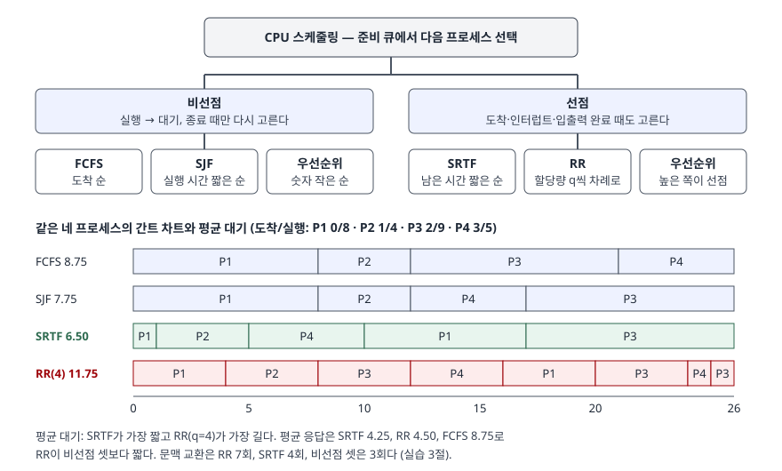

## 들어가며

CPU 스케줄링은 운영체제 문항에서 계산이 붙는 거의 유일한 주제다. 프로세스 몇 개의 도착 시각과 실행 시간을 주고
알고리즘별 간트 차트와 평균 대기시간을 구하게 하므로, 정의를 외워도 계산 규칙(동률 처리, 선점 시점)을 틀리면 점수가 없다.
실무에서는 응답성이 중요한 대화형 작업과 처리량이 중요한 일괄 작업이 한 서버에 섞일 때, 무엇을 희생해 무엇을 얻는지를 판단하는 틀이 된다.
이 글은 교재 예제를 직접 시뮬레이터로 다시 계산해, 답안에 쓸 숫자와 계산 규칙을 검산했다.

## 정의

**CPU 스케줄링**: 준비 큐(ready queue)에 있는 프로세스 가운데 하나를 골라 CPU 코어를 배정하는 운영체제의 결정이다.
Silberschatz 교재는 이 결정을 내리는 것을 **CPU 스케줄러**(단기 스케줄러), 고른 프로세스에 실제로 CPU를 넘기는 커널 구성요소를
**디스패처**로 나누고, 디스패처가 한 프로세스를 멈추고 다른 프로세스를 시작하는 데 걸리는 시간을 **디스패치 지연**이라 부른다.

스케줄링 결정이 일어나는 시점은 **4가지**다.

| 번호 | 시점 | 비선점에서도 결정하는가 |
|---|---|---|
| 1 | 실행 → 대기 (입출력 요청) | 예 |
| 2 | 실행 → 준비 (인터럽트) | 아니오 |
| 3 | 대기 → 준비 (입출력 완료) | 아니오 |
| 4 | 종료 | 예 |

1과 4에서만 결정하면 **비선점**, 네 시점 모두에서 결정하면 **선점** 스케줄링이다.

## 등장 배경

다중 프로그래밍으로 여러 프로세스가 메모리에 함께 올라오면서 "CPU가 비었을 때 누구에게 줄 것인가"가 정해야 할 문제가 되었다.
가장 단순한 도착 순서(FCFS)는 긴 작업 하나 뒤에 짧은 작업들이 줄지어 기다리는 **호위 효과**(convoy effect)를 낳는다.
교재는 CPU를 오래 쓰는 프로세스 하나와 입출력이 잦은 프로세스 여럿이 섞이면, 짧은 프로세스들이 긴 프로세스를 기다리는 동안
입출력 장치가 놀고 응답 시간이 나빠진다고 설명한다. 이후 시분할 시스템이 등장하자 **응답 시간**이 새 기준으로 추가되었다.
OSTEP은 반환 시간만 보면 최적인 STCF가 시분할 단말이 등장한 뒤에는 응답 시간이 나빠 맞지 않게 되었고, 그래서 응답 시간이라는 기준이 생겼다고 설명한다.

## 구성요소 — 평가 기준 5가지, 알고리즘 5가지

### 평가 기준 5가지

| 기준 | 정의 (Silberschatz) | 목표 |
|---|---|---|
| CPU 이용률 | CPU를 가능한 한 바쁘게 유지한 정도 | 최대화 |
| 처리량 | 단위 시간당 실행을 마친 프로세스 수 | 최대화 |
| 반환 시간 | 프로세스 하나를 실행하는 데 걸린 시간, 대기 포함 (종료 − 도착) | 최소화 |
| 대기 시간 | 준비 큐에서 기다린 시간의 합 (반환 − 실행) | 최소화 |
| 응답 시간 | 요청을 낸 뒤 첫 응답이 나오기까지의 시간 | 최소화 |

**응답 시간 정의는 교재마다 다르다.** Silberschatz는 "첫 응답이 나올 때까지", OSTEP은 "처음 스케줄될 때까지"
(T_response = T_firstrun − T_arrival)로 정의하고, 자기 정의가 응답이 즉시 나온다고 가정한 최선의 경우라고 각주에 밝힌다.
계산 문제는 처음 CPU를 받은 시각으로 푸는 것이 일반적이므로 아래 계산은 OSTEP 정의를 쓴다.
교재는 다섯 기준을 동시에 달성할 수 없어 최적화 문제가 된다고 적는다.

### 알고리즘 5가지

| 알고리즘 | 선점 | 고르는 기준 | 교재가 짚는 성질 |
|---|---|---|---|
| FCFS | 비선점 | 먼저 도착한 순 | 도착 순서에 따라 성능이 크게 갈린다, 호위 효과 |
| SJF | 비선점 | 다음 CPU 실행 시간이 짧은 순 | 주어진 프로세스 집합에서 평균 대기 최소. 다음 실행 시간을 알기 어렵다 |
| SRTF (선점 SJF, STCF) | 선점 | 남은 실행 시간이 짧은 순 | 새 프로세스가 도착할 때마다 다시 고른다 |
| 우선순위 | 둘 다 | 우선순위 숫자가 작은 순 | 기아(starvation) 발생, 해법은 에이징(aging) |
| RR | 선점 | 도착 순 + 할당량 q마다 교대 | 프로세스 n개면 (n−1)q 넘게 기다리지 않는다 |

SJF는 다음 실행 시간을 미리 알 수 없으므로 과거 실행 시간의 **지수 평균**으로 예측한다.
τ(n+1) = α·t(n) + (1−α)·τ(n)이고, 교재는 α를 보통 1/2로 둔다. α = 0이면 예측이 처음 값에서 바뀌지 않고, α = 1이면 직전 실행 시간만 쓴다.
교재는 SJF를 "예측한 다음 실행 시간의 역수를 우선순위로 쓰는 우선순위 스케줄링"으로도 설명한다.

## 도식

> **출처**: 선점·비선점 구분과 결정 시점은 [Silberschatz et al., *Operating System Concepts* 10th ed., Ch.5 슬라이드 5.9 Scheduling Decisions](https://www.cs.hunter.cuny.edu/~sweiss/course_materials/csci340/slides/chapter05.pdf),
> 알고리즘별 선택 기준은 같은 슬라이드 5.18·5.22·5.27·5.32·5.36. 간트 차트와 평균값은 아래 계산 검산 3절의 실행 결과다.

답안지에는 위쪽 분류 트리만 그려도 된다. 계산 문제가 나오면 아래쪽처럼 알고리즘마다 시간 축을 하나씩 그리고, 구간 경계에 시각을 적는다.

## 계산 검산

시뮬레이터: [`code/scheduling.py`](code/scheduling.py), 실행 기록: [`code/output.txt`](code/output.txt).
시간을 정수 단위로 한 칸씩 흉내 낸다. 교재가 정하지 않은 동률 규칙은 둘을 정했다 — 기준 값이 같으면 먼저 도착한 것,
도착도 같으면 목록에 먼저 적힌 것. RR에서 할당량이 끝난 순간 새 프로세스가 도착하면 새 프로세스가 먼저 큐 뒤에 선다.

### 교재 예제 7개

| 예제 | 교재 값 | 계산 값 | 간트 차트 |
|---|---|---|---|
| FCFS, P1 24·P2 3·P3 3 순 | 평균 대기 17 | 17 | P1 0-24, P2 24-27, P3 27-30 |
| FCFS, P2·P3·P1 순 | 평균 대기 3 | 3 | P2 0-3, P3 3-6, P1 6-30 |
| SJF, 6·8·7·3 모두 0 도착 | 평균 대기 7 | 7 | P4 0-3, P1 3-9, P3 9-16, P2 16-24 |
| SRTF, 도착 0·1·2·3 / 실행 8·4·9·5 | 평균 대기 6.5 | 13/2 | P1 0-1, P2 1-5, P4 5-10, P1 10-17, P3 17-26 |
| RR q=4, P1 24·P2 3·P3 3 | 평균 반환 15.7 | 47/3 ≈ 15.67 | P1 0-4, P2 4-7, P3 7-10, P1 10-30 |
| 비선점 우선순위, 5개 | 평균 대기 8.2 | 41/5 | P2 0-1, P5 1-6, P1 6-16, P3 16-18, P4 18-19 |
| 지수 평균, τ0 10, α 1/2 | — | 10, 8, 6, 6, 5, 9, 11, 다음 12 | 실제 실행 6, 4, 6, 4, 13, 13, 13 |

여섯 개의 교재 값이 모두 맞았다. RR 예제의 평균 대기는 17/3 ≈ 5.67이다(P1 6, P2 4, P3 7).
SJF가 최소인지는 1-3 예제의 네 프로세스로 가능한 순서 **24가지**를 전부 계산해 확인했다. 최소 평균 대기는 7이고 그 순서는 P4·P1·P3·P2 하나뿐, 최대는 11이었다.

### 예상과 달랐던 결과 1 — 교재 SJF 예제의 도착 시각

슬라이드 5.23은 "모든 프로세스가 0에 도착한다고 가정한다"고 적으면서 표에는 도착 시각 0·2·4·5를 함께 싣는다.
평균 대기 7은 **모두 0에 도착했을 때만** 나온다. 표의 도착 시각을 그대로 쓰면 비선점 SJF는 P1이 0에 혼자 도착해 먼저 끝까지 돌고
(P1 0-6, P4 6-9, P3 9-16, P2 16-24), 평균 대기는 (0+14+5+1)/4 = **5**가 된다. 도착 시각이 있는 문제에서는
"그 시각에 준비 큐에 누가 있는가"부터 확인해야 한다는 것을 교재 예제가 거꾸로 보여 준다.

### 같은 작업 묶음에 다섯 알고리즘

SRTF 예제의 네 프로세스(도착 0·1·2·3, 실행 8·4·9·5)에 우선순위 3·1·4·2를 붙여 다섯 알고리즘을 모두 돌렸다.

| 알고리즘 | 평균 대기 | 평균 반환 | 평균 응답 | 문맥 교환 |
|---|---|---|---|---|
| FCFS | 8.75 | 15.25 | 8.75 | 3 |
| SJF | 7.75 | 14.25 | 7.75 | 3 |
| SRTF | **6.50** | **13** | **4.25** | 4 |
| 우선순위(비선점) | 7.75 | 14.25 | 7.75 | 3 |
| RR(q=4) | 11.75 | 18.25 | 4.50 | 7 |

SRTF가 대기·반환·응답 셋 모두 가장 짧았다. RR은 대기와 반환이 가장 길지만 응답은 비선점 셋보다 짧고, 문맥 교환은 가장 많다.
OSTEP의 표현대로 CPU를 짧게 나눠 공평하게 돌리는 정책은 반환 시간에서 손해를 본다.

### 예상과 달랐던 결과 2 — RR 할당량과 평균 반환

P1 24·P2 3·P3 3에 할당량만 바꿔 돌렸다. 할당량이 커질수록 반환이 꾸준히 늘거나 줄 것이라 예상했다.

| q | 1 | 2 | 3 | 4 | 5 | 6 | 8 | 12 | 24 |
|---|---|---|---|---|---|---|---|---|---|
| 평균 반환 | 15.67 | 16.33 | **15** | 15.67 | 16.33 | 17 | 18.33 | 21 | 27 |
| 평균 응답 | 1 | 2 | 3 | 3.67 | 4.33 | 5 | 6.33 | 9 | 17 |
| 문맥 교환 | 9 | 6 | 3 | 3 | 3 | 3 | 3 | 3 | 2 |

평균 응답은 할당량에 따라 단조롭게 늘었지만 **평균 반환은 오르내렸다.** q=3에서 짧은 두 프로세스가 각자 할당량 한 번에 끝나
반환이 가장 짧았고, q=2는 짧은 프로세스가 두 번에 나뉘어 끝나므로 오히려 늘었다. q=24에서는 FCFS와 같아졌다(반환 27, 대기 17).
교재의 "실행 시간의 80%가 q보다 짧도록 잡는다"는 경험칙이 뜻하는 바가 이것이다 — 대부분의 작업이 할당량 한 번에 끝나야 반환이 줄고,
그보다 크게 잡으면 FCFS로 돌아간다.

## 비교

### 선점 SJF와 RR — 같은 선점, 다른 목표

| 구분 | SRTF | RR |
|---|---|---|
| 목표 | 평균 반환·대기 최소 | 응답 시간과 공평성 |
| 필요한 정보 | 남은 실행 시간 (예측해야 한다) | 없음 |
| 기아 | 긴 작업이 계속 밀릴 수 있다 | 없다, 최대 (n−1)q 대기 |
| 문맥 교환 | 도착 때만 | 할당량마다 |
| 위 계산 (같은 묶음) | 대기 6.50 · 응답 4.25 | 대기 11.75 · 응답 4.50 |

### 기아와 에이징

| 구분 | 내용 |
|---|---|
| 기아(무한 대기) | 우선순위가 낮은 프로세스가 끝내 실행되지 못하는 것. 우선순위·SJF·SRTF에서 생긴다 |
| 에이징 | 기다린 시간이 길수록 우선순위를 올려 결국 실행되게 하는 것 |
| 다단계 피드백 큐 | 프로세스가 큐 사이를 옮겨 다닐 수 있게 해서 에이징을 구현할 수 있다. 교재 예는 Q0 RR q=8, Q1 RR q=16, Q2 FCFS 3단 |

## 적용 시 고려사항

- **할당량은 문맥 교환 비용과 같이 정한다.** 교재는 q를 보통 10~100ms, 문맥 교환을 10μs 미만으로 든다. OSTEP은
  할당량 10ms에 문맥 교환 1ms면 시간의 약 10%를 교환에 쓰고, 100ms로 늘리면 1% 미만이 된다고 계산한다. 위 계산에서 q=1은 교환이 9회로 q=3의 세 배였다.
  OSTEP은 교환 비용이 레지스터 저장뿐 아니라 캐시·TLB·분기 예측기 상태를 다시 채우는 비용까지 포함한다고 짚는다.
- **SJF 계열은 실행 시간 예측이 맞을 때만 최적이다.** 지수 평균은 과거 패턴이 이어진다는 가정이다. 위 계산에서 실행 시간이 4에서 13으로 뛰자
  예측은 5 → 9 → 11 → 12로 세 번에 걸쳐 따라갔다. 작업 성격이 갑자기 바뀌는 부하에서는 짧은 작업으로 잘못 분류된 긴 작업이 다른 작업을 막는다.
- **선점은 공유 자료 보호 비용을 부른다.** 교재는 선점이 현대 운영체제의 표준이지만, 공유 자료를 고치던 중 선점되면 자료가 깨질 수 있고
  커널 모드에서의 선점은 커널 자료구조를 신중히 설계해야 한다고 적는다. 응답성을 얻는 대신 동기화 비용이 붙는다.
- **평균만 보지 않는다.** 교재는 시분할 시스템에서는 평균 응답 시간보다 응답 시간의 분산을 줄이는 것이 목표가 되기도 한다고 적는다.
  평균 대기가 가장 짧은 SRTF가 특정 긴 작업에는 가장 나쁜 대기를 줄 수 있다(위 계산에서 P3는 SRTF에서 15를 기다렸다).
- **계산 문제는 동률 규칙을 먼저 적는다.** 같은 시각에 할당량 만료와 새 도착이 겹칠 때 어느 쪽을 먼저 큐에 넣느냐에 따라 간트 차트가 달라진다.
  교재 예제는 이 상황을 피해서 만들어져 있으므로, 답안에 가정을 한 줄 적어 두면 채점자와 해석이 갈리지 않는다.

## 정리

- 결정 시점 **4가지**(실행→대기, 실행→준비, 대기→준비, 종료) 중 1·4에서만 고르면 비선점, 전부면 선점.
- 평가 기준 **5가지**: 이용률·처리량(최대화), 반환·대기·응답(최소화). 반환 = 종료 − 도착, 대기 = 반환 − 실행.
- 알고리즘 **5가지**: FCFS(호위 효과)·SJF(평균 대기 최소)·SRTF(선점 SJF)·우선순위(기아 → 에이징)·RR(할당량, (n−1)q).
- 교재 값 17·3·7·6.5·8.2와 RR 반환 15.7을 계산으로 확인했다. SJF 예제는 도착 시각을 쓰면 5다.
- RR 할당량이 크면 FCFS가 되고, 작으면 문맥 교환이 늘며, 반환은 할당량에 단조롭지 않다 — 경험칙은 "실행 시간의 80%가 q보다 짧게".

> 관련 개념: [프로세스 상태 전이 모델 — 5상태와 대기 큐](../2026-09-23-process-state-transition-model/index.md), [프로세스와 스레드 — 문맥 교환 비용](../2026-09-29-process-thread-context-switch-cost/index.md)

## 참고 자료

- [Silberschatz, Galvin, Gagne, *Operating System Concepts* 10th ed. (2018), 공식 사이트](https://www.os-book.com/OS10/)
- [같은 교재 Ch.5 CPU Scheduling 슬라이드 (Hunter College S. Weiss 2020 개정판)](https://www.cs.hunter.cuny.edu/~sweiss/course_materials/csci340/slides/chapter05.pdf) — 5.9 결정 시점, 5.13 디스패처, 5.14 평가 기준, 5.19~5.38 예제, 5.35 할당량 경험칙
- [Arpaci-Dusseau, *Operating Systems: Three Easy Pieces* v1.10, Ch.7 Scheduling: Introduction](https://pages.cs.wisc.edu/~remzi/OSTEP/cpu-sched.pdf) — 7.6 응답 시간 정의, 7.7 RR과 할당량·문맥 교환 비용의 상충
