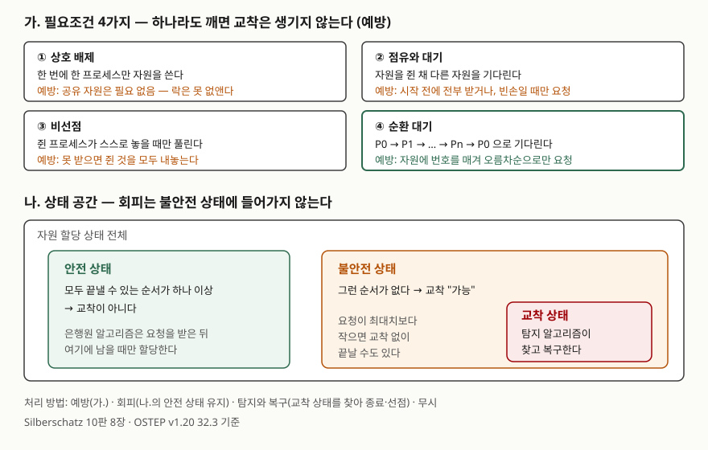

<!-- related:start -->
> **같은 기능을 다른 환경에서 다룬 글** (`deadlock`)
> - [데드락은 어떻게 만들어지고 SQLite는 누구에게 BUSY를 돌려주는가](../../../Database/2026-09-29-sqlite-deadlock-busy-victim/index.md) — SQLite 3.49.1, Python 3.13.5, Windows 11
<!-- related:end -->

## 들어가며

교착상태는 운영체제 문항에서 거의 매번 나오는 주제다. 필요조건 4가지를 쓰게 하거나, 자원 할당 표를 주고 은행원
알고리즘으로 안전 상태인지, 어떤 요청을 승인할 수 있는지를 묻는다. 실무에서는 락을 두 개 이상 잡는 코드, 여러 행을
갱신하는 DB 트랜잭션에서 같은 구조가 생긴다. 이 글은 교재의 정의와 해결 기법을 정리하고, 교재 예제를 직접 계산해
답안에 쓸 숫자를 검산했다.

## 정의

**교착상태(deadlock)**: 프로세스 집합의 각 프로세스가 다른 프로세스가 점유한 자원을 기다리며, 그 기다림이 순환을 이루어
어느 프로세스도 진행하지 못하는 상태다. Silberschatz 8장은 **상호 배제·점유와 대기·비선점·순환 대기 네 조건이 동시에
성립하면** 교착이 일어날 수 있다고 정리하고(슬라이드 8.8 "Deadlock Characterization"), OSTEP 32.3은 같은 네 조건을
Coffman·Elphick·Shoshani(1971)를 인용해 적고 **하나라도 성립하지 않으면 교착은 일어날 수 없다**고 적는다.

## 등장 배경

교재의 시스템 모델에서 프로세스는 자원을 **요청 → 사용 → 해제** 순서로 쓴다(슬라이드 8.4). 다중 프로그래밍으로
여러 프로세스가 한정된 자원을 나눠 쓰면서, 각자 일부를 쥔 채 나머지를 기다리는 일이 생겼다. 교재의 예는 뮤텍스 두 개다.
스레드 1이 `first_mutex`를, 스레드 2가 `second_mutex`를 먼저 잡으면 서로 상대의 뮤텍스를 기다리게 된다(슬라이드 8.7).
OSTEP은 이 문제를 처음 글로 적은 사람이 Dijkstra(1964)이고 그는 "deadly embrace"라고 불렀다고 소개한다.
문제는 이 상태가 저절로 풀리지 않는다는 데 있다. 기다리는 프로세스는 자원을 놓지 않고, 놓게 할 주체도 없다.

## 구성요소 — 필요조건 4가지, 처리 방법 4가지

### 필요조건 4가지 (Silberschatz 8.8, OSTEP 32.3)

| 조건 | 뜻 | 예방하는 법 (Silberschatz 8.15~8.17) |
|---|---|---|
| 상호 배제 (Mutual exclusion) | 한 번에 한 프로세스만 자원을 쓴다 | 읽기 전용 파일 같은 공유 자원에는 필요 없다. 공유할 수 없는 자원에서는 없앨 수 없다 |
| 점유와 대기 (Hold and wait) | 자원을 하나 이상 쥔 채 다른 자원을 기다린다 | 시작 전에 전부 할당받거나, 쥔 것이 없을 때만 요청한다. 자원 이용률이 낮고 기아가 생길 수 있다 |
| 비선점 (No preemption) | 쥔 프로세스가 작업을 마치고 스스로 놓을 때만 풀린다 | 즉시 받을 수 없는 요청을 하면 쥔 자원을 모두 내놓고, 옛 자원과 새 자원을 함께 받을 수 있을 때 다시 시작한다 |
| 순환 대기 (Circular wait) | P0 → P1 → … → Pn → P0 으로 기다림이 이어진다 | 자원 종류에 전체 순서를 매기고 번호가 커지는 순서로만 요청한다 (Havender) |

교재는 실제로 가장 흔한 방법이 순환 대기를 깨는 것이라고 적는다(슬라이드 8.18). OSTEP도 락 획득 순서를 정하는 것을
가장 실용적인 예방 기법으로 꼽고, 리눅스 메모리 매핑 코드가 주석에 락 순서 묶음 10개를 적어 둔 것을 부분 순서의 예로 든다.

### 처리 방법 4가지 (Silberschatz 8.14)

| 방법 | 방침 | 핵심 |
|---|---|---|
| 예방 (prevention) | 교착에 절대 들어가지 않게 한다 | 4조건 중 하나를 늘 깨지게 요청 방식을 제한한다 |
| 회피 (avoidance) | 교착에 절대 들어가지 않게 한다 | 최대 요구량을 미리 받고, 할당 뒤에도 안전 상태일 때만 승인한다 |
| 탐지와 복구 (detection and recovery) | 교착을 허용하고 나중에 푼다 | 주기적으로 탐지 알고리즘을 돌려 찾고, 종료나 선점으로 푼다 |
| 무시 | 교착이 없는 것처럼 동작한다 | 드물고 피해가 작으면 재시작으로 대응한다 |

### 은행원 알고리즘 — 자료구조 4개, 안전 알고리즘 4단계, 요청 알고리즘 3단계

n은 프로세스 수, m은 자원 종류 수다(슬라이드 8.30~8.32).

| 자료구조 | 크기 | 뜻 |
|---|---|---|
| Available | m | 종류별 남은 개수 |
| Max | n × m | 프로세스별 최대 요구량. 미리 신고한다 |
| Allocation | n × m | 지금 할당된 개수 |
| Need | n × m | 앞으로 더 필요할 수 있는 개수 = Max − Allocation |

**안전 알고리즘**: ① Work = Available, 모든 Finish = false ② Finish[i] = false이고 Need_i ≤ Work인 i를 찾는다. 없으면 ④로
③ Work += Allocation_i, Finish[i] = true, ②로 ④ 모든 Finish가 true면 안전 상태.

**자원 요청 알고리즘**: ① Request_i ≤ Need_i가 아니면 오류(최대 요구 초과) ② Request_i ≤ Available이 아니면 대기
③ 할당한 것으로 가정해 상태를 바꾸고 안전 알고리즘을 돌린다. 안전하면 할당, 불안전하면 대기하고 옛 상태로 되돌린다.

### 탐지와 복구

탐지는 자원 종류마다 인스턴스가 하나면 **대기 그래프**(wait-for graph)에서 순환을 찾고, 여러 개면 안전 알고리즘과 같은
모양의 **탐지 알고리즘**을 쓴다. 차이는 Need 대신 **지금 실제로 요청 중인 양(Request)** 을 보고, 자원을 하나도 쥐지 않은
프로세스는 처음부터 Finish = true로 둔다는 점이다(슬라이드 8.37~8.41). 끝까지 Finish가 false인 프로세스가 교착에 빠진 것이다.

복구는 **2가지**다(슬라이드 8.45~8.46).

- **프로세스 종료**: 교착에 빠진 프로세스를 전부 끝내거나, 순환이 없어질 때까지 하나씩 끝낸다. 고르는 기준은 6가지
  — 우선순위, 지금까지 계산한 시간과 남은 시간, 쓴 자원, 끝내는 데 더 필요한 자원, 끝내야 할 프로세스 수, 대화형인지 일괄 처리인지.
- **자원 선점**: 희생자 선택(비용 최소화), 롤백(안전한 상태로 되돌려 다시 시작), 기아 방지(같은 프로세스가 계속 뽑히지 않게
  롤백 횟수를 비용에 넣는다) 3가지를 정해야 한다.

## 도식



> **출처**: [Silberschatz et al., *Operating System Concepts* 10th ed. Ch.8 슬라이드](https://www.cs.hunter.cuny.edu/~sweiss/course_materials/csci340/slides/chapter08.pdf) — 8.8 Deadlock Characterization, 8.14 Methods for Handling Deadlocks, 8.15~8.17 Deadlock Prevention, 8.21~8.23 Safe State,
> [Arpaci-Dusseau, *OSTEP* v1.20 Ch.32 Common Concurrency Problems](https://pages.cs.wisc.edu/~remzi/OSTEP/threads-bugs.pdf) — 32.3 Conditions for Deadlock, Prevention.

답안지에는 위쪽 네 상자를 조건 이름과 예방 한 줄로 줄이고, 아래쪽은 "안전 | 불안전 ⊃ 교착" 세 칸만 그린다.

## 계산 검산

계산: [`code/bankers_algorithm.py`](code/bankers_algorithm.py), 실행 기록: [`code/output.txt`](code/output.txt).
교재 예제(슬라이드 8.33)는 프로세스 5개, 자원 A 10개·B 5개·C 7개, Available = (3, 3, 2)다.

### 안전 순서는 하나가 아니다 — 예상과 달랐던 결과

교재는 이 상태가 **<P1, P3, P4, P2, P0>** 로 안전하다고 적는다. 안전 알고리즘 2단계를 "매번 P0부터 다시 찾는" 방식으로 구현하자
다른 순서가 나왔다.

```text
     P1: Need(1 2 2) <= Work(3 3 2) -> Work += Allocation(2 0 0) = 5 3 2
     P3: Need(0 1 1) <= Work(5 3 2) -> Work += Allocation(2 1 1) = 7 4 3
     P0: Need(7 4 3) <= Work(7 4 3) -> Work += Allocation(0 1 0) = 7 5 3
     P2: Need(6 0 0) <= Work(7 5 3) -> Work += Allocation(3 0 2) = 10 5 5
     P4: Need(4 3 1) <= Work(10 5 5) -> Work += Allocation(0 0 2) = 10 5 7
   안전: True, 순서 <P1, P3, P0, P2, P4>
```

P3이 끝난 뒤 Work가 (7, 4, 3)이 되면 P0의 Need (7, 4, 3)와 정확히 같아져 P0이 먼저 들어온다. 찾은 뒤에도 다음 번호부터 이어서
훑으면 <P1, P3, P4, P0, P2>가 나왔다. 120가지 순서를 모두 대 보니 **안전 순서는 16가지**였고, 맨 앞에 올 수 있는 것은 P1과
P3뿐이었다. 교재 순서도 16가지 중 하나로 확인됐다. 알고리즘 2단계는 "그런 i를 찾는다"고만 하므로 **답안의 안전 순서는 하나로
정해지지 않는다.** 채점에서 보는 것은 순서가 Need ≤ Work를 매번 만족하는지다.

### 교재의 요청 예제 세 개

```text
-- P1 가 (1 0 2) 를 요청
   3단계: 가상 할당 -> Available = 2 3 0
   안전 -> 할당. 안전 순서 <P1, P3, P0, P2, P4>
-- P4 가 (3 3 0) 를 요청
   2단계: Request > Available(2 3 0) -> 대기
-- P0 가 (0 2 0) 를 요청
   3단계: 가상 할당 -> Available = 2 1 0
   불안전 -> 대기, 이전 상태로 복원 (끝까지 갈 수 있는 프로세스: 없음)
```

슬라이드 8.35는 P1의 요청 뒤 <P1, P3, P4, P0, P2>가 안전하다고 적고, P4 (3,3,0)과 P0 (0,2,0)은 승인할 수 있는지 묻기만 한다.
계산으로는 **P4는 2단계(가용 자원 부족)에서, P0은 3단계(불안전)에서** 거절됐다. 둘 다 "안 된다"지만 걸린 단계가 다르다.
P0의 경우 할당 뒤 Available (2, 1, 0)으로는 어떤 프로세스의 Need도 채울 수 없어 첫 걸음부터 막힌다.

### 불안전 상태는 교착이 아니다

P0의 요청을 그냥 승인했다고 하고 탐지 알고리즘을 두 번 돌렸다.

```text
-- 탐지: 모든 프로세스가 남은 최대치(Need)를 한꺼번에 요청하면
   교착: P0, P1, P2, P3, P4
-- 탐지: P3 만 B 1개를 요청하고 나머지는 지금 가진 것으로 끝낸다면
   끝낸 순서 <P0, P1, P2, P3, P4>
   교착: 없음
```

같은 불안전 상태라도 실제 요청이 최대치보다 작으면 모두 끝났다. 교재가 불안전 상태를 "교착 가능성"으로 적는 이유다(슬라이드 8.22).
은행원 알고리즘은 최악의 경우를 기준으로 거절하므로, 실제로는 문제없었을 요청까지 기다리게 한다.

### 탐지 예제

슬라이드 8.42의 상태는 교착이 없고, P2가 C를 1개 더 요청하면 P1·P2·P3·P4가 교착이라는 교재 결론이 그대로 나왔다.
끝낸 순서는 교재의 <P0, P2, P3, P1, P4>와 달리 <P0, P2, P1, P3, P4>였다. 안전 순서와 같은 이유로, 이것도 여럿이 가능하다.

## 비교

### 예방 · 회피 · 탐지와 복구

| 구분 | 예방 | 회피 | 탐지와 복구 |
|---|---|---|---|
| 교착 발생 | 불가능 | 불가능 | 허용 |
| 미리 알아야 할 것 | 없음 (요청 규칙만 지킨다) | 프로세스별 최대 요구량 | 없음 |
| 판단 시점 | 코드·정책을 짤 때 | 요청할 때마다 | 주기적으로 |
| 비용 | 자원 이용률 저하, 기아 | 요청마다 안전 알고리즘 계산, 필요 이상 대기 | 탐지 O(m × n²), 종료·롤백한 작업 손실 |
| 대표 | 락 순서, 일괄 할당 | 은행원 알고리즘, 자원 할당 그래프 알고리즘 | 대기 그래프, 탐지 알고리즘 |

탐지 알고리즘의 O(m × n²)는 슬라이드 8.41에 있다.

### 안전 알고리즘과 탐지 알고리즘

| 구분 | 안전 알고리즘 (회피) | 탐지 알고리즘 |
|---|---|---|
| 비교하는 값 | Need (앞으로 최대) | Request (지금 요청 중) |
| 처음 Finish | 모두 false | 자원을 쥐지 않은 프로세스는 true |
| 끝에 false가 남으면 | 불안전 → 요청 거절 | 그 프로세스들이 교착 |

### 자원 할당 그래프에서 순환의 뜻 (슬라이드 8.13)

| 자원 인스턴스 | 순환이 있으면 |
|---|---|
| 종류마다 하나 | 교착이다 |
| 여러 개인 종류가 있다 | 교착일 수도, 아닐 수도 있다 |

## 적용 시 고려사항

- **실무의 기본은 락 순서다.** OSTEP은 실제로 가장 좋은 해법이 락 획득 순서를 정해 예방하는 것이라고 정리한다. 두 락을 인자로
  받는 함수는 순서가 호출자에 따라 바뀌므로, 락 주소 크기 순으로 잡게 하는 방법을 OSTEP이 팁으로 소개한다.
- **비선점을 깨는 trylock은 라이브락을 남긴다.** 두 번째 락을 `trylock`으로 시도하고 실패하면 첫 락을 놓고 처음부터 다시 하면
  교착은 없지만, 두 스레드가 같은 시도를 계속 되풀이하며 진행하지 못할 수 있다. OSTEP은 다시 시도하기 전 무작위 지연을 넣는 방법을 든다.
- **은행원 알고리즘은 쓸 수 있는 곳이 좁다.** 최대 요구량을 미리 알아야 하고, 끝까지 가지 않을 최악을 가정해 요청을 거절한다.
  OSTEP은 이런 회피 방식이 실행할 작업과 필요한 락을 모두 아는 임베디드 시스템 같은 제한된 환경에서만 쓸모 있다고 적는다.
- **DB는 탐지와 복구를 쓴다.** OSTEP은 많은 DB 시스템이 자원 그래프를 주기적으로 만들어 순환을 찾는다고 적는다. 실제 DB가 희생자를
  골라 에러를 돌려주는 모습은 [SQLite의 BUSY 반환 글](../../../Database/2026-09-29-sqlite-deadlock-busy-victim/index.md)에서 돌려 봤다.
  응용은 그 에러를 받으면 트랜잭션을 다시 시도하게 짜야 한다.
- **탐지 주기는 비용과 진단 사이의 선택이다.** 교재는 탐지를 얼마나 자주 돌릴지가 교착 빈도와 롤백할 프로세스 수에 달렸고,
  드물게 돌리면 그래프에 순환이 여럿 생겨 어느 프로세스가 원인인지 가리기 어렵다고 적는다(슬라이드 8.44).

## 정리

- 필요조건 **4가지**: 상호 배제 · 점유와 대기 · 비선점 · 순환 대기 — 넷이 **동시에** 성립해야 교착, 하나라도 깨면 없다. ("상점비순")
- 처리 방법 **4가지**: 예방(조건 하나를 깬다) · 회피(안전 상태 유지) · 탐지와 복구 · 무시.
- 은행원 알고리즘: 자료구조 **4개**(Available·Max·Allocation·Need), 안전 알고리즘 **4단계**, 요청 알고리즘 **3단계**.
- 안전 → 교착 아님, 불안전 → 교착 가능. 교재 예제의 안전 순서는 120가지 중 **16가지**라 답이 하나가 아니다.
- 복구 **2가지**: 프로세스 종료(선택 기준 6가지) · 자원 선점(희생자 선택·롤백·기아 방지).

> 관련 개념: [프로세스 스케줄링 알고리즘과 평균 대기시간 계산](../2026-10-12-cpu-scheduling-waiting-time/index.md) · [페이지 교체 알고리즘과 벨레이디의 이상현상](../2026-10-12-page-replacement-belady-anomaly/index.md)

## 참고 자료

- [Silberschatz, Galvin, Gagne, *Operating System Concepts* 10th ed. Ch.8 Deadlocks 슬라이드 (Hunter College S. Weiss 2020 개정판)](https://www.cs.hunter.cuny.edu/~sweiss/course_materials/csci340/slides/chapter08.pdf) — 8.8 필요조건, 8.14 처리 방법, 8.15~8.18 예방, 8.21~8.22 안전 상태, 8.30~8.35 은행원 알고리즘과 예제, 8.37~8.43 탐지, 8.45~8.46 복구
- [Arpaci-Dusseau, *Operating Systems: Three Easy Pieces* v1.20, Ch.32 Common Concurrency Problems](https://pages.cs.wisc.edu/~remzi/OSTEP/threads-bugs.pdf) — 32.3 Deadlock Bugs: 4조건, 예방 기법, 스케줄링을 통한 회피, 탐지와 복구
- [Silberschatz, Galvin, Gagne, *Operating System Concepts* 10th ed. (2018), 공식 사이트](https://www.os-book.com/OS10/)
- E. G. Coffman, M. J. Elphick, A. Shoshani, "System Deadlocks", *ACM Computing Surveys* 3(2), 1971 — OSTEP 참고문헌 [C+71]로 확인, 원문 미열람
- [E. W. Dijkstra, EWD108 "Een algorithme ter voorkoming van de dodelijke omarming" (1964)](https://www.cs.utexas.edu/users/EWD/ewd01xx/EWD108.PDF) — 은행원 알고리즘 원문, OSTEP 참고문헌 [D64]로 확인, 원문 미열람
