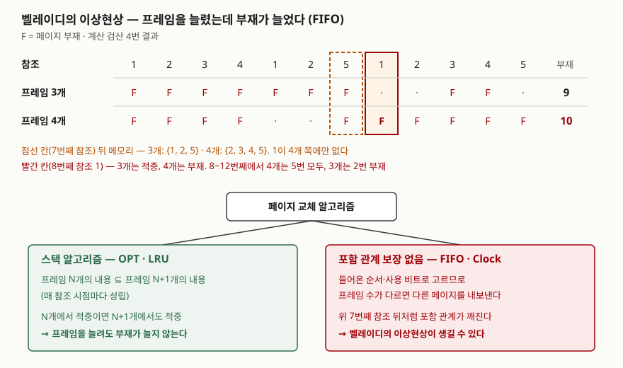

## 들어가며

페이지 교체는 운영체제 문항 가운데 스케줄링과 함께 계산이 붙는 주제다. 참조열과 프레임 수를 주고 알고리즘별 부재 횟수를
세게 하거나, "프레임을 늘렸는데 부재가 늘어나는 현상"을 설명하라고 묻는다. 실무에서는 운영체제의 페이지 캐시뿐 아니라
DB 버퍼 풀, 애플리케이션 캐시의 교체 정책을 고를 때 같은 틀을 쓴다. 이 글은 교재 예제를 시뮬레이터로 다시 세어 답안에
쓸 숫자를 검산하고, 이상현상이 왜 특정 알고리즘에서만 생기는지를 프레임 내용으로 확인했다.

## 정의

**페이지 교체**: 페이지 부재가 났는데 빈 프레임이 없을 때, 메모리에 있지만 당분간 쓰이지 않을 페이지를 골라 내보내고
그 프레임에 요청한 페이지를 올리는 것이다(Silberschatz 10장 슬라이드 "What Happens if There is no Free Frame?").
무엇을 내보낼지 고르는 규칙이 **페이지 교체 알고리즘**이고, 교재는 그 목표를 "가장 적은 페이지 부재"로 둔다.

**벨레이디의 이상현상**(Belady's anomaly): 할당한 프레임 수를 늘렸는데 같은 참조열의 페이지 부재가 오히려 늘어나는 현상이다.
Belady·Nelson·Shedler(1969)가 FIFO에서 참조열 1, 2, 3, 4, 1, 2, 5, 1, 2, 3, 4, 5로 보였다.

## 등장 배경

요구 페이징은 프로세스의 페이지를 처음 쓰는 순간에 올리므로, 메모리보다 큰 프로그램을 돌리고 더 많은 프로세스를 함께
올릴 수 있다. 대신 프레임이 모자라면 매 부재마다 누군가를 내보내야 한다. 교재는 빈 프레임이 없으면 부재 한 번에
**내보내기와 읽어 들이기 두 번의 전송**이 생길 수 있어 유효 접근 시간이 늘어난다고 적는다. OSTEP은 메모리 접근 100ns,
디스크 접근 10ms일 때 적중률 90%면 평균 접근 시간이 약 1ms, 99.9%면 10.1μs로 약 100배 차이가 난다고 계산한다.
부재율이 조금만 올라도 디스크 시간이 전체를 차지하므로, 어느 페이지를 내보내느냐가 성능을 정한다.

## 구성요소 — 교체 절차 4단계, 알고리즘 6가지

### 교체 절차 4단계 (Silberschatz "Basic Page Replacement")

| 단계 | 내용 |
|---|---|
| 1 | 디스크에서 요청한 페이지의 위치를 찾는다 |
| 2 | 빈 프레임을 찾는다. 없으면 교체 알고리즘으로 희생 프레임을 고르고, 변경(dirty)됐으면 디스크에 쓴다 |
| 3 | 요청한 페이지를 그 프레임에 읽어 들이고 페이지 표·프레임 표를 고친다 |
| 4 | 부재를 일으킨 명령부터 다시 실행한다 |

### 알고리즘 6가지

| 알고리즘 | 내보내는 페이지 | 교재가 짚는 성질 |
|---|---|---|
| FIFO | 가장 먼저 들어온 페이지 | 구현이 단순하다. 자주 쓰는 페이지도 순서가 되면 내보낸다. 벨레이디의 이상현상 |
| OPT (MIN) | 앞으로 가장 오래 쓰이지 않을 페이지 | 부재 횟수 최소. 미래를 알아야 해서 구현 불가, 비교 기준으로 쓴다 |
| LRU | 가장 오래전에 쓴 페이지 | 과거로 미래를 추정한다. 카운터나 스택으로 구현하며 하드웨어 지원이 필요하다 |
| 2차 기회 (Clock) | 원형 큐를 돌며 참조 비트가 0인 페이지. 1이면 0으로 지우고 넘어간다 | LRU 근사. 모든 비트가 1이면 한 바퀴 돌아 FIFO가 된다 |
| 향상된 2차 기회 | (참조, 변경) 비트 쌍이 가장 낮은 등급의 페이지 | (0,0) → (0,1) → (1,0) → (1,1) 순. 변경되지 않은 페이지를 먼저 내보내 쓰기를 줄인다 |
| 계수 기반 (LFU·MFU) | 참조 횟수가 가장 적은(LFU)·많은(MFU) 페이지 | 교재는 흔히 쓰지 않는다고 적는다 |

교재는 OPT와 LRU를 **스택 알고리즘**으로 분류하고, 이 부류는 벨레이디의 이상현상이 없다고 적는다.
OSTEP의 설명은 이렇다. 스택 성질을 가진 알고리즘은 크기 N+1인 캐시가 크기 N인 캐시의 내용을 늘 포함하므로,
캐시를 키우면 적중률이 같거나 오른다(Mattson 외 1970).

## 도식

> **출처**: [Arpaci-Dusseau, *OSTEP* v1.10 Ch.22 Beyond Physical Memory: Policies](https://pages.cs.wisc.edu/~remzi/OSTEP/vm-beyondphys-policy.pdf) — 22.3 FIFO의 ASIDE "Belady's Anomaly"(참조열과 스택 성질),
> [Silberschatz et al., *Operating System Concepts* 10th ed. Ch.10 슬라이드](https://www.cs.hunter.cuny.edu/~sweiss/course_materials/csci340/slides/chapter10.pdf) — 10.36 FIFO, 10.40 스택 알고리즘.
> 부재 표와 7번째 참조 뒤 프레임 내용은 아래 계산 검산 4·5번의 실행 결과다.

답안지에는 위쪽 표에서 F 표시 두 줄과 합계 9·10만 옮기고, 아래 분류는 상자 두 개로 줄여 그린다.

## 계산 검산

시뮬레이터: [`code/page_replacement.py`](code/page_replacement.py), 실행 기록: [`code/output.txt`](code/output.txt).
OPT에서 앞으로 쓰일 거리가 같은 페이지가 둘 이상이면 먼저 들어온 쪽을 내보낸다. 교재가 정하지 않은 규칙이다.
Clock은 바늘이 가리키는 프레임의 참조 비트가 1이면 지우고 다음으로 넘어가며, 새 페이지를 넣은 뒤 바늘을 한 칸 옮긴다.

### 교재 예제 두 개

| 예제 | 교재 값 | 계산 값 |
|---|---|---|
| Silberschatz 참조열 22회, 프레임 3개 | FIFO 15 · OPT 9 · LRU 12 | FIFO 15 · OPT 9 · LRU 12 · Clock 14 |
| OSTEP 참조열 0,1,2,0,1,3,0,3,1,2,1, 프레임 3개 | OPT 적중률 54.5%(강제 부재 제외 85.7%), FIFO 36.4%(57.1%) | 같다. LRU도 OPT와 같은 54.5% |

다섯 개 교재 값이 모두 맞았다. OSTEP은 LRU가 이 참조열에서 OPT와 같아진 것은 예제를 그렇게 골랐기 때문이라고 각주로 밝힌다.

### 벨레이디 참조열, 프레임 1~6개

| 프레임 | OPT | FIFO | LRU | Clock |
|---|---|---|---|---|
| 1 | 12 | 12 | 12 | 12 |
| 2 | 9 | 12 | 12 | 12 |
| 3 | 7 | **9** | 10 | **9** |
| 4 | 6 | **10** | 8 | **10** |
| 5 | 5 | 5 | 5 | 5 |

FIFO는 3개에서 9회, 4개에서 10회로 늘었다. LRU는 이 참조열에서 3개일 때 FIFO보다 나쁘지만(10회) 프레임을 늘리면 줄기만 한다.
**Clock은 이 참조열에서 FIFO와 똑같았다.** 내보낼 차례가 올 때마다 프레임의 참조 비트가 전부 1이라 한 바퀴를 돌며 지우고
처음 자리로 돌아오기 때문이다. 참조 비트가 모두 1이면 2차 기회가 FIFO와 같은 페이지를 고른다는 것이 그대로 나왔다.

### 이상현상이 시작되는 지점

5번 검산은 매 참조 뒤 프레임 N개의 내용이 N+1개의 내용에 들어 있는지를 확인했다. OPT와 LRU는 한 번도 깨지지 않았고,
FIFO는 **7번째 참조(5) 뒤 3개는 {1, 2, 5}, 4개는 {2, 3, 4, 5}**에서 처음 깨졌다. 4개 쪽은 가장 먼저 들어온 1을 내보냈고
3개 쪽은 이미 1을 한 번 내보냈다가 5번째 참조에서 다시 들여 늦게 들어온 페이지로 갖고 있었다. 들어온 시각이 프레임 수에 따라
달라지므로 같은 "가장 먼저 들어온 페이지"가 서로 다른 페이지가 된다. 바로 다음 참조 1에서 3개는 적중, 4개는 부재가 났다.

### 예상과 달랐던 결과 — 이상현상은 드물고, Clock에서 더 잦았다

무작위 참조열 2만 개(seed 42)마다 프레임을 1개부터 늘려 가며 부재가 한 번이라도 늘었는지 셌다.

| 조건 | OPT | FIFO | LRU | Clock |
|---|---|---|---|---|
| 길이 12, 페이지 1~5 | 0 | **0** | 0 | 1 (0.01%) |
| 길이 30, 페이지 1~8 | 0 | 55 (0.27%) | 0 | **513 (2.56%)** |

벨레이디 참조열과 같은 크기(길이 12, 페이지 5개)에서는 2만 개 중 FIFO 이상현상이 **하나도 없었다.** 교재의 참조열은 일부러
찾아낸 드문 경우다. 길이와 페이지 수를 늘리자 FIFO는 0.27%, Clock은 2.56%로 열 배 가까이 많았다. Clock의 참조 비트는
LRU를 흉내 내지만 포함 관계를 보장하지 않으므로, 프레임 수가 다르면 바늘 위치와 비트 상태가 갈라져 서로 다른 페이지를 내보낸다.
이 비율은 위에 적은 바늘 이동 규칙을 쓴 이 구현의 값이다.

## 비교

### FIFO · LRU · OPT

| 구분 | FIFO | LRU | OPT |
|---|---|---|---|
| 판단 근거 | 들어온 시각 | 마지막 사용 시각 (과거) | 다음 사용 시각 (미래) |
| 구현 | 큐 하나 | 참조마다 갱신, 하드웨어 지원 필요 | 불가능 |
| 스택 알고리즘 | 아니다 | 그렇다 | 그렇다 |
| 이상현상 | 생길 수 있다 | 없다 | 없다 |
| Silberschatz 예제 부재 | 15 | 12 | 9 |

### 부재의 세 가지 원인 (OSTEP ASIDE "Types of Cache Misses")

| 종류 | 원인 | 페이지 교체에서 |
|---|---|---|
| 강제(compulsory, cold-start) | 처음 참조라 캐시에 없었다 | 어떤 알고리즘도 피할 수 없다 |
| 용량(capacity) | 공간이 모자라 내보냈던 것을 다시 참조 | 알고리즘이 줄일 수 있는 부분 |
| 충돌(conflict) | 하드웨어 캐시의 집합 연관 제약 | 페이지 캐시는 완전 연관이라 생기지 않는다 |

## 적용 시 고려사항

- **비교 기준으로 OPT를 같이 계산한다.** OSTEP은 OPT를 실제 정책이 아니라 "얼마나 더 나아질 수 있는가"를 재는 기준으로 쓰라고 한다.
  같은 참조열에서 OPT가 9회면 LRU 12회는 개선 여지 3회를 뜻한다.
- **LRU를 그대로 구현하지 않는다.** 교재는 정확한 LRU가 참조마다 카운터나 스택을 갱신해야 해 하드웨어 지원이 필요하다고 적고,
  OSTEP은 4GB를 4KB로 나누면 페이지가 100만 개라 가장 오래된 하나를 찾는 탐색이 비싸다고 계산한다. 참조 비트를 쓰는 Clock 계열로 근사한다.
- **근사 알고리즘은 이상현상에서 자유롭지 않다.** 위 계산에서 Clock은 FIFO보다 이상현상이 잦았다. 메모리를 늘리면 반드시
  부재가 준다고 가정한 용량 계획은 스택 알고리즘에서만 성립한다.
- **변경된 페이지를 내보내는 비용을 같이 본다.** 변경 비트가 1인 페이지는 쓰기가 한 번 더 붙는다. 향상된 2차 기회처럼
  (참조, 변경) 쌍으로 등급을 매겨 깨끗한 페이지를 먼저 고른다.
- **알고리즘으로 풀 수 없는 상황이 있다.** 실행 중인 프로세스들의 작업 집합 합이 메모리보다 크면 계속 페이지를 바꾸는
  스래싱이 된다. OSTEP은 일부 프로세스를 돌리지 않는 승인 제어나, 리눅스의 메모리 부족 시 프로세스 종료(OOM killer)를 예로 든다.

## 정리

- 교체 절차 **4단계**: 위치 찾기 → 희생 프레임 고르기(변경됐으면 쓰기) → 읽어 들이고 표 갱신 → 명령 재실행.
- 알고리즘 **6가지**: FIFO·OPT·LRU·2차 기회(Clock)·향상된 2차 기회·계수 기반(LFU·MFU).
- 벨레이디의 이상현상 = 프레임을 늘렸는데 부재가 는다. **1,2,3,4,1,2,5,1,2,3,4,5 / FIFO 3개 9회 → 4개 10회.**
- 스택 알고리즘(OPT·LRU)은 "N개 내용 ⊆ N+1개 내용"이라 이상현상이 없다. FIFO·Clock은 이 포함 관계가 깨질 수 있다.
- 교재 값 FIFO 15·OPT 9·LRU 12를 계산으로 확인했다. 무작위 참조열에서 이상현상은 드물었고 Clock에서 FIFO보다 잦았다.

> 관련 개념: [프로세스 스케줄링 알고리즘과 평균 대기시간 계산](../2026-10-12-cpu-scheduling-waiting-time/index.md)

## 참고 자료

- [Arpaci-Dusseau, *Operating Systems: Three Easy Pieces* v1.10, Ch.22 Beyond Physical Memory: Policies](https://pages.cs.wisc.edu/~remzi/OSTEP/vm-beyondphys-policy.pdf) — 22.2 OPT, 22.3 FIFO와 ASIDE "Belady's Anomaly", 22.5 LRU, 22.8 Clock, 22.9 변경 비트, 22.11 스래싱
- [Silberschatz, Galvin, Gagne, *Operating System Concepts* 10th ed. Ch.10 Virtual Memory 슬라이드 (Hunter College S. Weiss 2020 개정판)](https://www.cs.hunter.cuny.edu/~sweiss/course_materials/csci340/slides/chapter10.pdf) — 10.32 교체 절차, 10.34 참조열, 10.36~10.45 알고리즘
- [Silberschatz, Galvin, Gagne, *Operating System Concepts* 10th ed. (2018), 공식 사이트](https://www.os-book.com/OS10/)
- L. A. Belady, R. A. Nelson, G. S. Shedler, "An Anomaly in Space-time Characteristics of Certain Programs Running in a Paging Machine", *Communications of the ACM* 12(6), 1969 — OSTEP 참고문헌 [BNS69]로 확인, 원문 미열람
- R. L. Mattson et al., "Evaluation Techniques for Storage Hierarchies", *IBM Systems Journal* 9(2), 1970 — 스택 성질, OSTEP 참고문헌 [M+70]으로 확인, 원문 미열람
