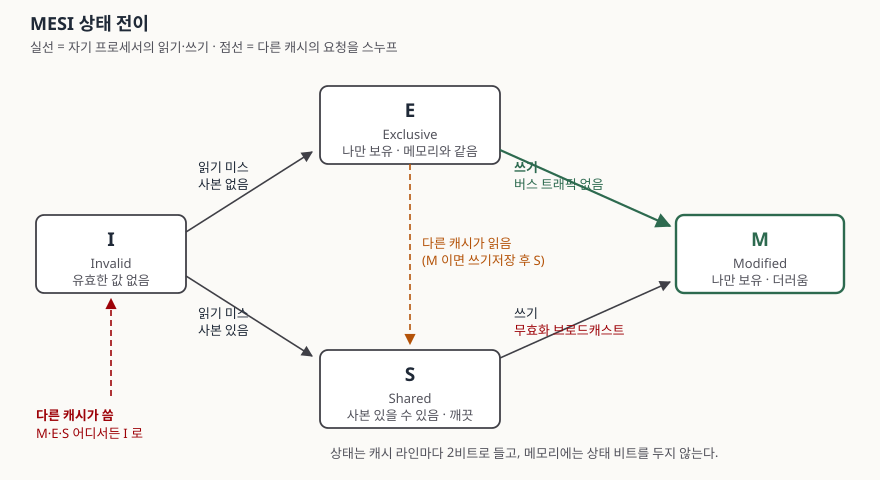

> **실행 검증 없음.** 이 글은 프로세서 아키텍처 매뉴얼과 원 논문의 서술만으로 정리했다.
> 상태 전이는 공개 문서에 적힌 규칙이고, 측정값이나 실행 결과는 싣지 않았다.

## 들어가며

멀티코어에서 스레드 두 개가 각자 다른 카운터를 올리는데 코어 하나로 돌릴 때보다
느려지는 일이 있다. 락도 안 걸었고 변수도 서로 다른데 그렇다. 두 변수가 **같은 캐시
라인**에 얹혀 있었기 때문인데, 왜 그것이 느려짐으로 이어지는지는 캐시 일관성 프로토콜을
알아야 설명된다. 기술사 시험에서도 메모리 계층의 지역성 원리와 묶어 자주 나오는 자리다.

## 정의

**캐시 일관성(cache coherence)** 은 같은 메모리 블록의 사본이 여러 캐시에 있을 때, 어느
캐시로 읽어도 같은 값이 보이도록 유지하는 성질이다.

**MESI** 는 캐시 라인마다 네 가지 상태를 두고, 버스에 오가는 요청을 엿들어(스누핑)
상태를 바꿔 가며 일관성을 유지하는 **무효화 기반(invalidation-based) 프로토콜**이다.
인텔 매뉴얼은 L1 데이터 캐시와 L2·L3 통합 캐시가 "캐시 라인당 두 개의 MESI 상태
플래그"를 가진다고 적는다.

## 등장 배경

사설 캐시를 코어마다 두면 메모리 접근은 빨라지지만 같은 블록의 사본이 여러 곳에 생긴다.
1984년 Papamarcos와 Patel의 논문은 그때까지의 해법 **세 갈래**와 각각의 한계를 든다.

| 기존 해법 | 방식 | 한계 |
|---|---|---|
| 브로드캐스트 무효화 | 쓸 때마다 주소를 전체에 뿌린다 | 쓰기가 참조의 25%면 프로세서 넷도 못 붙인다고 논문이 적는다 |
| 전역 디렉터리 | 메인 메모리 블록마다 상태 비트를 둔다 | 간섭을 줄이려면 분산 디렉터리와 크로스바가 필요해 하드웨어가 비싸다 |
| write-once (Goodman) | 첫 쓰기에만 무효화를 뿌리고 동시에 써 보낸다 | 쓰기 횟수에 성능이 묶인다 |

논문이 짚은 돌파구는 이것이다. 버스 기반 시스템에서는 **미스가 난 시점에 그 블록이 다른
캐시에 있는지 알 수 있다.** 그러면 블록마다 "나만 가졌는지(Exclusive) 남도 가졌는지
(Shared)"를 기록해 둘 수 있고, **보낼 필요가 없는 무효화를 보내는 쪽에서 미리 잘라낼 수
있다.** 그 결과 버스에는 캐시 미스, 실제 무효화, 메모리 쓰기만 남는다.

메모리 계층 자체는 **지역성 원리**가 떠받친다(Denning, 2005). 최근에 쓴 것을 또 쓰고
(시간 지역성), 가까운 주소를 잇따라 쓴다(공간 지역성). 캐시는 이 성질에 기대어 작은 저장소로 큰 메모리의 체감 속도를
올리고, 그 대가로 **같은 블록의 사본이 여러 벌 생기는 문제**를 떠안는다. 일관성
프로토콜은 그 대가를 치르는 장치다.

## 구성요소 — 네 상태와 두 비트

상태는 **네 가지**다.

| 상태 | 유효한가 | 메모리 사본은 | 다른 캐시에 사본이 | 이 라인에 쓰면 |
|---|---|---|---|---|
| **M** (Modified) | 예 | 낡았다 | 없다 | 버스로 나가지 않는다 |
| **E** (Exclusive) | 예 | 유효하다 | 없다 | 버스로 나가지 않는다 |
| **S** (Shared) | 예 | 유효하다 | 있을 수 있다 | 독점 소유권을 얻어 온다 |
| **I** (Invalid) | 아니오 | — | 있을 수 있다 | 곧바로 버스로 나간다 |

네 가지인 이유가 구조에 있다. 상태 비트는 **두 개**다. 하나는 Shared인지 Exclusive인지,
다른 하나는 지역에서 고쳤는지(Modified)를 표시한다. 두 비트면 네 조합이 나오는데,
논문은 **Shared-Modified 조합을 허용하지 않고 그 자리를 Invalid로 쓴다**고 적는다.
남이 가진 블록을 나 혼자 고친 상태를 아예 만들지 않겠다는 설계 선택이고, 덕분에 상태가
정확히 넷으로 떨어진다.

| 두 비트 조합 | 원 논문 이름 | 오늘날 표기 |
|---|---|---|
| Exclusive · Unmodified | Excl-Unmod | E |
| Exclusive · Modified | Excl-Mod | M |
| Shared · Unmodified | Shared-Unmod | S |
| Shared · Modified (쓰지 않음) | Invalid | I |

논문에는 "MESI"라는 이름이 없다. 네 상태의 머리글자를 딴 이 이름은 나중에 붙었다.

그리고 **메인 메모리에는 상태 비트를 두지 않는다.** 전역 디렉터리 방식과 갈리는
지점이고, 확장할 때 캐시 모듈을 고치지 않아도 되는 이유다.

## 전이 — 세 갈래로 나눠 외운다

> **출처**: [Papamarcos & Patel, "A Low-Overhead Coherence Solution for Multiprocessors with Private Cache Memories", ISCA 1984, §II Proposed Coherence Solution, pp. 348–349](https://www.csl.cornell.edu/courses/ece5750/papamarcos.isca84.pdf), [Intel® 64 and IA-32 SDM Vol. 3A §12.4 Cache Control Protocol, Table 12-4](https://cdrdv2-public.intel.com/812386/253668-sdm-vol-3a.pdf)

**① 미스가 났을 때.** 읽기 요청을 모든 캐시와 메모리에 뿌린다. 쓰기 때문에 난 미스면
무효화 신호가 함께 간다. 주소가 맞는 캐시가 있으면 그 캐시가 메모리를 막고 자기 데이터를
버스에 올린다. 요청한 캐시는 **블록이 다른 캐시에서 왔으면 S**, **메모리에서 왔으면 E**
로 적는다.

**② 자기 프로세서가 쓸 때.** E나 M이면 버스에 아무것도 내보내지 않고 고친 뒤 M으로
둔다. S이면 무효화를 뿌린 뒤 M이 된다. **E가 있어서 얻는 것이 바로 이 조용한 쓰기다.**

**③ 다른 캐시의 요청을 스누프할 때.** 읽기 요청이면 주소가 맞는 캐시들이 전부 S로
내린다. 이때 상태가 M이었다면 전송과 **동시에 메인 메모리로 써 보낸다.** 쓰기 요청이면
주소가 맞는 캐시들은 I가 된다.

## 비교

**MSI와 MESI** — E 하나를 더해서 무엇이 달라지는가.

| | MSI | MESI |
|---|---|---|
| 상태 수 | 3 (M·S·I) | 4 (M·E·S·I) |
| 혼자 읽어 온 뒤 쓸 때 | S로 들어와 무효화를 한 번 뿌려야 한다 | E로 들어와 버스 없이 M이 된다 |
| 추가 비용 | — | 미스 시점에 "다른 캐시에 있는가"를 알아낼 수단이 필요하다 |
| 유리한 작업 | 공유가 잦은 작업 | 사실상 단독으로 쓰는 데이터가 많은 작업 |

**스누핑과 디렉터리** — 상태를 어디에 두는가.

| | 스누핑 (MESI) | 디렉터리 |
|---|---|---|
| 상태 보관 위치 | 캐시 라인마다 2비트 | 메모리 블록마다 전역 테이블 |
| 통신 방식 | 공유 버스 브로드캐스트 | 디렉터리에 묻고 필요한 곳에만 |
| 확장성 | 버스 대역이 한계 | 노드 수가 늘어도 트래픽이 덜 는다 |
| 하드웨어 비용 | 모듈 추가 시 변경 없음 | 분산 디렉터리와 크로스바가 필요 |

## 적용 시 고려사항

**1. 상태의 단위는 변수가 아니라 캐시 라인이다.** 인텔 매뉴얼의 캐시 특성 표(Table 12-1)를
보면 Core 계열의 L1 데이터 캐시는 32KB·8-way에 **라인 크기가 64바이트**이고, 그보다 앞선
P6 계열은 32바이트였다. 라인 크기는 세대마다 다르므로 숫자를 외우지 말고 **확인해서
쓴다.** 서로 다른 변수라도 같은 라인에 얹히면 한쪽을 쓸 때마다 다른 쪽을 읽는
코어의 라인이 I로 떨어진다. 들어가며의 카운터 두 개가 느려진 이유가 이것이고,
해결은 변수를 라인 크기로 떨어뜨려 배치하는 것이다.

**2. Shared는 보수적인 표시다.** 논문은 Shared-Unmod가 처음 붙을 때는 적어도 두 캐시가
그 블록을 가지고 있지만, 나중에 다른 캐시들이 전부 쫓아내도 **구현을 단순하게 하려고
상태를 되돌리지 않는다**고 적는다. 즉 S에 쓸 때의 무효화 브로드캐스트는 실제로는 받을
곳이 없는 경우가 있다. 프로토콜이 트래픽을 완전히 없애지는 못한다는 뜻이다.

**3. 일관성(coherence)과 일관성 모델(consistency)을 섞지 않는다.** MESI가 보장하는 것은
**한 주소**의 사본들이 어긋나지 않는 것이다. 서로 다른 주소에 대한 읽기·쓰기가 어떤
순서로 보이는지는 메모리 모델과 배리어 명령이 정한다. 캐시가 일관적이어도 순서 문제는
남는다.

**4. 쓰기가 없는 캐시는 네 상태를 다 쓰지 않는다.** 인텔 매뉴얼은 P6 계열의 L1 명령
캐시가 쓰기가 불가능하므로 MESI 중 **"SI" 부분만 구현**한다고 적는다. 프로토콜은 상황에
맞게 줄여 쓸 수 있다.

**5. 네 상태는 기본형이다.** 상태를 더해 확장한 변형들이 있고(대표적으로 O를 더한
MOESI, F를 더한 MESIF), 각각의 정확한 정의는 해당 벤더의 아키텍처 매뉴얼에 있다.
답안에서는 기본형 네 상태를 정확히 쓰고 확장형은 이름과 추가된 상태만 언급하는 편이
안전하다.

## 정리

- **2비트 → 4상태**가 뼈대다. Shared/Exclusive 비트와 Modified 비트, 그리고
  **쓰지 않는 Shared-Modified 자리를 Invalid로 돌려 쓴다.**
- 전이는 **세 갈래**로 묶어 외운다. ① 미스: 남에게서 왔으면 S, 메모리에서 왔으면 E.
  ② 내 쓰기: E·M은 조용히, S는 무효화 뿌리고. ③ 스누프: 읽기면 전부 S(M이면 쓰기저장),
  쓰기면 전부 I.
- **E의 존재 이유 한 줄**: 혼자 읽어 온 블록을 쓸 때 무효화를 안 보내려고.
- 비교는 **두 축**이다. 상태 수(MSI ↔ MESI)와 상태를 두는 곳(스누핑 ↔ 디렉터리).
- 실무로 내려오는 지점은 **캐시 라인 단위**다. 한 라인 안에 다른 코어가 쓰는 변수가
  같이 있으면 프로토콜이 제 일을 하면서 성능이 깎인다.

## 참고 자료

- [Mark S. Papamarcos, Janak H. Patel, "A Low-Overhead Coherence Solution for Multiprocessors with Private Cache Memories", ISCA 1984, pp. 348–354](https://www.csl.cornell.edu/courses/ece5750/papamarcos.isca84.pdf)
- [Intel® 64 and IA-32 Architectures Software Developer's Manual Vol. 3A, Chapter 12 "Memory Cache Control" (§12.1 Internal Caches, TLBs, and Buffers / §12.4 Cache Control Protocol / Table 12-1 / Table 12-4)](https://cdrdv2-public.intel.com/812386/253668-sdm-vol-3a.pdf)
- [Peter J. Denning, "The Locality Principle", Communications of the ACM 48(7), July 2005, pp. 19–24](https://dl.acm.org/doi/10.1145/1070838.1070856)
- AMD64 Architecture Programmer's Manual, Volume 2: System Programming (문서번호 24593) — MOESI 확장의 1차 정의가 있는 문서. AMD 개발자 문서 사이트에서 받는다
