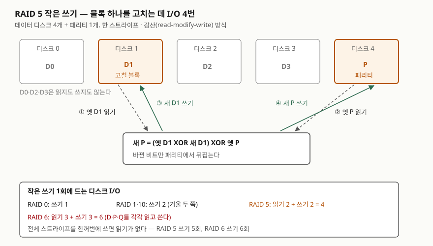

## 들어가며

RAID는 스토리지 문항의 기본이다. 레벨별 구조를 그리게 하거나, 용량 효율과 고장 허용 수를 비교하게 하거나, "DB 로그
디스크에 RAID 5를 쓰면 안 되는 이유"처럼 쓰기 성능을 묻는다. 마지막 유형에서 점수가 갈리는 것은 **쓰기 페널티**,
곧 블록 하나를 고쳐 쓸 때 디스크 I/O가 몇 번 일어나는가를 근거와 함께 쓰는 것이다. 이 글은 원 논문과 교재로
정의와 레벨을 정리하고, 디스크를 흉내 낸 코드로 그 횟수를 직접 세어 검산했다.

## 정의

**RAID(Redundant Arrays of Inexpensive Disks)**: 여러 개의 디스크를 묶어 하나의 저장 장치처럼 보이게 하고,
**데이터를 나눠 두는 방식(스트라이핑)과 중복 정보(미러 또는 패리티)를 두는 방식**을 조합해 성능과 신뢰성을 높이는
디스크 배열 구성이다. Patterson·Gibson·Katz(1988)는 개인용 컴퓨터용 디스크로 만든 배열이 단일 대형 디스크(SLED)를
대신할 수 있다고 제안하면서 **레벨 1~5의 다섯 가지** 구성을 제시했다. OSTEP 38장은 RAID가 위 계층에 투명하게
여러 디스크를 더 크고 더 믿을 수 있는 하나의 장치로 바꾼다고 요약한다.

> 실행 검증은 계산 검산만 했다. 실제 디스크·컨트롤러에서 처리량을 잰 것은 아니다. 처리량은 교재의 모형식으로만 쓴다.

## 등장 배경

원 논문의 문제의식은 **I/O 위기**다. CPU와 메모리는 빠르게 좋아지는데 대형 디스크는 탐색·회전 지연에 묶여 성능
향상이 더뎠다. 논문은 암달의 법칙으로 I/O가 전체 성능 향상을 붙잡는다고 설명한다. 작고 싼 디스크를 여러 개 묶으면
병렬로 읽고 쓸 수 있지만, 디스크 수가 늘수록 **어느 하나가 고장 날 확률도 커진다.** 그래서 묶음에 **검사
디스크(check disk)** 를 두어 고장 난 디스크의 내용을 다시 만들 수 있게 했다. 레벨 1~5는 이 검사 정보를 어떤 모양으로
두는지가 다르다. 미러(1)에서 시작해 검사 디스크 비용을 줄이고(2·3), 작은 I/O를 병렬로 처리하게 하고(4),
검사 디스크 병목을 없애는(5) 순서로 나아간다.

## 구성요소 — 기법 3가지, 레벨 8가지

### 구성 기법 3가지

| 기법 | 하는 일 | 얻는 것 | 잃는 것 |
|---|---|---|---|
| 스트라이핑 (striping) | 연속된 블록을 여러 디스크에 돌아가며 나눠 둔다 | 병렬 I/O → 처리량 | 디스크 하나만 고장 나도 전체 손실 |
| 미러링 (mirroring) | 같은 블록을 두 디스크에 똑같이 둔다 | 고장 허용, 읽기 분산 | 용량 절반 |
| 패리티 (parity) | 스트라이프의 데이터 블록을 XOR한 값을 따로 둔다 | 디스크 1개분 용량으로 고장 1개 허용 | 작은 쓰기마다 패리티 갱신 비용 |

### 레벨 8가지

레벨 1~5는 원 논문, 0·6·10은 리눅스 md(4) 매뉴얼의 설명을 따랐다. 용량은 디스크 N개 기준이다.

| 레벨 | 구성 | 사용 가능 용량 | 견디는 고장 | 비고 |
|---|---|---|---|---|
| RAID 0 | 스트라이핑만 | N | 0개 | md(4): 중복이 없는 스트라이프 배열 |
| RAID 1 | 미러링 | N/2 | 쌍마다 1개 | 원 논문 레벨 1. 모든 쓰기가 검사 디스크에도 쓰인다 |
| RAID 2 | 비트 단위 분산 + 해밍 코드 검사 디스크 여러 개 | 데이터 10개에 검사 4개 | 1개 | 원 논문: 슈퍼컴퓨터용, 거래 처리에 부적합 |
| RAID 3 | 비트 단위 분산 + 패리티 디스크 1개 | N−1 | 1개 | 고장 위치는 디스크 컨트롤러가 알려 준다 |
| RAID 4 | 블록 단위 분산 + 전용 패리티 디스크 1개 | N−1 | 1개 | 작은 쓰기가 패리티 디스크 하나에 몰린다 |
| RAID 5 | 블록 단위 분산 + 패리티를 모든 디스크에 돌려 둔다 | N−1 | 1개 | 패리티 디스크 병목을 없앴다 |
| RAID 6 | RAID 5 + 두 번째 패리티 Q | N−2 | 아무 2개 | Q는 GF(2⁸) 리드-솔로몬 부호 |
| RAID 10 | 미러 쌍을 스트라이핑 (1+0) | N/2 | 쌍마다 1개 | md(4): RAID 1과 RAID 0의 결합 |

### 쓰기 방식 2가지 — 패리티 갱신

스트라이프의 일부 블록만 고칠 때 새 패리티를 만드는 방법은 둘이다(OSTEP 38.6).

- **감산 방식(subtractive, read-modify-write)**: 옛 데이터와 옛 패리티를 읽어 **새 P = (옛 D ⊕ 새 D) ⊕ 옛 P** 로 만든다.
  원 논문 레벨 4 절의 식과 같다. 읽기 2 + 쓰기 2 = **4회**.
- **가산 방식(additive, reconstruct-write)**: 고치지 않는 나머지 데이터 블록을 전부 읽어 새 블록과 XOR한다.
  데이터 디스크가 N개면 읽기 N−1 + 쓰기 2.

## 도식



> **출처**: [Patterson, Gibson, Katz, "A Case for Redundant Arrays of Inexpensive Disks (RAID)", SIGMOD 1988](https://www.cs.cmu.edu/~garth/RAIDpaper/Patterson88.pdf) — 10. Fourth Level RAID(새 패리티 식, 작은 쓰기 4회), 11. Fifth Level RAID,
> [Arpaci-Dusseau, *OSTEP* v1.10 Ch.38 RAID](https://pages.cs.wisc.edu/~remzi/OSTEP/file-raid.pdf) — 38.6 RAID Level 4(가산·감산 방식), 38.7 RAID Level 5,
> [Anvin, "The mathematics of RAID-6"](https://www.kernel.org/pub/linux/kernel/people/hpa/raid6.pdf) — 2. Application to RAID-6(P·Q 정의).
> 레벨별 I/O 수는 아래 계산 1번의 결과다.

답안지에는 디스크 다섯 칸을 그리고 D1·P에만 표시한 뒤, ①② 읽기 ③④ 쓰기 화살표와 식 한 줄을 적는다.

## 계산 검산

계산: [`code/raid_write_penalty.py`](code/raid_write_penalty.py), 실행 기록: [`code/output.txt`](code/output.txt).
디스크를 8바이트 블록 목록으로 흉내 내고, 읽기·쓰기를 부를 때마다 센다. 한 스트라이프만 다루므로 RAID 4와
RAID 5의 차이(패리티 위치를 스트라이프마다 돌리는 것)는 이 계산에 드러나지 않는다.

### 작은 쓰기의 I/O 수

```text
-- 1. 데이터 디스크 4개 기준, 블록 하나 고쳐 쓰기 (작은 쓰기)
   레벨                      디스크 수  읽기  쓰기  합계  순서
   RAID 0                      4     0     1     1  W1
   RAID 10 (1+0)               8     0     2     2  W2 W3
   RAID 5 감산(RMW)              5     2     2     4  R1 R4 W1 W4
   RAID 5 가산(재구성)              5     3     2     5  R0 R2 R3 W1 W4
   RAID 6 감산(RMW)              6     3     3     6  R1 R4 R5 W1 W4 W5
-- 2. 고쳐 쓴 뒤 패리티가 맞는가 — 처음부터 다시 계산한 값과 비교
   RAID 5 감산 P 일치: True
   RAID 6 감산 Q 일치: True
```

흔히 외우는 **쓰기 페널티 1·2·4·6**이 그대로 나왔다. RAID 6이 6회인 이유는 Q도 P처럼 바뀐 몫만 더하면 되기 때문이다.
Anvin의 Q 정의(식 2)는 각 데이터 블록에 g^i를 곱해 XOR한 것이라, 블록 x 하나가 바뀌면 **새 Q = 옛 Q ⊕ g^x·(옛 D ⊕ 새 D)** 가
된다. 다른 데이터 블록은 읽을 필요가 없다. 계산한 Q가 처음부터 다시 만든 Q와 일치했다(2번).

### 예상과 달랐던 것 — 감산 방식이 늘 유리하지는 않다

```text
-- 3. 감산 방식과 가산 방식의 I/O 수 — 데이터 디스크 수 N에 따라
   N   감산(2R+2W)  가산((N-1)R+2W)  적은 쪽
   2             4                3  가산
   3             4                4  같음
   4             4                5  감산
```

"RAID 5 쓰기 페널티는 4"가 늘 맞는 것은 아니다. 데이터 디스크가 2개면 나머지 하나만 읽는 가산 방식이 3회로 더 적고,
3개에서 같아지며, 4개부터 감산 방식이 유리하다. OSTEP이 연습으로 남긴 교차점이 **N = 3**이다. 실무 배열은 데이터 디스크가
보통 그보다 많으므로 4가 대표값이 된다. 또 스트라이프 전체를 한꺼번에 쓰면 읽기가 없다(4번: RAID 5 쓰기 5회,
데이터 블록당 1.25회). 쓰기 페널티는 **작은 무작위 쓰기**의 비용이다.

### 고장과 복구

```text
-- 5. 디스크 1개 고장 — RAID 5에서 잃은 블록 읽기
   잃은 디스크 2, 읽은 횟수 4 (R0 R1 R3 R4)
   복구한 블록 일치: True
-- 6. 데이터 디스크 2개 고장 — RAID 6 복구 (Anvin 식 19·20)
   D0·D1 잃음 -> 복구 일치: True
   D1·D3 잃음 -> 복구 일치: True
-- 7. 같은 두 디스크를 RAID 5에서 잃으면 — P 하나로 풀 수 있는가
   P xor 남은 블록 = D0 xor D1 : True
   그 값이 D0과 같은가: False
```

RAID 5는 고장 난 디스크의 블록 하나를 읽으려고 **남은 디스크 전부**를 읽는다(5번). 두 개를 잃으면 P로 얻는 것은
D0 ⊕ D1 하나뿐이라 미지수 둘을 풀 수 없다(7번). RAID 6은 식이 P·Q 두 개라 어느 두 데이터 디스크를 잃어도 풀렸다(6번).

### 디스크 8개로 묶을 때

```text
   레벨     용량(디스크 수)  효율    견디는 고장  작은 쓰기 I/O  작은 쓰기 처리량
   RAID 0                8  100.0%  0개                    1  8/1 R = 8.00 R
   RAID 10               4   50.0%  쌍마다 1개                2  8/2 R = 4.00 R
   RAID 5                7   87.5%  1개                    4  8/4 R = 2.00 R
   RAID 6                6   75.0%  아무 2개                 6  8/6 R = 1.33 R
```

R은 디스크 1개의 무작위 I/O 처리량이다. 모든 디스크가 고르게 바쁘다고 보고 "전체 I/O 능력 ÷ 쓰기 1회당 I/O"로 셌다.
RAID 0·10·5의 식은 OSTEP 그림 38.8(N·R, N/2·R, N/4·R)과 같고, RAID 6의 N/6·R은 같은 방식으로 6회를 넣어 얻은 값이다.

## 비교

### 레벨별 선택 기준 (OSTEP 38.8 요약 + 계산)

| 기준 | RAID 0 | RAID 1·10 | RAID 5 | RAID 6 |
|---|---|---|---|---|
| 용량 효율 (8개) | 100% | 50% | 87.5% | 75% |
| 견디는 고장 | 0 | 쌍마다 1 | 1 | 아무 2 |
| 작은 쓰기 I/O | 1 | 2 | 4 | 6 |
| 무작위 쓰기 처리량 | N·R | N/2·R | N/4·R | N/6·R |
| 순차 쓰기 | 빠름 | 미러 양쪽에 쓴다 | 전체 스트라이프 쓰기면 읽기 없음 | 같음 |
| 맞는 곳 | 잃어도 되는 임시 데이터 | 무작위 쓰기가 많은 DB·로그 | 읽기 위주, 용량 중시 | 대용량 디스크, 고장 2개 대비 |

OSTEP의 결론도 같은 방향이다. 성능만 보면 스트라이핑, 무작위 I/O와 신뢰성을 함께 원하면 미러링, 용량과 신뢰성이
목표면 RAID 5이고 그 대가는 작은 쓰기 성능이다.

### RAID 4와 RAID 5

| 구분 | RAID 4 | RAID 5 |
|---|---|---|
| 패리티 위치 | 전용 디스크 1개 | 스트라이프마다 다른 디스크 |
| 작은 쓰기 I/O | 4회 | 4회 |
| 작은 쓰기 병렬성 | 모든 쓰기가 패리티 디스크를 지나므로 사실상 하나씩 | 패리티가 다른 디스크면 동시에 가능 |
| 무작위 쓰기 처리량 (OSTEP) | R/2 | N/4·R |

**I/O 횟수는 같고 병목 위치가 다르다.** 원 논문 11절의 예처럼 두 작은 쓰기의 패리티가 서로 다른 디스크에 있으면
RAID 5는 둘을 동시에 처리한다.

## 적용 시 고려사항

- **쓰기 비율부터 본다.** 무작위 작은 쓰기가 많은 DB 데이터·리두 로그 영역은 RAID 10이, 읽기 위주 대용량 영역은
  RAID 5·6이 맞다. 같은 디스크 8개라도 작은 쓰기 처리량이 4R과 2R로 두 배 차이 난다(계산 8번).
- **쓰기 캐시가 페널티를 가린다.** 원 논문 12절은 디스크 버퍼링이 효과적이면 옛 데이터와 옛 패리티가 이미 메모리에
  있어 레벨 5 작은 쓰기에 추가 읽기가 없다고 적는다. 반대로 캐시가 꺼지거나 넘치면 4회가 그대로 드러난다.
- **고장 중 성능과 재구축 시간을 계산에 넣는다.** RAID 5는 잃은 블록 하나를 읽을 때 남은 디스크 전부를 읽는다(계산 5번).
  md(4)는 RAID 6이 두 디스크 고장 상태에서 매우 느리다고 적는다. 재구축하는 동안 다음 고장이 나면 RAID 5는 데이터를 잃는다.
  OSTEP 38.9는 고장 중 성능, 재구축 중 성능, 잠재 섹터 오류를 RAID가 따로 다뤄야 할 문제로 꼽는다.
- **소프트웨어 RAID는 갱신 일관성을 따로 챙긴다.** 데이터와 패리티를 쓰는 사이에 전원이 끊기면 둘이 어긋난다.
  OSTEP 38.9는 소프트웨어 RAID의 이 문제를 consistent-update 문제로 언급한다.
- **RAID는 백업이 아니다.** 잘못 지운 데이터도 미러와 패리티에 그대로 반영된다. 디스크 고장을 견디는 장치이지
  논리 오류를 되돌리는 장치가 아니다.

## 정리

- 기법 **3가지**: 스트라이핑(성능) · 미러링(복제) · 패리티(XOR 검사 정보). 원 논문 레벨 **5가지**(1~5)에 0·6·10을 더해 **8가지**.
- 작은 쓰기 I/O: **0 → 1, 1·10 → 2, 5 → 4, 6 → 6** ("1·2·4·6"). 5는 읽기 2 + 쓰기 2, 6은 D·P·Q를 각각 읽고 쓴다.
- 새 P = (옛 D ⊕ 새 D) ⊕ 옛 P (감산). 가산 방식은 데이터 디스크 **3개**에서 같아지고 그보다 많으면 불리하다.
- 견디는 고장: 0 → 0, 5 → 1, 6 → 아무 2, 1·10 → 쌍마다 1. 용량: N, N−1, N−2, N/2.
- 고르는 순서: 쓰기 비율 → 고장 허용 수 → 용량 효율. 캐시·재구축·백업은 별도로 챙긴다.

> 관련 개념: [재해복구 전략 — RTO·RPO·MTD와 4가지 복구 방식](../2026-10-02-disaster-recovery-mtd-rto-rpo-strategies/index.md)

## 참고 자료

- [D. A. Patterson, G. Gibson, R. H. Katz, "A Case for Redundant Arrays of Inexpensive Disks (RAID)", *Proc. ACM SIGMOD* 1988](https://www.cs.cmu.edu/~garth/RAIDpaper/Patterson88.pdf) — 초록(다섯 레벨), 7~11절 레벨 1~5, 10절 새 패리티 식과 작은 쓰기 4회, 12절 버퍼링 효과
- [R. H. Arpaci-Dusseau, A. C. Arpaci-Dusseau, *Operating Systems: Three Easy Pieces* v1.10, Ch.38 Redundant Arrays of Inexpensive Disks](https://pages.cs.wisc.edu/~remzi/OSTEP/file-raid.pdf) — 38.6 가산·감산 방식과 작은 쓰기 문제, 38.7 RAID 5, 38.8 그림 38.8 비교표, 38.9 기타 문제
- [H. Peter Anvin, "The mathematics of RAID-6" (최초 2004-01-20, 갱신 2011-12-20)](https://www.kernel.org/pub/linux/kernel/people/hpa/raid6.pdf) — 1절 GF(2⁸) 연산, 2절 P·Q 정의와 두 디스크 복구 식 (16)~(20)
- [Linux man-pages, md(4)](https://man7.org/linux/man-pages/man4/md.4.html) — RAID0·1·4·5·6·10 설명, RAID 6의 두 디스크 고장 시 성능
