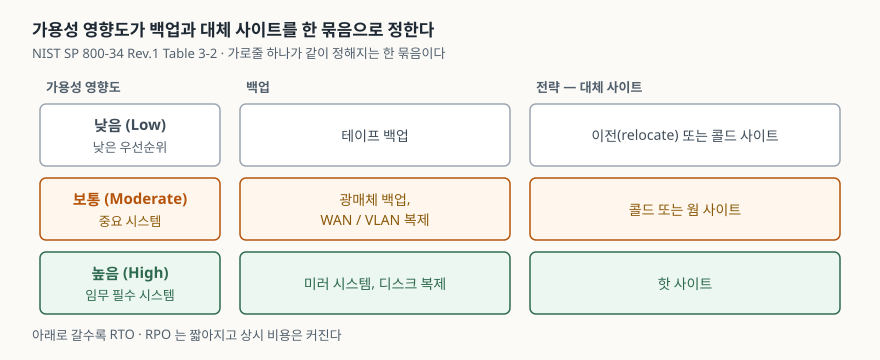
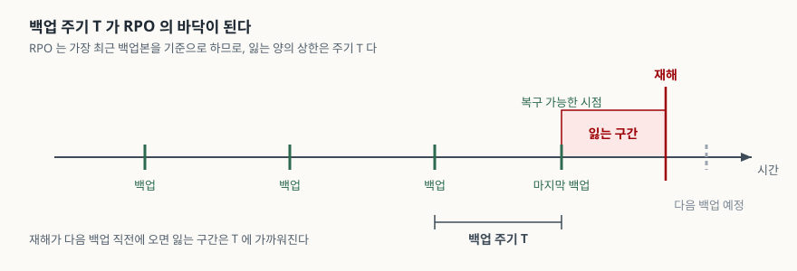

> 실행 검증 없음. NIST SP 800-34 Rev.1과 NIST SP 800-84 원문만 근거로 정리했다.
> 국내에서 흔히 쓰는 '미러–핫–웜–콜드 4등급'의 등급별 복구 시간 수치는 1차 자료를
> 확인하지 못해 싣지 않았다. 그 사정은 본문에 따로 적었다.

## 들어가며

재해복구 문항은 대개 RTO와 RPO의 정의를 묻는 데서 시작한다. 그런데 정의를 정확히 써도
배점의 절반밖에 못 가져간다. 목표 시간은 업무 부서가 "4시간 안에 돌아와야 한다"고 말하면
끝나는 값이고, 기술사에게 묻는 것은 **그 4시간을 무엇으로 만들 것인가**이기 때문이다.
실무에서도 목표를 받아 적는 일은 회의 한 번이고, 그 뒤에 백업 주기를 바꾸고 대체 사이트
계약을 고치고 1년에 한 번 전환을 해 보는 일이 남는다. 이 글은 그 부분을 다룬다.

## 정의

**재해복구시스템 구축 수준**: 시스템의 가용성 영향도에 따라 정해진 RTO·RPO를 달성하기 위해
**백업 방식, 데이터 복제 방식, 대체 사이트의 준비 정도, 시험·교육·훈련 체계를 한 묶음으로 정한
수준**이다.

여기서 중요한 것은 네 가지가 **따로 고를 수 있는 항목이 아니라 한 묶음**이라는 점이다. 핫
사이트를 계약해 두고 백업은 주 1회 테이프로 돌리면 RTO는 짧아져도 RPO는 일주일이 된다.
반대로 실시간 복제를 걸어 두고 전환 훈련을 한 번도 하지 않으면, 재해 당일 측정되는 RTO는
설계값과 아무 관계가 없다.

> RTO·RPO·MTD 세 값을 누가 어떤 순서로 정하는지는 앞 글에서 다뤘다.
> 이 글은 그 값이 정해진 뒤의 이야기다.
> [재해복구 전략 — RTO·RPO·MTD와 4가지 복구 방식](../2026-10-02-disaster-recovery-mtd-rto-rpo-strategies/index.md)

## 등장 배경

구축 수준을 등급으로 나눈 이유는 **모든 시스템에 같은 수준을 적용할 수 없기 때문**이다.
NIST SP 800-34 Rev.1은 대체 저장 시설과 대체 처리 시설을 FIPS 199의 가용성 보안 목표
영향도에 따라 적용한다고 적는다(§3.4.3). 가용성 영향도가 낮음으로 분류된 시스템에는 대체
저장 시설도 대체 처리 시설도 요구하지 않는다. 등급이 없으면 두 가지 중 하나가 된다. 모든
시스템에 핫 사이트를 두어 비용 균형점을 무시하거나, 모든 시스템에 테이프 백업만 두어
핵심 업무가 며칠씩 멈추거나다.

국내 실무에서는 복구 수준을 **미러 사이트–핫 사이트–웜 사이트–콜드 사이트의 4등급**으로
줄 세워 부르는 관행이 널리 쓰인다. 이 이름들은 NIST가 쓰는 대체 사이트 유형과 같지만,
NIST는 이것을 **등급이 아니라 준비 수준이 다른 유형**으로 설명하고 등급별 복구 시간 수치를
제시하지 않는다. 등급별 RTO 수치를 제시하는 국내 자료는 여럿 있으나 그 수치의 1차 출처를
확인하지 못했다. 그래서 이 글에서는 쓰지 않고, 답안에서도 "미러가 가장 짧고 콜드가 가장
길다"는 순서까지만 쓰고 시간 수치는 쓰지 않는 편이 안전하다.

## 구성요소 / 절차

### 영향도가 정하는 묶음 — 3등급

NIST SP 800-34 Rev.1은 FIPS 199 가용성 영향도별로 백업과 복구 전략을 묶어 예시한다(표 3-2).
백업 방식과 사이트 유형이 **한 칸에 같이 적혀 있다**는 것이 이 표의 요점이다.

| 가용성 영향도 | 복구 우선순위 | 백업 | 전략 |
|---|---|---|---|
| **낮음** | 중단되어도 조직에 거의 영향이 없는 낮은 우선순위 | 테이프 백업 | 이전(relocate) 또는 콜드 사이트 |
| **보통** | 중단되면 조직과 다른 시스템에 보통 수준의 문제를 일으키는 중요 시스템 | 광매체 백업, WAN/VLAN 복제 | 콜드 또는 웜 사이트 |
| **높음** | 중단 피해가 조직·임무·다른 시스템에 가장 큰 영향을 주는 임무 필수 시스템 | 미러 시스템, 디스크 복제 | 핫 사이트 |

### 백업 정책이 명시할 것 — 5가지

같은 문서의 백업 방식 절(§3.4.2)은 백업 정책에 다음을 적도록 한다.

1. **최소 주기와 범위** — 일 단위냐 주 단위냐, 증분이냐 전체냐. 데이터 중요도와 새 정보가
   들어오는 빈도를 근거로 정한다
2. **저장 데이터의 위치**
3. **파일 명명 규칙**
4. **매체 순환 주기**
5. **외부 반출 방법**

이 다섯 가지 중 RPO를 직접 정하는 것은 ①뿐이고, 나머지 넷은 **재해 때 그 백업을 실제로
쓸 수 있는가**를 정한다. 매체 순환 주기를 적지 않으면 몇 년 된 테이프가 돌고 있어도 아무도
모르고, 반출 방법을 적지 않으면 백업본이 주 센터와 같은 건물에서 같이 탄다.

외부 보관 시설을 고를 때 따질 기준도 같은 절이 **5가지**로 든다. 지리적 위치(주 센터와의
거리, 같은 재해를 겪을 확률), 접근성(인출에 걸리는 시간과 운영 시간), 보안(운송 수단·시설·
인력), 환경(온습도·화재 예방·전원), 비용이다.

### 백업 주기가 RPO의 상한이 되는 이유

NIST는 RPO를 **중단 이전의 어느 시점으로 데이터를 되살릴 수 있는가**로 정의하면서, 그 기준이
**가장 최근의 백업본**이라고 명시한다(§3.2.1). 여기서 산술 하나가 따라 나온다.

백업을 주기 *T* 로 돌린다면, 재해는 두 백업 사이 어느 시점에나 올 수 있다. 직전 백업 직후에
오면 거의 잃지 않고, 다음 백업 직전에 오면 *T* 에 가까운 분량을 잃는다. 그러므로 **잃는 양의
상한이 곧 *T*** 이고, RPO는 *T* 보다 작을 수 없다. 하루 한 번 백업으로 RPO 4시간을 약속하는
설계는 산술적으로 성립하지 않는다.

RPO를 *T* 아래로 내리는 방법은 주기를 줄이는 것과, 백업 대신 **복제**로 바꾸는 것 둘이다.
NIST SP 800-53의 시스템 백업 통제(CP-9)는 사용자 데이터·시스템 데이터·시스템 문서의 백업
주기를 모두 "RTO·RPO에 부합하는 조직이 정한 주기"로 적도록 요구한다. 주기를 먼저 정하고
목표를 나중에 맞추는 것이 아니라 **목표가 주기를 정한다**는 순서다.

### 목표를 확인하는 체계 — 시험·교육·훈련(TT&E)

구축 수준에서 가장 자주 빠지는 칸이 여기다. NIST SP 800-34 Rev.1은 비상계획을 준비 상태로
유지하는 일을 **시험(Test)·교육(Training)·훈련(Exercise) 세 갈래**로 나눈다(§3.5). 세부 방법론은
NIST SP 800-84가 따로 담당한다.

**시험**은 정량 지표로 시스템이나 구성요소의 작동을 검증하는 도구다. 비상계획 시험에서 다룰
항목을 같은 문서가 **6가지**로 든다(§3.5.1).

1. 통보 절차
2. 백업 매체로부터 대체 플랫폼에서의 시스템 복구
3. 내부·외부 연결성
4. 대체 장비를 쓴 시스템 성능
5. 정상 운영으로의 복귀
6. 연계가 확인된 다른 계획의 시험(COOP, BCP 등)

**교육**은 담당자가 계획 문서 없이도 자기 역할을 수행할 수 있게 하는 것이 목표다. 재해 첫
몇 시간 동안 종이든 전자든 계획서를 못 볼 수 있기 때문이다. 교육 항목도 **6가지**다 — 계획의
목적, 팀 간 조정과 소통, 보고 절차, 보안 요구사항, 팀별 절차, 개인별 책임. 주기는 최소 연 1회이고
새로 역할을 맡은 사람은 임명 직후에 받는다(§3.5.2).

**훈련**은 비상 상황을 모의해 계획의 실효성을 검증하는 시나리오 기반 활동이다. NIST SP 800-84가
단일 조직에서 널리 쓰이는 유형으로 **2가지**를 든다(§3.5.3).

- **도상 훈련(Tabletop Exercise)** — 담당자들이 한 자리에 모여 진행자가 제시한 시나리오를 놓고
  각자의 역할과 대응을 **토의로** 검증한다. 토의만 하며 장비나 자원을 투입하지 않는다
- **모의 훈련(Functional Exercise)** — 모의된 운영 환경에서 실제로 자기 역할을 **수행해** 운영
  준비도를 검증한다. 범위는 계획의 특정 부분만 보는 것부터 모든 요소를 다루는 전체 규모
  훈련까지 넓다

모든 활동은 사후 보고서(after-action report)로 남기고, 거기서 나온 교훈을 계획 갱신에 반영한다.
훈련을 했다는 사실이 아니라 **무엇이 안 됐는지가 산출물**이다.

## 도식

> **출처**: [NIST SP 800-34 Rev.1 §3.4.1 Backup and Recovery, Table 3-2 FIPS 199 Category Backup & Strategy Examples](https://nvlpubs.nist.gov/nistpubs/Legacy/SP/nistspecialpublication800-34r1.pdf)

답안지에는 왼쪽에 영향도 세 칸을 세로로 쌓고, 오른쪽으로 백업·전략 두 열을 그어 채운다.
가로줄 하나가 **같이 정해져야 하는 묶음**이라는 뜻이다.

> **출처**: [NIST SP 800-34 Rev.1 §3.2.1 Determine Business Processes and Recovery Criticality (RPO 정의) · §3.4.2 Backup Methods and Offsite Storage (백업 주기와 범위)](https://nvlpubs.nist.gov/nistpubs/Legacy/SP/nistspecialpublication800-34r1.pdf)

가로선 위에 백업 시점을 같은 간격으로 찍고 그 사이에 재해를 놓으면 끝이다. 잃는 구간이
가장 길어지는 자리가 **다음 백업 직전**이라는 것만 보이면 된다.

## 비교

### 시험 · 교육 · 훈련

| 비교 항목 | 시험(Test) | 교육(Training) | 훈련(Exercise) |
|---|---|---|---|
| 대상 | 시스템과 구성요소 | 사람 | 계획 |
| 검증하는 것 | 작동 여부 | 역할 수행 능력 | 계획 내용의 실효성 |
| 방식 | 정량 지표로 측정 | 설명 + 이해도 확인 활동 | 시나리오 기반 모의 |
| 환경 | 운영 환경에 최대한 가깝게 | — | 모의된 환경 |
| 순서 | 보통 마지막 | 가장 먼저 | 교육 뒤, 시험 앞 |

NIST SP 800-84는 세 글자가 'TT&E'로 붙어 있어도 본문은 **교육 → 훈련 → 시험** 순으로 서술한다고
각주로 밝힌다. 교육을 받아야 훈련에 참여할 수 있고, 훈련으로 계획을 다듬은 뒤에 시험을 하기
때문이다. 답안에 순서를 쓸 일이 있으면 이쪽이다.

### 도상 훈련과 모의 훈련

| 비교 항목 | 도상 훈련 | 모의 훈련 |
|---|---|---|
| 형태 | 토의 기반 | 수행 기반 |
| 장비·자원 투입 | 없다 | 있다(모의 환경) |
| 장소 | 강의실 또는 분임 토의 | 모의된 운영 환경 |
| 진행 방식 | 진행자가 시나리오와 질문을 제시 | 참가자가 실제 절차를 수행 |
| 범위 | 역할·책임·조정·의사결정 | 특정 기능부터 전체 규모까지 |
| 드러나는 결함 | 역할 공백, 연락 체계, 판단 기준 | 절차의 누락, 소요 시간, 장비 호환성 |

## 적용 시 고려사항

- **복제는 백업을 대신하지 못한다.** 복제는 복제 지연만큼의 손실로 RPO를 줄이지만, 데이터
  손상이나 잘못된 삭제는 그대로 복제된다. NIST는 백업 매체 자체의 신뢰성과 무결성을 주기적으로
  시험하라고 요구하고(CP-9(1)), 비상계획 시험의 일부로 **백업본을 실제로 복원해 보라**고 적는다
  (CP-9(2)). 복제 구성이어도 시점 백업을 따로 둔다.
- **대체 저장 시설은 RTO·RPO에 맞춰 구성한다.** 대체 저장 시설 통제(CP-6)는 주 저장 시설과
  지리적으로 떨어뜨릴 것, **복구 목표에 부합하도록 구성할 것**, 광역 재해 때 접근이 막히는 상황을
  미리 따져 완화 조치를 적어 둘 것을 요구한다. 완화 조치의 예로 백업본을 또 다른 시설에
  이중으로 두는 것과, 전자적 접근이 끊길 때 물리적으로 가서 가져오는 절차를 든다.
- **훈련은 대체 사이트에서 한다.** 비상계획 시험 통제(CP-4)의 확장 항목은 **대체 처리 시설에서**
  시험·훈련을 수행해 담당자가 그 시설과 가용 자원에 익숙해지게 하고 시설의 수용 능력을
  평가하라고 적는다. 주 센터에서 서류로만 점검한 계획은 전환 당일 처음 돌아간다.
- **시험 시나리오는 현실에 가까워야 한다.** 같은 문서는 시나리오로 최악의 사고 또는 가장
  일어날 법한 사고를 고르되 **현실을 최대한 모사하라**고 적고, 시험 계획에 명시적 목표와 성공
  기준을 넣으라고 요구한다. 성공 기준 없는 훈련은 "했다"만 남고 RTO 달성 여부를 말해 주지 않는다.

## 정리

- **정의 1줄**: 가용성 영향도가 정한 RTO·RPO를 달성하도록 백업·복제·대체 사이트·훈련을 한 묶음으로
  정한 수준.
- **묶음을 정하는 것은 영향도 3등급**: 낮음은 테이프 + 콜드, 보통은 광매체·WAN 복제 + 콜드/웜,
  높음은 미러·디스크 복제 + 핫.
- **백업 정책 5가지**: 주기·범위 / 위치 / 명명 규칙 / 매체 순환 / 반출 방법. 외부 보관 시설 선정
  기준도 **5가지**(지리·접근성·보안·환경·비용).
- **백업 주기 *T* 가 RPO의 바닥**: RPO는 가장 최근 백업본 기준이므로 *T* 보다 작아질 수 없다.
  더 줄이려면 주기를 줄이거나 복제로 바꾼다.
- **TT&E = 시험·교육·훈련**: 시험은 시스템(**6항목**), 교육은 사람(**6항목**, 연 1회 이상),
  훈련은 계획(**도상 2 ·모의**). 서술 순서는 교육 → 훈련 → 시험.

> 기출 답안: [기출문제 — 클라우드 네이티브 환경의 재해복구 전략 (RTO·RPO, Active-Active·Active-Passive·Pilot Light)](../../exam/2026-10-02-disaster-recovery-rto-rpo-strategies/index.md)

## 참고 자료

- [NIST SP 800-34 Rev.1, Contingency Planning Guide for Federal Information Systems (2010-05)](https://nvlpubs.nist.gov/nistpubs/Legacy/SP/nistspecialpublication800-34r1.pdf) — §3.2.1 RPO 정의, §3.4.1 Table 3-2 영향도별 백업·전략, §3.4.2 백업 정책 5항목과 외부 보관 시설 선정 기준 5항목, §3.5 TT&E, 부록 E의 CP-4·CP-6·CP-9 통제
- [NIST SP 800-84, Guide to Test, Training, and Exercise Programs for IT Plans and Capabilities (2006-09)](https://nvlpubs.nist.gov/nistpubs/Legacy/SP/nistspecialpublication800-84.pdf) — Executive Summary의 교육·훈련 정의, §2 TT&E 프로그램 수립, §4 도상 훈련, §5 모의 훈련, §6 시험
- [FIPS 199, Standards for Security Categorization of Federal Information and Information Systems (2004-02)](https://nvlpubs.nist.gov/nistpubs/FIPS/NIST.FIPS.199.pdf) — 가용성 보안 목표의 영향도 3등급
