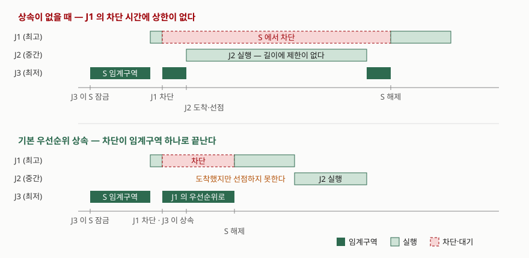

> **실행 검증 없음.** 이 글의 정의·규칙·정리는 전부 원 논문(IEEE Trans. Computers 39(9),
> 1990)과 POSIX.1-2017 명세에서 확인한 것이고, 실행 결과나 측정값은 싣지 않았다.
> 차단 시간의 상한은 논문이 증명한 정리를 그대로 인용한다.

## 들어가며

우선순위를 매겨 둔 시스템에서 **가장 높은 우선순위 작업이 가장 오래 기다리는** 일이
생긴다. 설계 의도와 정반대이므로 처음 보면 버그처럼 보이지만, 동기화 기법을 그대로
쓰면 필연적으로 생기는 현상이다. 시험에서는 뮤텍스·세마포어·모니터 문항의 뒷부분에
붙어 "이 기법의 한계와 해결책"으로 자주 나오고, 실무에서는 실시간 제어나 임베디드
쪽에서 "평소엔 멀쩡한데 가끔 응답이 늦는다"로 나타난다. 원인과 처방이 모두 한 편의
논문에 정리되어 있어 답안으로 쓰기도 좋다.

## 정의

**우선순위 역전은 높은 우선순위 작업이 낮은 우선순위 작업들에 의해 무한정 차단되는
상황이다.**

Sha·Rajkumar·Lehoczky는 세마포어·모니터·Ada 랑데부 같은 동기화 기본 요소를 그대로
적용하면 "통제되지 않은 우선순위 역전"으로 이어질 수 있다고 적으면서, 그것을 "높은
우선순위 작업이 낮은 우선순위 작업들에 의해 무한한 기간 동안 차단되는 상황"으로
정의한다.

여기서 **차단(blocked)의 뜻이 좁다는 점**이 중요하다. 논문은 작업 J가 **낮은 우선순위**
작업의 수행을 기다리게 될 때만 차단되었다고 하고, 높은 우선순위 작업이나 먼저 도착한
동등 우선순위 작업을 기다리는 것은 차단으로 치지 않는다. 우선순위대로 밀리는 것은
정상이고, 거꾸로 밀리는 것만 문제라는 뜻이다.

## 등장 배경

논문의 예제 1이 현상 전체를 담고 있다. 우선순위가 높은 순으로 J1·J2·J3가 있고,
J1과 J3가 이진 세마포어 S로 보호되는 자료구조를 공유한다.

1. J3가 S를 잠그고 임계구역에 들어간다
2. J1이 시작되어 J3를 선점하고, 공유 자료를 쓰려다 S에서 차단된다
3. 중간 우선순위 J2가 도착해 J3를 선점한다
4. J3의 차단이, 따라서 J1의 차단이 **J2와 대기 중인 다른 중간 작업들이 끝날 때까지 이어진다**

J1은 최고 우선순위이므로 J3의 임계구역 하나만큼만 기다리리라 기대하지만, 실제
차단 시간은 예측 불가능하다. **S와 아무 관계도 없는 J2가 차단 시간을 늘린다**는
것이 핵심이고, 이 때문에 차단 구간이 임의로 길어질 수 있다.

가장 단순한 처방은 임계구역 안에서 선점을 금지하는 것이다. 논문은 이것이 **아주 짧은
임계구역에만 적절하다**고 적는다. 불필요한 차단을 만들기 때문이다. 낮은 우선순위
작업이 긴 임계구역에 들어가면, 그 자료구조를 쓰지도 않는 높은 우선순위 작업까지
공연히 차단된다.

이 문제를 처음 논의한 것은 모니터 맥락의 Lampson과 Redell로, 모니터를 그것을 호출할
수 있는 모든 태스크보다 높은 우선순위로 수행하자고 제안했다. Ada 랑데부에도 같은
문제가 있고, 서버 우선순위를 모든 호출자보다 높이면 이번에는 **낮은 우선순위 작업이
서버를 통해 독립적인 높은 우선순위 작업을 공연히 차단**하는 새 문제가 생긴다.

## 구성요소 — 차단 3가지와 프로토콜 2가지

### 차단의 종류 — 3가지

| # | 종류 | 언제 생기는가 | 어느 프로토콜 |
|---|---|---|---|
| 1 | 직접 차단 (direct blocking) | 잠긴 세마포어를 직접 요청해 막힐 때 | 둘 다 |
| 2 | 밀어내기 차단 (push-through blocking) | 우선순위를 상속한 낮은 작업이 중간 작업을 밀어낼 때 | 둘 다 |
| 3 | 상한 차단 (ceiling blocking) | 상한 규칙에 걸려 잠금 자체가 거부될 때 | 상한 프로토콜만 |

2번은 상속의 대가다. 논문은 세마포어 S가 작업 J에 밀어내기 차단을 일으키려면
**J보다 낮은 우선순위 작업과, J 이상의 우선순위를 갖거나 상속할 수 있는 작업이
모두 S에 접근해야 한다**고 적는다(보조정리 4). 공유하지 않는 세마포어는 밀어내기
차단을 만들지 않는다는 뜻이다.

### ① 기본 우선순위 상속 프로토콜

핵심 규칙은 하나다. **높은 우선순위 작업을 차단하고 있는 작업은 자기가 차단한 작업들
중 가장 높은 우선순위를 물려받고, 임계구역을 나올 때 들어갈 때의 우선순위로 돌아온다.**
상속은 전이적이며, 상속과 복귀 연산은 불가분이어야 한다. 예제 1에서 J3가 J1의
우선순위를 상속하면 J2가 J3를 선점하지 못하므로, J1의 차단이 J3의 임계구역 하나로
줄어든다.

차단 시간의 상한은 두 정리가 함께 정한다.

- **정리 3** — J0를 차단할 수 있는 낮은 우선순위 작업이 n개면, J0는 각 작업의
  임계구역 **하나씩**에 대해서만 차단된다
- **정리 6** — J를 차단할 수 있는 세마포어가 m개면, J는 **최대 m번** 차단된다

둘을 합치면 최악의 차단은 **min(n, m)개의 임계구역**이다. 무한이 유한으로 바뀌었고,
컴파일 시점에 최악 차단 시간을 계산할 수 있게 되었다.

그러나 논문은 기본 프로토콜에 문제가 **2가지** 남는다고 적는다.

- **교착을 막지 못한다.** J2가 S2를 잠그고 S1을 중첩해 잠그려는 순간 J1이 선점해
  S1을 잠그고, 이어 J1이 S2를 요청하면 교착이다
- **연쇄 차단이 생긴다.** J1이 S1과 S2를 차례로 써야 하는데 S1은 J3가, S2는 J2가
  쥐고 있으면, J1은 **임계구역 두 개**를 연달아 기다린다

### ② 우선순위 상한 프로토콜 (PCP)

발상은 이렇다. 어떤 작업이 남의 임계구역을 선점하고 자기 임계구역에 들어갈 때,
**그 새 임계구역이 선점된 모든 임계구역의 상속 우선순위보다 높은 우선순위로 수행됨이
보장되게** 한다. 보장되지 않으면 진입을 막고 중단시킨다.

이를 위해 세마포어마다 **우선순위 상한**을 둔다. 그 세마포어를 잠글 수 있는 작업들
중 **가장 높은 우선순위**가 상한이다. 규칙은 **3가지**다.

1. **잠금 허가 규칙** — 자기 외의 작업들이 잠근 세마포어 중 상한이 가장 높은 것을
   S*라 할 때, 요청 작업의 우선순위가 **S*의 상한보다 높지 않으면 잠금을 거부**하고
   차단한다. 이때 S*를 쥔 작업이 요청 작업을 차단한 것으로 본다
2. **상속 규칙** — 작업은 자기 우선순위로 수행하되, 임계구역 안에서 높은 우선순위
   작업들을 차단하고 있으면 그중 최고 우선순위를 상속한다. 임계구역을 나오면 진입
   시점의 우선순위로 돌아온다. 상속은 전이적이고, 상속·복귀는 불가분 연산이다
3. **선점 규칙** — 임계구역에 들어가려는 것이 아닌 작업은, 상대가 **상속했든 원래
   갖고 있든 지금 수행 중인 우선순위**보다 높으면 선점할 수 있다

1번이 상한 차단을 만든다. 논문은 이 접근이 **때때로 불필요한 차단을 만드는 비관적
프로토콜 부류**에 속한다고 스스로 밝힌다. 그 대가로 얻는 것이 아래 세 가지다.

- **보조정리 9** — 전이 차단을 방지한다 (J가 Ji에, Ji가 다시 Jj에 차단되는 상황)
- **정리 10** — 교착을 방지한다. 따라서 각 작업이 자기 자신과 교착되지만 않으면
  프로그래머는 **적절히 중첩된 세마포어 접근을 임의의 순서로 써도 된다**
- **정리 12** — 작업 J는 **최대 하나의 임계구역** 동안만 차단된다

## 도식

> **출처**: [Sha L., Rajkumar R., Lehoczky J.P., *Priority Inheritance Protocols: An Approach to Real-Time Synchronization*, IEEE Transactions on Computers 39(9), pp.1175-1185, §I Introduction (Example 1) 및 §IV The Priority Ceiling Protocol (1990)](https://ieeexplore.ieee.org/document/57058)

## 비교 — 두 프로토콜과 POSIX 대응

| 구분 | 기본 우선순위 상속 | 우선순위 상한 프로토콜 |
|---|---|---|
| 잠금 요청 처리 | 비어 있으면 잠근다 | 다른 작업이 잠근 세마포어의 최고 상한보다 높아야 잠근다 |
| 차단 종류 | 직접·밀어내기 **2가지** | 상한 차단을 더한 **3가지** |
| 최악 차단 | **min(n, m)개** 임계구역 | **1개** 임계구역 |
| 교착 | 막지 못한다 | 방지한다 (정리 10) |
| 전이 차단 | 생긴다 | 방지한다 (보조정리 9) |
| 사전 정보 | 필요 없다 | 세마포어마다 상한을 미리 정해야 한다 |
| 성격 | 일이 생긴 뒤 올린다 | 미리 막는다 — 비관적 |
| POSIX 속성 | `PTHREAD_PRIO_INHERIT` | `PTHREAD_PRIO_PROTECT` |

POSIX.1-2017은 뮤텍스 속성 `protocol`에 값 **3가지**를 둔다.

- `PTHREAD_PRIO_NONE` — 기본값. 뮤텍스를 소유해도 **우선순위와 스케줄링이 영향을
  받지 않는다.** 역전이 그대로 일어나는 설정이다
- `PTHREAD_PRIO_INHERIT` — 소유 스레드는 자기 우선순위와, 자기가 소유한 뮤텍스를
  기다리는 스레드들 중 최고 우선순위 가운데 **높은 쪽**으로 수행한다. 소유자가 다시
  다른 `PTHREAD_PRIO_INHERIT` 뮤텍스에서 막히면 상속이 **재귀적으로 전파**된다
- `PTHREAD_PRIO_PROTECT` — 소유 스레드는 자기 우선순위와, 자기가 소유한 이 속성
  뮤텍스들의 **우선순위 상한 중 최고치** 가운데 높은 쪽으로 수행한다

세 번째를 논문의 PCP와 같은 것으로 적으면 틀린다. 명세는 이 상승이 **"다른 스레드가
그 뮤텍스들에서 차단되어 있든 아니든 상관없이"** 적용된다고 적는다. 즉 잠그는 즉시
상한으로 올라간다. 반면 논문의 PCP는 규칙 1에서 **잠금 자체를 거부**하는 방식이다.
`PTHREAD_PRIO_PROTECT`가 표준화한 것은 상한을 쓰는 **우선순위 보호**이지 논문의
진입 거부 규칙이 아니다. 상한값은 `pthread_mutexattr_setprioceiling()`으로 호출자가
정하고, `SCHED_FIFO` 정책의 우선순위 범위 안에 있어야 한다.

## 적용 시 고려사항 — 5가지

1. **`PTHREAD_PRIO_PROTECT`를 PCP라고 쓰지 않는다.** 즉시 상한으로 올리는 방식과
   잠금을 거부하는 방식은 차단이 생기는 자리가 다르다. 답안에서도 "POSIX는 상한을
   쓰는 보호 방식을 표준화했다"까지 쓰는 편이 안전하다.
2. **상한값은 설계자의 책임이다.** 명세는 그 뮤텍스를 잠글 수 있는 스레드들의 최고
   우선순위 **이상**으로 상한을 두라고 권고한다. 이 값을 정하려면 **어떤 스레드가 그
   뮤텍스를 잠그는지 전부 알아야 하므로**, 정적 분석이 가능한 구조가 전제된다.
   동적으로 스레드가 늘어나는 설계에는 맞지 않는다.
3. **상한 프로토콜은 공짜가 아니다.** 상한 차단은 실제로 필요 없었을 수도 있는
   차단이다. 논문이 비관적 부류라고 밝힌 그대로이며, 교착·연쇄 차단을 막는 값으로
   이 손해를 받아들이는 선택이다.
4. **논문의 가정이 깨지면 보장도 깨진다.** 증명은 작업이 **스스로 중단하지 않고**
   (입출력 대기 등), 임계구역이 **적절히 중첩**되며, 종료 전에 **모든 잠금을 해제**
   한다는 가정 위에 있다. 임계구역 안에서 블로킹 입출력을 하는 코드는 이 가정을
   깬다. 논문은 중단이 필요하면 작업을 둘 이상으로 나누어 표현하라고 적는다.
5. **기본 상속만 쓰면 교착은 따로 막아야 한다.** 논문은 기본 프로토콜의 교착 문제를
   세마포어 접근에 **전역 순서를 부여해** 풀 수 있다고 적는다. 상속을 켰다고 교착이
   사라지지 않는다는 점은 답안에서 자주 빠지는 대목이다.

## 정리

**"역전은 중간이 만든다"** — 차단을 길게 만드는 것은 자원을 쥔 낮은 우선순위 작업이
아니라, 그 작업을 선점하는 **중간 우선순위 작업**이다. 상속은 중간이 끼어들 수 없게
만들고, 상한은 끼어들 상황 자체를 만들지 않는다.

- 차단의 종류는 **3가지**: 직접, 밀어내기, 상한(상한 프로토콜만)
- 기본 상속의 차단 상한은 **min(n, m)개** 임계구역 — n은 낮은 우선순위 작업 수,
  m은 차단 가능한 세마포어 수 (정리 3·정리 6)
- 기본 상속의 남은 문제는 **2가지**: 교착 미방지, 연쇄 차단
- 상한 프로토콜의 규칙은 **3가지**: 잠금 허가, 상속, 선점
- 상한 프로토콜의 성과는 **3가지**: 전이 차단 방지(보조정리 9), 교착 방지(정리 10),
  차단 **1회**(정리 12)
- POSIX 뮤텍스 `protocol` 값은 **3가지**: `NONE`·`INHERIT`·`PROTECT`.
  `PROTECT`는 상한을 쓰되 **잠그는 즉시** 올리는 보호 방식이다

> 기출 답안: [기출문제 — 뮤텍스·세마포어·모니터](../../exam/2026-10-21-mutex-semaphore-monitor/index.md)

## 참고 자료

- [Sha L., Rajkumar R., Lehoczky J.P., *Priority Inheritance Protocols: An Approach to Real-Time Synchronization*, IEEE Transactions on Computers 39(9), pp.1175-1185 (1990)](https://ieeexplore.ieee.org/document/57058) — 우선순위 역전의 정의, 예제 1, 차단 종류, 정리 3·6·10·12, 보조정리 4·9, 상한 프로토콜 규칙 3가지의 1차 자료
- [The Open Group Base Specifications Issue 7, 2018 Edition (IEEE Std 1003.1-2017), *pthread_mutexattr_getprotocol / pthread_mutexattr_setprotocol*](https://pubs.opengroup.org/onlinepubs/9699919799/functions/pthread_mutexattr_getprotocol.html) — `PTHREAD_PRIO_NONE`·`INHERIT`·`PROTECT`의 정의와 상속 전파 규정
- [The Open Group Base Specifications Issue 7, 2018 Edition (IEEE Std 1003.1-2017), *pthread_mutexattr_getprioceiling / pthread_mutexattr_setprioceiling*](https://pubs.opengroup.org/onlinepubs/9699919799/functions/pthread_mutexattr_getprioceiling.html) — 상한값의 설정 주체와 `SCHED_FIFO` 범위 제약
