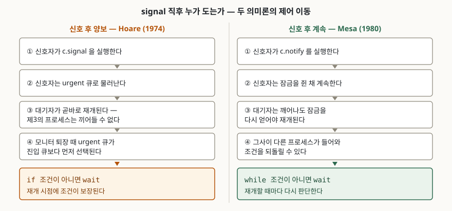

> **실행 검증 없음.** 이 글의 정의·규칙·코드 형태는 전부 원 논문 두 편(CACM 17(10), 1974 /
> CACM 23(2), 1980)과 POSIX.1-2017·Java SE 21 명세에서 확인한 것이고, 실행 결과나
> 측정값은 싣지 않았다.

## 들어가며

조건 대기를 쓰는 코드에서 `if`로 쓴 대기와 `while`로 쓴 대기는 글자 두 자 차이로
보인다. 그런데 둘 중 어느 쪽이 맞는지는 취향이 아니라 **그 언어의 조건변수가 신호를
어떻게 처리하도록 정의되어 있는지**가 정한다. 시험에서는 뮤텍스·세마포어·모니터 문항의
뒷부분에 "조건변수의 signal 의미론을 설명하라"로 붙고, 실무에서는 `if`로 쓴 대기가 평소엔
멀쩡하다가 경합이 늘면 조건이 성립하지 않은 채 임계구역이 진행되는 형태로 드러난다.
두 의미론의 이름과 각각이 요구하는 코드 형태를 함께 외워야 답안이 된다.

## 정의

**모니터는 공유 데이터와 그 데이터를 다루는 프로시저를 한 모듈로 묶고, 그 프로시저들이
한 번에 하나씩만 수행되도록 상호배제를 언어 차원에서 보장하는 구조다. 조건변수는 그
모니터 안에서 상호배제를 반납한 채 특정 조건이 성립하기를 기다리는 대기 줄이다.**

Hoare의 원 논문은 조건변수에 쓰는 연산을 두 가지로 정의한다. **wait**는 모니터 프로시저
안에서 호출되어 호출한 프로그램을 지연시키고, **signal**은 같은 모니터의 프로시저 안에서
호출되어 기다리던 프로그램 중 **정확히 하나**를 즉시 재개시킨다. 논문은 이어서 대기하는
프로그램이 없을 때의 signal에 대해 "the signal has no effect"라고 못 박는다. 신호를
세어 두었다가 나중에 쓰는 세마포어의 V와 정반대이며, **조건변수에는 신호를 저장하는
기능이 없다.** 그리고 대기 중에 다른 프로그램이 자원을 반납할 수 있어야 하므로, wait는
멈추기 전에 상호배제를 반드시 반납한다.

## 등장 배경

세마포어는 P와 V가 프로그램 곳곳에 흩어져 짝을 빠뜨려도 코드를 읽어서는 드러나지
않는다. 논문은 모니터 지역 변수를 바깥에서 접근하지 못하게 묶어 두면 **시간 의존적
오류의 일부를 컴파일러가 훑어서 걸러낼 수 있다**고 적는다. 상호배제를 프로그래머가
거는 것이 아니라 구조가 거는 쪽으로 옮긴 것이다.

그러면 상호배제만으로 해결되지 않는 문제가 남는다. "버퍼가 빌 때까지 기다린다" 같은
조건 대기다. 모니터 잠금을 쥔 채로 기다리면 조건을 바꿔 줄 쪽이 모니터에 들어오지 못해
아무 일도 일어나지 않는다. 조건변수는 이 자리를 메우려고 들어온 장치이고, **잠금 반납과
대기를 한 덩어리로 수행한다**는 점이 핵심이다.

여기서 설계 선택이 하나 남는다. signal이 불린 직후에 **누가 모니터를 쓰는가**다. 이
한 줄의 선택이 아래의 모든 차이를 만든다.

## 구성요소 — 대기 줄 3가지, 의미론 3가지

### 대기 줄 — 3가지

원 논문의 구현 절(§2)은 모니터를 세마포어로 옮기면서 줄 세 개를 세운다.

| # | 이름 | 무엇을 기다리는가 | 언제 풀리는가 |
|---|---|---|---|
| 1 | 진입 큐 (`mutex`) | 모니터 상호배제 | 모니터가 비고 urgent도 비었을 때 |
| 2 | 조건변수 큐 (`condsem`) | 조건 성립 신호 | 그 조건변수에 signal이 걸릴 때 |
| 3 | urgent 큐 (`urgent`) | 신호를 보낸 뒤 모니터를 되돌려받는 것 | 깨운 쪽이 모니터를 떠날 때 |

세 번째가 이 글의 주인공이다. 논문은 신호를 보낸 프로세스가 **재개된 프로세스가
허락할 때까지 기다려야 한다**고 보고, 그 기다리는 자리로 세마포어 `urgent`를 둔다.
모니터 프로시저의 모든 출구는 이렇게 코딩된다.

```text
if urgentcount > 0 then V(urgent) else V(mutex)
```

**urgent 큐가 진입 큐보다 먼저 선택된다.** 모니터를 쓸 권리를 밖에 내놓지 않고 안에서
명시적으로 넘겨주는 구조이며, 아무도 그 권리를 원하지 않을 때에만 `mutex`가 풀린다.

### signal 이후의 의미론 — 3가지

| # | 이름 | 신호 직후 도는 쪽 | 신호자는 어디로 |
|---|---|---|---|
| 1 | 신호 후 양보 (signal and urgent wait) | 깨어난 대기자 | urgent 큐 |
| 2 | 신호 후 퇴장 (signal and exit) | 깨어난 대기자 | 프로시저를 그대로 떠난다 |
| 3 | 신호 후 계속 (signal and continue) | 신호자 | 모니터 안에 그대로 |

1번이 Hoare의 정의다. 논문은 signal 다음에 **곧바로** 대기 프로그램이 재개되며 그
사이에 제3의 프로그램이 모니터 프로시저를 호출할 수 없다고 규정한다. 이유도 함께
적는다. 그래야 기다리던 쪽이 **방금 반납된 자원을 제3자에게 가로채이지 않는다는 절대적
보장**을 얻는다.

2번은 같은 논문의 효율 개선 항목에서 나온다. signal이 프로시저 본문의 마지막 연산이면
모니터 퇴장과 합칠 수 있고, **모든 signal이 마지막 연산이면 `urgent`와 `urgentcount`를
통째로 없앨 수 있다.** 논문은 이 단순화가 커서 O-J. Dahl이 signal을 항상 마지막 연산으로
두자고 제안했으며 그 제약이 매우 자연스럽다고 적는다. Concurrent Pascal 계열이 택한
형태가 이쪽이다.

3번이 1980년 Mesa 보고서의 선택이다.

### Mesa가 바꾼 것 — 힌트와 재개 수단 3가지

Mesa 보고서는 Hoare의 정의가 **WAIT 뒤에 계속되는 프로세스마다 문맥 교환을 여러 번
더 요구하고, 신호 기구가 완벽하게 믿을 수 있어야 한다**는 점을 들어 반대쪽으로 간다.
Mesa에서 신호(`NOTIFY`)는 대기 중인 프로세스에게 주는 **힌트**이며, 깨어난 프로세스는
적당한 미래 시점에 재개하면서 모니터 잠금을 다시 얻는다. 그 사이 다른 프로세스가
모니터에 먼저 들어가지 않는다는 보장은 없다.

그래서 보고서는 **WAIT 뒤에 모니터 불변식 말고는 아무것도 가정할 수 없고, 대기자는
재개할 때마다 상황을 다시 판단해야 한다**고 적는다. 대기 코드의 올바른 형태가 여기서
갈린다.

```text
Hoare:  IF NOT <OK to proceed> THEN WAIT c.
Mesa:   WHILE NOT <OK to proceed> DO WAIT c ENDLOOP.
```

Hoare 논문의 유계 버퍼 예제도 `if count = N then nonfull.wait` 형태로 쓰여 있어, 두
의미론의 차이가 예제 코드에 그대로 드러난다. Mesa 쪽은 술어를 한 번 더 평가하는 대신
문맥 교환이 늘지 않고, **NOTIFY가 없어도 대기 프로세스를 돌려 보내는 것이 전혀 문제가
되지 않는다.**

신호를 힌트로 보기로 하면 깨우는 방법을 더 붙이기 쉬워진다. 보고서는 **3가지**를 든다.

1. **시간 제한(Timeout)** — 조건변수마다 대기 시간 t를 두고, t가 지나면 신호 여부와
   무관하게 재개한다. 처음 설계는 예외를 던졌으나 다시 기다리기만 하려는 이용자가 많아
   예외를 걷어냈다
2. **중단(Abort)** — 다른 프로세스가 `Abort`로 깨우면 대기 중이던 프로세스가 즉시
   재개하며 중단 예외를 받는다. 받은 쪽이 그것을 무시해도 된다
3. **전체 깨우기(Broadcast)** — 조건변수에 걸린 프로세스 **전부**를 재개시킨다.
   신호가 힌트일 뿐이므로 **broadcast는 언제나 옳다**

## 도식



> **출처**: urgent 큐와 신호 직후 즉시 재개 규칙은 [Hoare C.A.R., *Monitors: An Operating System Structuring Concept*, CACM 17(10), pp.549-557, §1 Introduction·§2 Interpretation (1974)](https://pages.cs.wisc.edu/~remzi/Classes/736/Spring2000/Papers/hoare-monitors.pdf), 신호를 힌트로 보는 쪽과 `WHILE` 재검사 규칙은 [Lampson B.W., Redell D.D., *Experience with Processes and Monitors in Mesa*, CACM 23(2), pp.105-117, §4 Condition variables (1980)](https://www.bennetyee.org/ucsd-pages/Courses/cse221.w01/lampson,redell.experiences_with_processes_and_monitors_in_mesa.pdf) 근거다.

## 비교 — 두 의미론

| 구분 | 신호 후 양보 (Hoare) | 신호 후 계속 (Mesa) |
|---|---|---|
| 신호 직후 도는 쪽 | 깨어난 대기자 | 신호자 |
| 신호자가 가는 곳 | urgent 큐 | 모니터 안에 그대로 |
| 제3자의 끼어들기 | 불가능 | 가능하다 |
| 깨어난 뒤 가정할 수 있는 것 | 모니터 불변식 + 신호자가 세운 더 강한 술어 | **모니터 불변식뿐** |
| 대기 코드 | `if` | `while` |
| 술어 평가 횟수 | 1회 | 재개할 때마다 |
| 문맥 교환 | 추가로 든다 | 추가분이 없다 |
| 신호 기구에 요구되는 것 | 완전한 신뢰성 | 힌트 수준이면 된다 |
| 공정성 | 재개 순서가 정해진다 | 보장이 없어 기아가 가능하다 |
| 재개 수단 | signal | notify·broadcast·시간 제한·중단 |

공정성 항목은 Mesa 보고서가 스스로 인정한 대가다. 다만 보고서는 **제대로 설계된
시스템이라면 모니터 잠금을 기다리는 프로세스가 애초에 거의 없어야 한다**는 이유로 이를
문제 삼지 않는다.

### 현행 명세는 어느 쪽인가 — 2가지 모두 Mesa 쪽

**POSIX.1-2017.** 조건 대기 함수의 설명 절은 "Spurious wakeups ... may occur"라고
적고, 그런 복귀 뒤에는 술어를 다시 평가하라고 요구한다. 근거 절은 조건 대기를
**`while` 루프에 해당하는 형태로 감싸라**고 권고한다. 가짜 깨어남을 허용하는 이유도
같은 절에 있다. 다중 프로세서에서는 **구현이 둘 이상의 스레드가 깨어나는 것을 피하기
불가능할 수 있다**는 것이다. 신호 함수의 규정도 이와 맞물린다. broadcast는 걸려 있는
스레드 **전부**를 풀지만, signal은 "적어도 하나"를 푼다고만 적혀 있어 **정확히 하나가
아니다.** 두 함수 모두 뮤텍스를 소유하지 않은 채 호출해도 되지만, **예측 가능한 스케줄링을
원하면 뮤텍스를 잠근 채 호출하라**고 명시한다.

**Java SE 21.** 언어 명세의 대기 집합 절(§17.2.1)은 구현이 가짜 깨우기를 수행하는 것을
"permitted, although not encouraged"라고 적는다. 그리고 바로 다음 문장에서 **이 조항
때문에 `wait`를 조건이 성립할 때까지만 도는 루프 안에서만 쓰는 관행이 필요하다**고
덧붙인다. 관행이 아니라 명세가 요구하는 형태라는 뜻이다.

## 적용 시 고려사항 — 5가지

1. **`while`은 의미론과 무관하게 안전한 쪽이다.** Mesa 계열 명세에서는 필수이고, Hoare
   의미론에서도 틀리지 않는다. 구현이 가짜 깨어남을 일으키지 않더라도 **신호와 잠금 재획득
   사이에 다른 스레드가 조건을 되돌릴 수 있으므로** 결과는 같다. `if`로 써도 되는 경우를
   찾는 것보다 `while`로 통일하는 편이 싸다.
2. **signal과 broadcast의 선택에는 기준이 있다.** 신호가 힌트이므로 broadcast는 언제나
   옳지만, 대기자가 여럿이고 **그중 아무나 응답해도 되는 것이 확실할 때**는 signal 쪽이
   낫다. 반대로 하나의 조건변수가 여러 이유를 덮는 **포괄 조건변수**를 쓰면 broadcast가
   아니면 틀린다. Mesa 보고서는 정확한 조건을 공유 자료구조에 적어 두는 대신 **값싼
   술어로 깨우고 판단은 깨어난 쪽에 맡기는** 이 방식을 권한다. 두 프로세스의 설계를
   떼어 놓을 수 있고, 깨우는 비용이 작아서 성립한다.
3. **중첩 모니터 호출과 중단 처리를 함께 본다.** 모니터 안에서 다른 모니터의 프로시저를
   부르고 거기서 대기하면 안쪽 잠금만 반납되고 바깥쪽 잠금은 쥔 채로 멈춘다. 계산을
   포기하는 절(§3.4)이 다루는 경우도 같은 계열이다. 예외로 entry 프로시저를 빠져나갈 때
   **불변식을 복원하고 잠금을 풀어야** 하는데, Mesa는 잠금 해제 코드만 자동으로 넣고
   불변식 복원 핸들러는 프로그래머가 쓰게 한다. **핸들러를 빠뜨리면 잠금이 걸린 채
   남아 교착이 된다.**
4. **모니터 잠금으로 고수준 스케줄링을 하지 않는다.** 자원 배분 순서를 정해야 하면 요구
   사항을 기록해 두고 조건변수로 깨우는 **별도의 스케줄러**를 만든다. 모니터가 보호하는
   자료는 그 설계에서 병목이 되지 않는다.
5. **모니터 잠금을 쥐지 않은 신호원은 경쟁을 만든다.** Mesa 보고서의 장치 통신 절(§4.2)은
   입출력 장치가 모니터 잠금 없이 조건변수를 깨우는 경우를 `naked NOTIFY`라 부르고, 이때
   **술어가 거짓임을 확인한 프로세스가 WAIT를 수행하기 직전에 장치가 자료를 바꾸고 신호를
   보내면 그 신호가 사라진다**고 적는다. 인터럽트 처리기처럼 잠금 밖에서 깨우는 구조를
   설계하면 이 경쟁을 따로 막아야 한다.

## 정리

**"양보는 `if`, 계속은 `while`"** — 이 한 줄이 두 의미론의 차이를 전부 담는다. 신호 직후
누가 도는가에 따라 깨어난 쪽이 가정할 수 있는 것이 달라지고, 가정할 수 있는 것이
대기 코드의 모양을 정한다.

- 모니터의 대기 줄은 **3가지**: 진입 큐, 조건변수 큐, urgent 큐. 퇴장 시 **urgent가
  진입 큐보다 먼저**다
- 조건변수의 성질은 **2가지**: 읽을 수 있는 값이 없다, 대기자 없는 signal은 사라진다
- signal 의미론은 **3가지**: 신호 후 양보(Hoare), 신호 후 퇴장(Dahl 제안), 신호 후
  계속(Mesa)
- 모든 signal을 프로시저의 마지막 연산으로 제한하면 **urgent 큐 자체가 필요 없어진다**
- Mesa가 더한 재개 수단은 **3가지**: 시간 제한, 중단, broadcast
- 현행 명세 **2가지**(POSIX.1-2017·Java SE 21)는 모두 Mesa 쪽이다. 가짜 깨어남을
  허용하고 `while` 루프를 요구한다
- POSIX의 signal은 **"적어도 하나"**를 푼다. 정확히 하나가 아니다

> 기출 답안: [기출문제 — 뮤텍스, 세마포어, 모니터](../../exam/2026-10-21-mutex-semaphore-monitor/index.md)

## 참고 자료

- [Hoare C.A.R., *Monitors: An Operating System Structuring Concept*, Communications of the ACM 17(10), pp.549-557 (1974)](https://pages.cs.wisc.edu/~remzi/Classes/736/Spring2000/Papers/hoare-monitors.pdf) — wait·signal의 정의, 대기자 없는 signal의 무효, 구현 절(§2)의 `urgent` 세마포어와 퇴장 코드, signal을 마지막 연산으로 두자는 Dahl의 제안, 유계 버퍼 예제, 우선순위 지정 대기(§5)의 1차 자료
- [Lampson B.W., Redell D.D., *Experience with Processes and Monitors in Mesa*, Communications of the ACM 23(2), pp.105-117 (1980)](https://www.bennetyee.org/ucsd-pages/Courses/cse221.w01/lampson,redell.experiences_with_processes_and_monitors_in_mesa.pdf) — 계산 포기와 UNWIND(§3.4), 신호를 힌트로 보는 규정과 `WHILE` 대기 형태, 재개 수단 3가지(§4.1), `naked NOTIFY` 경쟁(§4.2)의 1차 자료
- [The Open Group Base Specifications Issue 7, 2018 Edition (IEEE Std 1003.1-2017), *pthread_cond_timedwait, pthread_cond_wait*](https://pubs.opengroup.org/onlinepubs/9699919799/functions/pthread_cond_wait.html) — 가짜 깨어남 규정, 술어 재평가 요구, 호출 시 뮤텍스 소유 조건과 복귀 시 재획득, 근거 절의 `while` 루프 권고
- [The Open Group Base Specifications Issue 7, 2018 Edition (IEEE Std 1003.1-2017), *pthread_cond_broadcast, pthread_cond_signal*](https://pubs.opengroup.org/onlinepubs/9699919799/functions/pthread_cond_broadcast.html) — broadcast의 전체 해제와 signal의 "적어도 하나", 뮤텍스 소유와 예측 가능한 스케줄링, 다중 프로세서에서 가짜 깨어남이 생기는 이유
- [The Java Language Specification, Java SE 21 Edition, §17.2.1 Wait](https://docs.oracle.com/javase/specs/jls/se21/html/jls-17.html) — 가짜 깨우기 허용 조항과 그로부터 따라 나오는 루프 대기 관행
