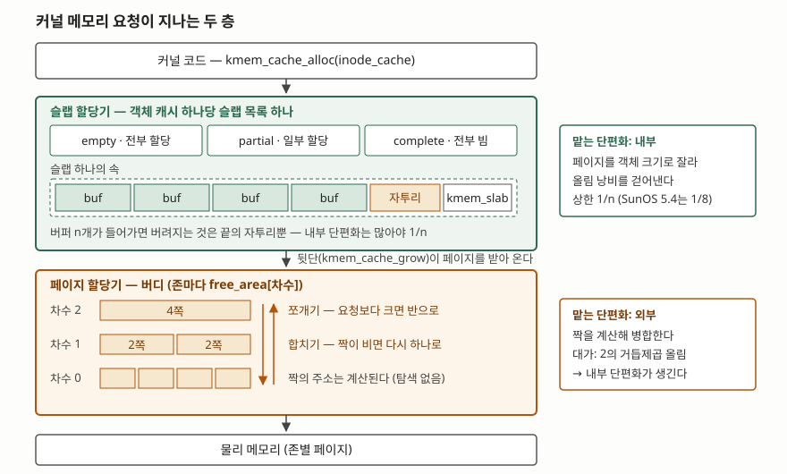

> **실행 검증 없음.** 이 글의 정의·절차·수치는 전부 Bonwick의 1994년 USENIX 논문 원문과
> Linux 커널 7.3.0 문서에서 확인한 것이고, 직접 실행해 얻은 측정값은 싣지 않았다.
> 인용한 측정값은 모두 그 논문이 SunOS 5.4·SPARCstation에서 측정해 발표한 값이다.

## 들어가며

커널 안에서 구조체 하나를 잡는 일은 응용 프로그램의 `malloc`과 사정이 다르다. 물리
페이지가 유일한 재고이고, 그 재고를 깎아 쓰는 주체가 수백 종류이며, 한 종류는 24바이트를
초당 수만 번 잡고 다른 종류는 2MB를 한 번 잡는다. 시험에서는 가상메모리 문항의 뒷부분에
"단편화 최소화 방안"으로 붙고, 그 자리에서 **버디 시스템**과 **슬랩 할당기**가 나란히
등장한다. 두 이름을 각각 설명하면 반쪽이다. 둘은 경쟁하는 대안이 아니라 **위아래로 쌓여
서로 다른 단편화를 맡는 두 층**이고, 그 분담을 설명해야 답안이 된다.

## 정의

**버디 시스템은 할당 단위를 2의 거듭제곱 크기로만 제한하고, 큰 블록을 반으로 쪼갤 때
생긴 같은 크기의 짝(버디)을 기억해 두었다가 양쪽이 모두 비면 다시 한 블록으로 합치는
할당 기법이다.**

**슬랩 할당기는 같은 종류의 객체만 담는 캐시를 두고, 한 장 이상의 가상 연속 페이지를 그
객체 크기로 똑같이 자른 슬랩 단위로 메모리를 주고받으며, 객체의 생성된 상태를 재사용
사이에 보존하는 할당기다.**

슬랩 쪽 정의의 뒷부분이 핵심이다. Bonwick의 논문 초록은 이 할당기가 **"객체의 상태를
사용과 사용 사이에 보존하여 복잡한 객체를 할당하는 비용을 줄이는"** 객체 캐싱 원시연산
위에 세워졌다고 적는다. 메모리를 어떻게 나누느냐가 아니라 **무엇을 다시 쓰느냐**가 설계의
출발점이라는 뜻이다.

Denning은 기억장치 관리 정책을 세 갈래로 나누면서 버디 시스템을 **배치(placement) 정책**
항목에 놓는다. 비어 있는 자리 중 어디에 둘 것인가를 정하는 규칙이라는 분류다. Bonwick은
같은 것을 할당기의 **아레나 관리 전략 3가지** — 순차 적합, 버디, 분리 저장 — 중 하나로
세고, 슬랩 할당기는 세 번째인 분리 저장에 속한다고 밝힌다.

## 등장 배경

### 버디가 풀려던 문제 — 병합 비용

가변 크기 블록을 그대로 쓰면 할당은 쉽고 **해제가 비싸다.** 방금 반납한 블록 앞뒤에
빈 블록이 있는지 알아야 합칠 수 있는데, 크기가 제각각이면 그것을 알아내려고 빈 블록
목록을 뒤져야 한다. Bonwick은 순차 적합 방식이 좋은 블록을 찾느라 **서로 멀리 떨어진
여러 노드를 훑어야 하므로 큰 캐시 발자국을 피할 수 없고**, 그 때문에 캐시 미스뿐 아니라
TLB 미스까지 유발한다고 적는다.

블록 크기를 2의 거듭제곱으로 묶으면 이 탐색이 사라진다. 차수 k인 블록의 짝은 **주소에서
계산되는 하나뿐**이기 때문이다. 병합 판정이 목록 순회에서 산술 연산으로 바뀐다. 대신
요청이 2의 거듭제곱이 아니면 위로 올림되어 **그 차이만큼이 블록 안쪽에서 버려진다.**
버디는 외부 단편화를 싸게 줄이는 대신 내부 단편화를 사들인 설계다.

### 슬랩이 풀려던 문제 — 초기화 비용과 캐시 낭비

Bonwick의 문제 제기는 단편화에서 출발하지 않는다. 논문 서론은 **많은 경우 객체를
초기화하고 파괴하는 비용이 그 객체의 메모리를 할당하고 반납하는 비용을 넘어선다**고
적는다. 뮤텍스가 박힌 구조체를 잡을 때마다 `mutex_init()`과 `mutex_destroy()`를 쌍으로
도는 것은, 논문의 표현대로 **아주 비싼 무연산**이다.

논문이 든 실측이 이 주장을 뒷받침한다. SPARCstation-2에서 스트림 헤드 하나를 할당하고
반납하는 비용이 **33μs에서 5.7μs로** 줄었는데, 내역을 보면 메모리 할당 자체는 9.4μs에서
3.8μs로 줄었을 뿐이고 **생성·파괴 23.6μs가 0으로 사라진 것이 절감의 대부분**이다.

두 번째 동기는 하드웨어 캐시다. 논문 4.1절은 모든 버퍼가 2ⁿ 바이트이고 2ⁿ 경계에 정렬되는
**2의 거듭제곱 할당기가 캐시 관점에서 최악**이라고 못 박는다. 약 300바이트인 inode가
512바이트 버퍼를 512바이트 정렬로 받고 앞쪽 48바이트만 자주 쓰인다면, inode 관련 메모리
트래픽은 전부 512로 나눈 나머지가 0~47인 주소에 몰린다. **캐시의 9%(48/512)만 inode에
쓸 수 있게 되는 셈이다.** 같은 절은 SPARCcenter 2000에서 LADDIS를 돌릴 때 기존
2의 거듭제곱 버디 할당기를 슬랩으로 교체하자 **버스 불균형이 43%에서 17%로 내려가고
1차 캐시 미스율이 13% 떨어졌다**고 보고한다.

## 구성요소와 절차

### 가. 버디 시스템의 할당·해제 절차 — 4단계

커널 7.3.0 문서는 존 구조체 설명에서 이 절차를 두 문장으로 요약한다. 요청을 받으면
**충분히 큰 블록 중 가장 작은 것**을 찾고, 그것이 필요보다 크면 요청한 크기에 닿을
때까지 **재귀적으로 쪼갠다.** 해제할 때는 **버디와 합쳐 더 큰 블록을 만들 수 있다.**
절차로 풀면 4단계다.

| 단계 | 하는 일 |
|---|---|
| ① 차수 결정 | 요청 페이지 수를 2의 거듭제곱으로 올림해 차수 k를 정한다 |
| ② 목록 조회 | `free_area[k]`에 블록이 있으면 떼어 준다 |
| ③ 쪼개기 | 없으면 k+1, k+2…로 올라가 가장 작은 충분한 블록을 찾고, 반으로 쪼개며 내려온다. 쪼개고 남은 짝은 그 차수의 목록으로 돌아간다 |
| ④ 합치기 | 해제 시 버디가 비어 있으면 둘을 합쳐 상위 차수로 올리고, 더 합칠 수 없을 때까지 되풀이한다 |

③과 ④가 서로의 역연산이다. 쪼갠 기록을 따로 남기지 않아도 되는 이유는 짝의 주소가
계산되기 때문이고, 이것이 버디가 **병합 알고리즘 없이 병합하는** 방법이다.

### 나. 리눅스 버디 할당기의 자료구조 — 3가지

| # | 이름 | 무엇인가 |
|---|---|---|
| 1 | `free_area` | 존(`struct zone`)마다 두는 배열. **차수마다 한 칸**이고 각 칸이 2의 거듭제곱 크기 블록들을 쥔다. `zone_init_free_lists()`가 초기화하고 `zone->lock`이 보호한다 |
| 2 | 이동성별 자유 목록 | 한 차수 안에서도 페이지를 이동 가능성으로 갈라 둔 목록. 열거형은 unmovable·movable·reclaimable 세 기본형에 highatomic이 붙고, 설정에 따라 CMA·isolate가 더 붙는다 |
| 3 | 페이지블록 | 이동성이 **붙는 단위.** 커널 문서는 x86-64에서 그 크기를 2MB로 예시하고, 블록마다 `NR_PAGEBLOCK_BITS`비트의 플래그를 둔다고 적는다 |

2번과 3번이 있는 이유는 외부 단편화가 **버디로 끝나지 않기 때문**이다. 커널 문서는
이동 가능성을 기준으로 페이지를 묶어 두면 **페이지블록 안에서 회수가 가능해진다**고
적는다. 움직일 수 없는 페이지 한 장이 2MB 블록 한가운데 박히면 그 블록은 더 큰 차수로
올라가지 못하므로, 애초에 그런 페이지끼리 모아 두는 것이다.

### 다. 슬랩 할당기의 구성요소 — 4가지

| # | 이름 | 하는 일 |
|---|---|---|
| 1 | 객체 캐시 | 한 종류의 객체만 담는 단위. 이름·크기·정렬·생성자·소멸자로 정의된다 |
| 2 | 슬랩 | 한 장 이상의 가상 연속 페이지를 **같은 크기 조각으로 자른 것** + 참조 계수 |
| 3 | bufctl | 조각 하나를 관리하는 구조체. 자유 목록 링크, 버퍼 주소, 슬랩 역포인터를 쥔다 |
| 4 | 앞단·뒷단 | 앞단은 객체를 캐시에서 꺼내고 넣는 공개 인터페이스, 뒷단은 VM에서 페이지를 받아 오고 돌려주는 쪽 |

논문 3.1절은 앞단과 뒷단을 **가능한 한 서로 떼어 놓도록 설계했다**고 적고, 뒷단의 모든
활동이 **오직 메모리 압박에 의해서만** 촉발된다고 못 박는다. 캐시가 객체를 더 원할 때
메모리가 흘러들어오고 나머지 시스템이 페이지를 원할 때 흘러 나가며, **임의의 상한선이나
워터마크가 없다.**

객체 크기가 페이지의 1/8보다 작으면 3번이 사라진다. 논문 3.2.2절은 이때 각 버퍼가
**자유 목록에 있는 동안 스스로의 bufctl 노릇을 한다**고 적는다. 나머지 정보는 전부 계산되므로
링크만 있으면 되고, 그러지 않으면 **버퍼만큼의 메모리를 bufctl에 쓰게 된다.** 그 링크를
버퍼의 앞이 아니라 **뒤**에 두는 이유도 같은 절에 있다. 자료구조는 앞쪽이 더 활발히
쓰이므로, 해제된 버퍼가 덮어써졌을 때 뒤쪽 링크가 멀쩡해야 진단이 쉽다는 경험적 관찰이다.

### 라. 객체 캐시 인터페이스 — 4가지 함수

논문 2.3절은 인터페이스를 두 관찰에서 끌어낸다. **객체의 서술(이름·크기·정렬·생성자·소멸자)은
클라이언트의 것**이고, **메모리 관리 정책은 중앙 할당기의 것**이라는 분담이다. 그래서
함수가 넷으로 떨어진다.

| # | 함수 | 하는 일 |
|---|---|---|
| 1 | `kmem_cache_create` | 이름·크기·정렬·생성자·소멸자를 주고 캐시를 만든다 |
| 2 | `kmem_cache_alloc` | 캐시에서 객체를 꺼낸다. **이미 생성된 상태로** 나온다 |
| 3 | `kmem_cache_free` | 객체를 캐시로 돌려준다. **생성된 상태를 유지한 채** 돌려줘야 한다 |
| 4 | `kmem_cache_destroy` | 캐시를 없애고 자원을 회수한다 |

2번과 3번의 단서가 이 설계의 전부다. 생성자는 캐시를 채울 때만, 소멸자는 캐시를 비울
때만 불린다. 논문 2.4절은 이것의 부수 효과로 **드물게 수행되는 생성·파괴 코드가 빈번한
경로에서 빠져나가 명령어 캐시 발자국이 줄어든다**는 점을 덧붙인다.

### 마. 슬랩 목록의 정렬 순서 — 3구간

논문 3.3절은 캐시마다 슬랩들을 원형 이중 연결 목록으로 두고 부분 정렬한다고 적는다.
**논문의 용어가 직관과 반대이므로 주의한다.**

| 구간 | 논문 용어 | 상태 |
|---|---|---|
| 앞 | empty | 버퍼가 **전부 할당된** 슬랩 |
| 가운데 | partial | 일부만 할당된 슬랩 |
| 뒤 | complete | 버퍼가 **전부 비어 있는** 슬랩 (refcnt == 0) |

캐시의 자유 목록 포인터는 첫 번째 비어-있지-않은 슬랩을 가리키고, 각 슬랩은 다시 자기
버퍼의 자유 목록을 쥔다. 이 **두 단계 자유 목록**이 회수를 간단하게 만든다. 슬랩을
회수할 때 버퍼를 하나씩 끊을 필요 없이 **슬랩만 끊으면 되기 때문**이다.

3.4절의 회수 규칙도 여기서 나온다. 참조 계수가 0이 되어도 **즉시 반납하지 않고** 목록
끝으로 보낸다. 모든 부분 슬랩이 소진되기 전에는 완전히 빈 슬랩을 쪼개지 않겠다는 뜻이다.
시스템이 메모리를 요구하면 최대한 내놓되 **최근 15초치 작업 집합을 남겨** 스래싱을
막는다. 논문은 이 간격에 시스템 성능이 **별로 민감하지 않다**고 덧붙인다. 양극단인
"즉시 전부 회수"와 "전혀 회수하지 않음"이 둘 다 최적은 아니어도 합리적인 정책이기
때문이라는 설명이다.

## 도식

> **출처**: 슬랩·객체 캐시·bufctl 구조와 앞단/뒷단 분리는 [Bonwick J., *The Slab Allocator: An Object-Caching Kernel Memory Allocator*, USENIX Summer 1994 Technical Conference — §3.1 Caches, §3.2 Slabs, §3.3 Freelist Management (1994)](https://www.usenix.org/legacy/publications/library/proceedings/bos94/bonwick.html), `free_area`의 차수별 구성과 쪼개기·합치기 규칙은 [Linux kernel 7.3.0, *Physical Memory* — struct zone (`free_area`, `lock`, `managed_pages`)](https://docs.kernel.org/mm/physical_memory.html) 근거다. 그림의 차수 숫자와 버퍼 칸 수는 설명용 예시다.

## 비교

### 버디 시스템과 슬랩 할당기

| 구분 | 버디 시스템 | 슬랩 할당기 |
|---|---|---|
| 다루는 단위 | 물리 페이지 블록 | 커널 객체(버퍼) |
| 블록 크기 | 2의 거듭제곱으로 제한 | 캐시마다 **정확히 객체 크기** |
| 주로 줄이는 단편화 | 외부 | 내부 |
| 치르는 대가 | 2의 거듭제곱 올림에 따른 내부 단편화 | 슬랩 끝에 남는 자투리, 캐시별 여유 버퍼 |
| 빈 공간 되돌리기 | 버디 병합(재귀) | 참조 계수가 0인 슬랩을 통째로 반납 |
| 할당 비용 | 차수를 오르내리는 쪼개기·합치기 | 상수 시간. 자유 목록에서 하나 떼고 계수 증가 |
| 객체 상태 | 관심 없음 | **생성된 상태를 보존한다** |
| 분류 | 배치 정책 / 버디 방식 | 분리 저장 방식 |
| 위치 | 아래층(페이지 공급자) | 위층(페이지를 받아 쓰는 쪽) |

마지막 줄이 둘의 관계다. 슬랩은 버디를 대체하지 않는다. 뒷단이 페이지를 받아 오는 곳이
곧 버디이고, 슬랩은 그 페이지를 **같은 크기로 잘라 쓰는 방법**을 정할 뿐이다.

### 단편화 유형별로 누가 맡는가

| 단편화 유형 | 어디서 생기는가 | 누가 줄이는가 | 어떻게 |
|---|---|---|---|
| 외부 | 페이지 블록 수준 | 버디 | 짝을 계산해 병합한다 |
| 외부 (이동 불가 페이지로 인한) | 페이지블록 수준 | 이동성별 목록 | 성질이 같은 페이지를 한 블록에 모은다 |
| 내부 (2의 거듭제곱 올림) | 버디 블록 안쪽 | 슬랩 | 페이지를 객체 크기로 잘라 쓴다 |
| 내부 (슬랩 자투리) | 슬랩 끝 | 슬랩 크기 선택 | 버퍼 수 n을 늘려 1/n을 낮춘다 |

### 슬랩이 내부 단편화를 누르는 정도

논문 3.2절은 수치로 못 박는다. 4096바이트 페이지에 400바이트 객체 캐시를 올리면 슬랩마다
버퍼 **10개**가 들어가고 **96바이트가 남는다.** 버퍼당 9.6바이트가 버려지는 셈이므로
내부 단편화는 **2.4%**다. 일반화하면 슬랩이 버퍼 n개를 담을 때 **내부 단편화는 많아야
1/n**이고, 따라서 슬랩 크기를 정하는 것이 곧 내부 단편화의 상한을 정하는 일이 된다.

여기에 반대 방향 힘이 걸린다. 슬랩이 커질수록 **버퍼가 전부 비기를 기다려야 반납되므로
회수 가능성이 낮아지고, 그만큼 외부 단편화가 늘어난다.** SunOS 5.4 구현이 내부 단편화를
**12.5%(1/8)로 제한한 것은 이 둘의 절충점을 실측으로 찾은 결과**라고 논문은 적는다.

논문 5.2절의 비교 측정에서 전체 단편화는 부팅·부하 급증·find·kenbus를 차례로 돌린 뒤
슬랩 14%, SunOS 4.1.3 27%, 4.4BSD 45%, SVr4(2의 거듭제곱 버디) 46%로 나왔다. 속도는
SPARCstation-2에서 `kmem_cache_alloc` 3.8μs, 4.4BSD 4.1μs, 슬랩의 `kmem_alloc` 4.7μs,
SVr4 9.4μs, SunOS 4.1.3 25.0μs 순이었다. **같은 SunOS 5.4 기반 시스템에 네 할당기를
이식해 비교한 값**이라고 논문은 밝힌다.

## 적용 시 고려사항

1. **크기로 할당 수단을 고른다.** 커널 7.3.0의 메모리 할당 안내는 `kmalloc`으로 잡을 수
   있는 덩어리의 **최대 크기에 제한이 있고 그 실제 한계는 하드웨어와 커널 설정에 달렸다**고
   적는다. 그래서 안내는 **페이지보다 작은 객체는 `kmalloc`**, 큰 것은 `vmalloc`이나
   페이지 할당기 직접 호출을 권하고, 너무 큰지 아닌지 확신이 없으면 `kmalloc`을 먼저
   시도하고 실패 시 `vmalloc`으로 물러나는 `kvmalloc`을 쓰라고 한다. 다만 같은 문서는
   **`kvmalloc`이 물리적으로 연속되지 않은 메모리를 돌려줄 수 있다**고 경고하므로, DMA처럼
   물리 연속이 필요한 쪽에서는 쓸 수 없다.
2. **큰 차수 할당은 실패할 수 있는 요청으로 다룬다.** 버디는 차수가 올라갈수록 조건이
   까다로워진다. 커널 문서는 외부 단편화가 **일부 작업부하에서 문제가 되며 `buddyinfo`가
   유용한 도구**라고 적고, 이 파일이 **얼마나 큰 영역을 안전하게 할당할 수 있는지, 또는
   앞선 할당이 왜 실패했는지**를 알려 준다고 설명한다. `pagetypeinfo`는 같은 수를 이동성별로
   쪼개 보여 준다. 고차수 할당을 전제로 설계하면 **메모리가 남아 있는데도 실패하는** 상황을
   만든다.
3. **객체 캐시의 계약을 지킨다.** `kmem_cache_free`에 돌려주는 객체는 **생성된 상태를
   유지하고 있어야 한다.** 쓰는 동안 뮤텍스를 파괴했거나 참조 계수를 0이 아닌 값으로 두고
   돌려주면, 그 객체는 다음 할당자에게 **그 상태 그대로** 건네진다. 생성자가 다시 불리지
   않는 것이 이 구조의 이득이자 함정이다.
4. **전용 캐시를 만들 것인가를 수명으로 판단한다.** 논문은 슬랩이 외부 단편화를 줄이는 두
   번째 이유로 **한 슬랩의 객체가 전부 같은 종류여서 수명 분포가 같다**는 점을 든다.
   수명이 짧은 것과 긴 것이 슬랩 단위로 갈리면, **오래 사는 할당 하나 때문에 페이지 한
   장이 통째로 붙잡히는 일**이 줄어든다. 반대로 범용 캐시에 아무 객체나 섞으면 이 효과가
   사라진다. 논문도 범용 캐시를 **눈에 띄는 예외**로 따로 적어 둔다.
5. **2의 거듭제곱 정렬을 성능 이득으로 오해하지 않는다.** 4.1절의 결론은 그 반대다.
   중간 크기 구조체를 2의 거듭제곱 경계에 정렬하면 자주 쓰는 앞부분이 **전부 같은 캐시
   라인 집합에 몰린다.** 슬랩 컬러링은 이것을 슬랩마다 시작 오프셋을 어긋나게 주어 푼다.
   논문의 예로 4096바이트 슬랩에 200바이트 객체 20개를 담으면 버퍼가 4000바이트,
   `kmem_slab` 자료가 32바이트를 쓰고 **남는 64바이트가 색의 몫**이 되어 색 순열은
   0, 8, 16, …, 64, 0, 8…로 돈다. 논문은 **맞춤이 가장 나쁜 중간 크기 2의 거듭제곱
   버퍼가 오히려 가장 많은 색을 받는다**는 점을 이 방식의 좋은 성질로 든다.
6. **할당기를 직접 만들기 전에 중앙 할당기를 본다.** 논문 2.2절은 서브시스템이 사설 캐시를
   따로 두는 방식의 단점을 **3가지**로 정리한다. ① 메모리를 쥐려는 캐시와 돌려받으려는
   시스템 사이의 긴장을 사설 캐시는 분별 있게 다루지 못한다. ② 중앙 할당기를 우회하므로
   **회계·디버깅 기능도 함께 우회**해 감시와 진단이 어려워진다. ③ 같은 해법이 여러 벌
   존재해 커널 코드 크기와 유지보수 비용이 늘어난다.

## 정리

**"버디는 밖을, 슬랩은 안을"** — 이 한 줄이 두 할당기의 분담이다. 버디는 짝을 계산해
합침으로써 외부 단편화를 싸게 줄이고 그 대가로 반올림 낭비를 떠안으며, 슬랩은 그 위에서
페이지를 객체 크기로 잘라 그 반올림 낭비를 걷어낸다.

- 버디의 절차는 **4단계**: 차수 결정 → 목록 조회 → 쪼개기 → 합치기. ③과 ④는 서로의
  역연산이고, 짝의 주소가 **계산되기 때문에** 병합 알고리즘이 필요 없다
- 리눅스 버디의 자료구조는 **3가지**: 차수별 `free_area`, 이동성별 자유 목록, 페이지블록
  (x86-64에서 2MB). 뒤의 둘은 **버디로 안 잡히는 외부 단편화**를 겨눈다
- 슬랩의 구성요소는 **4가지**: 객체 캐시, 슬랩, bufctl, 앞단·뒷단. 페이지의 1/8보다 작은
  객체는 **버퍼가 스스로 bufctl**이 되어 세 번째가 사라진다
- 객체 캐시 인터페이스는 **4가지 함수**: create·alloc·free·destroy. alloc은 **생성된
  상태로** 주고, free는 **생성된 상태로** 받는다
- 슬랩 목록은 **3구간**: empty(전부 할당) → partial → complete(전부 빔). 논문 용어가
  직관과 반대다
- 내부 단편화 상한은 **1/n**(n = 슬랩당 버퍼 수). SunOS 5.4는 외부 단편화와의 절충으로
  **12.5%(1/8)**로 제한했다
- 2의 거듭제곱 정렬은 캐시에 **최악**이다. 슬랩 컬러링이 슬랩마다 시작 오프셋을 어긋나게
  주어 이를 푼다

> 기출 답안: [기출문제 — 가상메모리 관리기법과 단편화](../../exam/2026-10-22-virtual-memory-management-fragmentation/index.md)

## 참고 자료

- [Bonwick J., *The Slab Allocator: An Object-Caching Kernel Memory Allocator*, USENIX Summer 1994 Technical Conference, Boston (1994)](https://www.usenix.org/legacy/publications/library/proceedings/bos94/bonwick.html) — 객체 캐싱의 정의와 스트림 헤드 실측(§1·§2), 사설 캐시의 단점 3가지(§2.2), 인터페이스 4함수(§2.3), 앞단·뒷단 분리(§3.1), 슬랩 구조와 1/n·12.5% 규칙(§3.2), 작은 객체의 bufctl 생략과 링크 위치(§3.2.2), 두 단계 자유 목록(§3.3), 15초 작업 집합(§3.4), 2의 거듭제곱 정렬의 캐시·버스 영향과 컬러링(§4.1~4.3), 아레나 관리 3분류(§4.4), 속도·단편화 비교(§5.1·§5.2)의 1차 자료
- [Linux kernel 7.3.0 documentation, *Physical Memory*](https://docs.kernel.org/mm/physical_memory.html) — `struct zone`의 `free_area`와 `zone_init_free_lists()`, 가장 작은 충분한 블록을 재귀적으로 쪼개는 규칙과 해제 시 버디 병합, `zone->lock`의 보호 범위, 페이지블록 플래그, 존 폴백 순서
- [Linux kernel 7.3.0 documentation, *The /proc Filesystem* — `/proc/buddyinfo`, `/proc/pagetypeinfo`](https://docs.kernel.org/filesystems/proc.html) — 차수별 가용 블록 수의 의미, 외부 단편화 진단 용도, 이동성별 분해와 x86-64의 2MB 페이지블록 예시
- [Linux kernel 7.3.0 documentation, *Memory Allocation Guide*](https://docs.kernel.org/core-api/memory-allocation.html) — `kmalloc` 최대 크기가 하드웨어·설정에 달렸다는 규정, `vmalloc`·`kvmalloc`의 물리 비연속성 경고, GFP 플래그 선택 기준
- [Denning P.J., *Virtual Memory*, ACM Computing Surveys 2(3), pp.153-189 (1970)](https://dl.acm.org/doi/10.1145/356571.356573) — 기억장치 관리 정책 분류에서 버디 시스템을 배치 정책으로 두는 근거
- [Knowlton K.C., *A Fast Storage Allocator*, Communications of the ACM 8(10), pp.623-624 (1965)](https://dl.acm.org/doi/10.1145/365628.365655) — 버디 시스템을 기술한 초기 논문. 이 글은 서지 정보로만 인용했고, 본문의 버디 설명은 커널 문서와 Bonwick 논문에서 확인한 내용이다
