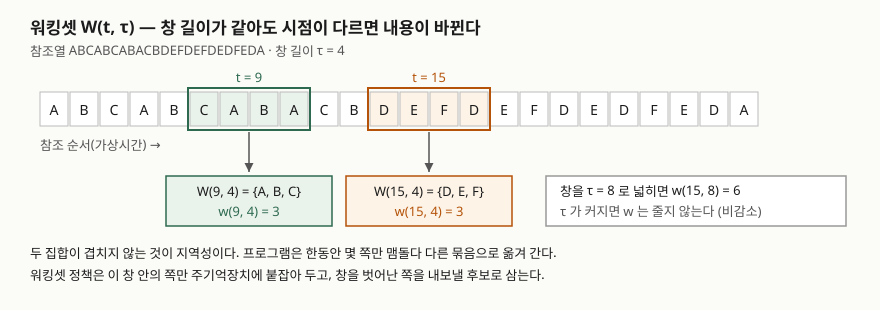
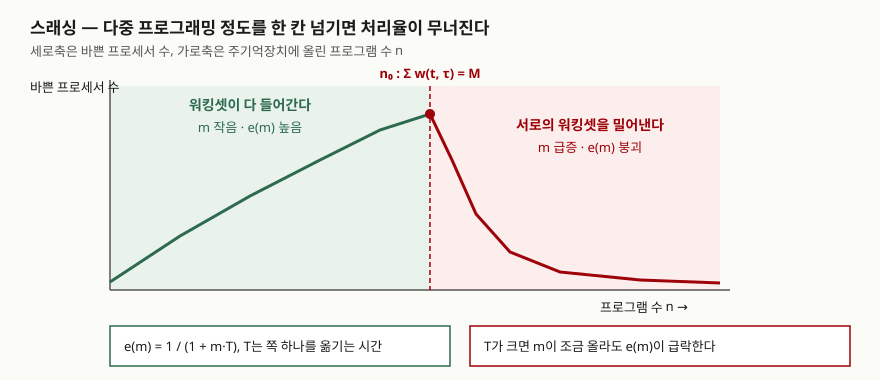

## 들어가며

운영체제 과목에서 교체 알고리즘을 묻는 문제는 대개 FIFO·LRU·OPT를 참조열에 적용해
부재 횟수를 세게 한다. 그런데 실제 시스템이 무너지는 자리는 교체 알고리즘 자체가 아니라
**몇 개의 프로그램을 동시에 올릴 것인가**다. 프로그램을 하나 더 올렸을 뿐인데 처리율이
절반이 아니라 1/50로 떨어지는 현상이 있고, 그 이름이 스래싱이다. 워킹셋 모델은 이
붕괴가 왜 완만하지 않고 절벽처럼 일어나는지를 설명하고, 동시에 막는 방법까지 같이
내놓은 모형이라 시험에서 정의·구성요소·방지책이 한 묶음으로 나온다.

## 정의

**워킹셋 W(t, τ)는 어떤 프로세스가 시각 t 직전의 가상시간 구간 (t − τ, t) 동안
참조한 쪽(page)의 집합이다.** Denning의 1968년 원 논문이 이 문장으로 정의하고,
τ를 **워킹셋 파라미터**, 집합의 원소 수 w(t, τ)를 **워킹셋 크기**라고 부른다.
같은 논문이 워킹셋의 뜻을 한 줄로 더 풀어 둔다 — 프로세스가 불필요한 페이지 부재 없이
동작하는 데 주기억장치에 올라와 있어야 할 **최소한의 쪽 묶음**이다.

**스래싱은 과도한 페이징으로 생기는 극심한 성능 저하 또는 붕괴다.** Denning의 같은 해
다른 논문이 그렇게 정의하고, 한 문장을 덧붙인다. 스래싱은 기억 공간의 부족을
**프로세서 시간의 남아돎으로 바꾼다.** 메모리가 모자라면 프로세서가 노는 것이지
프로세서가 바빠지는 것이 아니다. 답안에서 이 한 줄이 이해도를 가른다.

## 등장 배경

워킹셋 이전의 교체 알고리즘은 **전역**으로 동작했다. 빈 프레임이 필요하면 주기억장치
전체에서 FIFO나 LRU 기준으로 한 쪽을 골라 내보낸다. 이 방식은 프로그램 하나의
메모리 요구가 **다른 프로그램의 보유량을 깎는다**는 성질을 갖는다. 원 논문은 이
상호간섭을 구체적으로 짚는다. LRU에서는 큰 프로그램일수록 참조 간격이 길어 가장 오래
안 쓴 쪽을 많이 갖게 되므로 먼저 빼앗기고, FIFO에서는 큰 프로그램이 오래 실행되므로
자기 쪽이 큐의 앞으로 돌아올 때까지 살아 있을 확률이 높아 역시 먼저 빼앗긴다.

여기에 **보조기억장치 접근 시간 T가 크다**는 사실이 겹친다. 원 논문이 든 1968년
기준 수치로 드럼·디스크의 왕복 시간은 가상시간 단위로 10⁴~10⁶이었다. 주기억장치 한
번 접근이 1인 척도에서 1만 배다. 그래서 부재 확률 m이 조금만 올라도 효율이 급락한다.
워킹셋 모델은 이 두 가지를 동시에 끊는다. **교체를 프로그램별로 적용**해 간섭을 없애고,
**워킹셋이 다 들어갈 때만 실행**시켜 m이 오를 여지를 없앤다.

## 구성요소

### 워킹셋의 성질 4가지

원 논문은 워킹셋이 갖는 일반적 성질을 **4가지**로 든다.

| 성질 | 내용 |
|---|---|
| **P1 크기(Size)** | w(t, 0) = 0이고, w(t, τ) ≤ τ이며, τ에 대해 비감소한다. 위로 볼록하다 |
| **P2 예측(Prediction)** | 작은 시간차 α에 대해 W(t, τ)는 W(t + α, τ)의 좋은 예측값이다 |
| **P3 재진입률(Reentry Rate)** | τ를 줄이면 워킹셋에서 빠진 쪽이 다시 불려 들어오는 비율이 올라간다 |
| **P4 τ 민감도(τ-Sensitivity)** | 재진입률이 τ 변화에 얼마나 민감한지를 나타내는 값. 항상 0 이상이다 |

P2가 이 모형의 전제다. **최근에 쓴 것이 곧 앞으로 쓸 것**이라는 가정이 깨지면
워킹셋은 아무것도 예측하지 못한다. 그 가정의 근거가 **지역성**이다. 원 논문은 지역성을
"참조가 프로그램 전체에 고르게 흩어지지 않는 성질"로 정의한다.

### 워킹셋 정책을 가르는 2가지

같은 논문이 FIFO·LRU와 워킹셋(WS)을 비교하며 WS만 갖는 성질을 **2가지**로 정리한다.

1. **기억장치 관리와 프로세스 스케줄링이 묶인다.** 프로세스는 자기 워킹셋이 주기억장치에
   완전히 들어 있을 때만 활성 상태가 된다. 들어가지 않으면 실행시키지 않는다
2. **정책이 프로그램 단위로 적용된다.** FIFO·LRU는 메모리 전체에 전역으로 걸리지만
   WS는 프로그램마다 따로 걸려, 한 프로그램의 요구가 다른 프로그램의 보유량을 건드리지 않는다

그리고 이 둘을 지키는 조건이 **워킹셋 합 조건**이다. 활성 프로세스들의 워킹셋 크기
합이 주기억장치 크기 M을 넘지 않아야 한다(Σ wᵢ(t, τᵢ) ≤ M). 넘는 순간이 스래싱의
시작점이고, 그 직전의 프로그램 수를 n₀라고 부른다.

## 도식



> **출처**: [Denning, The Working Set Model for Program Behavior, CACM 11(5), 1968 — §3 The Working Set Model, Fig. 2 (Definition of W(t, τ))](https://cs.uwaterloo.ca/~brecht/courses/epfl/Possible-Readings/vm-and-gc/working-set-model-denning-sosp-1967.pdf)

창 길이 τ는 그대로인데 t가 옮겨가면 집합의 내용이 통째로 바뀐다. 앞쪽에서는 A·B·C를
맴돌고 뒤쪽에서는 D·E·F를 맴도는 것이 지역성이고, 워킹셋은 그 묶음을 자동으로 따라간다.



> **출처**: [Denning, Thrashing: Its Causes and Prevention, AFIPS FJCC 1968 — Missing-page probability(Fig. 3), Efficiency(Fig. 4)](https://cs.uwaterloo.ca/~brecht/courses/epfl/Possible-Readings/vm-and-gc/thrashing-denning-afips-1968.pdf)

## 계산으로 확인

원 논문의 식을 그대로 계산해 두 가지를 확인했다. 전체 코드는
[`code/working_set_demo.py`](code/working_set_demo.py), 실행 기록은
[`code/output.txt`](code/output.txt)에 있다.

첫째, **크기 성질 P1이 참조열 전체에서 성립한다.** 참조열
`ABCABCABACBDEFDEFDEDFEDA`에 대해 τ를 0부터 12까지 바꿔 가며 모든 t에서 검사했다.

```text
[2] 크기 성질 P1 검사 — 원 논문이 든 세 가지
    w(t, 0) = 0                : True
    w(t, tau) <= tau           : True
    tau 에 대해 비감소          : True
```

둘째, **효율 e(m) = 1 / (1 + m·T)가 T가 클 때 m에 극도로 민감하다.**

```text
[3] 효율 e(m) = 1 / (1 + m*T) — T 는 가상시간 단위(vtu)
     m         T=1         T=10        T=100       T=1000      T=10000
    0.0001    0.9999      0.9990      0.9901      0.9091      0.5000
    0.0010    0.9990      0.9901      0.9091      0.5000      0.0909
    0.0100    0.9901      0.9091      0.5000      0.0909      0.0099
    0.1000    0.9091      0.5000      0.0909      0.0099      0.0010
```

T = 10,000일 때 m이 0.0001에서 0.001로 열 배 오르면 효율은 0.5에서 0.09로 떨어진다.
T = 1이면 같은 변화에도 효율이 0.9999에서 0.9990으로 거의 그대로다. **붕괴의 원인은
알고리즘이 아니라 T와 m의 곱**이라는 것이 여기서 보인다.

셋째, 원 논문의 사고실험을 그대로 돌렸다. 메모리가 꽉 찬 상태에 같은 크기의 프로그램을
하나 더 넣으면 부재 확률이 1/(n+1)만큼 오른다고 보고, 바쁜 프로세서 수를 다시 센다.

```text
[4] 프로그램 하나를 더 넣었을 때 — 바쁜 프로세서 수의 변화
    T = 10000 vtu, m0 = 0.001

      n   늘어난 결함확률 d   바쁜 프로세서 n개일 때   n+1개일 때   비율
      4   0.2000            0.364                    0.002        0.0068
     10   0.0909            0.909                    0.012        0.0132
     20   0.0476            1.818                    0.043        0.0237
     50   0.0196            4.545                    0.246        0.0542
```

n = 10에서 프로그램 하나를 더 넣자 처리율이 **1.3%로 떨어진다.** 열한 번째 프로그램이
10%의 부하를 더한 것이 아니라 전체를 멈춰 세운 것이다. 완만한 저하를 예상하는 직관이
빗나가는 자리가 여기다.

## 비교

| | 교체 범위 | 할당량을 정하는 기준 | 스래싱 내성 | 구현 비용 |
|---|---|---|---|---|
| **FIFO** | 전역 | 없음(전체 큐 순서) | 낮음. 큰 프로그램이 먼저 빼앗긴다 | 가장 낮음 |
| **LRU** | 전역 | 없음(최근 사용 순서) | 낮음. 참조 간격이 긴 쪽이 먼저 빠진다 | 중간 |
| **워킹셋(WS)** | 지역(프로그램별) | 창 길이 τ 안의 참조 집합 | 높음. 합 조건이 다중도를 막는다 | 높음. 참조 시각 추적 필요 |
| **PFF** | 지역(프로그램별) | 부재 사이 간격과 임계값 T의 비교 | 중간 | 중간. 부재 시점에만 판단 |

**PFF**(Page Fault Frequency)는 1972년 Chu와 Opderbeck이 낸 방식으로, 부재와 부재
사이의 간격을 재서 메모리를 늘리고 줄인다. 간격이 임계값 T보다 **길면** 여유가 있다고
보고 그 구간에 참조되지 않은 쪽을 전부 내보내며, **짧으면** 모자란다고 보고 프레임을
한 개 늘린다. 워킹셋이 **창 길이**라는 시간 기준으로 집합을 정하는 데 비해 PFF는
**부재가 난 시점에만** 판단하므로 추적 비용이 싸다. 대신 지역성이 바뀌는 중인지
워킹셋 자체가 커진 것인지를 구분하기 어렵다.

## 적용 시 고려사항

1. **τ를 작게 잡되 즐겨 쓰는 쪽은 다 담는 크기여야 한다.** τ가 크면 워킹셋이 커져
   동시에 올릴 수 있는 프로그램 수 n₀가 줄고, τ가 작으면 즐겨 쓰는 쪽이 창 밖으로
   밀려나 재진입률(P3)이 올라간다. 원 논문도 τ가 프로그램마다, 시점마다 달라질 수
   있다고 적는다. 고정값 하나로 전 시스템을 덮으려 하면 양쪽에서 손해를 본다
2. **메모리를 꽉 채워 운영하지 않는다.** 원 논문은 가용 메모리의 일부만 쓰도록
   목표를 잡고 나머지를 **예상 못 한 워킹셋 확장분**으로 남겨 두라고 적는다.
   Q(p) = M으로 맞추면 워킹셋이 조금만 커져도 그대로 스래싱으로 넘어간다
3. **현대 시스템에서는 지표를 먼저 본다.** Linux는 PSI(Pressure Stall Information)에서
   **모든 비유휴 태스크가 동시에 멈춰 있는 시간 비율**을 `full`로 내놓고, 이 상태가
   오래 이어지는 것을 스래싱으로 본다. `/proc/pressure/memory`의 avg10·avg60·avg300이
   그 값이다. 다중 세대 LRU는 `min_ttl_ms`로 워킹셋을 축출에서 보호하고, 그래도 안
   들어가면 OOM 킬러를 부른다 — 스래싱으로 끌고 가느니 하나를 죽이는 선택이다
4. **컨테이너에서는 합 조건을 사람이 깨뜨린다.** 메모리 한도를 실측 워킹셋보다 낮게
   잡고 복제본 수를 늘리면 Σwᵢ > M을 그대로 만드는 것이다. Windows가
   `SetProcessWorkingSetSizeEx`로 프로세스별 워킹셋 최소·최대를 두는 것도 같은
   문제를 다른 층에서 다루는 장치다

## 정리

**"창 하나, 조건 하나, 성질 넷"**으로 묶으면 답안에서 빠뜨리지 않는다.

- **창 하나** — W(t, τ)는 직전 τ 구간에 참조된 쪽의 집합이다. τ가 워킹셋 파라미터
- **조건 하나** — Σ wᵢ(t, τᵢ) ≤ M. 이걸 넘는 순간이 n₀이고 그 너머가 스래싱이다
- **성질 넷** — 크기(P1)·예측(P2)·재진입률(P3)·τ 민감도(P4)
- 워킹셋 정책이 다른 점은 **2가지**다. 스케줄링과 묶인다는 것, 프로그램별로 걸린다는 것
- 붕괴의 원인은 알고리즘이 아니라 **큰 T와 m의 곱**이다. 메모리 부족은
  프로세서의 남아돎으로 나타난다

> 기출 답안: [기출문제 — 가상메모리 관리기법과 단편화](../../exam/2026-10-22-virtual-memory-management-fragmentation/index.md)
>
> 같이 보면 좋은 글: [페이지 교체와 벨레이디의 이상현상](../2026-10-12-page-replacement-belady-anomaly/index.md)

## 참고 자료

- [Denning, The Working Set Model for Program Behavior, CACM 11(5), 1968, pp. 323–333](https://cs.uwaterloo.ca/~brecht/courses/epfl/Possible-Readings/vm-and-gc/working-set-model-denning-sosp-1967.pdf) — W(t, τ) 정의, 성질 P1~P4, 워킹셋 기반 메모리 관리
- [Denning, Thrashing: Its Causes and Prevention, AFIPS FJCC 1968, pp. 915–922](https://cs.uwaterloo.ca/~brecht/courses/epfl/Possible-Readings/vm-and-gc/thrashing-denning-afips-1968.pdf) — 스래싱 정의, 효율 e(m) = 1/(1+mT), FIFO·LRU·WS 비교, 합 조건
- Chu & Opderbeck, Program Behavior and the Page-Fault-Frequency Replacement Algorithm, IEEE Computer 9(11), 1976 — PFF 알고리즘의 출처. 전문은 유료라 확인하지 못했고, 아래 Sadeh 논문이 인용한 규칙만 썼다
- [Sadeh, An Analysis of the Performance of the Page Fault Frequency (PFF) Replacement Algorithm, SOSP 1975, pp. 6–13](https://static.aminer.org/pdf/20170130/pdfs/sosp/dkbcza1tmw6ido2yfhlqbpnlugqni483.pdf) — PFF의 임계값 규칙 서술
- [Linux kernel 문서 — PSI: Pressure Stall Information](https://docs.kernel.org/accounting/psi.html) — `full` 상태와 스래싱 판정, avg10·avg60·avg300
- [Linux kernel 문서 — Multi-Gen LRU](https://docs.kernel.org/admin-guide/mm/multigen_lru.html) — 워킹셋 추정, `min_ttl_ms`로 축출 보호
- [Microsoft Learn — Working Set (Win32)](https://learn.microsoft.com/en-us/windows/win32/memory/working-set) — 프로세스 워킹셋 정의, 최소·최대 크기, 트리밍
