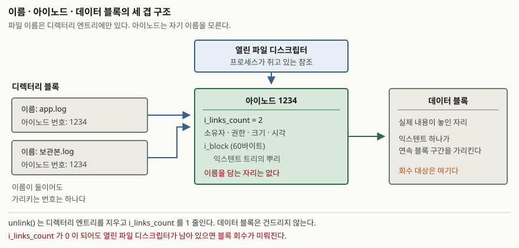
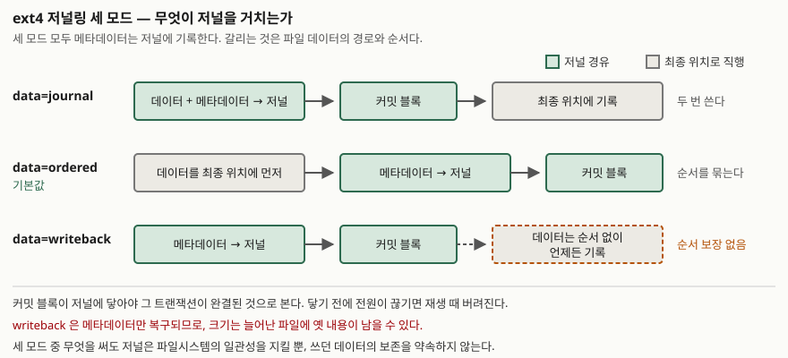

> **실행 검증 없음.** 이 글은 POSIX 명세와 커널 문서의 서술만 정리한 것이다.
> 측정값이나 명령 출력은 싣지 않는다.

## 들어가며

운영 중인 서버의 디스크가 찼다는 알람이 온다. 가장 큰 로그 파일을 찾아 지우고 `df`를
다시 찍는데 사용량이 그대로다. 파일은 목록에서 사라졌는데 용량이 돌아오지 않는다.
재부팅하면 돌아온다는 말을 듣고 결국 서비스를 내린다.

이 현상은 장애가 아니라 파일 시스템의 설계가 그대로 드러난 것이다. "파일을 지운다"는
말이 실제로는 두 단계로 나뉘고, 그 둘이 같은 순간에 일어나지 않기 때문에 생긴다.
어느 단계가 무엇을 지우는지를 알면 재부팅 없이 처리할 수 있고, 시험에서는 이 구조를
링크 카운트와 참조 개수로 설명할 수 있어야 한다.

## 정의

**아이노드(inode)** 는 파일 하나의 메타데이터와 데이터 블록 위치를 담는 자료 구조이며,
**파일 이름을 담지 않는다.** 이름은 디렉터리 엔트리가 가지고 있고, 엔트리는 이름과
아이노드 번호의 짝이다.

**저널링(journaling)** 은 파일 시스템 변경을 최종 위치에 쓰기 전에 별도의 로그 영역에
먼저 기록해, 중단된 변경을 재시작 때 일관된 상태로 되돌리는 기법이다.

POSIX는 아이노드라는 말 대신 **파일 일련번호(file serial number)** 라는 표현을 쓴다.
`st_ino`와 `st_dev`를 함께 보면 시스템 안에서 파일이 하나로 식별된다고 적는다.

## 등장 배경

이름과 메타데이터를 분리하지 않으면 한 파일을 두 이름으로 가리킬 수 없고, 이름을 바꿀
때마다 데이터 위치 정보를 함께 옮겨야 한다. 아이노드를 따로 두면 디렉터리 엔트리는
번호만 들고 있으면 되므로, 이름 추가·삭제가 메타데이터 한 벌을 건드리지 않는다.

저널링은 다른 문제에서 나왔다. 파일 하나를 늘리는 일은 **블록 비트맵 갱신, 아이노드의
크기·시각 갱신, 데이터 블록 기록**의 세 가지 쓰기로 나뉘는데, 그 사이에 전원이 끊기면
"할당됐다고 표시됐지만 어느 파일도 쓰지 않는 블록" 같은 어긋남이 남는다. 저널 이전에는
부팅할 때 파일 시스템 전체를 훑어 이런 어긋남을 찾아야 했고, 용량에 비례해 시간이 늘었다.

## 구성요소

### 파일 접근 경로의 세 겹

> **출처**: [The Open Group Base Specifications Issue 7 — `<sys/stat.h>`](https://pubs.opengroup.org/onlinepubs/9699919799/basedefs/sys_stat.h.html) (IEEE Std 1003.1-2017) 의 `st_ino` · `st_nlink` 정의와, [ext4 Data Structures — 4.1 Index Nodes](https://docs.kernel.org/filesystems/ext4/inodes.html) 의 `i_links_count` · `i_block` 필드 표.

ext4 아이노드가 담는 것 중 시험에서 묻는 것은 **네 가지**다.

| 필드 | 무엇 | 비고 |
|---|---|---|
| `i_links_count` | 하드 링크 개수 | 0이 되면 회수 대상이 된다 |
| 소유자 · 권한 · 크기 | 접근 제어와 메타정보 | |
| 시각 세 가지 | 접근 · 수정 · 상태 변경 시각 | |
| `i_block` (60바이트) | 블록 맵 또는 익스텐트 트리의 뿌리 | 익스텐트 네 개까지는 여기에 들어간다 |

ext4 아이노드 레코드는 기본 256바이트다. ext2·ext3에서는 128바이트로 고정이었고,
크기는 포맷 시점에 정해진다.

### 삭제가 일어나는 두 단계

POSIX의 `unlink()` 정의가 이 글의 중심이다. 명세는 `unlink()`가 **디렉터리 엔트리를
제거하고 링크 카운트를 1 줄인다**고 적는다. 데이터 블록 회수는 별개의 조건에 걸려 있다.

1. 링크 카운트가 0이 되고 **그 파일을 연 프로세스도 없으면** 공간이 해제된다
2. 링크 카운트가 0이지만 **아직 연 프로세스가 있으면** 이름은 즉시 사라지되
   내용 제거는 모든 참조가 닫힐 때까지 미뤄진다

들어가며의 현상이 2번이다. 로그 파일을 지웠지만 그 파일에 쓰고 있던 프로세스가
파일 디스크립터를 쥐고 있으므로, 이름만 사라지고 블록은 그대로 잡혀 있다.
`df`는 블록을 세고 `du`는 이름을 따라가므로 두 값이 어긋난다. 해당 프로세스를
재시작하면 참조가 닫히면서 공간이 돌아온다. 재부팅이 듣는 이유도 같다.

### 저널의 구성 블록 네 가지

JBD2 저널은 블록 네 종류로 이루어진다.

| 블록 | 역할 |
|---|---|
| 저널 수퍼블록 | 저널 전체 크기, 로그 시작 위치, 다음 커밋 번호 |
| 디스크립터 블록 | 뒤따르는 데이터 블록들이 최종적으로 어디에 놓일지 적은 태그 배열 |
| 커밋 블록 | 트랜잭션이 끝났다는 표시. 체크섬과 커밋 시각을 담는다 |
| 리보크 블록 | 앞선 트랜잭션의 어떤 블록을 **재생하지 말라**는 표시 |

리보크 블록이 왜 필요한지가 이해의 분수령이다. 메타데이터 블록이 해제된 뒤 다른 파일의
데이터 블록으로 재할당되면, 재생 때 옛 메타데이터를 그 자리에 덮어써 새 파일의 내용을
깨뜨린다. 리보크는 그 재생을 막는다.

## 비교

### 저널링 세 모드

> **출처**: [ext4(5) — Mount options for ext3](https://man7.org/linux/man-pages/man5/ext4.5.html#Mount_options_for_ext3) (Linux man-pages 6.19) 의 `data=` 옵션 서술과, [ext4 Data Structures — 3.6 Journal (jbd2)](https://docs.kernel.org/filesystems/ext4/journal.html#journal-jbd2) 의 커밋 절차.

| 모드 | 데이터 경로 | 메타데이터 | 특징 |
|---|---|---|---|
| `data=journal` | 저널을 거쳐 최종 위치로 | 저널 경유 | 데이터까지 두 번 쓴다 |
| `data=ordered` | 최종 위치에 직접 | 저널 경유 | 데이터를 먼저 내보낸 뒤 메타데이터를 커밋한다. **기본값** |
| `data=writeback` | 최종 위치에 직접 | 저널 경유 | 순서를 묶지 않는다 |

세 모드 모두 **메타데이터는 항상 저널에 기록된다.** 매뉴얼의 표현 그대로다.
갈리는 것은 파일 데이터가 저널을 거치는지, 그리고 데이터와 메타데이터의 **기록 순서를
묶는지**다. `writeback`에 대해 매뉴얼은 크래시 뒤 파일에 옛 데이터가 보일 수 있다고
경고한다. 메타데이터상 크기는 늘었는데 그 자리에 새 내용이 아직 안 닿은 경우다.

### 재생이 멈추는 지점

마운트할 때 저널은 **마지막 커밋 레코드까지** 재생된다. 커밋 블록이 없거나 체크섬이
맞지 않는 트랜잭션은 재생 중에 버려진다. 저널이 보장하는 것은 "쓰다 만 변경이 절반만
반영되지는 않는다"는 것이지, "쓰고 있던 데이터가 남는다"가 아니다. 이 구분이 시험에서
자주 갈리는 지점이다.

## 적용 시 고려사항

**디스크가 찼는데 지울 파일이 안 보이면 참조부터 센다.** `df`와 `du`가 어긋나는 것이
신호다. 파일을 지우는 대신 해당 프로세스에 로그 재개방을 시키거나, 내용을 비우는
방식으로 크기를 줄이면 참조를 끊지 않고 공간을 돌려받는다.

**아이노드 고갈은 용량과 따로 온다.** 아이노드 개수는 포맷 시점에 정해지므로, 작은
파일이 많은 워크로드에서는 블록이 남아도 아이노드가 먼저 떨어진다. 이때 나오는
오류는 "공간 없음"이지만 원인은 용량이 아니다. 설계 단계에서 파일 개수를 보고
포맷 옵션을 정해야 한다.

**저널 모드 선택은 보존이 아니라 일관성의 문제다.** `data=journal`로 바꿔도 쓰던
데이터가 반드시 남지는 않는다. 애플리케이션이 데이터를 잃지 않으려면 `fsync()`로
직접 내보내고 성공을 확인해야 하며, 파일 시스템 옵션이 그것을 대신하지 않는다.

**`norecovery`로 마운트하면 재생을 건너뛴다.** 매뉴얼은 이 경우 파일 시스템에
불일치가 남는다고 적는다. 장애 분석을 위해 원본 상태를 보존해야 할 때만 쓰고,
그 상태로 서비스를 올리지 않는다.

## 정리

암기 단서는 **이름 · 번호 · 내용의 세 겹**과 **삭제의 두 조건**이다.

- 이름은 디렉터리 엔트리에, 메타데이터와 블록 위치는 아이노드에, 내용은 데이터 블록에 있다
- `unlink()`는 엔트리를 지우고 링크 카운트를 1 줄일 뿐이다
- 공간 회수에는 조건이 둘이다. **링크 카운트 0** 그리고 **열린 참조 없음**.
  둘 중 하나라도 안 맞으면 블록은 잡혀 있다
- 저널 블록은 넷이다 — 수퍼블록 · 디스크립터 · 커밋 · 리보크
- 저널 모드는 셋이고 메타데이터는 셋 다 저널을 거친다. 기본값은 `ordered`
- 저널은 **일관성**을 지키고, 데이터 보존은 `fsync()`의 몫이다

## 참고 자료

- [The Open Group Base Specifications Issue 7 — `unlink`](https://pubs.opengroup.org/onlinepubs/9699919799/functions/unlink.html) (IEEE Std 1003.1-2017) — 엔트리 제거와 공간 회수 조건
- [The Open Group Base Specifications Issue 7 — `link`](https://pubs.opengroup.org/onlinepubs/9699919799/functions/link.html) — 하드 링크가 새 디렉터리 엔트리라는 정의
- [The Open Group Base Specifications Issue 7 — `<sys/stat.h>`](https://pubs.opengroup.org/onlinepubs/9699919799/basedefs/sys_stat.h.html) — `st_ino` · `st_nlink` 정의
- [unlink(2) — Linux manual page](https://man7.org/linux/man-pages/man2/unlink.2.html) (Linux man-pages 6.19) — 마지막 디스크립터가 닫힐 때까지 파일이 남는다는 서술
- [ext4(5) — Linux manual page](https://man7.org/linux/man-pages/man5/ext4.5.html#Mount_options_for_ext3) — `data=` 세 모드와 기본값
- [ext4 Data Structures and Algorithms — 3.6 Journal (jbd2)](https://docs.kernel.org/filesystems/ext4/journal.html#journal-jbd2) — 저널 블록 구조와 재생 규칙
- [ext4 Data Structures and Algorithms — 4.1 Index Nodes](https://docs.kernel.org/filesystems/ext4/inodes.html#inode-size) — 아이노드 필드와 기본 크기
- [ext4 Data Structures and Algorithms — 4.2.3 Extent Tree](https://docs.kernel.org/filesystems/ext4/ifork.html#extent-tree) — `i_block` 에 들어가는 익스텐트 트리의 뿌리
