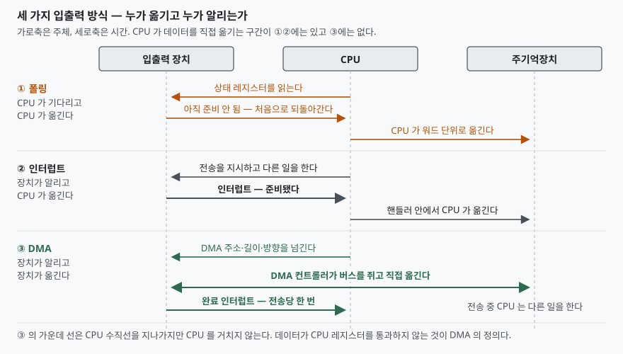

> 이 글은 **실행 검증 없음**이다. 특정 장치·드라이버에서 직접 측정한 값이 아니라
> 공개된 사양과 공식 문서에 적힌 동작만 정리했다. 성능 수치는 싣지 않는다.

## 들어가며

입출력 방식은 운영체제 과목에서 가장 자주 나오는 문항 중 하나다. 세 가지를 외우기는
쉬운데, 답안에서 점수가 갈리는 곳은 이름이 아니라 **구분 기준**이다. "DMA가 가장
빠르다"로 끝내면 비교표를 채울 수가 없고, 요즘 고속 장치가 왜 다시 폴링으로 돌아가는지도
설명되지 않는다.

기준을 둘로 쪼개면 세 방식이 정확히 갈린다. **데이터를 누가 옮기는가**와 **완료를 누가
알리는가**다. 이 두 축을 세워 두면 비교표가 저절로 채워지고, 하이브리드 방식이 왜
나왔는지도 같은 축 위에서 설명된다.

## 정의

**입출력 방식(I/O method)이란 주변장치와 주기억장치 사이의 데이터 전송을 누가 수행하고
전송 완료를 어떻게 통보하느냐에 따라 구분한 처리 구조를 말한다.** CPU 관여 정도에 따라
폴링, 인터럽트 구동 입출력, DMA의 **3가지**로 나뉜다.

- **폴링(polling, 프로그램 제어 입출력)**: CPU가 장치의 상태 레지스터를 반복해 읽어
  준비 여부를 확인하고, 데이터도 CPU 명령으로 옮긴다
- **인터럽트 구동 입출력(interrupt-driven I/O)**: 장치가 준비되면 인터럽트 신호로 알리고
  CPU는 그때 핸들러로 분기한다. 전송은 여전히 CPU가 한다
- **DMA(Direct Memory Access)**: DMA 컨트롤러가 버스를 쥐고 장치와 주기억장치 사이를
  직접 옮긴다. CPU는 전송 시작 설정과 완료 인터럽트만 맡는다

세 번째가 "직접 접근"인 이유는 **데이터가 CPU 레지스터를 통과하지 않기 때문**이다.
리눅스 커널 문서도 장치 쪽 전송을 두고 "DMA는 CPU 가상 메모리 체계를 거치지 않는다"고
적으며, 그래서 장치에 넘길 주소가 따로 필요하다고 설명한다.

## 등장 배경

폴링은 하드웨어가 가장 단순하다. 인터럽트 컨트롤러도, DMA 컨트롤러도 필요 없다. 대신
**CPU가 대기에 묶인다.** 장치가 준비될 때까지 상태 레지스터만 읽는 동안 그 CPU는 아무
일도 못 한다.

인터럽트는 이 대기를 푼다. CPU는 전송을 지시해 두고 다른 작업을 하다가, 장치가 신호를
올리면 그때 돌아온다. 그러나 **전송 자체는 여전히 CPU 몫**이다. 블록 하나를 옮기려면
CPU가 워드 단위로 읽고 쓰는 명령을 그만큼 수행해야 한다.

DMA는 전송까지 넘긴다. 대신 두 가지 문제를 새로 떠안는다. **장치가 쓸 주소**가 CPU가
쓰는 주소와 다르고, **캐시 일관성**이 깨질 수 있다. 아래 고려사항이 둘 다 여기서 나온다.

그리고 축은 한 번 더 돈다. 장치가 아주 빨라지면 **인터럽트 자체가 부담**이 된다. 리눅스
NAPI 문서는 "요청 처리율이 아주 높은 응용은 한 요청이나 묶음을 끝낼 때까지 방해받고 싶지
않을 수 있다"고 적는다. 그래서 고속 경로는 인터럽트를 끄고 다시 폴링으로 간다. 폴링은
낡은 방식이 아니라 **CPU가 남아돌 때 지연을 줄이는 선택**이다.

## 구성요소와 절차

### 폴링 — 4단계

① 장치의 상태 레지스터를 읽는다 → ② 준비 비트를 확인한다 → ③ 준비되지 않았으면 ①로
되돌아간다 → ④ 준비됐으면 데이터 레지스터를 읽거나 써서 한 워드를 옮기고, 남은 양이
있으면 ①로 되돌아간다.

### 인터럽트 구동 — 커널이 돌리는 흐름 3단계

리눅스 커널 문서는 인터럽트가 걸리면 "저수준 아키텍처 코드가 범용 인터럽트 코드를
호출한다"고 적고, 인터럽트 디스크립터마다 고유한 흐름 핸들러가 배정된다고 설명한다.
레벨 트리거의 기본 흐름은 **3단계**다.

① `irq_mask_ack()` — 해당 인터럽트를 마스크하고 장치에 수신을 알린다 →
② `handle_irq_event()` — 등록된 드라이버 핸들러를 호출한다 →
③ `irq_unmask()` — 마스크를 푼다.

마스크를 먼저 거는 이유는 **엣지 트리거와 레벨 트리거의 성질이 다르기 때문**이다.
커널 문서는 엣지 트리거 이벤트가 컨트롤러 하드웨어에 래치되어 "재활성화되려면 ack
되어야 한다"고 적고, 레벨 트리거는 하드웨어 선이 활성 레벨을 유지하는 동안 계속
활성이라고 적는다. 레벨 선을 마스크하지 않고 핸들러에 들어가면 같은 인터럽트가 곧바로
다시 들어온다.

### DMA — 5단계

① **매핑**: 드라이버가 버퍼의 커널 가상 주소를 `dma_map_single()`에 넘겨 **DMA 주소**를
받는다 → ② **디스크립터 작성**: 받은 DMA 주소·길이·전송 방향을 장치에 알린다 →
③ **기동**: 장치 레지스터에 전송 시작을 지시한다 → ④ **전송**: DMA 컨트롤러가 버스를
쥐고 장치와 주기억장치 사이를 옮긴다. 이 동안 CPU는 다른 일을 한다 →
⑤ **완료 통보와 해제**: 장치가 완료 인터럽트를 올리고, 드라이버가 매핑을 해제하거나
동기화한다.

**DMA 매핑은 2종**이다. 커널 문서는 일관(coherent) 매핑을 두고 "CPU의 메모리 쓰기가
장치에 즉시 보이고 그 역도 성립한다"고 적으며 "일관을 동기로 생각하라"고 덧붙인다.
스트리밍(streaming) 매핑은 "보통 한 번의 DMA 전송을 위해 매핑하고 직후에 해제한다"고
적고 "비동기 또는 일관성 영역 밖"으로 생각하라고 한다.

**주소는 3종**을 구분해야 한다. CPU 가상 주소, CPU 물리 주소(`phys_addr_t`), 그리고
장치가 보는 **버스 주소**(`dma_addr_t`)다. 커널 문서는 IOMMU와 호스트 브리지가 물리
주소와 버스 주소 사이에 "임의의 매핑을 만들어 낼 수 있다"고 적는다. 그래서 커널 가상
주소를 장치에 그냥 넘길 수 없고, `vmalloc()`으로 받은 메모리나 커널 스택 주소도 DMA에
직접 쓸 수 없다.

## 도식

> **출처**: [Linux Kernel — Dynamic DMA mapping Guide §CPU and DMA addresses](https://docs.kernel.org/core-api/dma-api-howto.html#cpu-and-dma-addresses), [Linux Kernel — Linux generic IRQ handling §Default Level IRQ flow handler](https://docs.kernel.org/core-api/genericirq.html#default-level-irq-flow-handler)

## 비교

| 구분 | 폴링 | 인터럽트 구동 | DMA |
|---|---|---|---|
| 데이터를 옮기는 주체 | CPU | CPU | DMA 컨트롤러 |
| 완료를 알리는 주체 | 없음 (CPU가 확인) | 장치 | 장치 |
| 전송당 인터럽트 횟수 | 0회 | 전송 단위마다 | 1회 |
| 대기 중 CPU | 묶인다 | 다른 일을 한다 | 다른 일을 한다 |
| 추가 하드웨어 | 불필요 | 인터럽트 컨트롤러 | DMA 컨트롤러(+IOMMU) |
| 부가 비용 | 대기 시간 전체 | 문맥 저장·복원 | 주소 매핑, 캐시 동기화 |
| 유리한 상황 | 지연이 짧고 CPU가 남을 때 | 장치가 느리고 간헐적일 때 | 전송량이 클 때 |

세 방식은 **대체 관계가 아니라 조합**된다. 실제 고속 장치는 DMA로 데이터를 옮기면서
완료 통보만 인터럽트에서 폴링으로 바꾼다. 리눅스 NAPI가 그 예다. 드라이버는 인터럽트
핸들러에서 NAPI 인스턴스를 스케줄하고 **인터럽트를 마스크한 채로 둔다.** 문서는 "IRQ는
`napi_complete_done()` 호출이 성공한 뒤에만 언마스크되어야 한다"고 적는다. 즉 바쁠 때는
폴링으로 돌고 한가해지면 인터럽트로 되돌아간다.

저장장치 쪽도 같다. `io_uring_setup(2)` 매뉴얼은 `IORING_SETUP_IOPOLL`을 두고 "입출력
완료를 바쁜 대기로 확인한다"고 적는다. 이 모드는 `O_DIRECT`로 연 파일 기술자에만 쓸 수
있고, 응용이 `io_uring_enter(2)`를 불러 완료 큐를 직접 폴링해야 한다. NVMe에서는
드라이버를 `poll_queues` 인자와 함께 올려야 한다.

## 적용 시 고려사항

**첫째, 장치 속도와 CPU 여유를 함께 본다.** 폴링은 지연이 가장 짧지만 그 시간만큼 코어
하나를 소모한다. NAPI 문서도 바쁜 폴링이 "지연을 낮추는 대가로 CPU 사이클을 쓴다"고
적는다. 코어가 남는 전용 서버라면 맞는 거래지만, 코어를 나눠 쓰는 환경에서는 다른
작업의 처리량을 깎는다.

**둘째, DMA 주소는 CPU 주소가 아니다.** 드라이버는 반드시 매핑 API로 `dma_addr_t`를
받아 써야 하고, `vmalloc()` 영역·커널 스택·모듈 주소를 DMA 버퍼로 쓰면 안 된다.
설계 단계에서 **DMA 가능한 메모리를 어디서 할당할지**를 먼저 정해야 한다.

**셋째, 캐시 일관성을 설계에 넣는다.** 스트리밍 매핑을 여러 번 재사용하면서 사이에
CPU가 데이터를 건드리면 동기화가 필요하다. 커널 문서는 CPU가 읽기 전에
`dma_sync_single_for_cpu()`를, 장치에 돌려주기 전에 `dma_sync_single_for_device()`를
부르라고 적고, 그러지 않으면 캐시 라인 공유로 **데이터 손상**이 생긴다고 경고한다.

**넷째, 주소 폭 제약을 확인한다.** 커널은 기본적으로 장치가 32비트 DMA 주소를 다룰 수
있다고 가정하고, 다르면 `dma_set_mask_and_coherent()`로 알려야 한다. 문서는 이 계열
함수가 성공을 돌려주기 전에는 **그 장치로 DMA를 쓰면 안 된다**고 못 박는다. 64비트
주소를 못 쓰는 장치에 고주소 버퍼를 넘기면 전송이 실패하거나 우회 버퍼를 거쳐 느려진다.

## 정리

암기 단서는 **"누가 옮기고, 누가 알리는가"** 두 축이다.

- 폴링 = CPU가 옮기고 **아무도 안 알린다**(CPU가 확인한다). 절차 **4단계**
- 인터럽트 = CPU가 옮기고 **장치가 알린다**. 레벨 트리거 흐름 **3단계**
  (마스크·ack → 핸들러 → 언마스크)
- DMA = **DMA 컨트롤러가 옮기고** 장치가 알린다. 절차 **5단계**, 매핑 **2종**
  (일관·스트리밍), 주소 **3종**(가상·물리·버스)
- 고속 장치는 **DMA + 폴링**으로 조합된다. 인터럽트를 줄이려고 폴링으로 되돌아가는
  것이지 DMA를 버리는 것이 아니다
- 고려사항 **4가지**: CPU 여유, DMA 주소, 캐시 일관성, 주소 폭 제약

## 참고 자료

- [Linux Kernel — Dynamic DMA mapping Guide](https://docs.kernel.org/core-api/dma-api-howto.html)
- [Linux Kernel — Dynamic DMA mapping Guide §Types of DMA mappings](https://docs.kernel.org/core-api/dma-api-howto.html#types-of-dma-mappings)
- [Linux Kernel — Dynamic DMA mapping Guide §DMA addressing capabilities](https://docs.kernel.org/core-api/dma-api-howto.html#dma-addressing-capabilities)
- [Linux Kernel — Linux generic IRQ handling](https://docs.kernel.org/core-api/genericirq.html)
- [Linux Kernel — Linux generic IRQ handling §Default Edge IRQ flow handler](https://docs.kernel.org/core-api/genericirq.html#default-edge-irq-flow-handler)
- [Linux Kernel — NAPI §Scheduling and IRQ masking](https://docs.kernel.org/networking/napi.html#scheduling-and-irq-masking)
- [Linux Kernel — NAPI §Busy polling](https://docs.kernel.org/networking/napi.html#busy-polling)
- [Linux man-pages — io_uring_setup(2)](https://man7.org/linux/man-pages/man2/io_uring_setup.2.html)
