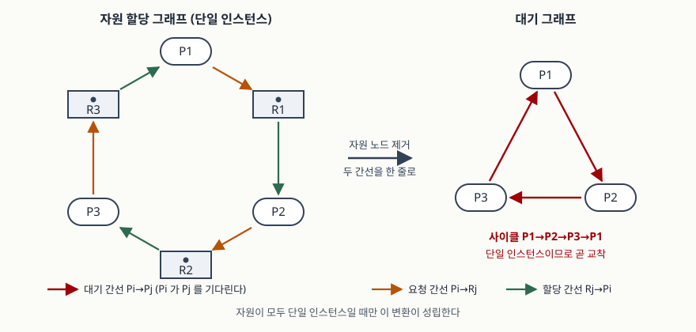

## 들어가며

교착을 묻는 문항은 둘로 갈린다. 하나는 필요조건 네 가지와 은행원 알고리즘을 쓰라는
것이고, 다른 하나는 그래프를 그려 "지금 교착인가"를 판정하라는 것이다. 앞쪽만 외워 간
사람은 뒤쪽에서 자주 미끄러진다. **사이클이 보이면 교착**이라고 익혀 두었는데 문항이
자원마다 인스턴스를 여러 개 준 경우다. 그때 사이클은 교착의 증거가 아니다.

실무에서 보는 화면도 같은 구분 위에 있다. DB가 교착을 잡아 희생자를 고를 때 내부에서
돌리는 것은 자원 할당 그래프가 아니라 **대기 그래프**이고, 둘은 같은 정보를 다르게
접은 것이다. 접는 조건을 모르면 화면에 뜬 그래프를 잘못 읽는다.

## 정의

**자원 할당 그래프(Resource-Allocation Graph)는 프로세스와 자원 유형을 꼭짓점으로 두고,
요청과 할당을 방향 간선으로 나타낸 방향 그래프다.**

**대기 그래프(Wait-for Graph)는 자원 할당 그래프에서 자원 꼭짓점을 들어내고 프로세스
사이의 대기 관계만 남긴 그래프이며, 간선 Pi → Pj 는 Pi가 Pj가 쥔 자원을 기다린다는
뜻이다.** 교재는 대기 그래프를 단일 인스턴스 자원에 한해 정의한다(슬라이드 8.37).

## 등장 배경

교착을 다루는 길은 네 가지인데, 그중 앞의 둘은 값이 비싸다. 예방은 필요조건 넷 가운데
하나를 구조적으로 깨는 방식이라 자원 이용률이 떨어지고, 회피(은행원 알고리즘)는 각
프로세스가 **최대 요구량을 미리 선언**해야 돌아간다. 선언할 수 없는 작업이 섞인 시스템
에서는 쓸 수가 없다.

그래서 많은 시스템이 세 번째 길을 고른다. 교착이 생기도록 두고, 생긴 뒤에 찾아서
복구하는 것이다. 교재는 이 길을 탐지 알고리즘과 복구 기법의 짝으로 적는다(슬라이드 8.36).
이때 "지금 교착인가"를 기계가 판정할 도구가 필요하고, 그 도구가 그래프다.

## 구성요소 — 꼭짓점 2종, 간선 3종, 그래프 사실 3가지

**꼭짓점 2종**(슬라이드 8.9)

| 종류 | 집합 | 뜻 |
|---|---|---|
| 프로세스 | P = {P1, …, Pn} | 시스템의 모든 프로세스 |
| 자원 유형 | R = {R1, …, Rm} | 시스템의 모든 자원 유형. 인스턴스 수를 점으로 그린다 |

**간선 3종**

| 간선 | 방향 | 뜻 |
|---|---|---|
| 요청 간선 | Pi → Rj | Pi가 Rj의 인스턴스 하나를 요청했고 아직 못 받았다 |
| 할당 간선 | Rj → Pi | Rj의 인스턴스 하나가 Pi에게 할당돼 있다 |
| 요구 간선 | Pi ⇢ Rj (점선) | Pi가 앞으로 Rj를 요청할 수 있다. **회피에서만 쓴다** |

요구 간선은 탐지가 아니라 회피 쪽 장치다. 프로세스가 실제로 요청하면 요청 간선이 되고,
할당되면 할당 간선이 되며, 반납하면 다시 요구 간선으로 돌아간다(슬라이드 8.25).
자원을 **미리 선언**해야 한다는 제약이 여기서 나온다. 탐지 문항에 점선을 그리면 틀린다.

**그래프 사실 3가지**(슬라이드 8.13) — 이 트랙에서 가장 자주 묻는 세 줄이다.

| 그래프 모양 | 판정 |
|---|---|
| 사이클이 없다 | 교착이 **아니다** |
| 사이클이 있고 모든 자원 유형의 인스턴스가 1개다 | 교착이다 |
| 사이클이 있고 다중 인스턴스 자원이 하나라도 있다 | 교착일 수도, 아닐 수도 있다 |

세 번째 줄이 답안의 득점 지점이다. 사이클은 다중 인스턴스에서 **필요조건일 뿐**이다.
다른 인스턴스를 쥔 프로세스가 끝나면서 반납하면 고리가 풀리기 때문이다.

## 도식



> **출처**: [Silberschatz·Galvin·Gagne, *Operating System Concepts* 10th ed. Ch.8 슬라이드 (Hunter College S. Weiss 2020 개정판)](https://www.cs.hunter.cuny.edu/~sweiss/course_materials/csci340/slides/chapter08.pdf) — 8.9 Resource-Allocation Graph(꼭짓점과 간선 정의), 8.13 Resource Allocation Graph Facts(사이클 판정), 8.37 Single Instance of Each Resource Type(대기 그래프), 8.38 Resource-Allocation Graph and Wait-for Graph(두 그래프의 대응).

## 탐지 알고리즘 — 자원 유형이 둘로 갈린다

### 단일 인스턴스 — 대기 그래프에서 사이클을 찾는다

자원 노드를 들어내고 Pi → Rj → Pk로 이어지던 두 간선을 Pi → Pk 한 줄로 잇는다.
이러면 그래프가 프로세스만 남아 **사이클 탐색 문제**가 된다. 교재는 주기적으로 사이클
탐색 알고리즘을 돌리고, 사이클이 있으면 교착이 존재한다고 적는다. 비용은 꼭짓점 수 n에
대해 n²차다(슬라이드 8.37).

변환이 성립하는 조건이 **자원마다 인스턴스가 하나**라는 점이 중요하다. 인스턴스가
여럿이면 Pi가 Rj를 기다린다고 해서 특정 Pk 하나를 기다리는 것이 아니라 Rj를 쥔
**여러 프로세스 중 아무나** 끝나기를 기다리는 것이어서, 간선 하나로 줄일 수가 없다.

### 다중 인스턴스 — 자료구조 3개, 4단계

자료구조 3개는 다음과 같다(슬라이드 8.39).

| 이름 | 모양 | 뜻 |
|---|---|---|
| Available | 길이 m 벡터 | 자원 유형별 가용 인스턴스 수 |
| Allocation | n × m 행렬 | 프로세스별로 현재 쥐고 있는 수 |
| Request | n × m 행렬 | 프로세스별로 **지금 요청 중인** 수 |

은행원 알고리즘의 Need와 모양이 같아 헷갈리기 쉬운데, 뜻이 다르다. Need는 앞으로
**더 요구할 수 있는 최대치**이고 Request는 **지금 걸려 있는 요청**이다. 탐지는 미래를
보지 않고 현재만 본다.

절차는 4단계다(슬라이드 8.40~8.41).

1. Work ← Available, 그리고 Allocation이 0이 아닌 i는 Finish[i] ← false, 0이면 true
2. Finish[i]가 false이면서 Request_i ≤ Work인 i를 찾는다. 없으면 4단계로
3. Work ← Work + Allocation_i, Finish[i] ← true, 2단계로
4. Finish[i]가 false인 i가 있으면 시스템은 교착이고, 그 Pi들이 교착 프로세스다

교재는 비용을 m과 n에 대해 m × n²차로 적는다. 2·3단계가 **요청을 충족시킬 수 있는
프로세스를 끝났다고 치고 자원을 회수하는** 환원(reduction) 과정이고, 끝까지 환원되지
않고 남은 것이 교착이다.

## 검산

교재가 결론만 적어 둔 세 가지를 직접 돌렸다. 전체 코드는 [`code/detect.py`](code/detect.py)에 있고,
돌린 기록은 [`code/output.txt`](code/output.txt)에 그대로 남겼다. 아래 출력은 전부 그 파일에서 가져왔다.

**단일 인스턴스 변환과 사이클**

```text
  대기 그래프 (자원 노드를 들어낸 결과)
    P1 -> P2
    P2 -> P3
    P3 -> P1

  사이클: P1 -> P2 -> P3 -> P1
  판정: 교착  (단일 인스턴스에서는 사이클이 곧 교착이다)

  P3 가 R3 요청을 거둔 경우
    P1 -> P2
    P2 -> P3
  사이클: 없음
  판정: 교착 아님
```

**다중 인스턴스 — 교재의 T0 스냅샷**(슬라이드 8.42)

```text
  Allocation            Request               Available
         A   B   C             A   B   C      [0, 0, 0]
    P0   0   1   0        P0   0   0   0
    P1   2   0   0        P1   2   0   2
    P2   3   0   3        P2   0   0   0
    P3   2   1   1        P3   1   0   0
    P4   0   0   2        P4   0   0   2

  환원 순서: P0 -> P2 -> P3 -> P4 -> P1
  교착 프로세스: 없음
  판정: 교착 아님
```

가용 자원이 전부 0인데도 교착이 아니다. 요청이 비어 있는 P0가 먼저 환원되면서 B를 한 개
내놓고, 그것이 다음 환원의 밑천이 된다. 교재가 적은 순서는 P0 → P2 → P3 → P1 → P4인데
여기서 나온 순서는 P4와 P1의 자리가 다르다. **환원 순서는 하나로 정해지지 않으므로**
답안에서도 "이 순서가 유일하다"고 쓰면 안 된다. 중요한 것은 전부 환원되는가다.

**요청 하나가 늘어난 뒤**(슬라이드 8.43) — P2가 C를 하나 더 요청한다.

```text
  Request
         A   B   C
    P0   0   0   0
    P1   2   0   2
    P2   0   0   1
    P3   1   0   0
    P4   0   0   2

  환원 순서: P0
  교착 프로세스: ['P1', 'P2', 'P3', 'P4']
  판정: 교착
```

P0만 환원되고 멈춘다. P0가 내놓은 B 한 개로는 A나 C를 기다리는 어느 요청도 채울 수 없다.
교재가 적은 결론(P1·P2·P3·P4가 교착)과 같다. 요청 한 칸이 0에서 1로 바뀐 것만으로
상태가 뒤집힌다는 점이 이 예제의 요지다.

## 비교

**자원 할당 그래프와 대기 그래프**

| | 자원 할당 그래프 | 대기 그래프 |
|---|---|---|
| 꼭짓점 | 프로세스 + 자원 유형 | 프로세스만 |
| 간선의 뜻 | 요청·할당 | 프로세스 사이의 대기 |
| 쓰는 곳 | 회피(요구 간선 포함)와 탐지 | 탐지 |
| 성립 조건 | 제한 없음 | **자원마다 인스턴스 1개** |
| 판정 비용 | — | 꼭짓점 수 n에 대해 n²차 |

**안전 알고리즘과 탐지 알고리즘** — 둘 다 환원 형태라 모양이 거의 같다.

| | 안전 알고리즘(회피) | 탐지 알고리즘 |
|---|---|---|
| 보는 행렬 | Need (앞으로의 최대 요구) | Request (현재 요청) |
| 묻는 것 | 이 요청을 들어줘도 안전한가 | 지금 교착인가 |
| 시점 | 요청이 들어올 때마다 사전에 | 사후에, 정해진 주기로 |
| 결론 | 안전/불안전 | 교착/비교착 + 교착 프로세스 목록 |
| 비용 | m × n²차 | m × n²차 |

불안전 상태가 곧 교착이 아니라는 점도 여기서 갈린다. 회피는 교착 **가능성**만으로
요청을 막고, 탐지는 실제로 막힌 것만 잡는다.

## 적용 시 고려사항

**1. 호출 주기를 정해야 한다.** 교재는 언제·얼마나 자주 돌릴지가 교착 발생 빈도와
되돌려야 할 프로세스 수에 달렸다고 적고, 되돌릴 프로세스는 서로 떨어진 사이클마다
하나씩이라고 덧붙인다(슬라이드 8.44). 자주 돌리면 탐지 비용이 상시로 들고, 드물게 돌리면
그 사이에 사이클이 여러 개 쌓인다. 교재는 **임의 주기로 돌리면 그래프에 사이클이 여러 개
생겨 어느 프로세스가 교착을 일으켰는지 가려낼 수 없다**고 경고한다. 복구 비용은 여기서
갈린다.

**2. 초기화 한 줄이 사각을 만든다.** 1단계는 Allocation이 0인 프로세스의 Finish를 곧바로
true로 둔다. 아무것도 쥐지 않은 프로세스는 다른 프로세스를 막을 수 없으니 환원 대상에서
빼는 최적화인데, **그 프로세스 자신이 영원히 기다리는 경우는 교착 목록에 오르지 않는다.**
직접 만들어 돌려 보면 이렇다.

```text
  Allocation            Request               Available
         A   B   C             A   B   C      [0, 0, 0]
    P1   0   0   3        P1   0   0   3
    P2   0   0   3        P2   0   0   3
    P3   0   0   0        P3   0   0   2

  환원 순서: (없음)
  교착 프로세스: ['P1', 'P2']
```

P3는 C를 2개 기다리는데 가용분이 0이고 P1·P2는 교착이라 영원히 반납하지 않는다. 그런데
교착 목록에는 P1·P2만 오른다. 알고리즘이 **교착에 갇힌 프로세스**와 **교착 때문에 굶는
프로세스**를 다르게 취급한다는 뜻이고, 복구 설계는 이 차이를 알고 해야 한다.

**3. 복구는 두 갈래이고 각각 고를 것이 있다.** 프로세스 종료는 교착 프로세스를 전부
중단하거나 사이클이 풀릴 때까지 하나씩 중단하며, 교재는 중단 순서를 고를 때 볼 것으로
우선순위, 수행 시간과 남은 시간, 쓴 자원, 완료에 필요한 자원, 함께 종료될 프로세스 수,
대화형인지 일괄인지 **6가지**를 든다(슬라이드 8.45). 자원 선점은 비용이 가장 작은 희생자를
고르고, 안전한 상태로 되돌린 뒤 거기서 다시 시작하며, 같은 프로세스가 매번 희생자로
뽑히는 **기아**를 막으려고 되돌린 횟수를 비용에 넣는다(슬라이드 8.46).

**4. 사이클을 보고 성급히 교착이라 쓰지 않는다.** 답안에서 가장 흔한 실점이다.
자원마다 인스턴스가 하나라는 조건을 먼저 확인하고, 다중 인스턴스가 섞여 있으면 사이클을
근거로 쓰지 말고 Request·Allocation·Available로 환원해 보인다.

## 정리

- **꼭짓점 2종**(프로세스·자원 유형), **간선 3종**(요청·할당·요구), 요구 간선은 점선이고
  회피에서만 쓴다
- **그래프 사실 3가지**: 사이클 없음 → 비교착 / 사이클 + 단일 인스턴스 → 교착 /
  사이클 + 다중 인스턴스 → 미정
- 단일 인스턴스는 **대기 그래프로 줄여 사이클 탐색**(n²차), 다중 인스턴스는
  **자료구조 3개·4단계 환원**(m × n²차)
- Need는 미래, **Request는 현재**. 안전 알고리즘과 탐지 알고리즘을 가르는 한 글자다
- 복구는 **종료와 선점** 두 갈래. 종료 순서 기준 6가지, 선점은 희생자·되돌리기·기아 3가지

> 관련 개념: [교착상태 4조건과 해결 기법](../2026-10-12-deadlock-conditions-bankers-algorithm/index.md) · [모니터와 조건 변수 — signal 의미론](../2026-10-26-monitor-condition-variable-signal-semantics/index.md)

> 기출 답안: [기출문제 — 은행원 알고리즘](../../exam/2026-10-27-bankers-algorithm/index.md)

## 참고 자료

- [Silberschatz·Galvin·Gagne, *Operating System Concepts* 10th ed. Ch.8 Deadlocks 슬라이드 (Hunter College S. Weiss 2020 개정판)](https://www.cs.hunter.cuny.edu/~sweiss/course_materials/csci340/slides/chapter08.pdf) — 8.9 Resource-Allocation Graph, 8.13 Resource Allocation Graph Facts, 8.25 Resource-Allocation Graph Scheme(요구 간선), 8.28 Resource-Allocation Graph Algorithm, 8.36 Deadlock Detection, 8.37 Single Instance of Each Resource Type, 8.39 Several Instances of a Resource Type, 8.40~8.41 Detection Algorithm, 8.42~8.43 Example of Detection Algorithm, 8.44 Detection-Algorithm Usage, 8.45 Recovery from Deadlock: Process Termination, 8.46 Recovery from Deadlock: Resource Preemption (1차)
- [Arpaci-Dusseau, *Operating Systems: Three Easy Pieces* v1.20 Ch.32 Common Concurrency Problems](https://pages.cs.wisc.edu/~remzi/OSTEP/threads-bugs.pdf) — 32.3 Deadlock Bugs, 교착 조건과 회피·탐지의 위치 (1차)
