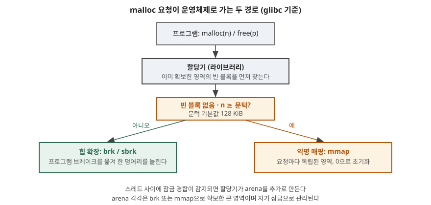

> **실행 검증 없음.** 리눅스 매뉴얼 페이지(man-pages 6.19)에 적힌 동작만 쓴다. `top`이나
> `pmap` 출력, 할당 시간 측정값은 싣지 않는다. glibc 내부 구조(bin 종류, chunk 배치)는
> 1차 자료를 읽지 못해 다루지 않는다.

## 들어가며

서버 프로세스가 오래 돌면 `free`를 충실히 불렀는데도 상주 메모리가 줄지 않는 일이 생긴다.
누수를 의심해 코드를 뒤지지만 해제 코드는 멀쩡하다. 반대로 한 번에 수 MB를 잡았다 놓는
코드는 잡을 때마다 느려지는 것처럼 보이기도 한다. 두 현상 모두 `malloc`이 시스템 호출이
아니라는 데서 출발한다.

시험에서는 프로세스 메모리 4영역 중 힙이 어떻게 관리되는지를 물을 때 이 구조가 답의 근거가
된다. 실무에서는 메모리 사용량 해석, 단편화 대응, 멀티스레드 서버의 할당 경합을 판단하는
기본 지식이다.

## 정의

**동적 메모리 할당기(dynamic memory allocator)** 는 프로그램이 실행 중에 요청하는 가변 크기
메모리를 운영체제에서 **큰 단위로 받아 와 잘게 나눠 내주고, 반납된 조각을 다시 재사용하는**
사용자 영역 라이브러리다. glibc의 `malloc`이 그 예이고, 운영체제에서 메모리를 받을 때
`sbrk(2)`와 `mmap(2)` 두 가지를 쓴다
([malloc(3) NOTES](https://man7.org/linux/man-pages/man3/malloc.3.html)).

## 등장 배경

프로그램이 작은 객체를 요청할 때마다 시스템 호출로 운영체제에 메모리를 받으면 호출 비용이
요청 수만큼 늘어난다. 또 운영체제가 내주는 단위는 페이지이므로 수십 바이트 요청에 페이지를
통째로 주면 낭비가 크다. 그래서 할당기가 둘 사이에 한 겹 끼어, 한 번에 넉넉히 받아 둔
영역에서 작은 조각을 내주고 반납된 조각을 재사용한다. 이 구조가 시스템 호출 횟수를 줄이는
대신 **반납한 메모리가 곧바로 운영체제로 돌아가지 않는** 성질을 낳는다.

## 구성요소 — 알아야 할 것 4가지

> **출처**: [malloc(3) NOTES](https://man7.org/linux/man-pages/man3/malloc.3.html), [mallopt(3) M_MMAP_THRESHOLD](https://man7.org/linux/man-pages/man3/mallopt.3.html), [brk(2)](https://man7.org/linux/man-pages/man2/brk.2.html), [mmap(2) MAP_ANONYMOUS](https://man7.org/linux/man-pages/man2/mmap.2.html) (모두 man-pages 6.19)

### ① brk 경로 — 힙을 늘린다

`brk`와 `sbrk`는 **프로그램 브레이크(program break)**, 곧 데이터 세그먼트의 끝을 옮긴다. 끝을
올리면 메모리가 할당되고 내리면 해제된다. `brk`는 절대 주소를, `sbrk`는 증분을 인자로 받고
`sbrk(0)`은 현재 브레이크를 돌려준다([brk(2)](https://man7.org/linux/man-pages/man2/brk.2.html)).
보통의 요청은 이 힙에서 처리되고 할당기가 `sbrk`로 힙 크기를 조정한다.

### ② mmap 경로 — 큰 요청은 따로 받는다

문턱 `MMAP_THRESHOLD`를 넘는 요청은 glibc가 `mmap`으로 **비공개 익명 매핑(private anonymous
mapping)** 을 만들어 처리한다. 문턱의 기본값은 **128 KiB**(128×1024)다. 익명 매핑은 파일에 연결되지
않고 내용이 0으로 초기화된다([mmap(2)](https://man7.org/linux/man-pages/man2/mmap.2.html)).
`M_MMAP_MAX`(기본 65,536)가 mmap으로 받을 수 있는 요청 수의 상한이고, 0이면 큰 요청에도
mmap을 쓰지 않는다([mallopt(3)](https://man7.org/linux/man-pages/man3/mallopt.3.html)).

### ③ 문턱의 동적 조정

고정값은 아니다. 동적 조정이 켜져 있으면 문턱이 초기값 128 KiB에서 **해제된 블록 크기만큼
위로 올라가고, 이때 트림 임계값은 mmap 문턱의 2배**가 된다. 상한은 64비트에서
`4*1024*1024*sizeof(long)`이다. `M_TRIM_THRESHOLD`, `M_TOP_PAD`, `M_MMAP_THRESHOLD`,
`M_MMAP_MAX` 중 하나라도 직접 설정하면 **동적 조정이 꺼진다**(mallopt(3)).

### ④ arena — 스레드 경합을 나눈다

여러 스레드가 같은 힙을 쓰면 잠금 경합이 생긴다. glibc는 **경합이 감지되면 arena를
추가로 만든다.** arena는 `brk` 또는 `mmap`으로 확보한 큰 영역이고 **자기 잠금**으로
관리된다(malloc(3) NOTES). 개수의 상한은 `M_ARENA_MAX`로 정하며 기본값 0은 `M_ARENA_TEST`에
따라 정해진다는 뜻이다. `M_ARENA_TEST` 기본값은 `long`이 4바이트면 2, 아니면 8이다.

## 동작 — 요청과 반납의 흐름 5단계

1. **요청** — 프로그램이 `malloc(n)`을 부른다. 멀티스레드면 스레드가 쓸 arena를 정한다.
2. **재사용 탐색** — 할당기가 이미 확보한 영역에서 맞는 빈 블록을 먼저 찾는다. 있으면 시스템 호출 없이 끝난다.
3. **확보** — 빈 블록이 없으면 `n`이 문턱 이상인지 본다. 미만이면 `sbrk`로 힙을 늘리고, 이상이면 `mmap`으로 독립 영역을 받는다.
4. **해제** — `free(p)`를 부르면 블록이 할당기의 빈 블록으로 돌아간다. mmap 블록은 독립 영역이라 **운영체제에 따로 돌려줄 수 있다.**
5. **트림** — 힙 쪽은 브레이크가 하나의 끝 주소를 옮기는 구조(brk(2))이므로 **끝 쪽에서만** 줄일 수 있다. 트림 임계값(기본 128 KiB)이 이 반환의 판단에 쓰이고, `-1`로 설정하면 트림이 꺼진다.

4단계와 5단계에서 첫 문장의 현상이 설명된다. 힙 중간에 살아 있는 블록이 하나라도 남으면 그 뒤쪽 빈 공간은 브레이크를 내려도 돌려줄 수 없다.
이 설명은 `brk`가 끝 주소 하나만 옮긴다는 매뉴얼 서술에서 이어 낸 것이며, 반환 조건의 세부는 glibc 문서로 따로 확인해야 한다.

## 비교

| 구분 | brk 경로 (힙) | mmap 경로 (익명 매핑) |
|---|---|---|
| 대상 요청 | 문턱 미만의 보통 요청 | 문턱 이상의 큰 요청 |
| 확장 방식 | 프로그램 브레이크 이동 | 요청마다 독립 영역 생성 |
| 초기값 | — | 0으로 초기화 |
| 반환 | 끝 쪽에서만 줄일 수 있다 | 블록 단위로 독립적으로 반환 가능 |
| 요청 수 상한 | 없음 | `M_MMAP_MAX` (기본 65,536) |

| 구분 | 할당기(`malloc`) | 시스템 호출(`brk`·`mmap`) |
|---|---|---|
| 위치 | 사용자 영역 라이브러리 | 커널 인터페이스 |
| 단위 | 바이트 단위 요청 | 페이지 단위 영역 |
| 호출 비용 | 재사용 시 시스템 호출 없음 | 호출마다 커널 진입 |
| 매뉴얼의 권고 | `malloc` 사용 | `brk`·`sbrk` 직접 사용은 피하라고 권고 |

## 적용 시 고려사항

- **`free` 뒤 상주 메모리가 안 줄어도 누수라고 단정하지 않는다.** 할당기가 영역을 쥐고 있다가
  재사용하기 때문이다. 누수인지는 시간이 지나도 사용량이 **계속 늘어나는지**로 판단한다.
- **큰 버퍼를 자주 잡았다 놓으면 문턱 조정이 성능에 영향을 준다.** 문턱이 동적으로 올라가면
  이후 큰 요청도 힙에서 처리되므로 패턴이 바뀐다. 이 동작에 기대지 말아야 하는 환경이면
  `mallopt`로 값을 고정하되, 그 순간 동적 조정이 꺼진다는 점을 알고 설정한다.
- **멀티스레드 서버는 arena 개수를 고려한다.** arena가 늘면 경합은 줄지만 각자 영역을
  쥐고 있어 전체 상주 메모리가 늘 수 있다. 상한은 `M_ARENA_MAX`로 정한다.
- **`brk`·`sbrk`를 직접 부르지 않는다.** 매뉴얼이 피하고 `malloc`을 쓰라고 권한다. 할당기가
  브레이크를 관리하고 있어 직접 옮기면 서로의 가정이 깨진다.
- **mmap으로 받은 영역은 0으로 초기화돼 있으나 힙 재사용 블록은 아니다.** 재사용된 블록의
  내용은 이전 사용자의 값이 남아 있을 수 있으므로 `calloc`이나 직접 초기화로 처리한다.
- **할당기 교체나 튜닝은 같은 부하로 비교해야 한다.** 요청 크기 분포와 스레드 수에 따라
  결과가 갈리므로, 측정 없이 설정값을 옮겨 쓰지 않는다.

## 정리

- **정의**: 운영체제에서 큰 단위로 받아 잘게 나눠 내주고 재사용하는 사용자 영역 라이브러리
- **구성 4가지**: brk 경로 · mmap 경로 · 문턱의 동적 조정 · arena
- **숫자**: mmap 문턱 **128 KiB**, 트림 임계값 **128 KiB**, 동적 조정 시 트림 임계값은 문턱의 **2배**
- 한 줄 요약: 작은 건 힙(**끝에서만 반환**), 큰 건 mmap(**독립 반환**), 스레드는 arena로 나눈다
- 외우는 단서: **"브·엠·문·아"** (brk · mmap · 문턱 · arena)

> 기출 답안: [기출문제 — 프로그램 실행 시 메모리 4영역: 코드·데이터·힙·스택](../../exam/2026-10-30-process-memory-layout-code-data-heap-stack/index.md)

## 참고 자료

- [Linux man-pages 6.19 — malloc(3)](https://man7.org/linux/man-pages/man3/malloc.3.html) — brk와 mmap 사용, 문턱 기본값, arena 생성
- [Linux man-pages 6.19 — mallopt(3)](https://man7.org/linux/man-pages/man3/mallopt.3.html) — `M_MMAP_THRESHOLD`·`M_TRIM_THRESHOLD`·`M_TOP_PAD`·`M_ARENA_MAX`·`M_MMAP_MAX` 정의와 기본값, 동적 조정
- [Linux man-pages 6.19 — brk(2)](https://man7.org/linux/man-pages/man2/brk.2.html) — 프로그램 브레이크, `brk`와 `sbrk`의 차이
- [Linux man-pages 6.19 — mmap(2)](https://man7.org/linux/man-pages/man2/mmap.2.html) — `MAP_ANONYMOUS`
