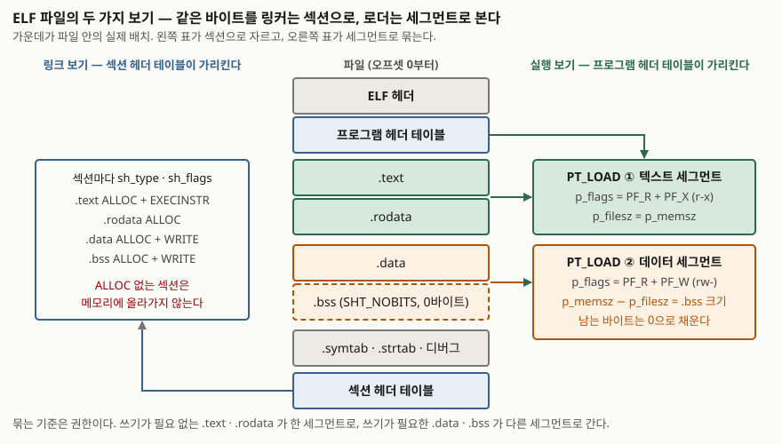

> **실행 검증 없음.** ABI 명세와 매뉴얼 페이지에 적힌 정의와 규칙만으로 쓴다.
> 바이너리를 열어 본 출력이나 측정값은 싣지 않는다.

## 들어가며

서버에서 프로그램이 뜨지 않을 때 가장 먼저 보는 메시지가 "cannot execute binary file"이나
"No such file or directory"다. 파일은 분명 그 자리에 있다. 전자는 다른 아키텍처용 파일을
가져온 것이고, 후자는 실행 파일 자체가 아니라 그 안에 적힌 **동적 링커 경로**가 없는 것이다.
두 메시지 모두 ELF 헤더와 프로그램 헤더에 적힌 값에서 나온다.

전역 배열을 수백 MB로 잡았는데 실행 파일은 수십 KB인 것, 실행 파일에서 디버그 정보를 떼어
내도 실행에 지장이 없는 것도 같은 구조에서 설명된다. 시험에서는 프로세스 메모리 4영역이
실행 파일의 어느 부분에서 오는지를 물을 때 이 포맷이 답의 근거가 되고, 실무에서는 적재
실패·메모리 사용량·바이너리 분석의 출발점이 된다.

## 정의

**ELF(Executable and Linkable Format)** 는 System V ABI가 정한 오브젝트 파일 포맷으로,
**링크에 필요한 섹션 단위의 보기와 실행에 필요한 세그먼트 단위의 보기를 한 파일에 나란히
담는** 형식이다
([System V ABI, ELF Object File Format — Introduction](https://gabi.xinuos.com/elf/01-intro.html)).
명세는 오브젝트 파일을 **3종류**로 든다.

| 종류 | `e_type` | 무엇 | 필요한 테이블 |
|---|---|---|---|
| 재배치 가능 파일 | `ET_REL` | 컴파일 결과(`.o`). 다른 오브젝트와 링크돼 실행 파일이나 공유 오브젝트가 된다 | 섹션 헤더 테이블 |
| 실행 파일 | `ET_EXEC` | 프로세스 이미지를 만들 수 있는 파일 | 프로그램 헤더 테이블 |
| 공유 오브젝트 파일 | `ET_DYN` | 링커가 다른 오브젝트와 묶거나, 동적 링커가 실행 시 적재하는 파일 | 둘 다 |

명세는 두 가지를 못 박는다. 프로세스 이미지를 만드는 파일은 **프로그램 헤더 테이블을 반드시**
가지며 재배치 가능 파일은 없어도 되고, 링크에 쓰이는 파일은 **섹션 헤더 테이블을 반드시**
가지며 그 밖의 파일은 있어도 없어도 된다(같은 문서 Introduction). 코어 파일(`ET_CORE`)도
예약돼 있으나 내용은 명세 밖이다.

## 등장 배경

링커와 로더가 파일에서 원하는 정보는 다르다. 링커는 **심볼·재배치·섹션 경계**를 알아야
여러 오브젝트를 하나로 합치고, 로더는 **어느 바이트를 어느 주소에 어떤 권한으로 올릴지**만
알면 된다. 한 가지 구조로 둘을 다 섬기면 로더가 링크용 정보를 건너뛰어야 하고, 링커는
적재용 묶음을 다시 풀어야 한다.

ELF는 이 문제를 **같은 바이트를 두 테이블이 다르게 가리키는 방식**으로 푼다. 섹션 헤더
테이블은 파일을 `.text`·`.data` 같은 섹션으로 자르고, 프로그램 헤더 테이블은 같은 바이트를
세그먼트로 묶는다. 명세는 두 보기가 **링크와 실행이라는 두 활동의 서로 다른 요구를
반영한 평행한 보기**라고 적는다(같은 문서 Introduction).

## 구성요소 — 헤더 1개와 테이블 2개

> **출처**: [System V ABI, ELF Object File Format 4.3 DRAFT — 1. Introduction, Figure 1.1 ELF Object File Format](https://gabi.xinuos.com/elf/01-intro.html), [같은 문서 — 7. Program Loading, §7.5 Program Loading의 .bss 서술](https://gabi.xinuos.com/elf/07-pheader.html), [같은 문서 — Sections, Figure 4-16 Special Sections](https://www.sco.com/developers/gabi/latest/ch4.sheader.html)

### ① ELF 헤더 — 파일 맨 앞, 나머지를 찾는 지도

ELF 헤더는 항상 오프셋 0에 있다. 식별 바이트 `e_ident`의 앞 네 바이트는 `0x7f` `E` `L` `F`로
고정이고, 그 뒤에 **클래스**(`ELFCLASS32`/`ELFCLASS64`)와 **바이트 순서**(`ELFDATA2LSB`
리틀 엔디언 / `ELFDATA2MSB` 빅 엔디언)가 온다
([elf(5)](https://man7.org/linux/man-pages/man5/elf.5.html)). 이어서 파일 종류 `e_type`,
대상 기계 `e_machine`, 진입점 주소 `e_entry`, 그리고 두 테이블의 파일 오프셋 `e_phoff`·
`e_shoff`와 항목 수가 온다. 섹션 헤더 테이블이 없으면 `e_shoff`와 `e_shnum`은 0이다.
"cannot execute binary file"은 로더가 이 헤더의 클래스나 기계 종류를 보고 거부한 결과다.

### ② 프로그램 헤더 테이블 — 세그먼트, 실행 보기

실행 파일과 공유 오브젝트에서 의미를 갖는 배열이고, 항목 하나가 세그먼트 하나를 기술한다.
명세가 드는 세그먼트 종류는 **8가지**다(같은 문서 Program Loading, Table 7.1).

| `p_type` | 무엇 | 비고 |
|---|---|---|
| `PT_NULL` | 쓰지 않는 항목 | |
| `PT_LOAD` | **적재 가능 세그먼트.** `p_filesz`·`p_memsz`로 기술 | 적재의 본체 |
| `PT_DYNAMIC` | 동적 링크 정보 | 공유 라이브러리 이름, 심볼 테이블 위치 |
| `PT_INTERP` | 인터프리터(동적 링커) 경로 문자열 | 파일에 한 번만, 적재 항목보다 앞에 |
| `PT_NOTE` | 보조 정보 | |
| `PT_SHLIB` | 예약. 의미 미정 | 쓰면 ABI 비준수 |
| `PT_PHDR` | 프로그램 헤더 테이블 자신의 위치 | 테이블이 메모리 이미지에 포함될 때만 |
| `PT_TLS` | 스레드 지역 저장소 템플릿 | |

항목의 나머지 필드가 적재 규칙을 정한다. `p_offset`(파일 오프셋), `p_vaddr`(가상 주소),
`p_filesz`(파일 이미지 크기), `p_memsz`(메모리 이미지 크기), `p_flags`(권한), `p_align`(정렬)이다.
권한 비트는 **3개**로 `PF_X`(0x1 실행), `PF_W`(0x2 쓰기), `PF_R`(0x4 읽기)이고, 비트가 0이면
그 접근은 거부된다. 명세는 **명시하지 않는 한 어떤 세그먼트도 쓰기 권한을 갖지 않는다**고
적는다(같은 문서 Program Loading, Table 7.2·7.3).

"No such file or directory"는 `PT_INTERP`에서 나온다. 커널은 실행 파일을 직접 돌리지 않고
여기 적힌 경로의 동적 링커를 먼저 올리는데, 그 경로가 없으면 **실행 파일이 아니라 링커를
못 찾았다**는 뜻의 메시지가 나온다.

### ③ 섹션 헤더 테이블 — 섹션, 링크 보기

파일의 모든 섹션을 찾게 해 주는 배열이다. 항목의 `sh_type`이 섹션의 내용 종류를,
`sh_flags`가 속성을 정한다. 속성 비트도 **3개**다(같은 문서 Sections).

| `sh_flags` | 값 | 뜻 |
|---|---|---|
| `SHF_WRITE` | 0x1 | 프로세스 실행 중 쓸 수 있어야 하는 데이터 |
| `SHF_ALLOC` | 0x2 | 프로세스 실행 중 **메모리를 차지한다** |
| `SHF_EXECINSTR` | 0x4 | 실행 가능한 기계 명령 |

시험에서 묻는 특수 섹션 **4개**의 조합은 다음과 같다(같은 문서 Sections, Figure 4-16).

| 섹션 | `sh_type` | `sh_flags` | 담는 것 |
|---|---|---|---|
| `.text` | `SHT_PROGBITS` | `ALLOC + EXECINSTR` | 기계 명령 |
| `.rodata` | `SHT_PROGBITS` | `ALLOC` | 읽기 전용 데이터 |
| `.data` | `SHT_PROGBITS` | `ALLOC + WRITE` | 초기값이 있는 변수 |
| `.bss` | **`SHT_NOBITS`** | `ALLOC + WRITE` | 초기화되지 않은 변수. **파일 공간을 차지하지 않는다** |

`SHT_NOBITS`는 "파일에서 공간을 차지하지 않지만 그 외에는 `SHT_PROGBITS`와 같다"는 종류다.
크기 `sh_size`는 0이 아닐 수 있고, `sh_offset`은 개념상의 오프셋만 담는다. `.symtab`·
`.strtab`·`.rela*` 같은 링크용 섹션은 적재 세그먼트에 포함될 때만 `SHF_ALLOC`이 켜진다.
**`SHF_ALLOC`이 꺼진 섹션은 실행에 필요 없다**는 뜻이므로, 디버그 정보를 떼어 내도
프로그램이 그대로 도는 이유가 여기 있다.

## 동작 — 적재 규칙 4가지

로더는 섹션을 보지 않는다. 프로그램 헤더 테이블의 `PT_LOAD` 항목만 읽고 다음 규칙을
따른다(같은 문서 Program Loading).

1. **순서** — 적재 가능 항목은 `p_vaddr` 기준 **오름차순**으로 테이블에 나타난다. 낮은
   주소의 텍스트 세그먼트가 먼저, 높은 주소의 데이터 세그먼트가 다음이다.
2. **정렬** — 적재 가능 세그먼트는 `p_vaddr`와 `p_offset`이 **페이지 크기로 나눈 나머지가
   같아야** 한다. 파일의 바이트를 페이지 단위로 그대로 매핑하기 위한 조건이다.
3. **크기** — 파일에서 `p_filesz` 바이트를 읽어 세그먼트 앞쪽에 놓는다. `p_memsz`가 더
   크면 **남는 바이트는 0으로 채워 초기화 영역 뒤에 둔다.** 파일 크기가 메모리 크기보다
   클 수는 없다.
4. **권한** — `p_flags`대로 보호를 건다. 전형적인 텍스트 세그먼트는 읽기·실행만 갖는다.

3번 규칙이 `.bss`를 만든다. 명세는 `.bss`가 파일에서 공간을 차지하지 않으면서 세그먼트의
메모리 이미지에는 기여하며, **보통 세그먼트 끝에 놓여 `p_memsz`를 `p_filesz`보다 크게
만든다**고 적는다(같은 문서의 프로그램 적재 절, §7.5). 수백 MB 전역 배열이 실행 파일 크기를 늘리지 않는 이유가
이 한 줄이다. 섹션이 세그먼트로 묶이는 기준은 **권한**이다. 쓰기가 필요 없는 `.text`·`.rodata`가
한 세그먼트로, 쓰기가 필요한 `.data`·`.bss`가 다른 세그먼트로 간다.

## 비교

### 섹션과 세그먼트

| 구분 | 섹션 (Section) | 세그먼트 (Segment) |
|---|---|---|
| 기술하는 테이블 | 섹션 헤더 테이블 | 프로그램 헤더 테이블 |
| 쓰는 주체 | 링커 | 로더 (커널·동적 링커) |
| 단위 | 내용의 종류 (`.text`, `.data`, `.symtab`) | 권한과 주소 (`r-x`, `rw-`) |
| 필수인 파일 | 링크에 쓰이는 파일 | 프로세스 이미지를 만드는 파일 |
| 관계 | 여러 섹션이 한 세그먼트에 묶인다 | `SHF_ALLOC`이 꺼진 섹션은 어느 세그먼트에도 없다 |

### `.data`와 `.bss`

| 구분 | `.data` | `.bss` |
|---|---|---|
| 섹션 종류 | `SHT_PROGBITS` | `SHT_NOBITS` |
| 파일 공간 | 차지한다 | 차지하지 않는다 |
| 메모리 초기값 | 파일에서 읽은 값 | 0 (프로그램 시작 시 시스템이 채운다) |
| 프로그램 헤더에서 | `p_filesz` 안 | `p_memsz − p_filesz` 만큼 |

### 다른 포맷과의 자리

ELF는 System V 계열과 리눅스의 표준이고, 같은 역할을 Windows는 PE, macOS는 Mach-O가
맡는다. 세 포맷 모두 헤더·적재 단위·링크 단위를 갖지만 이름과 배치가 다르므로, 한 포맷의
실행 파일은 다른 운영체제의 로더가 헤더 단계에서 거부한다.

## 적용 시 고려사항

- **섹션 헤더 테이블을 떼어 내면 실행은 되지만 분석은 막힌다.** 실행에 필요한 것은
  프로그램 헤더 테이블뿐이다. 배포 바이너리의 심볼을 떼어 크기를 줄이는 것은 괜찮지만,
  장애 시 스택 추적을 읽으려면 디버그 심볼을 따로 보관해야 한다.
- **`.bss` 크기는 실행 파일 크기와 무관하다.** 배포 파일이 작다고 메모리를 적게 쓰는
  것이 아니다. 용량 산정은 `p_memsz` 합을 봐야 하고, 반대로 큰 배열을 0이 아닌 값으로
  초기화하면 그 순간 `.data`로 옮겨 가 파일이 그만큼 커진다.
- **페이지 크기가 다른 환경으로 옮길 때 정렬 규칙에 걸린다.** `p_vaddr`와 `p_offset`의
  합동 조건은 적재 환경의 페이지 크기 기준이다. 4KB 페이지에서 링크한 바이너리를 더 큰
  페이지를 쓰는 커널에 올리면 적재가 거부될 수 있으므로 `p_align`을 확인한다.
- **동적 링커 경로는 파일 안에 고정돼 있다.** `PT_INTERP`의 경로가 대상 시스템에 없으면
  실행 파일이 멀쩡해도 뜨지 않는다. 컨테이너 베이스 이미지를 바꾸거나 정적 링크 여부를
  바꿀 때 먼저 볼 항목이다.
- **데이터 세그먼트의 실행 권한은 명세와 관행이 다르다.** 명세는 데이터 세그먼트에
  읽기·쓰기·실행을 허용 가능 조합으로 적지만, 리눅스는 GNU 확장 `PT_GNU_STACK`의 플래그로
  스택 실행 가능 여부를 따로 제어한다([elf(5)](https://man7.org/linux/man-pages/man5/elf.5.html)).
  보안 요구가 있는 바이너리는 이 항목이 실행 불가로 돼 있는지 확인한다.
- **클래스와 바이트 순서는 헤더에서 끝난다.** 64비트 커널은 32비트 ELF를 호환 계층이
  있을 때만 돌리고, 엔디언이 다른 파일은 돌리지 않는다. 크로스 컴파일 산출물을 검사할 때
  `e_ident`의 두 바이트만 보면 된다.

## 정리

- **보기 2개**: 링크 보기(섹션)와 실행 보기(세그먼트). 같은 바이트를 두 테이블이 다르게 가리킨다
- **파일 종류 3개**: `ET_REL`(섹션 헤더 필수) · `ET_EXEC`(프로그램 헤더 필수) · `ET_DYN`(둘 다)
- **구성요소 3개**: ELF 헤더(오프셋 0, 지도) · 프로그램 헤더 테이블(세그먼트 8종) · 섹션 헤더 테이블(속성 비트 3개)
- **적재 규칙 4개**: 오름차순 · 페이지 합동 정렬 · `p_filesz` 읽고 나머지 0 · 권한 적용
- 외우는 단서: **"2보기 · 3종류 · 3테이블 · 4규칙"**, 그리고 `.bss`는 **`p_memsz − p_filesz`**

> 기출 답안: [기출문제 — 프로그램 실행 시 메모리 4영역: 코드·데이터·힙·스택](../../exam/2026-10-30-process-memory-layout-code-data-heap-stack/index.md)

## 참고 자료

- [System V ABI, ELF Object File Format 4.3 DRAFT — 1. Introduction (Xinuos)](https://gabi.xinuos.com/elf/01-intro.html) — 세 종류 오브젝트 파일, 두 보기, 테이블 필수 조건
- [System V ABI, ELF Object File Format 4.3 DRAFT — 2. ELF Header (Xinuos)](https://gabi.xinuos.com/elf/02-eheader.html) — `e_type` 값, `e_shoff`·`e_shnum`이 0인 경우
- [System V ABI, ELF Object File Format 4.3 DRAFT — 7. Program Loading (Xinuos)](https://gabi.xinuos.com/elf/07-pheader.html) — 세그먼트 종류 8가지, `p_filesz`/`p_memsz`, 권한 비트, 오름차순·정렬 규칙, 프로그램 적재 절(§7.5)의 `.bss` 서술
- [System V ABI — Sections (gABI Chapter 4, sco.com)](https://www.sco.com/developers/gabi/latest/ch4.sheader.html) — `sh_flags` 세 비트, `SHT_NOBITS`, 특수 섹션 표
- [Linux man-pages 6.19 — elf(5)](https://man7.org/linux/man-pages/man5/elf.5.html) — `e_ident` 식별 바이트, `PT_INTERP`, `PT_GNU_STACK`, 섹션 설명
