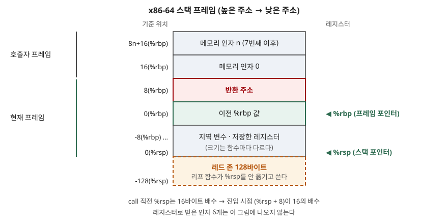

> **실행 검증 없음.** ABI 명세에 적힌 규칙만으로 쓴다. 디스어셈블 출력이나 측정값은 싣지 않는다.
> 아래 규칙은 x86-64 System V ABI 기준이며, 다른 ABI는 이 글의 범위 밖이다.

## 들어가며

서로 다른 컴파일러가 만든 오브젝트 파일을 링크하면 함수가 잘 호출된다. 호출하는 쪽은
인자를 어디에 둘지, 받는 쪽은 어디서 꺼낼지를 소스 코드 없이도 아는 셈이다. 장애 분석에서도
같은 약속이 쓰인다. 코어 덤프에서 스택 추적이 가능한 것은 프레임이 정해진 모양으로 쌓여 있기
때문이다.

시험에서는 프로세스 메모리 4영역 중 스택에 무엇이 쌓이는지를 물을 때 이 개념이 답의 뼈대가
된다. 실무에서는 C와 다른 언어를 이어 붙이는 FFI, 어셈블리 최적화, 스택 오버플로·변조 분석,
성능 프로파일러의 호출 그래프가 모두 이 약속 위에서 동작한다.

## 정의

**함수 호출 규약(calling convention)** 은 호출자와 피호출자가 인자·반환값·레지스터·스택을
**어떻게 주고받고 누가 정리할지** 정한 약속으로, ABI의 일부다. x86-64 System V ABI는 이를
**함수 호출 시퀀스(Function Calling Sequence)** 라는 절에서 정하며, 스택 프레임 배치·레지스터
사용·인자 전달을 함께 다룬다
([System V ABI AMD64 psABI §3.2 Function Calling Sequence](https://github.com/hjl-tools/x86-psABI/wiki/x86-64-psABI-1.0.pdf)).
이 규약은 **다른 컴파일 단위에서 닿을 수 있는 전역 함수에만 적용**되고, 외부에서 닿지 않는
지역 함수는 다른 규약을 써도 된다.

## 등장 배경

규약이 없으면 컴파일 단위마다 호출 방식이 다를 수 있다. 라이브러리 함수를 부르려면 그
라이브러리를 만든 컴파일러의 방식을 알아야 하고, 언어가 다르면 맞출 방법이 없다.
인자를 전부 스택으로 넘기면 호출마다 메모리 접근이 생긴다. x86-64 ABI는 범용 레지스터를
16개로 두고 그중 6개를 정수 인자 전달에 배정해, 인자가 적은 호출에서 스택을 거치지 않게 했다.
명세도 Intel386 ABI와 달리 `%rdi`·`%rsi`가 피호출자 몫이라고 짚는다.

## 구성요소 — 규칙 4가지

> **출처**: [System V ABI AMD64 psABI Draft 1.0 §3.2.2 The Stack Frame, Figure 3.3 Stack Frame with Base Pointer](https://github.com/hjl-tools/x86-psABI/wiki/x86-64-psABI-1.0.pdf)

### ① 인자·반환값 전달 — 레지스터 먼저, 넘치면 스택

정수·포인터 인자는 왼쪽부터 `%rdi`, `%rsi`, `%rdx`, `%rcx`, `%r8`, `%r9`의 **6개 레지스터**에
배정한다. 부동소수 인자는 `%xmm0`~`%xmm7`을 쓴다. 레지스터가 모자란 인자는 **스택에
오른쪽부터(right-to-left) 밀어 넣는다.** 명세는 이 순서가 가변 인자 함수의 처리를 쉽게
한다고 적는다. 첫 번째 인자의 위치를 타입만으로 정적으로 계산할 수 있기 때문이다.
반환값은 정수가 `%rax`, 두 번째 값이 `%rdx`, 부동소수가 `%xmm0`이다. 반환 타입이 메모리 클래스면
호출자가 공간을 마련하고 그 주소를 `%rdi`로 넘기는데, 이 주소가 보이지 않는 첫 인자가 된다.
가변 인자 함수를 부를 때는 `%al`에 사용한 벡터 레지스터 수의 상한(0~8)을 담는다.

### ② 레지스터 보존 — 누가 책임지는가

레지스터는 **2종류**로 나뉜다. 명세의 레지스터 사용 표(Figure 3.4)에서 `%rbx`, `%rbp`,
`%r12`~`%r15`의 **6개는 호출 전후로 값이 보존**돼야 하는 피호출자 저장(callee-saved)
레지스터다. 나머지는 호출 전후로 보존되지 않는 호출자 저장(caller-saved)이다. 호출자가 그
값을 호출 뒤에도 쓰려면 **자기 스택 프레임에 직접 저장**해야 한다. 피호출자가 이 6개를 쓰려면
진입 시 저장하고 반환 전에 복원한다.

### ③ 스택 프레임 — 호출마다 한 칸

스택은 높은 주소에서 낮은 주소로 자란다. 프레임 포인터 `%rbp`를 쓰는 형태(Figure 3.3)에서
`8(%rbp)`에 **반환 주소**, `0(%rbp)`에 **호출자의 `%rbp` 값**이 있고, 그 아래로 지역 변수와
저장한 레지스터가 이어진다. `%rsp`는 가장 최근에 할당된 프레임의 끝을 가리킨다.
`%rbp`를 프레임 포인터로 쓰는 관례는 선택이며, 쓰지 않아도 된다고 명세 각주가 밝힌다.
이때 `%rbp`는 일반 보존 레지스터가 된다.

### ④ 정렬과 레드 존 — 스택 위 두 가지 제약

- **정렬**: 인자 영역의 끝은 **16바이트 경계**에 맞는다. 명세의 표현으로는 제어가 함수
  진입점으로 넘어갈 때 `(%rsp + 8)`이 항상 16의 배수다. `call`이 반환 주소 8바이트를 밀어 넣기 때문에
  호출 직전에는 `%rsp` 자체가 16의 배수여야 한다. `__m256`·`__m512`를 스택으로 넘기면 32·64바이트다.
- **레드 존**: `%rsp` 아래 **128바이트**는 시그널·인터럽트 핸들러가 건드리지 않는 영역이다.
  함수는 호출을 가로질러 살릴 필요 없는 임시 데이터를 여기 둘 수 있고, **리프 함수(다른 함수를
  부르지 않는 함수)** 는 프레임 전체를 여기 두어 프롤로그·에필로그에서 `%rsp`를 조정하지 않는다.

## 동작 — 호출 한 번의 흐름 5단계

1. **호출자 준비** — 인자를 레지스터에 담고 넘치는 인자는 스택에 민다. 살릴 값이 호출자 저장 레지스터에 있으면 자기 프레임에 저장한다.
2. **`call`** — 반환 주소를 스택에 밀고 피호출자로 점프한다.
3. **프롤로그** — 호출자의 `%rbp`를 저장하고 `%rbp`를 새 프레임 기준으로 옮긴 뒤, 지역 변수 크기만큼 `%rsp`를 내린다. 쓸 피호출자 저장 레지스터는 여기서 저장한다.
4. **본문** — 인자는 레지스터 또는 `%rbp` 기준 양의 오프셋에서, 지역 변수는 음의 오프셋에서 읽는다.
5. **에필로그와 `ret`** — 반환값을 `%rax`에 두고 저장한 레지스터와 `%rbp`를 복원한 뒤 `%rsp`를 올리고, 스택 맨 위의 반환 주소로 돌아간다.

프롤로그·에필로그의 구체적 명령 순서는 명세가 강제하지 않는다. 명세가 정하는 것은 프레임 모양과
레지스터 보존 규칙이고, 이를 지키는 한 컴파일러가 명령을 어떻게 짤지는 자유다.

## 비교

| 구분 | 호출자 저장 (caller-saved) | 피호출자 저장 (callee-saved) |
|---|---|---|
| 해당 레지스터 | `%rax` `%rcx` `%rdx` `%rsi` `%rdi` `%r8`~`%r11`, `%xmm` 전부 | `%rbx` `%rbp` `%r12`~`%r15` (6개) |
| 보존 책임 | 값을 살려야 하면 호출자가 호출 전에 저장 | 피호출자가 쓰려면 진입 시 저장, 반환 전 복원 |
| 쓰는 곳 | 인자·반환값·임시 계산 | 호출을 가로질러 유지할 값 |
| 비용이 드는 쪽 | 호출이 잦은 호출자 | 레지스터를 많이 쓰는 피호출자 |

| 구분 | 레지스터 전달 | 스택 전달 |
|---|---|---|
| 대상 | 정수·포인터 6개, 부동소수 8개까지 | 레지스터에 못 담은 인자, 메모리 클래스 인자 |
| 접근 | 레지스터 이동 | 메모리 접근 |
| 순서 | 왼쪽부터 배정 | 오른쪽부터 밀어 넣음 |

## 적용 시 고려사항

- **프레임 포인터를 없애면 `%rbp`를 따라가는 스택 추적이 안 된다.** `%rbp`를 프레임 포인터로
  쓰는 것은 선택이므로, 쓰지 않고 일반 레지스터로 돌린 빌드에서는 `0(%rbp)`에 저장된 이전 값을
  따라 프레임을 거슬러 오르는 방식이 통하지 않는다. 프로파일링·크래시 분석 환경이 어느 방식에
  기대는지 빌드 옵션과 함께 정한다.
- **정렬이 어긋나면 벡터 명령에서 죽는다.** 직접 어셈블리를 쓰거나 스택을 조작하는 코드는
  호출 직전 `%rsp`의 16바이트 정렬을 지켜야 한다. 지키지 않으면 정렬을 요구하는 명령에서
  장애가 나는데, 호출 지점이 아니라 한참 안쪽에서 터져 원인을 찾기 어렵다.
- **레드 존은 핸들러가 이 영역을 건드리지 않는다는 보장이 있는 환경에서만 쓴다.** 명세가
  이 보장을 하는 것은 시그널·인터럽트 핸들러에 대해서다. 같은 보장이 없는 실행 환경의
  코드에 레드 존을 쓰는 코드를 가져가면 임시 데이터가 덮일 수 있으므로 환경의 규약을 먼저 확인한다.
- **반환 주소가 스택에 있으므로 버퍼 오버런이 제어 흐름 탈취로 이어질 수 있다.** 그림에서
  지역 변수 영역 위에 저장된 `%rbp`와 반환 주소가 있으므로, 지역 배열을 넘어 쓰면 이를 덮는다.
  반환 주소의 위치가 규약으로 고정돼 있다는 점이 이 문제의 전제다.
- **가변 인자 함수는 `%al` 설정이 빠지면 오동작한다.** 프로토타입 없이 부르거나 선언을 잘못
  적으면 컴파일러가 `%al`을 맞추지 않아 부동소수 인자가 유실된다.
- **언어를 넘나드는 호출은 ABI 일치 여부부터 본다.** FFI로 다른 언어 함수를 부를 때 호출 규약이
  다르면 인자가 엉뚱한 레지스터에서 읽힌다. 이 규약은 전역 함수에만 적용되므로, 외부에 노출되지
  않는 지역 함수는 컴파일러가 다른 방식으로 호출했을 수 있다.

## 정리

- **정의**: 인자·반환값·레지스터·스택을 호출자와 피호출자가 어떻게 나눌지 정한 ABI의 약속
- **규칙 4가지**: 인자 전달 · 레지스터 보존 · 스택 프레임 · 정렬과 레드 존
- **숫자**: 정수 인자 레지스터 **6개**, 피호출자 저장 레지스터 **6개**, 정렬 **16바이트**, 레드 존 **128바이트**
- 외우는 단서: 인자는 **"디-시-디-씨-8-9"**(`rdi` `rsi` `rdx` `rcx` `r8` `r9`), 보존은 **"브-비-12~15"**(`rbx` `rbp` `r12`~`r15`)

> 기출 답안: [기출문제 — 프로그램 실행 시 메모리 4영역: 코드·데이터·힙·스택](../../exam/2026-10-30-process-memory-layout-code-data-heap-stack/index.md)

## 참고 자료

- [System V Application Binary Interface AMD64 Architecture Processor Supplement, Draft Version 1.0 (2018-01-28)](https://github.com/hjl-tools/x86-psABI/wiki/x86-64-psABI-1.0.pdf) — §3.2.1 레지스터, §3.2.2 스택 프레임과 레드 존, §3.2.3 인자 전달, Figure 3.3·3.4
